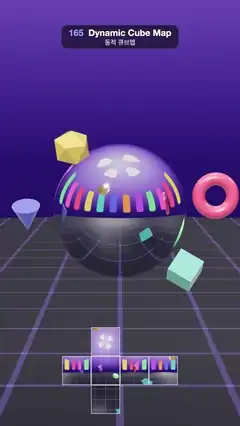

# 165 · Dynamic Cube Map · 동적 큐브맵



**EN** Glossy toys orbit a chrome ball in a purple studio and slide across its mirror skin; the six live cube-map faces are shown unfolded below.  
**KO** 보라색 스튜디오에서 광택 장난감들이 크롬 공 주위를 돌며 거울 같은 표면 위로 미끄러지고, 아래에는 실시간 큐브맵 여섯 면이 펼쳐져 보인다.

[Video (mp4)](https://sueun-dev.github.io/motion-effects/videos/165-dynamic-cube-map.mp4) · [Code](../effects/165-dynamic-cube-map.js) · Reflection, refraction & ray tracing · 반사·굴절·레이 트레이싱

## Prompt (English)

```text
Create a "Dynamic Cube Map" motion effect: a chrome ball reflects colourful objects orbiting it in real time, because every frame the scene is rendered six times from the ball's centre into a cube map.

Look
- Studio: a dome (sphere radius 22, inside faces) with a 2048 × 1024 canvas texture: vertical gradient #D8D0FF (top) → #8A6FD8 (30 %) → #3B2670 (50 %) → #140E2C; four white rounded softboxes near the top; a ring of 16 tall rounded colour panels at the horizon in #FF4F7B, #FFC93C, #2EC4B6, #5B6CFF, #FF8A3D, #B15CFF, #45E07A, #FF5ED1, leaving the wall behind the ball (toward −Z) a clean gradient.
- Floor: a disc of radius 21 at y = −2.6, dark #120E22 with a lavender grid (lines at 30 % opacity, three repeats), anisotropic filtering.
- The ball: radius 1.35, standard material #F2F4F8, metalness 1, roughness 0.03, its environment map is the live cube render target (1024 px per face, half float, mipmapped). It bobs 0.08 · sin(2a) around y = −0.15.
- Six glossy toys (physical material, roughness 0.25, clearcoat 1) on orbits tilted about the axis (1, 0, 0.35): a torus #FF4F7B (radius 1.95, tilt 0.5, 1 lap), an icosahedron #FFC93C (2.05, −0.7, 1), a cube #2EC4B6 (1.9, 1.1, −1), a cone #5B6CFF (2.15, −1.25, −1), a torus knot #B15CFF (2.0, 0.2, 2 laps), a sphere #45E07A (2.0, −0.3, −2 laps), each with its own phase offset.
- Overlay: the cube map unfolded as a cross (4 × 3 cells, 520 × 390 px, centred at x 540, about y 1475–1865): −X, −Z, +X, +Z across the middle, +Y above and −Y below the −Z cell, each cell sampling the live cube map in its direction, with thin white seams.
- Lights: a room environment (0.6) for the toys, a key light 1.6 from (−3, 6, 5). ACES Filmic tone mapping.
- Camera: 32° field of view at (0, 1.4, 15) looking at (0, −0.2, 0); the ball is about 600 px wide in the middle.

Motion (0–5 s), a = 2π · t / 5
- Toy i is at angle laps · a + phase on a circle of its radius, then tilted; it also spins (2a + phase, a + phase, 0). Every toy makes a whole number of laps, so the loop is seamless.
- Their reflections race across the ball (and across the unfolded faces) as they pass in front of, beside and behind it.

Technique
- three.js CubeCamera + WebGLCubeRenderTarget: each frame hide the ball, call cubeCamera.update(renderer, scene) (six 90° renders along ±X, ±Y, ±Z from the ball's centre), show the ball, render the view, then draw the overlay on top without clearing.
- The ball's material uses the cube texture as envMap (prefiltered into mip levels, so the squeezed reflections near its rim stay smooth); the overlay shader samples the same cube texture with a direction built from each cell's position.

Output and rules
- One self-contained HTML file with no external assets (three.js from a CDN is fine if you use it), drawing on a 1080 × 1920 canvas (9:16) scaled to fit the window.
- Write a function renderFrame(t) that draws the frame for time t in seconds, and preview it with requestAnimationFrame. Everything must be a pure function of t and fixed seeds: no Math.random(), Date or state carried between frames, so frame i = renderFrame(i / 30) can be exported to a 30 fps video.
- Loop seamlessly every 5 seconds: renderFrame(5) must look exactly like renderFrame(0).
- No flicker of any kind: no noise or grain that changes from frame to frame, no strobing or blinking, no z-fighting, no shimmering 1 px lines. Any grain or texture stays fixed to the screen or to the object.
- Keep the top 280 px free of important content (a title label goes there) and fill the whole frame with a designed background.
```

## 프롬프트 (한국어)

```text
"동적 큐브맵" 모션 효과를 만들어 줘: 크롬 공이 주위를 도는 알록달록한 물체를 실시간으로 비추는 효과. 매 프레임 공의 중심에서 장면을 여섯 번 그려 큐브맵을 만들기 때문이다.

모양
- 스튜디오: 돔(반지름 22 구의 안쪽 면)에 2048 × 1024 캔버스 텍스처: 세로 그라디언트 #D8D0FF(위) → #8A6FD8(30 %) → #3B2670(50 %) → #140E2C; 꼭대기 근처의 흰 둥근 소프트박스 네 개; 지평선에 둥글고 긴 색 패널 16개 #FF4F7B, #FFC93C, #2EC4B6, #5B6CFF, #FF8A3D, #B15CFF, #45E07A, #FF5ED1. 공 뒤쪽(−Z 방향) 벽은 깨끗한 그라디언트로 남긴다.
- 바닥: y = −2.6의 반지름 21 원판, 어두운 #120E22에 라벤더 격자(선 불투명도 30 %, 3번 반복), 이방성 필터링.
- 공: 반지름 1.35, 표준 재질 #F2F4F8, 금속성 1, 거칠기 0.03, 환경맵은 실시간 큐브 렌더 타깃(면당 1024 px, 하프 플로트, 밉맵). y = −0.15를 중심으로 0.08 · sin(2a) 들썩인다.
- 광택 장난감 여섯 개(물리 기반 재질, 거칠기 0.25, 클리어코트 1)가 (1, 0, 0.35) 축으로 기울어진 궤도를 돈다: 토러스 #FF4F7B(반지름 1.95, 기울기 0.5, 1바퀴), 정이십면체 #FFC93C(2.05, −0.7, 1), 정육면체 #2EC4B6(1.9, 1.1, −1), 원뿔 #5B6CFF(2.15, −1.25, −1), 토러스 매듭 #B15CFF(2.0, 0.2, 2바퀴), 구 #45E07A(2.0, −0.3, −2바퀴), 각자 위상이 다르다.
- 오버레이: 큐브맵을 십자로 펼친 그림(4 × 3칸, 520 × 390 px, x 540 중심, 대략 y 1475–1865): 가운데 줄에 −X, −Z, +X, +Z, −Z 칸 위에 +Y, 아래에 −Y. 칸마다 자기 방향으로 실시간 큐브맵을 읽고, 칸 사이에 가는 흰 이음선.
- 조명: 장난감용 룸 환경맵(0.6), 키 라이트 1.6, 위치 (−3, 6, 5). ACES Filmic 톤 매핑.
- 카메라: 시야각 32°, 위치 (0, 1.4, 15)에서 (0, −0.2, 0)을 본다. 공은 가운데에서 폭 약 600 px.

움직임 (0–5초), a = 2π · t / 5
- i번째 장난감은 자기 반지름의 원 위 각도 바퀴 수 · a + 위상에 놓인 뒤 기울어지고, 스스로 (2a + 위상, a + 위상, 0)으로 돈다. 모두 정수 바퀴를 돌아서 루프가 끊김 없다.
- 장난감이 공 앞·옆·뒤를 지날 때 그 반사가 공 위(그리고 펼친 면 위)를 빠르게 지나간다.

기법
- three.js CubeCamera + WebGLCubeRenderTarget: 매 프레임 공을 숨기고 cubeCamera.update(renderer, scene)(공 중심에서 ±X, ±Y, ±Z로 90° 렌더 여섯 번)를 부른 뒤 공을 다시 보이게 하고 장면을 그리고, 그 위에 지우지 않고 오버레이를 그린다.
- 공의 재질은 큐브 텍스처를 envMap으로 쓴다(밉 레벨로 미리 필터링되어 가장자리에서 눌린 반사도 매끄럽다). 오버레이 셰이더는 각 칸의 위치로 방향을 만들어 같은 큐브 텍스처를 읽는다.

출력과 규칙
- 외부 파일 없는 HTML 파일 하나(three.js를 쓴다면 CDN은 괜찮다). 1080 × 1920(9:16) 캔버스에 그리고 창 크기에 맞춰 보이게 한다.
- 시간 t(초)의 프레임을 그리는 renderFrame(t) 함수를 만들고, 미리보기는 requestAnimationFrame으로 돌린다. 모든 것은 t와 고정 시드만으로 정해진다: Math.random(), Date, 프레임 사이에 쌓이는 상태 금지. 그래야 i번째 프레임 = renderFrame(i / 30)으로 30fps 영상을 뽑을 수 있다.
- 5초마다 끊김 없이 반복: renderFrame(5)는 renderFrame(0)과 똑같아 보여야 한다.
- 어떤 깜빡임도 금지: 프레임마다 바뀌는 노이즈·그레인, 번쩍임·깜빡임, z-fighting, 반짝이며 떨리는 1px 선 모두 금지. 그레인·질감은 화면이나 물체에 고정한다.
- 위쪽 280px에는 중요한 내용을 두지 않고(제목 라벨 자리), 화면 전체를 디자인된 배경으로 채운다.
```
