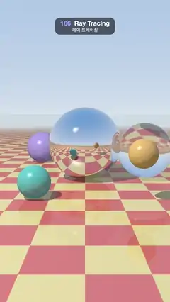

# 166 · Ray Tracing · 레이 트레이싱



**EN** A classic Whitted scene: a glass ball circles a mirror ball over a coral-and-cream checkerboard, with recursive reflections, refractions and hard shadows.  
**KO** 고전적인 휘티드 장면: 유리 공이 산호색·크림색 체커보드 위의 거울 공 주위를 돌고, 재귀 반사·굴절과 선명한 그림자가 보인다.

[Video (mp4)](https://sueun-dev.github.io/motion-effects/videos/166-ray-tracing.mp4) · [Code](../effects/166-ray-tracing.js) · Reflection, refraction & ray tracing · 반사·굴절·레이 트레이싱

## Prompt (English)

```text
Create a "Ray Tracing" motion effect in the style of Turner Whitted's 1980 images: mirror and glass spheres over a checkerboard under a blue sky, traced recursively in a fragment shader, completely noise-free.

Look
- Spheres (centre, radius):
  - a mirror ball at (0, 1.05, −0.6), radius 1.05, tint (0.92, 0.94, 0.98);
  - a glass ball, radius 0.8, index 1.5, tint (0.97, 0.99, 1.0), orbiting the mirror ball;
  - a teal matte ball (0.10, 0.62, 0.62), radius 0.38, at x −1.15, z 1.5, and an orange one (0.95, 0.55, 0.12), radius 0.32, at x 1.25, z 1.8, both hopping;
  - a violet ball (0.45, 0.35, 0.85), radius 0.6, resting at (−1.7, 0.6, −3.8).
- Floor y = 0: checker squares 0.8 units wide, coral (0.86, 0.20, 0.16) and cream yellow (0.98, 0.84, 0.36) in linear colour (≈ #EE7B6F and #FDECA0), 12 % mirror reflection, fading into the horizon colour between 18 and 45 units.
- Sky: mix of horizon (0.78, 0.87, 0.95) and zenith blue (0.18, 0.42, 0.82) by height^0.55.
- One point light at (−5, 9, 6): Phong shading (ambient 0.22, diffuse 0.85, white specular), hard shadows from shadow rays; glass lets 60 % of the light through.
- Camera: at (0, 1.9, 8.2) looking at (0, 0.9, 0), focal length 2 (vertical field about 53°); the horizon sits near y 720 px and the spheres around the middle of the frame. Gamma 2.2 with a soft highlight roll-off.

Motion (0–5 s), a = 2π · t / 5
- The glass ball circles the mirror ball: (1.75 cos a, 0.85 + 0.15 sin 2a, −0.6 + 2.0 sin a), passing in front of it and behind it once per loop.
- The teal and orange balls hop four times per loop: height = radius + 1.0 · sin²(2a) and radius + 0.85 · sin²(2a + 1.2) (smooth at the bottom).
- Everything else is still; the camera does not move.

Technique
- One full-screen fragment shader, analytic ray–sphere and ray–plane intersections. An iterative Whitted tracer with a stack of 8 rays (origin, direction, weight, ray cone, depth), at most 24 rays per sample and 6 bounces: matte surfaces add Phong light plus an 8 % reflection, mirrors push a reflected ray (weight 0.9 × tint), glass pushes a Fresnel-weighted reflection (Schlick, F0 = 0.04) and a refracted ray (Snell, total internal reflection handled); rays weaker than 1.5 % are not traced.
- Ray cones: each ray carries a footprint width that grows with distance and widens at every curved bounce (by 2 × width / radius), and the checkerboard is box-filtered over that footprint, so far squares and squares seen in the curved mirror and through the glass never shimmer or moiré.
- 2 × 2 samples per pixel. No randomness anywhere, so the image is completely free of noise.

Output and rules
- One self-contained HTML file with no external assets (three.js from a CDN is fine if you use it), drawing on a 1080 × 1920 canvas (9:16) scaled to fit the window.
- Write a function renderFrame(t) that draws the frame for time t in seconds, and preview it with requestAnimationFrame. Everything must be a pure function of t and fixed seeds: no Math.random(), Date or state carried between frames, so frame i = renderFrame(i / 30) can be exported to a 30 fps video.
- Loop seamlessly every 5 seconds: renderFrame(5) must look exactly like renderFrame(0).
- No flicker of any kind: no noise or grain that changes from frame to frame, no strobing or blinking, no z-fighting, no shimmering 1 px lines. Any grain or texture stays fixed to the screen or to the object.
- Keep the top 280 px free of important content (a title label goes there) and fill the whole frame with a designed background.
```

## 프롬프트 (한국어)

```text
터너 휘티드의 1980년 이미지 스타일로 "레이 트레이싱" 모션 효과를 만들어 줘: 파란 하늘 아래 체커보드 위의 거울 공과 유리 공을 프래그먼트 셰이더에서 재귀적으로 추적하고, 노이즈는 전혀 없다.

모양
- 구(중심, 반지름):
  - 거울 공 (0, 1.05, −0.6), 반지름 1.05, 색조 (0.92, 0.94, 0.98);
  - 유리 공, 반지름 0.8, 굴절률 1.5, 색조 (0.97, 0.99, 1.0), 거울 공 주위를 돈다;
  - 청록 무광 공 (0.10, 0.62, 0.62), 반지름 0.38, x −1.15, z 1.5와 주황 공 (0.95, 0.55, 0.12), 반지름 0.32, x 1.25, z 1.8, 둘 다 통통 뛴다;
  - 보라 공 (0.45, 0.35, 0.85), 반지름 0.6, (−1.7, 0.6, −3.8)에 놓여 있다.
- 바닥 y = 0: 한 칸 0.8 단위의 체커, 선형 색 산호 (0.86, 0.20, 0.16)와 크림 노랑 (0.98, 0.84, 0.36)(≈ #EE7B6F, #FDECA0), 12 % 거울 반사, 18–45 단위에서 지평선 색으로 사라진다.
- 하늘: 지평선 (0.78, 0.87, 0.95)과 천정 파랑 (0.18, 0.42, 0.82)을 높이^0.55로 섞는다.
- 점광원 하나 (−5, 9, 6): 퐁 셰이딩(주변 0.22, 확산 0.85, 흰 스펙큘러), 그림자 광선으로 만든 선명한 그림자. 유리는 빛의 60 %를 통과시킨다.
- 카메라: (0, 1.9, 8.2)에서 (0, 0.9, 0)을 보고 초점 거리 2(세로 시야 약 53°). 지평선은 y 720 px 근처, 구들은 화면 가운데쯤. 감마 2.2, 부드러운 하이라이트 압축.

움직임 (0–5초), a = 2π · t / 5
- 유리 공이 거울 공 주위를 돈다: (1.75 cos a, 0.85 + 0.15 sin 2a, −0.6 + 2.0 sin a), 한 루프에 한 번 앞과 뒤를 지난다.
- 청록·주황 공은 한 루프에 네 번 뛴다: 높이 = 반지름 + 1.0 · sin²(2a), 반지름 + 0.85 · sin²(2a + 1.2)(바닥에서 부드럽게).
- 나머지는 가만히 있고 카메라도 움직이지 않는다.

기법
- 전체 화면 프래그먼트 셰이더 하나, 광선–구·광선–평면 교차를 해석적으로 계산. 광선 8개짜리 스택(원점, 방향, 가중치, 광선 원뿔, 깊이)을 쓰는 반복형 휘티드 추적기, 샘플당 최대 24개 광선과 6번 반사: 무광 표면은 퐁 조명과 8 % 반사를 더하고, 거울은 반사 광선(가중치 0.9 × 색조)을, 유리는 프레넬 가중 반사(슐릭, F0 = 0.04)와 굴절 광선(스넬, 전반사 처리)을 쌓는다. 1.5 %보다 약한 광선은 추적하지 않는다.
- 광선 원뿔: 광선마다 거리에 따라 커지고 곡면에서 반사할 때마다(2 × 폭 / 반지름만큼) 넓어지는 발자국 폭을 가지고 다니며, 체커보드를 그 폭으로 박스 필터링한다. 그래서 먼 칸도, 곡면 거울과 유리 너머로 보이는 칸도 반짝이거나 모아레가 생기지 않는다.
- 픽셀당 2 × 2 샘플. 어디에도 난수가 없어 화면에 노이즈가 전혀 없다.

출력과 규칙
- 외부 파일 없는 HTML 파일 하나(three.js를 쓴다면 CDN은 괜찮다). 1080 × 1920(9:16) 캔버스에 그리고 창 크기에 맞춰 보이게 한다.
- 시간 t(초)의 프레임을 그리는 renderFrame(t) 함수를 만들고, 미리보기는 requestAnimationFrame으로 돌린다. 모든 것은 t와 고정 시드만으로 정해진다: Math.random(), Date, 프레임 사이에 쌓이는 상태 금지. 그래야 i번째 프레임 = renderFrame(i / 30)으로 30fps 영상을 뽑을 수 있다.
- 5초마다 끊김 없이 반복: renderFrame(5)는 renderFrame(0)과 똑같아 보여야 한다.
- 어떤 깜빡임도 금지: 프레임마다 바뀌는 노이즈·그레인, 번쩍임·깜빡임, z-fighting, 반짝이며 떨리는 1px 선 모두 금지. 그레인·질감은 화면이나 물체에 고정한다.
- 위쪽 280px에는 중요한 내용을 두지 않고(제목 라벨 자리), 화면 전체를 디자인된 배경으로 채운다.
```
