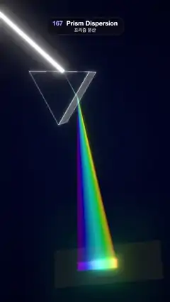

# 167 · Prism Dispersion · 프리즘 분산



**EN** A white beam enters a rocking glass prism and leaves as a rainbow fan, traced per wavelength with Snell's law, that sweeps across a dark card.  
**KO** 흰 빛줄기가 흔들리는 유리 프리즘에 들어가 파장마다 스넬 법칙으로 꺾인 무지개 부채가 되어 나오고, 어두운 카드 위를 쓸고 지나간다.

[Video (mp4)](https://sueun-dev.github.io/motion-effects/videos/167-prism-dispersion.mp4) · [Code](../effects/167-prism-dispersion.js) · Reflection, refraction & ray tracing · 반사·굴절·레이 트레이싱

## Prompt (English)

```text
Create a "Prism Dispersion" motion effect: a white beam hits a glass prism and fans out into a spectrum, because each wavelength has its own index of refraction; every ray is computed with Snell's law each frame.

Look
- Prism: an equilateral triangle of side 2.4 (centred on its centroid) extruded 1.4 deep, glass (physical material #DDEEFF, transmission 1, index 1.5, roughness 0.03, environment reflections × 2) with crisp 2.5 px edge lines #DDEBFF at 75 % opacity.
- Dispersion: 64 wavelengths λ from 400 to 700 nm, n(λ) = 1.40 + 0.035 / λ² with λ in µm (n ≈ 1.62 for violet, 1.47 for red; about ten times real glass, so the fan is wide). Colour of λ: hue 0.75 · (700 − λ) / 300 (red to violet) at full saturation, dimmed toward both ends (0.3 + 0.7 · edge over the last 40 nm).
- The beam plane is the prism's cross-section. The white beam (0.14 wide, intensity 1.1) rises at 19.3°, the minimum-deviation angle for green, aimed at the middle of the left face. Inside the glass each wavelength is a faint coloured line (0.3); outside, the 64 rays form one continuous additive ribbon from the exit face to the card (0.45 at the prism, 0.3 at the card).
- Card: a dark matte panel #15161E, 4.6 × 1.6, 7 units along the green exit ray, square to it and tilted 55° toward the camera; where the rays land, a bright spectrum band 0.36 tall (intensity 0.9).
- The whole set is turned −1.06 rad and moved 0.8 left, so the beam enters from the upper left (clear of the top 280 px) and the rainbow falls toward the bottom.
- Background: a radial gradient #1A1D33 → #05060C; a room environment at 0.5 for the glass. Neutral tone mapping, a light bloom (strength 0.55, radius 0.4, threshold 0.35).
- Camera: 34° field of view at (4.2, 0.4, 19.5), a little to the side so the prism shows its depth, looking at (0.1, −2.5, 0).

Motion (0–5 s), a = 2π · t / 5
- The prism rocks 0.17 · sin(a) rad (about ±10°) about its axis. All rays are traced again every frame: the entry and exit points move along the faces, the exit angles change, and the rainbow swings across the card while it widens and narrows.

Technique
- 2D ray tracing in the beam plane: intersect the beam with the left face, refract with the vector form of Snell's law (eta = 1 / n), intersect the inside ray with the right face, refract out (eta = n; a ray with total internal reflection is dropped), then intersect with the card line.
- The beams are BufferGeometry ribbons (pairs of vertices per wavelength, indexed quads) with vertex colours, additive blending and no depth test, updated in place each frame; EffectComposer with RenderPass, UnrealBloomPass and OutputPass.

Output and rules
- One self-contained HTML file with no external assets (three.js from a CDN is fine if you use it), drawing on a 1080 × 1920 canvas (9:16) scaled to fit the window.
- Write a function renderFrame(t) that draws the frame for time t in seconds, and preview it with requestAnimationFrame. Everything must be a pure function of t and fixed seeds: no Math.random(), Date or state carried between frames, so frame i = renderFrame(i / 30) can be exported to a 30 fps video.
- Loop seamlessly every 5 seconds: renderFrame(5) must look exactly like renderFrame(0).
- No flicker of any kind: no noise or grain that changes from frame to frame, no strobing or blinking, no z-fighting, no shimmering 1 px lines. Any grain or texture stays fixed to the screen or to the object.
- Keep the top 280 px free of important content (a title label goes there) and fill the whole frame with a designed background.
```

## 프롬프트 (한국어)

```text
"프리즘 분산" 모션 효과를 만들어 줘: 흰 빛줄기가 유리 프리즘에 부딪혀 스펙트럼으로 퍼지는 효과. 파장마다 굴절률이 달라서이고, 모든 광선을 매 프레임 스넬 법칙으로 계산한다.

모양
- 프리즘: 한 변 2.4의 정삼각형(무게중심 기준)을 깊이 1.4로 돌출, 유리(물리 기반 재질 #DDEEFF, 투과 1, 굴절률 1.5, 거칠기 0.03, 환경 반사 × 2), 선명한 2.5 px 모서리 선 #DDEBFF 불투명도 75 %.
- 분산: 400–700 nm 사이 파장 64개, n(λ) = 1.40 + 0.035 / λ²(λ는 µm, 보라 약 1.62, 빨강 약 1.47; 실제 유리의 약 10배라 부채가 넓다). 파장의 색: 색상 0.75 · (700 − λ) / 300(빨강에서 보라), 채도 최대, 양 끝 40 nm에서 어둡게(0.3 + 0.7 · 가장자리 값).
- 빛줄기 평면은 프리즘의 단면이다. 흰 빛줄기(폭 0.14, 세기 1.1)는 초록의 최소 편향각인 19.3°로 올라가며 왼쪽 면 가운데를 겨눈다. 유리 안에서는 파장마다 옅은 색 선(0.3), 밖에서는 64개 광선이 출사면에서 카드까지 하나로 이어진 가산 합성 리본이 된다(프리즘 쪽 0.45, 카드 쪽 0.3).
- 카드: 어두운 무광 판 #15161E, 4.6 × 1.6, 초록 출사 광선을 따라 7 단위 거리, 광선에 수직이고 카메라 쪽으로 55° 기울였다. 광선이 닿는 곳에 높이 0.36의 밝은 스펙트럼 띠(세기 0.9).
- 전체 구성을 −1.06 rad 돌리고 왼쪽으로 0.8 옮겨, 빛줄기가 왼쪽 위에서(위쪽 280 px를 피해) 들어오고 무지개는 아래로 떨어진다.
- 배경: 방사형 그라디언트 #1A1D33 → #05060C, 유리용 룸 환경맵 0.5. 뉴트럴 톤 매핑, 약한 블룸(세기 0.55, 반지름 0.4, 문턱값 0.35).
- 카메라: 시야각 34°, 위치 (4.2, 0.4, 19.5)로 조금 옆에서 보아 프리즘의 두께가 보이게 하고, (0.1, −2.5, 0)을 본다.

움직임 (0–5초), a = 2π · t / 5
- 프리즘이 축을 중심으로 0.17 · sin(a) rad(약 ±10°) 흔들린다. 모든 광선을 매 프레임 다시 추적한다: 입사점과 출사점이 면을 따라 움직이고 출사각이 바뀌어, 무지개가 카드 위를 쓸고 지나가며 넓어졌다 좁아진다.

기법
- 빛줄기 평면에서의 2D 레이 트레이싱: 빛줄기와 왼쪽 면의 교점을 구하고, 벡터 형태의 스넬 법칙으로 굴절(eta = 1 / n), 안쪽 광선과 오른쪽 면의 교점을 구해 밖으로 굴절(eta = n; 전반사되는 광선은 버린다), 그다음 카드 선과의 교점을 구한다.
- 빛줄기는 BufferGeometry 리본(파장마다 꼭짓점 한 쌍, 인덱스 사각형)에 꼭짓점 색, 가산 합성, 깊이 테스트 없음으로 그리고 매 프레임 제자리에서 갱신한다. EffectComposer에 RenderPass, UnrealBloomPass, OutputPass.

출력과 규칙
- 외부 파일 없는 HTML 파일 하나(three.js를 쓴다면 CDN은 괜찮다). 1080 × 1920(9:16) 캔버스에 그리고 창 크기에 맞춰 보이게 한다.
- 시간 t(초)의 프레임을 그리는 renderFrame(t) 함수를 만들고, 미리보기는 requestAnimationFrame으로 돌린다. 모든 것은 t와 고정 시드만으로 정해진다: Math.random(), Date, 프레임 사이에 쌓이는 상태 금지. 그래야 i번째 프레임 = renderFrame(i / 30)으로 30fps 영상을 뽑을 수 있다.
- 5초마다 끊김 없이 반복: renderFrame(5)는 renderFrame(0)과 똑같아 보여야 한다.
- 어떤 깜빡임도 금지: 프레임마다 바뀌는 노이즈·그레인, 번쩍임·깜빡임, z-fighting, 반짝이며 떨리는 1px 선 모두 금지. 그레인·질감은 화면이나 물체에 고정한다.
- 위쪽 280px에는 중요한 내용을 두지 않고(제목 라벨 자리), 화면 전체를 디자인된 배경으로 채운다.
```
