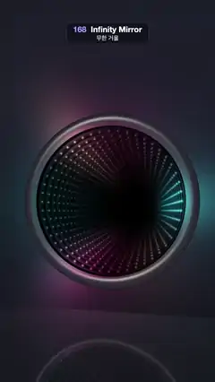

# 168 · Infinity Mirror · 무한 거울



**EN** A round mirror box with a neon LED ring opens into a tunnel of rings that recedes forever and swings round as the camera circles in front of it.  
**KO** 네온 LED 고리가 달린 둥근 거울 상자 안으로 고리가 끝없이 이어지는 터널이 열리고, 카메라가 앞에서 원을 그리면 터널이 따라 휘어 돈다.

[Video (mp4)](https://sueun-dev.github.io/motion-effects/videos/168-infinity-mirror.mp4) · [Code](../effects/168-infinity-mirror.js) · Reflection, refraction & ray tracing · 반사·굴절·레이 트레이싱

## Prompt (English)

```text
Create an "Infinity Mirror" motion effect: a round infinity mirror hanging on a dark wall. Two facing mirrors with a ring of LEDs between them repeat the ring into a tunnel that recedes forever; the camera circles in front of it and the tunnel swings round.

Look
- A round box set into a wall (the plane z = 0): opening radius 0.82, a half-silvered front glass at z = 0 and a full mirror behind it, box depth 0.19. 48 LEDs sit on a ring of radius 0.79 halfway between the two mirrors (z = −0.095).
- LED colour by its angle θ around the ring, with a = 2π · t / 5: mix(hot pink #FF2985, cyan #26D9FF, 0.5 + 0.5 · cos(2θ − a)), plus an amber #FFB840 accent of 0.35 · (0.5 + 0.5 · cos(2θ + a + 2))⁶, all times a brightness 0.45 + 1.4 · (0.5 + 0.5 · cos(3θ − 2a))⁵: three bright comets chasing round.
- Each LED is a soft dot: a Gaussian core of radius 0.011 (never drawn smaller than 1.3 px; when widened, its total light stays the same) plus a faint halo 6 times wider.
- Reflectance: back mirror 0.94, front glass 0.8 seen from inside; 32 % of the light gets through the front glass to the eye. Ring copy m (0, 1, 2, …) is therefore dimmed by 0.94^ceil(m / 2) · 0.8^floor(m / 2), and the tunnel fades into black after about 40 copies.
- The dark inner wall of the box catches a little LED light near each ring copy (a Gaussian about 0.045 wide in depth).
- A brushed metal bezel from radius 0.82 to 0.96: a half-round profile, dark grey #17171C, a soft white highlight (power 40) from a light at the upper left, and its inner lip lit by the LED colour.
- The wall: deep slate #090A0F, a little lighter toward the top, with a very faint fixed noise texture (±7 %), and a spill of the LED colour around the bezel that falls off as e^(−3.2 · (r − 0.96)).
- A polished dark floor at y = −1.2: base #050608, lit by 12 sample points on the ring, and mirroring the wall and the mirror with a Fresnel weight 0.12 + 0.5 · (1 − |dir.y|)⁵.
- The front glass also reflects a faint cool softbox (5 % strength).
- Camera: on a circle of radius 0.42 around (0, −0.1), 2.65 in front of the wall, always looking at (0, −0.1, 0); focal length 2.3 for uv = (2 · fragCoord − resolution) / width, with the view shifted by +0.18 in uv.y so the mirror (about 900 px across) sits just below the middle of the frame and the floor shows at the bottom.

Motion (0–5 s), a = 2π · t / 5
- The camera goes once round its circle: position (0.42 · cos a, −0.1 + 0.42 · sin a, 2.65). Every copy lies deeper behind the same opening, so the tunnel's vanishing point follows the camera and the whole tunnel swings round once.
- The colour gradient turns once around the ring per loop; the comet pattern repeats every third of a turn and moves two thirds of a turn per loop, so everything loops.

Technique
- A WebGL2 fragment shader that traces the reflections "unfolded": instead of bouncing the ray between the mirrors, let it run straight on into mirrored copies of the box. The LED rings then repeat every 0.19 in depth (z = −0.19 · (m + 0.5)) along an endless tube of radius 0.82.
- Intersect the ray with the tube wall once to find where it stops. For each ring copy before that (up to 46), find where the ray crosses that ring's plane, take the three nearest LEDs, and add their glow by the angle between the ray and the LED, times the copy's dimming.
- The floor reflection calls the same wall-and-mirror function with the mirrored ray.
- 2 × 2 supersampling, then a soft tone curve 1 − e^(−1.6x) and a gamma pow(x, 0.85).

Output and rules
- One self-contained HTML file with no external assets (three.js from a CDN is fine if you use it), drawing on a 1080 × 1920 canvas (9:16) scaled to fit the window.
- Write a function renderFrame(t) that draws the frame for time t in seconds, and preview it with requestAnimationFrame. Everything must be a pure function of t and fixed seeds: no Math.random(), Date or state carried between frames, so frame i = renderFrame(i / 30) can be exported to a 30 fps video.
- Loop seamlessly every 5 seconds: renderFrame(5) must look exactly like renderFrame(0).
- No flicker of any kind: no noise or grain that changes from frame to frame, no strobing or blinking, no z-fighting, no shimmering 1 px lines. Any grain or texture stays fixed to the screen or to the object.
- Keep the top 280 px free of important content (a title label goes there) and fill the whole frame with a designed background.
```

## 프롬프트 (한국어)

```text
"무한 거울" 모션 효과를 만들어 줘: 어두운 벽에 걸린 둥근 인피니티 미러. 마주 보는 두 거울 사이에 LED 고리가 있어서, 고리가 끝없이 깊어지는 터널로 되풀이된다. 카메라가 그 앞에서 원을 그리면 터널이 따라 휘어 돈다.

모양
- 벽(평면 z = 0)에 박힌 둥근 상자: 구멍 반지름 0.82, z = 0에 반투명 반사 앞유리, 그 뒤에 완전 거울, 상자 깊이 0.19. 두 거울의 정확히 가운데(z = −0.095)에 반지름 0.79 고리를 따라 LED 48개.
- 고리 위 각도 θ에 따른 LED 색, a = 2π · t / 5: mix(핫핑크 #FF2985, 시안 #26D9FF, 0.5 + 0.5 · cos(2θ − a))에 호박색 #FFB840 강조 0.35 · (0.5 + 0.5 · cos(2θ + a + 2))⁶을 섞고, 전체에 밝기 0.45 + 1.4 · (0.5 + 0.5 · cos(3θ − 2a))⁵를 곱한다: 밝은 혜성 세 개가 고리를 따라 돈다.
- LED 하나는 부드러운 점: 반지름 0.011 가우시안 중심(화면에서 1.3px보다 작게 그리지 않고, 넓힐 때는 전체 빛의 양을 유지)과 6배 넓은 희미한 후광.
- 반사율: 뒤 거울 0.94, 안쪽에서 본 앞유리 0.8. 앞유리를 통과해 눈에 오는 빛은 32 %. 그래서 m번째 고리 복사본(0, 1, 2, …)은 0.94^ceil(m / 2) · 0.8^floor(m / 2)만큼 어두워지고, 터널은 약 40개 뒤에 검게 사라진다.
- 상자 안쪽 어두운 벽은 고리 복사본 근처에서 LED 빛을 조금 받는다(깊이 방향 폭 약 0.045 가우시안).
- 반지름 0.82–0.96의 헤어라인 금속 테: 반원 단면, 짙은 회색 #17171C, 왼쪽 위 조명의 부드러운 흰 하이라이트(지수 40), 안쪽 가장자리는 LED 색으로 물든다.
- 벽: 짙은 슬레이트 #090A0F, 위로 갈수록 조금 밝고, 아주 옅은 고정 노이즈 질감(±7 %). 테 둘레로 LED 색이 e^(−3.2 · (r − 0.96))로 번진다.
- y = −1.2의 광택 있는 어두운 바닥: 기본색 #050608, 고리 위 12개 점에서 빛을 받고, 벽과 거울을 프레넬 가중치 0.12 + 0.5 · (1 − |방향.y|)⁵로 비춘다.
- 앞유리는 차가운 소프트박스도 희미하게(5 %) 비춘다.
- 카메라: 벽 앞 2.65 거리에서 (0, −0.1)을 중심으로 반지름 0.42 원 위, 늘 (0, −0.1, 0)을 본다. uv = (2 · fragCoord − 해상도) / 너비에 초점 거리 2.3, uv.y를 +0.18 옮겨 거울(지름 약 900px)이 화면 가운데보다 살짝 아래에 오고 아래쪽에 바닥이 보이게 한다.

움직임 (0–5초), a = 2π · t / 5
- 카메라가 원을 한 바퀴 돈다: 위치 (0.42 · cos a, −0.1 + 0.42 · sin a, 2.65). 복사본은 모두 같은 구멍 뒤로 점점 깊어지므로 터널의 소실점이 카메라를 따라가고, 터널 전체가 한 바퀴 휘어 돈다.
- 색 그라디언트는 루프마다 고리를 한 바퀴 돌고, 혜성 무늬는 1/3바퀴마다 반복되며 루프마다 2/3바퀴 움직이므로 모두 끊김 없이 반복된다.

기법
- 반사를 "펼쳐서" 추적하는 WebGL2 프래그먼트 셰이더: 광선을 두 거울 사이에서 튕기는 대신, 거울에 비친 상자 복사본 속으로 곧장 계속 나아가게 한다. 그러면 LED 고리는 반지름 0.82의 끝없는 관을 따라 깊이 0.19마다(z = −0.19 · (m + 0.5)) 되풀이된다.
- 광선과 관 벽의 교차를 한 번 구해 멈추는 깊이를 안다. 그보다 앞의 고리 복사본마다(최대 46개) 광선이 그 고리 평면을 지나는 점을 구하고, 가장 가까운 LED 세 개의 빛을 광선과 LED 사이 각도로 더한 뒤 그 복사본의 감쇠를 곱한다.
- 바닥 반사는 반사된 광선으로 같은 벽·거울 함수를 부른다.
- 2 × 2 슈퍼샘플링, 그다음 부드러운 톤 곡선 1 − e^(−1.6x)와 감마 pow(x, 0.85).

출력과 규칙
- 외부 파일 없는 HTML 파일 하나(three.js를 쓴다면 CDN은 괜찮다). 1080 × 1920(9:16) 캔버스에 그리고 창 크기에 맞춰 보이게 한다.
- 시간 t(초)의 프레임을 그리는 renderFrame(t) 함수를 만들고, 미리보기는 requestAnimationFrame으로 돌린다. 모든 것은 t와 고정 시드만으로 정해진다: Math.random(), Date, 프레임 사이에 쌓이는 상태 금지. 그래야 i번째 프레임 = renderFrame(i / 30)으로 30fps 영상을 뽑을 수 있다.
- 5초마다 끊김 없이 반복: renderFrame(5)는 renderFrame(0)과 똑같아 보여야 한다.
- 어떤 깜빡임도 금지: 프레임마다 바뀌는 노이즈·그레인, 번쩍임·깜빡임, z-fighting, 반짝이며 떨리는 1px 선 모두 금지. 그레인·질감은 화면이나 물체에 고정한다.
- 위쪽 280px에는 중요한 내용을 두지 않고(제목 라벨 자리), 화면 전체를 디자인된 배경으로 채운다.
```
