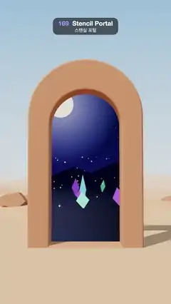

# 169 · Stencil Portal · 스텐실 포털



**EN** A stone arch in a pastel desert opens onto a moonlit night of glowing crystals, which shifts with real depth as the camera swings around the arch.  
**KO** 파스텔 사막의 돌 아치 안으로 빛나는 크리스털이 선 달밤 세계가 보이고, 카메라가 아치 둘레를 돌면 그 세계가 실제 깊이를 갖고 움직인다.

[Video (mp4)](https://sueun-dev.github.io/motion-effects/videos/169-stencil-portal.mp4) · [Code](../effects/169-stencil-portal.js) · Reflection, refraction & ray tracing · 반사·굴절·레이 트레이싱

## Prompt (English)

```text
Create a "Stencil Portal" motion effect: a stone arch stands in a sunny pastel desert, and through its opening you see a different world, a moonlit night of glowing crystals with its own depth, drawn only inside the opening with the stencil buffer.

Look
- Outer world (three.js scene 1):
  - Sky: a vertical gradient #7FB2E5 (top) → #CFE3F2 (55 %) → #F6DCC8 (62 %) → #F2C9A8 (bottom); linear fog #F1D6C2 from 25 to 90.
  - Lights: hemisphere #DDEBFF / #E8B48C, intensity 1.4; sun #FFF1DC, intensity 2.6, from (−8, 14, 9), PCF soft shadows 2048 × 2048, radius 4.
  - Sand: a 160 × 160 plane with 160 × 160 segments, #E9BC93, roughness 0.95, flat near the arch and rising into dunes further out: height = clamp((r − 6) / 10, 0, 1) · (1.1 · sin(0.11x + 1) · cos(0.09z) + 0.5 · sin(0.23x − 0.17z)).
  - Nine flat-shaded dodecahedron rocks (radius 0.4–1.3, #C98F6C) scattered 4–16 units away, several right behind the arch.
  - The arch: an extruded outline, 3.4 wide with straight sides up to 4.0 and a semicircular top; the opening cut out of it is 2.3 wide with straight sides up to 3.7 and a round top. Depth 0.6 (centred on z = 0), bevel 0.06, #D9A07A, roughness 0.75, casting and receiving shadows.
  - The mask: the same opening shape as a flat mesh at the arch's back face (z = −0.3), material with colorWrite false, depthWrite false, stencilWrite true, stencilRef 1, stencilFunc Always, stencilZPass Replace, renderOrder 10 (drawn after everything else, so only its visible part marks the stencil).
- Inner world (scene 2), every material with stencilWrite true, stencilRef 1, stencilFunc Equal:
  - A sky dome (sphere radius 80, back side, no fog) with a gradient #05061A → #141A4A (45 %) → #2A2466 (50 %) → #0B1030 (53 %) → #05061A; 700 stars as 3.2 px soft points on a sphere of radius 70, in a 137° wedge behind the arch.
  - A moon: a disc of radius 2.6, #FFF3D6, at (−5, 15, −61), with a soft blue-white halo sprite 24 wide.
  - Exponential fog #0B1030, density 0.035; hemisphere light #3A4AA0 / #060814, 0.8; moonlight #B9C6FF, 0.35.
  - A lake floor: a plane #0B1236, roughness 0.7. Fourteen far mountains: six-sided cones (radius 5–11, height 3–8), #1B1A46, flat shaded, at z −50 to −65.
  - 36 crystals: stretched octahedra (radius 0.5, scaled to 0.8–3.0 tall), cycling #57E3FF, #B06BFF, #FF5FB0, #6BFFC8, emissive at 1.6, from 1.5 to 30 units behind the arch and spread sideways ±(1.5 + 0.8 · depth); every sixth one carries a point light of its colour (intensity 6, range 9).
  - 60 fireflies: additive yellow sprites (size 0.22) on small loops between 1.5 and 17.5 units behind the arch.
- Camera: perspective, 45° vertical field of view; the arch fills about 60 % of the frame width with its top about 450 px from the top.

Motion (0–5 s), a = 2π · t / 5
- The camera swings round the arch: angle θ = 0.62 · sin(a) (±35°), position (11.5 · sin θ, 2.4 + 0.3 · sin 2a, 11.5 · cos θ), looking at (0, 2.9, 0). The arch's sides come into view, and the night world slides behind the opening with parallax (near crystals move more than the far mountains), so it is clearly a 3D world and not a picture.
- Crystals turn ±0.25 rad; fireflies circle their loops 1 or 2 times per loop. Everything is periodic in a.

Technique
- three.js. The renderer's default canvas has no stencil buffer, so render into a 1080 × 1920 WebGLRenderTarget with stencilBuffer true, half-float colour and 4× MSAA, with renderer.autoClear = false.
- Each frame: setRenderTarget(target); clear colour, depth and stencil; render the outer scene (desert, arch, then the mask, which writes 1 into the stencil where the opening is visible); clearDepth(); render the inner scene, which only passes the stencil test where the value is 1; then draw the target to the screen with an OutputPass (ACES Filmic tone mapping and sRGB output).

Output and rules
- One self-contained HTML file with no external assets (three.js from a CDN is fine if you use it), drawing on a 1080 × 1920 canvas (9:16) scaled to fit the window.
- Write a function renderFrame(t) that draws the frame for time t in seconds, and preview it with requestAnimationFrame. Everything must be a pure function of t and fixed seeds: no Math.random(), Date or state carried between frames, so frame i = renderFrame(i / 30) can be exported to a 30 fps video.
- Loop seamlessly every 5 seconds: renderFrame(5) must look exactly like renderFrame(0).
- No flicker of any kind: no noise or grain that changes from frame to frame, no strobing or blinking, no z-fighting, no shimmering 1 px lines. Any grain or texture stays fixed to the screen or to the object.
- Keep the top 280 px free of important content (a title label goes there) and fill the whole frame with a designed background.
```

## 프롬프트 (한국어)

```text
"스텐실 포털" 모션 효과를 만들어 줘: 햇살 가득한 파스텔 사막에 돌 아치가 서 있고, 그 구멍 너머로는 전혀 다른 세계, 즉 자기만의 깊이를 가진 빛나는 크리스털의 달밤이 보인다. 그 세계는 스텐실 버퍼로 구멍 안에만 그린다.

모양
- 바깥 세계(three.js 장면 1):
  - 하늘: 세로 그라디언트 #7FB2E5(위) → #CFE3F2(55 %) → #F6DCC8(62 %) → #F2C9A8(아래). 선형 안개 #F1D6C2, 25에서 90까지.
  - 조명: 반구광 #DDEBFF / #E8B48C, 세기 1.4; 해 #FFF1DC, 세기 2.6, 위치 (−8, 14, 9), PCF 소프트 그림자 2048 × 2048, 반지름 4.
  - 모래: 160 × 160 평면(160 × 160 분할), #E9BC93, 거칠기 0.95. 아치 근처는 평평하고 멀어질수록 모래 언덕: 높이 = clamp((r − 6) / 10, 0, 1) · (1.1 · sin(0.11x + 1) · cos(0.09z) + 0.5 · sin(0.23x − 0.17z)).
  - 평면 셰이딩 십이면체 바위 9개(반지름 0.4–1.3, #C98F6C)를 4–16 거리에 흩어 두고, 몇 개는 아치 바로 뒤에 둔다.
  - 아치: 돌출한 윤곽선. 폭 3.4, 높이 4.0까지 곧은 옆면에 반원 지붕. 가운데 뚫린 구멍은 폭 2.3, 3.7까지 곧은 옆면에 둥근 지붕. 두께 0.6(z = 0 중심), 베벨 0.06, #D9A07A, 거칠기 0.75, 그림자를 드리우고 받는다.
  - 마스크: 같은 구멍 모양의 평면 메시를 아치 뒷면(z = −0.3)에 둔다. 재질은 colorWrite false, depthWrite false, stencilWrite true, stencilRef 1, stencilFunc Always, stencilZPass Replace, renderOrder 10(다른 것을 다 그린 뒤 그려서 보이는 부분만 스텐실에 표시).
- 안쪽 세계(장면 2), 모든 재질에 stencilWrite true, stencilRef 1, stencilFunc Equal:
  - 하늘 돔(반지름 80 구, 뒷면, 안개 없음): 그라디언트 #05061A → #141A4A(45 %) → #2A2466(50 %) → #0B1030(53 %) → #05061A. 별 700개를 반지름 70 구 위, 아치 뒤 137° 부채꼴 안에 3.2px 부드러운 점으로.
  - 달: 반지름 2.6 원판, #FFF3D6, 위치 (−5, 15, −61), 폭 24의 푸르스름한 흰 후광 스프라이트.
  - 지수 안개 #0B1030, 밀도 0.035; 반구광 #3A4AA0 / #060814, 0.8; 달빛 #B9C6FF, 0.35.
  - 호수 바닥: 평면 #0B1236, 거칠기 0.7. 먼 산 14개: 육각뿔(반지름 5–11, 높이 3–8), #1B1A46, 평면 셰이딩, z −50 ~ −65.
  - 크리스털 36개: 길게 늘인 정팔면체(반지름 0.5, 높이 0.8–3.0), 색은 #57E3FF, #B06BFF, #FF5FB0, #6BFFC8 순환, 발광 1.6. 아치 뒤 1.5에서 30까지, 옆으로 ±(1.5 + 0.8 · 깊이) 안에 흩어 둔다. 여섯 개마다 하나에 같은 색 점광원(세기 6, 범위 9).
  - 반딧불 60개: 가산 혼합 노란 스프라이트(크기 0.22), 아치 뒤 1.5–17.5 사이에서 작은 고리를 그린다.
- 카메라: 원근, 세로 시야각 45°. 아치가 화면 너비의 약 60 %를 차지하고 꼭대기는 위에서 약 450px.

움직임 (0–5초), a = 2π · t / 5
- 카메라가 아치 둘레를 흔들며 돈다: 각도 θ = 0.62 · sin(a)(±35°), 위치 (11.5 · sin θ, 2.4 + 0.3 · sin 2a, 11.5 · cos θ), (0, 2.9, 0)을 본다. 아치 옆면이 보이고, 밤 세계는 구멍 뒤에서 시차를 두고 미끄러져(가까운 크리스털이 먼 산보다 많이 움직인다) 그림이 아니라 진짜 3D 세계임이 드러난다.
- 크리스털은 ±0.25 rad 돌고, 반딧불은 루프마다 고리를 1바퀴나 2바퀴 돈다. 모두 a의 주기 함수.

기법
- three.js. 렌더러 기본 캔버스에는 스텐실 버퍼가 없으므로, stencilBuffer true, 반정밀도(half float) 색, 4× MSAA인 1080 × 1920 WebGLRenderTarget에 그리고 renderer.autoClear = false로 둔다.
- 매 프레임: setRenderTarget(target); 색·깊이·스텐실을 지운다; 바깥 장면을 그린다(사막, 아치, 마지막에 마스크: 구멍이 보이는 곳의 스텐실에 1을 쓴다); clearDepth(); 안쪽 장면을 그린다(스텐실 값이 1인 곳에서만 통과); 그다음 OutputPass로 타깃을 화면에 그린다(ACES Filmic 톤 매핑, sRGB 출력).

출력과 규칙
- 외부 파일 없는 HTML 파일 하나(three.js를 쓴다면 CDN은 괜찮다). 1080 × 1920(9:16) 캔버스에 그리고 창 크기에 맞춰 보이게 한다.
- 시간 t(초)의 프레임을 그리는 renderFrame(t) 함수를 만들고, 미리보기는 requestAnimationFrame으로 돌린다. 모든 것은 t와 고정 시드만으로 정해진다: Math.random(), Date, 프레임 사이에 쌓이는 상태 금지. 그래야 i번째 프레임 = renderFrame(i / 30)으로 30fps 영상을 뽑을 수 있다.
- 5초마다 끊김 없이 반복: renderFrame(5)는 renderFrame(0)과 똑같아 보여야 한다.
- 어떤 깜빡임도 금지: 프레임마다 바뀌는 노이즈·그레인, 번쩍임·깜빡임, z-fighting, 반짝이며 떨리는 1px 선 모두 금지. 그레인·질감은 화면이나 물체에 고정한다.
- 위쪽 280px에는 중요한 내용을 두지 않고(제목 라벨 자리), 화면 전체를 디자인된 배경으로 채운다.
```
