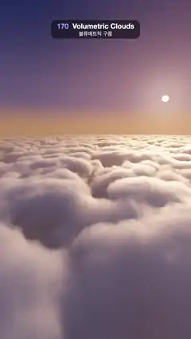

# 170 · Volumetric Clouds · 볼류메트릭 구름



**EN** Flying low over a sea of sunset cumulus: raymarched clouds with glowing sunward edges and soft self-shadows under a low sun on a violet sky.  
**KO** 노을 진 적운 바다 위를 낮게 난다. 레이마칭한 구름은 해 쪽 가장자리가 빛나고 안쪽에 부드러운 그림자가 지며, 보랏빛 하늘에 낮은 해가 걸려 있다.

[Video (mp4)](https://sueun-dev.github.io/motion-effects/videos/170-volumetric-clouds.mp4) · [Code](../effects/170-volumetric-clouds.js) · Atmosphere & volumes · 대기·볼륨

## Prompt (English)

```text
Create a "Volumetric Clouds" motion effect: flying low over a sea of cumulus at sunset. The clouds are a raymarched density field lit by a short march toward the sun, with glowing sunward edges, soft self-shadows, gaps down to a dark sea and a low sun on a violet sky.

Look
- The cloud layer fills y = 0 to 2.0. Density at p: lattice coordinates q = p · 6 / 12 (6 cells per 12 units), base = n(q · (1, 0.8, 1)) + 0.5 · n(2q + offset), then base · 0.9 + 0.3 (high coverage); shaped by smoothstep(0, 0.1, h) · smoothstep(1, 0.3, h) − 0.22h with h = y / 2.0 (flat bases, rounded tops). Billowy detail (three octaves of |noise| from 4q) is subtracted, weighted 0.4 · (1 − clamp(2.5d)), so it eats the edges and leaves the cores. Final density clamp(3.5d, 0, 1). n is gradient noise.
- Sun direction normalize(0.43, 0.19, −0.882): low, ahead and to the right, so a small warm sun disc #FFDBA8 (about 1° across) sits in the sky in frame.
- Sky: from horizon peach #FF9961 to mauve #6B5785 (by 0.2 up) to deep blue #0F1C52 (0.12 → 0.7 up), plus an orange glow toward the sun (power 5) and a tighter one (power 80).
- Lighting per sample: sunlight #FFA866 × 2.4 × (e^(−8 · τ) + 0.2 · e^(−1.5 · τ)), τ = optical depth from a 5-step march toward the sun (first step 0.06, each 1.7× longer); phase = mix(HG(0.7), HG(−0.15), 0.35); a powder term 0.4 + 0.6 · (1 − e^(−6d)); ambient from #141A38 at the base to #4D5C9E at the top. Extinction 9 · density.
- Far clouds blend into the horizon haze colour by e^(−0.028 · distance); rays that pass the clouds' last 70 units show the haze.
- Gaps in the deck look down to the ground 9 units below the cloud base, never into empty space: coast and sea from periodic noise (sea #0A1424, land in field patches from olive #212412 to brown #33291A), with lit = e^(−1.5 · Σ density) sampled where the sunbeam crosses the deck at three heights (0.3, 0.9, 1.5), and colour × ((0.35, 0.36, 0.5) + (1.3, 0.85, 0.55) · lit): dim blue in the deck's shadow, warm where the sun gets through, with a sun glint on the water. Between deck and ground, aerial perspective: mix toward 0.85 × mix(#4D4D6E, horizon haze colour, 0.3 + 0.4 · lit) by 1 − e^(−0.06 · distance below the deck).
- Camera at height 3.8 (about 1.8 above the tallest tops), looking straight ahead with the view shifted so the horizon sits about 40 % down the frame (direction normalize(uv.x, uv.y − 0.42, −1.5)).

Motion (0–5 s)
- The camera flies straight forward exactly 12 units per loop. The cloud noise repeats every 12 units along the flight direction, so frame 150 shows the same clouds as frame 0.
- The billowy detail also churns slowly: its lookup moves round a circle of radius 0.15 once per loop.

Technique
- A WebGL2 fragment shader. Gradient noise made periodic along z by wrapping the lattice coordinate (mod(i.z, period)) before hashing; each octave doubles both the frequency and the period, so the sum stays periodic.
- March from the top of the layer down to its bottom (or 70 units): step 0.03 + 0.011 × distance travelled, up to 240 steps, stopping when transmittance < 1 %. Integrate each step energy-conservingly (S · (1 − e^(−σ·dt))).
- Start every ray a fixed per-pixel random fraction of the first step in (hash of the pixel, never of time), so stepping bands become an invisible still dither instead of moving stripes.
- Tone curve 1 − e^(−1.15x), gamma pow(x, 0.92).

Output and rules
- One self-contained HTML file with no external assets (three.js from a CDN is fine if you use it), drawing on a 1080 × 1920 canvas (9:16) scaled to fit the window.
- Write a function renderFrame(t) that draws the frame for time t in seconds, and preview it with requestAnimationFrame. Everything must be a pure function of t and fixed seeds: no Math.random(), Date or state carried between frames, so frame i = renderFrame(i / 30) can be exported to a 30 fps video.
- Loop seamlessly every 5 seconds: renderFrame(5) must look exactly like renderFrame(0).
- No flicker of any kind: no noise or grain that changes from frame to frame, no strobing or blinking, no z-fighting, no shimmering 1 px lines. Any grain or texture stays fixed to the screen or to the object.
- Keep the top 280 px free of important content (a title label goes there) and fill the whole frame with a designed background.
```

## 프롬프트 (한국어)

```text
"볼류메트릭 구름" 모션 효과를 만들어 줘: 해 질 녘 적운 바다 위를 낮게 나는 장면. 구름은 레이마칭한 밀도장이고, 해 쪽으로 짧게 행진해 빛을 계산한다. 해 쪽 가장자리가 빛나고, 안쪽엔 부드러운 그림자, 틈 사이로 어두운 바다, 보랏빛 하늘엔 낮은 해.

모양
- 구름층은 y = 0부터 2.0까지. p의 밀도: 격자 좌표 q = p · 6 / 12(12 단위마다 격자 6칸), base = n(q · (1, 0.8, 1)) + 0.5 · n(2q + 오프셋), 그다음 base · 0.9 + 0.3(덮개 많이). 모양은 smoothstep(0, 0.1, h) · smoothstep(1, 0.3, h) − 0.22h, h = y / 2.0(평평한 밑면, 둥근 윗면). 몽글몽글한 세부(4q에서 |노이즈| 3옥타브)를 0.4 · (1 − clamp(2.5d)) 가중치로 빼서 가장자리는 깎이고 중심은 남게 한다. 최종 밀도 clamp(3.5d, 0, 1). n은 그라디언트 노이즈.
- 해 방향 normalize(0.43, 0.19, −0.882): 낮게, 앞쪽 오른편. 그래서 작고 따뜻한 해 원반 #FFDBA8(지름 약 1°)이 화면 속 하늘에 있다.
- 하늘: 지평선 복숭아색 #FF9961 → 위로 0.2에서 연보라 #6B5785 → 0.12 → 0.7에서 짙은 파랑 #0F1C52. 해 쪽으로 주황 빛무리(지수 5)와 더 좁은 빛무리(지수 80).
- 샘플마다 빛: 햇빛 #FFA866 × 2.4 × (e^(−8 · τ) + 0.2 · e^(−1.5 · τ)), τ는 해 쪽으로 5걸음 행진한 광학 깊이(첫 걸음 0.06, 걸음마다 1.7배). 위상 함수 = mix(HG(0.7), HG(−0.15), 0.35). 파우더 항 0.4 + 0.6 · (1 − e^(−6d)). 환경광은 밑면 #141A38에서 윗면 #4D5C9E. 소멸 계수 9 · 밀도.
- 먼 구름은 e^(−0.028 · 거리)로 지평선 연무 색에 녹아든다. 구름층의 마지막 70 단위를 넘는 광선은 연무 색.
- 구름층의 틈으로는 빈 공간이 아니라 구름 밑면에서 9 단위 아래의 땅이 보인다: 주기적 노이즈로 만든 해안과 바다(바다 #0A1424, 땅은 올리브 #212412에서 갈색 #33291A까지 밭 조각). 햇살이 구름층을 지나는 세 높이(0.3, 0.9, 1.5)에서 밀도를 재어 햇빛 = e^(−1.5 · Σ밀도), 색 × ((0.35, 0.36, 0.5) + (1.3, 0.85, 0.55) · 햇빛): 구름 그림자 속은 푸르게 어둡고 해가 드는 곳은 따뜻하며, 물에는 햇빛 반짝임. 구름층과 땅 사이는 대기 원근: 구름 밑면 아래 거리에 따라 1 − e^(−0.06 · 거리)만큼 0.85 × mix(#4D4D6E, 지평선 연무 색, 0.3 + 0.4 · 햇빛)으로 섞는다.
- 카메라 높이 3.8(가장 높은 꼭대기보다 약 1.8 위). 정면을 보되 시야를 옮겨 지평선이 화면 위에서 약 40 %에 온다(방향 normalize(uv.x, uv.y − 0.42, −1.5)).

움직임 (0–5초)
- 카메라가 루프마다 정확히 12 단위 앞으로 곧장 난다. 구름 노이즈는 비행 방향으로 12 단위마다 반복되므로 150번째 프레임이 0번째와 같은 구름을 보여 준다.
- 몽글몽글한 세부도 천천히 일렁인다: 그 조회 위치가 루프마다 반지름 0.15 원을 한 바퀴 돈다.

기법
- WebGL2 프래그먼트 셰이더. 그라디언트 노이즈를 해시하기 전에 격자 좌표를 감아(mod(i.z, 주기)) z 방향으로 주기적으로 만든다. 옥타브마다 주파수와 주기를 함께 두 배로 해서 합도 주기적이다.
- 구름층 위에서 아래까지(또는 70 단위) 행진: 걸음 0.03 + 0.011 × 지나온 거리, 최대 240걸음, 투과율 < 1 %면 멈춘다. 걸음마다 에너지 보존 적분(S · (1 − e^(−σ·dt))).
- 모든 광선을 첫 걸음의 픽셀마다 고정된 무작위 비율만큼 늦게 시작한다(시간이 아니라 픽셀의 해시). 그러면 걸음 띠가 움직이는 줄무늬 대신 보이지 않는 고정 디더가 된다.
- 톤 곡선 1 − e^(−1.15x), 감마 pow(x, 0.92).

출력과 규칙
- 외부 파일 없는 HTML 파일 하나(three.js를 쓴다면 CDN은 괜찮다). 1080 × 1920(9:16) 캔버스에 그리고 창 크기에 맞춰 보이게 한다.
- 시간 t(초)의 프레임을 그리는 renderFrame(t) 함수를 만들고, 미리보기는 requestAnimationFrame으로 돌린다. 모든 것은 t와 고정 시드만으로 정해진다: Math.random(), Date, 프레임 사이에 쌓이는 상태 금지. 그래야 i번째 프레임 = renderFrame(i / 30)으로 30fps 영상을 뽑을 수 있다.
- 5초마다 끊김 없이 반복: renderFrame(5)는 renderFrame(0)과 똑같아 보여야 한다.
- 어떤 깜빡임도 금지: 프레임마다 바뀌는 노이즈·그레인, 번쩍임·깜빡임, z-fighting, 반짝이며 떨리는 1px 선 모두 금지. 그레인·질감은 화면이나 물체에 고정한다.
- 위쪽 280px에는 중요한 내용을 두지 않고(제목 라벨 자리), 화면 전체를 디자인된 배경으로 채운다.
```
