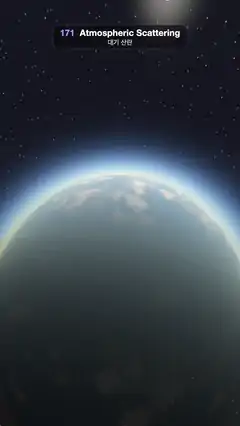

# 171 · Atmospheric Scattering · 대기 산란



**EN** A planet seen from orbit turns from blue daylight to a glowing orange sunset limb as its sun swings behind it, then rises back into day.  
**KO** 궤도에서 본 행성이 해가 뒤로 넘어가며 파란 낮에서 주황빛으로 타오르는 노을 테두리로 바뀌었다가, 해가 다시 떠오르며 낮으로 돌아온다.

[Video (mp4)](https://sueun-dev.github.io/motion-effects/videos/171-atmospheric-scattering.mp4) · [Code](../effects/171-atmospheric-scattering.js) · Atmosphere & volumes · 대기·볼륨

## Prompt (English)

```text
Create an "Atmospheric Scattering" motion effect: a planet seen from orbit with a raymarched atmosphere (Rayleigh and Mie single scattering). As the sun swings from behind the camera over the top to behind the planet and back, the sky band and the surface go from blue daylight to an orange sunset limb and a glowing eclipse ring.

Look
- Units: planet radius 1, top of the atmosphere 1.45. Scale heights (exaggerated so the sky band is thick): Rayleigh 0.045, Mie 0.01.
- Rayleigh scattering coefficients (red, green, blue) = (1.75, 4.0, 10.0) per unit: blue scatters 5.7 times more than red. Mie (haze) scattering 2.5, grey, extinction 1.1 × that. Rayleigh phase 3/(16π) · (1 + μ²); Mie phase Cornette–Shanks with g = 0.8.
- Camera at (0, 0, 1.75), looking 22° above the planet's centre, focal length 1.4 (uv = (2 · fragCoord − resolution) / width): the planet fills the lower 60 % of the frame and its limb arcs across the frame about 800 px from the top, with black space and stars above.
- Surface from fixed noise on the sphere: deep ocean #040D21, land #3D361A / green #1F3312, white clouds (fbm, about 85 % cover where present). City lights #FF9E4D appear on the night side. A sun glint on the oceans.
- Space: near-black #010102, small fixed stars (one per cell of a 3D grid of 80 cells per unit on the direction), and the sun: a disc about 2.3° across, intensity 40, with a soft glare (μ^400).

Motion (0–5 s), a = 2π · t / 5
- Sun elevation, seen from the camera: el = 75° + 45° · sin(a), with a 10° sideways offset: sun direction = normalize(sin 10°, sin el, −cos el).
  - 1.25 s, el = 120°: the sun is behind the camera; the face we see is in full daylight, blue with white clouds and a bright blue limb.
  - The sun passes over the top, enters the frame (below about 74°), sinks toward the limb (about 40°): the terminator sweeps over the planet, the air band turns yellow, orange and red where sunlight crosses the most air.
  - 3.75 s, el = 30°: the sun is behind the planet: a thin orange ring of lit air outlines the dark night side, blue higher up.
  - Back again; the loop is a sine, so it is seamless.

Technique
- A WebGL2 fragment shader. For each pixel, intersect the view ray with the atmosphere sphere and the planet; march 40 steps through the air. At each sample, add the density (e^(−h/H)) to the view optical depth, march 8 steps toward the sun to get the light optical depth (infinite if the planet blocks the sun), and accumulate density × e^(−(β_R · (τ_view + τ_light)_R + 1.1 β_M · (τ_view + τ_light)_M)) for Rayleigh and Mie separately.
- In-scattered light = 22 × (Σ_R · β_R · phase_R + Σ_M · β_M · phase_M). The surface is lit by sunlight attenuated along its own path to the sun (that is what turns it orange near the terminator), then dimmed by the view transmittance and the in-scatter added on top; the stars and the sun are dimmed the same way.
- Tone curve 1 − e^(−1.2x), then gamma 1/2.2.

Output and rules
- One self-contained HTML file with no external assets (three.js from a CDN is fine if you use it), drawing on a 1080 × 1920 canvas (9:16) scaled to fit the window.
- Write a function renderFrame(t) that draws the frame for time t in seconds, and preview it with requestAnimationFrame. Everything must be a pure function of t and fixed seeds: no Math.random(), Date or state carried between frames, so frame i = renderFrame(i / 30) can be exported to a 30 fps video.
- Loop seamlessly every 5 seconds: renderFrame(5) must look exactly like renderFrame(0).
- No flicker of any kind: no noise or grain that changes from frame to frame, no strobing or blinking, no z-fighting, no shimmering 1 px lines. Any grain or texture stays fixed to the screen or to the object.
- Keep the top 280 px free of important content (a title label goes there) and fill the whole frame with a designed background.
```

## 프롬프트 (한국어)

```text
"대기 산란" 모션 효과를 만들어 줘: 궤도에서 본 행성과 레이마칭한 대기(레일리·미 단일 산란). 해가 카메라 뒤에서 위로 넘어가 행성 뒤로 갔다가 돌아오는 동안, 하늘 띠와 지표가 파란 낮에서 주황빛 노을 테두리와 빛나는 일식 고리로 바뀐다.

모양
- 단위: 행성 반지름 1, 대기 꼭대기 1.45. 척도 높이(하늘 띠가 두껍게 보이도록 과장): 레일리 0.045, 미 0.01.
- 레일리 산란 계수(빨강, 초록, 파랑) = 단위 길이당 (1.75, 4.0, 10.0): 파랑이 빨강보다 5.7배 많이 산란한다. 미(연무) 산란 2.5, 회색, 소멸은 그 1.1배. 레일리 위상 함수 3/(16π) · (1 + μ²), 미 위상 함수는 g = 0.8의 Cornette–Shanks.
- 카메라 (0, 0, 1.75), 행성 중심보다 22° 위를 본다, 초점 거리 1.4(uv = (2 · fragCoord − 해상도) / 너비): 행성이 화면 아래 60 %를 채우고, 테두리가 위에서 약 800px 높이로 화면을 가로지르며, 그 위는 검은 우주와 별.
- 구 위의 고정 노이즈로 만든 지표: 깊은 바다 #040D21, 땅 #3D361A / 초록 #1F3312, 흰 구름(fbm, 있는 곳은 약 85 % 덮음). 밤쪽에 도시 불빛 #FF9E4D. 바다에 햇빛 반짝임.
- 우주: 거의 검정 #010102, 작은 고정 별(방향 위 3D 격자, 단위당 80칸에 하나씩), 그리고 해: 지름 약 2.3° 원반, 세기 40, 부드러운 눈부심(μ^400).

움직임 (0–5초), a = 2π · t / 5
- 카메라에서 본 해의 고도: el = 75° + 45° · sin(a), 옆으로 10° 비켜서: 해 방향 = normalize(sin 10°, sin el, −cos el).
  - 1.25초, el = 120°: 해가 카메라 뒤에 있다. 보이는 면은 한낮으로 흰 구름이 뜬 파란 행성과 밝은 파란 테두리.
  - 해가 위로 넘어가 화면에 들어오고(약 74° 아래), 테두리 쪽으로(약 40°) 가라앉는다: 명암 경계가 행성을 쓸고 지나가며, 햇빛이 공기를 가장 많이 지나는 곳의 대기 띠가 노랑·주황·빨강으로 바뀐다.
  - 3.75초, el = 30°: 해가 행성 뒤에 있다: 빛나는 공기의 얇은 주황 고리가 어두운 밤쪽 윤곽을 그리고, 그 위로는 파랗다.
  - 다시 돌아온다. 사인 곡선이라 끊김 없이 반복된다.

기법
- WebGL2 프래그먼트 셰이더. 픽셀마다 시선 광선을 대기 구와 행성에 교차시키고 공기 속을 40걸음 행진한다. 샘플마다 밀도(e^(−h/H))를 시선 광학 깊이에 더하고, 해 쪽으로 8걸음 행진해 빛의 광학 깊이를 구하고(행성이 해를 가리면 무한대), 밀도 × e^(−(β_R · (τ시선 + τ빛)_R + 1.1 β_M · (τ시선 + τ빛)_M))를 레일리와 미 따로 누적한다.
- 산란되어 들어오는 빛 = 22 × (Σ_R · β_R · 위상_R + Σ_M · β_M · 위상_M). 지표는 해까지의 자기 경로로 감쇠한 햇빛을 받고(명암 경계 근처가 주황이 되는 이유), 그다음 시선 투과율로 어두워진 뒤 산란광이 더해진다. 별과 해도 같은 방식으로 어두워진다.
- 톤 곡선 1 − e^(−1.2x), 그다음 감마 1/2.2.

출력과 규칙
- 외부 파일 없는 HTML 파일 하나(three.js를 쓴다면 CDN은 괜찮다). 1080 × 1920(9:16) 캔버스에 그리고 창 크기에 맞춰 보이게 한다.
- 시간 t(초)의 프레임을 그리는 renderFrame(t) 함수를 만들고, 미리보기는 requestAnimationFrame으로 돌린다. 모든 것은 t와 고정 시드만으로 정해진다: Math.random(), Date, 프레임 사이에 쌓이는 상태 금지. 그래야 i번째 프레임 = renderFrame(i / 30)으로 30fps 영상을 뽑을 수 있다.
- 5초마다 끊김 없이 반복: renderFrame(5)는 renderFrame(0)과 똑같아 보여야 한다.
- 어떤 깜빡임도 금지: 프레임마다 바뀌는 노이즈·그레인, 번쩍임·깜빡임, z-fighting, 반짝이며 떨리는 1px 선 모두 금지. 그레인·질감은 화면이나 물체에 고정한다.
- 위쪽 280px에는 중요한 내용을 두지 않고(제목 라벨 자리), 화면 전체를 디자인된 배경으로 채운다.
```
