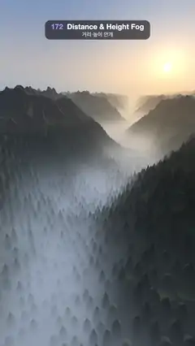

# 172 · Distance & Height Fog · 거리·높이 안개



**EN** A camera glides over a winding forested valley at sunrise: white fog pools low between the ridges while far mountains fade into warm haze.  
**KO** 해 뜰 무렵 숲이 덮인 굽은 골짜기 위를 카메라가 미끄러지듯 난다. 흰 안개는 능선 사이 낮은 곳에 고이고, 먼 산은 따뜻한 연무 속으로 사라진다.

[Video (mp4)](https://sueun-dev.github.io/motion-effects/videos/172-height-fog.mp4) · [Code](../effects/172-height-fog.js) · Atmosphere & volumes · 대기·볼륨

## Prompt (English)

```text
Create a "Distance & Height Fog" motion effect: a raymarched 3D landscape of a winding valley between pine-covered ridges at sunrise. Fog thickens with distance and lies low: white fog pools along the valley floor while the ridge tops stay clear, the far mountains fade into haze, and toward the low sun the fog glows warm.

Look
- Terrain, a heightfield of (x, z): ridged noise r = Σ over 4 octaves of a · (1 − |n|)² (a = 0.5, 0.25, …), with n gradient noise of (x, z) · 4 / 24 and the frequency doubling each octave. The valley floor winds: x_v(z) = 2.5 · sin(2π · z / 24); with v = |x − x_v|, ground = 7 · smoothstep(0.5, 11, v) · (0.45 + 0.75r) · (1 + 0.9 · b · smoothstep(4, 14, v)) + 1.6r − 0.8, where b is a broad noise (frequency 1/12) that makes stretches of the range taller or lower.
- Pines: cones on two staggered grids of 0.55-unit cells (25 % of cells empty), each 0.4–0.75 tall with base radius 0.2, jittered inside its cell; only between ground height 0 and about 5 (below the tree line), faded out between 12 and 32 units from the camera.
- Colours: forest #0D1712, meadows #29331F, rock #3D382B. Light: sky ambient (0.32, 0.38, 0.5) · (0.5 + 0.5 · n.y) plus sunlight (1.0, 0.75, 0.5) × 1.6 × max(n · sun, 0), and a faint warm rim on edges facing the sun.
- Sun direction (0.17, 0.15, −0.974): low, ahead and to the right. Sky: #FAD6B3 at the horizon to #6B8CBF higher up, a warm glow around the sun and a small sun disc.
- Fog: two exponential layers, each integrated exactly along the ray: valley fog with density 0.5 · e^(−1.2 · (y − y0)) and distance haze with density 0.045 · e^(−0.12 · y). Fog amount = 1 − e^(−(τ_valley + τ_haze)); fog colour = mix(blue-grey #9EADC2, warm #FFDBAD, max(dir · sun, 0)⁶). The sky gets the fog of a 400-unit ray, so the skyline melts into the same haze.
- Camera about 8.5 above the valley floor, looking down the valley at (−1.73, 4.5, −12), focal length 1.5, view shifted down (uv.y − 0.35) so the skyline sits about a quarter of the way down the frame, with the fogged valley and the forest filling the rest.

Motion (0–5 s), a = 2π · t / 5
- The camera glides on a small loop: position (1.41 + 0.8 · sin a, 8.5 + 0.25 · sin 2a, cos a). The near forest slides against the far ridges, so the depth is obvious.
- The fog bank breathes: y0 = 0.9 + 0.35 · sin(a + 1); its edge drifts: at each hit, y0 is offset by 0.4 · noise(0.12x + 1.2 · cos a, 0.12z + 1.2 · sin a, 3), read on a circle so it loops.

Technique
- A WebGL2 fragment-shader heightfield raymarcher: step 0.35 × the height above the ground (trees included), never less than 0.006 × distance, up to 340 steps and 250 units, then 5 bisection steps for a clean silhouette. Normals from central differences of the height.
- Fog per hit by the closed-form integral of a · e^(−b · (y − y0)) along the ray: a · e^(−b · (y_camera − y0)) · (1 − e^(−b · dir.y · t)) / (b · dir.y), for both layers.
- 2 × 2 supersampling, each subsample with its own fixed (never time-varying) start offset; gamma pow(x, 1.05).

Output and rules
- One self-contained HTML file with no external assets (three.js from a CDN is fine if you use it), drawing on a 1080 × 1920 canvas (9:16) scaled to fit the window.
- Write a function renderFrame(t) that draws the frame for time t in seconds, and preview it with requestAnimationFrame. Everything must be a pure function of t and fixed seeds: no Math.random(), Date or state carried between frames, so frame i = renderFrame(i / 30) can be exported to a 30 fps video.
- Loop seamlessly every 5 seconds: renderFrame(5) must look exactly like renderFrame(0).
- No flicker of any kind: no noise or grain that changes from frame to frame, no strobing or blinking, no z-fighting, no shimmering 1 px lines. Any grain or texture stays fixed to the screen or to the object.
- Keep the top 280 px free of important content (a title label goes there) and fill the whole frame with a designed background.
```

## 프롬프트 (한국어)

```text
"거리·높이 안개" 모션 효과를 만들어 줘: 해 뜰 무렵 소나무 숲이 덮인 능선 사이로 굽이치는 골짜기를 레이마칭한 3D 풍경. 안개는 멀수록 짙고 낮게 깔린다: 흰 안개가 골짜기 바닥을 따라 고이고 능선 꼭대기는 또렷하며, 먼 산은 연무 속으로 흐려지고, 낮은 해 쪽으로는 안개가 따뜻하게 빛난다.

모양
- 지형은 (x, z)의 높이장: 능선 노이즈 r = 4옥타브에 걸친 a · (1 − |n|)²의 합(a = 0.5, 0.25, …), n은 (x, z) · 4 / 24의 그라디언트 노이즈이고 옥타브마다 주파수가 두 배. 골짜기 바닥은 굽이친다: x_v(z) = 2.5 · sin(2π · z / 24). v = |x − x_v|일 때 지면 = 7 · smoothstep(0.5, 11, v) · (0.45 + 0.75r) · (1 + 0.9 · b · smoothstep(4, 14, v)) + 1.6r − 0.8, b는 산줄기가 구간마다 높거나 낮아지게 하는 넓은 노이즈(주파수 1/12).
- 소나무: 0.55 단위 칸의 엇갈린 격자 두 벌 위의 원뿔(칸의 25 %는 비움), 높이 0.4–0.75, 밑면 반지름 0.2, 칸 안에서 위치를 흔든다. 지면 높이 0에서 약 5 사이(수목한계선 아래)에만, 카메라에서 12–32 단위 사이에서 서서히 사라진다.
- 색: 숲 #0D1712, 초지 #29331F, 바위 #3D382B. 빛: 하늘 환경광 (0.32, 0.38, 0.5) · (0.5 + 0.5 · n.y)에 햇빛 (1.0, 0.75, 0.5) × 1.6 × max(n · 해, 0), 해를 향한 가장자리에 옅은 따뜻한 테.
- 해 방향 (0.17, 0.15, −0.974): 낮게, 앞쪽 오른편. 하늘: 지평선 #FAD6B3에서 위로 #6B8CBF, 해 둘레의 따뜻한 빛무리와 작은 해 원반.
- 안개: 광선을 따라 각각 정확히 적분하는 지수 층 두 개. 골짜기 안개 밀도 0.5 · e^(−1.2 · (y − y0)), 거리 연무 밀도 0.045 · e^(−0.12 · y). 안개 양 = 1 − e^(−(τ골짜기 + τ연무)). 안개 색 = mix(푸른 회색 #9EADC2, 따뜻한 #FFDBAD, max(방향 · 해, 0)⁶). 하늘은 400 단위 광선의 안개를 받아 스카이라인이 같은 연무로 녹아든다.
- 카메라는 골짜기 바닥에서 약 8.5 위, 골짜기 아래쪽 (−1.73, 4.5, −12)을 본다. 초점 거리 1.5, 시야를 아래로 옮겨(uv.y − 0.35) 스카이라인이 화면 위에서 약 1/4에 오고 나머지를 안개 낀 골짜기와 숲이 채운다.

움직임 (0–5초), a = 2π · t / 5
- 카메라가 작은 고리를 따라 미끄러진다: 위치 (1.41 + 0.8 · sin a, 8.5 + 0.25 · sin 2a, cos a). 가까운 숲이 먼 능선에 대해 미끄러져 깊이가 또렷하다.
- 안개 둑이 숨 쉬듯 오르내린다: y0 = 0.9 + 0.35 · sin(a + 1). 가장자리도 흐른다: 맞은 점마다 y0에 0.4 · noise(0.12x + 1.2 · cos a, 0.12z + 1.2 · sin a, 3)를 더하고, 원을 따라 읽으므로 반복된다.

기법
- WebGL2 프래그먼트 셰이더 높이장 레이마처: 걸음 = 0.35 × 지면 위 높이(나무 포함), 거리 × 0.006보다 작지 않게, 최대 340걸음과 250 단위, 그다음 이분법 5번으로 실루엣을 깨끗하게. 법선은 높이의 중앙 차분.
- 맞은 점마다 a · e^(−b · (y − y0))를 광선을 따라 적분한 닫힌 꼴 a · e^(−b · (y카메라 − y0)) · (1 − e^(−b · 방향.y · t)) / (b · 방향.y)로 두 층의 안개를 구한다.
- 2 × 2 슈퍼샘플링, 샘플마다 따로 고정된(시간에 따라 바뀌지 않는) 시작 오프셋; 감마 pow(x, 1.05).

출력과 규칙
- 외부 파일 없는 HTML 파일 하나(three.js를 쓴다면 CDN은 괜찮다). 1080 × 1920(9:16) 캔버스에 그리고 창 크기에 맞춰 보이게 한다.
- 시간 t(초)의 프레임을 그리는 renderFrame(t) 함수를 만들고, 미리보기는 requestAnimationFrame으로 돌린다. 모든 것은 t와 고정 시드만으로 정해진다: Math.random(), Date, 프레임 사이에 쌓이는 상태 금지. 그래야 i번째 프레임 = renderFrame(i / 30)으로 30fps 영상을 뽑을 수 있다.
- 5초마다 끊김 없이 반복: renderFrame(5)는 renderFrame(0)과 똑같아 보여야 한다.
- 어떤 깜빡임도 금지: 프레임마다 바뀌는 노이즈·그레인, 번쩍임·깜빡임, z-fighting, 반짝이며 떨리는 1px 선 모두 금지. 그레인·질감은 화면이나 물체에 고정한다.
- 위쪽 280px에는 중요한 내용을 두지 않고(제목 라벨 자리), 화면 전체를 디자인된 배경으로 채운다.
```
