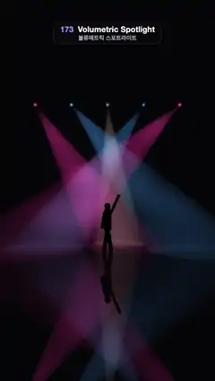

# 173 · Volumetric Spotlight · 볼류메트릭 스포트라이트



**EN** Five moving-head spotlights sweep pink, blue and white beams through stage haze around a singer, all mirrored in a glossy black floor.  
**KO** 무빙 헤드 조명 다섯 개가 무대 연기 속으로 분홍·파랑·흰 빛줄기를 휘두르며 가수를 비추고, 그 모든 빛이 검은 유광 바닥에 비친다.

[Video (mp4)](https://sueun-dev.github.io/motion-effects/videos/173-volumetric-spotlight.mp4) · [Code](../effects/173-volumetric-spotlight.js) · Atmosphere & volumes · 대기·볼륨

## Prompt (English)

```text
Create a "Volumetric Spotlight" motion effect: a concert stage in the dark, five moving-head spotlights on a truss sweep their beams through haze, the beams visible as glowing cones, a singer's silhouette in the middle, everything mirrored in a glossy black floor.

Look
- Five fixtures at (−4 + 2i, 7.4, −3.2), i = 0 … 4, colours pink #FF2E8C, blue #338CFF, warm white #FFE6C7, blue #338CFF, pink #FF2E8C. Each lens is a bright dot with a soft halo, brighter when it points toward the camera.
- Each beam is a cone with a soft edge between 8.3° and 9.8° from its axis; light falls off as 9 / (1 + 0.012 · d²).
- Haze: density 0.65 + 0.35 · noise(0.3x, 0.3z, 0.45y), the noise lookup drifting on a circle of radius 0.6 once per loop. Forward-scattering Henyey–Greenstein phase with g = 0.55, so beams that come toward the camera glow the most.
- The singer: capsules for two legs (radius 0.075), body (0.15), head (0.11) and two arms (0.05), one arm raised; standing at z = −0.6, swaying 0.05 side to side. A dark silhouette with a faint coloured rim; it blocks the beams, cutting shadows into the haze and onto the floor.
- Floor y = 0: glossy black. It shows the elliptical pools of light (diffuse 0.012, a specular highlight power 60) and mirrors the beams, the lenses and the singer at 20 % strength. Back wall at z = −5, dark, with faint pools where beams hit it.
- Camera at (0, 1.3, 6.5) looking at (0, 2.3, −1), focal length 1.75: the lenses sit about 530 px from the top, the singer stands just below the middle, the reflections fill the lower third.

Motion (0–5 s), a = 2π · t / 5
- Each beam aims at a point on the floor that moves on its own loop: x = side · 0.6 + 2.6 · sin(a + 1.3i) (the centre one ±1.0 only), z = −1.6 + 1.2 · sin(2a + 2.1i), with side = +1 for the two left fixtures, 0 for the centre one, −1 for the two right ones. The beams sweep, cross and pass over the singer.
- The singer sways at twice the loop rate; the raised arm moves slightly. The haze drifts on its circle.

Technique
- A WebGL2 fragment shader. Find what the ray hits (the singer's capsules by exact ray–capsule intersection, the floor, the back wall), then march the haze from 1 unit to the hit (at most 22) in 90 steps. At each sample add, for every fixture whose cone contains the point, its colour × cone factor × falloff × shadow × haze density × phase.
- The shadow is a ray–capsule test from the fixture to the sample point. Start each march with a fixed per-pixel random offset (never changing over time).
- For floor pixels, march the mirrored ray too (40 steps) and add 20 % of it, stopping at the singer so her reflection is dark.
- Tone curve 1 − e^(−1.2x), gamma pow(x, 0.9).

Output and rules
- One self-contained HTML file with no external assets (three.js from a CDN is fine if you use it), drawing on a 1080 × 1920 canvas (9:16) scaled to fit the window.
- Write a function renderFrame(t) that draws the frame for time t in seconds, and preview it with requestAnimationFrame. Everything must be a pure function of t and fixed seeds: no Math.random(), Date or state carried between frames, so frame i = renderFrame(i / 30) can be exported to a 30 fps video.
- Loop seamlessly every 5 seconds: renderFrame(5) must look exactly like renderFrame(0).
- No flicker of any kind: no noise or grain that changes from frame to frame, no strobing or blinking, no z-fighting, no shimmering 1 px lines. Any grain or texture stays fixed to the screen or to the object.
- Keep the top 280 px free of important content (a title label goes there) and fill the whole frame with a designed background.
```

## 프롬프트 (한국어)

```text
"볼류메트릭 스포트라이트" 모션 효과를 만들어 줘: 어두운 콘서트 무대에서 트러스에 달린 무빙 헤드 조명 다섯 개가 연기 속으로 빛줄기를 휘두른다. 빛줄기는 빛나는 원뿔로 보이고, 가운데에는 가수의 실루엣, 모든 것이 검은 유광 바닥에 비친다.

모양
- 조명 다섯 개, 위치 (−4 + 2i, 7.4, −3.2), i = 0 … 4, 색은 분홍 #FF2E8C, 파랑 #338CFF, 따뜻한 흰색 #FFE6C7, 파랑 #338CFF, 분홍 #FF2E8C. 렌즈는 부드러운 후광이 있는 밝은 점이고, 카메라 쪽을 향할수록 밝다.
- 빛줄기는 축에서 8.3°와 9.8° 사이에서 부드럽게 끝나는 원뿔. 빛은 9 / (1 + 0.012 · d²)로 줄어든다.
- 연기: 밀도 0.65 + 0.35 · noise(0.3x, 0.3z, 0.45y), 노이즈 조회 위치가 루프마다 반지름 0.6 원을 한 바퀴 돌며 흐른다. 앞쪽 산란 헨이-그린스타인 위상 함수 g = 0.55라서 카메라 쪽으로 오는 빛줄기가 가장 밝다.
- 가수: 다리 둘(반지름 0.075), 몸통(0.15), 머리(0.11), 팔 둘(0.05)의 캡슐, 한 팔은 들어 올렸다. z = −0.6에 서서 좌우로 0.05 흔들린다. 옅은 색 테두리가 있는 어두운 실루엣이고, 빛줄기를 가려 연기와 바닥에 그림자를 새긴다.
- 바닥 y = 0: 검은 유광. 타원형 빛 웅덩이(난반사 0.012, 정반사 지수 60)를 보여 주고, 빛줄기·렌즈·가수를 20 % 세기로 비춘다. z = −5의 뒷벽은 어둡고 빛줄기가 닿는 곳에 옅은 빛 웅덩이.
- 카메라 (0, 1.3, 6.5)에서 (0, 2.3, −1)을 본다, 초점 거리 1.75: 렌즈는 위에서 약 530px, 가수는 가운데 바로 아래, 반사가 아래 1/3을 채운다.

움직임 (0–5초), a = 2π · t / 5
- 빛줄기마다 바닥 위 겨눈 점이 제 고리를 따라 움직인다: x = 방향 · 0.6 + 2.6 · sin(a + 1.3i)(가운데 것은 ±1.0만), z = −1.6 + 1.2 · sin(2a + 2.1i). 방향은 왼쪽 두 개 +1, 가운데 0, 오른쪽 두 개 −1. 빛줄기가 휩쓸고 교차하며 가수 위를 지나간다.
- 가수는 루프의 두 배 빠르기로 흔들리고, 든 팔이 살짝 움직인다. 연기는 원을 따라 흐른다.

기법
- WebGL2 프래그먼트 셰이더. 광선이 무엇에 맞는지(가수의 캡슐은 정확한 광선–캡슐 교차, 바닥, 뒷벽) 찾고, 1 단위부터 맞은 점(최대 22)까지 연기 속을 90걸음 행진한다. 샘플마다 원뿔 안에 그 점이 든 조명마다 색 × 원뿔 계수 × 감쇠 × 그림자 × 연기 밀도 × 위상을 더한다.
- 그림자는 조명에서 샘플 점까지의 광선–캡슐 검사. 행진은 픽셀마다 고정된 무작위 오프셋으로 시작한다(시간에 따라 바뀌지 않음).
- 바닥 픽셀은 반사된 광선도 행진해(40걸음) 20 %를 더하고, 가수에서 멈춰 가수의 반사가 어둡게 보이게 한다.
- 톤 곡선 1 − e^(−1.2x), 감마 pow(x, 0.9).

출력과 규칙
- 외부 파일 없는 HTML 파일 하나(three.js를 쓴다면 CDN은 괜찮다). 1080 × 1920(9:16) 캔버스에 그리고 창 크기에 맞춰 보이게 한다.
- 시간 t(초)의 프레임을 그리는 renderFrame(t) 함수를 만들고, 미리보기는 requestAnimationFrame으로 돌린다. 모든 것은 t와 고정 시드만으로 정해진다: Math.random(), Date, 프레임 사이에 쌓이는 상태 금지. 그래야 i번째 프레임 = renderFrame(i / 30)으로 30fps 영상을 뽑을 수 있다.
- 5초마다 끊김 없이 반복: renderFrame(5)는 renderFrame(0)과 똑같아 보여야 한다.
- 어떤 깜빡임도 금지: 프레임마다 바뀌는 노이즈·그레인, 번쩍임·깜빡임, z-fighting, 반짝이며 떨리는 1px 선 모두 금지. 그레인·질감은 화면이나 물체에 고정한다.
- 위쪽 280px에는 중요한 내용을 두지 않고(제목 라벨 자리), 화면 전체를 디자인된 배경으로 채운다.
```
