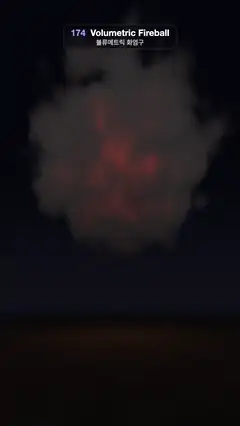

# 174 · Volumetric Fireball · 볼류메트릭 화염구



**EN** A raymarched fireball bursts from a spark into rolling white-hot flames, cools to red and rises away as dark smoke while the next one ignites.  
**KO** 레이마칭한 불덩이가 불씨에서 터져 하얗게 달아오른 화염으로 굴러 오르고, 붉게 식어 검은 연기로 떠오르는 사이 다음 폭발이 일어난다.

[Video (mp4)](https://sueun-dev.github.io/motion-effects/videos/174-volumetric-fireball.mp4) · [Code](../effects/174-volumetric-fireball.js) · Atmosphere & volumes · 대기·볼륨

## Prompt (English)

```text
Create a "Volumetric Fireball" motion effect: a raymarched explosion on a dark plain at night. It bursts from a spark into a rolling ball of white-hot and orange flame, cools to red, turns into dark smoke and rises away, while the next blast ignites below it.

Look
- One blast of age L (in loops): radius R = 1.6 · (1 − e^(−4L)) + 0.5L (a fast burst, then slow growth); centre (0, −0.4 + 0.9L + 2.2L², 0), so it rises faster and faster as it cools.
- Billowing shape: q = point − centre, noise coordinate q / R · 1.2 + (0, −L, 0) + 3.7 (the noise rolls upward with age); turbulence = 5 octaves of |simplex noise| (lacunarity 2.03, gain 0.5); shape = (R − |q|) / R + turbulence − 0.3. Density = smoothstep(0, 0.35, shape) × (1 − smoothstep(0.65, 1.3, L)) × smoothstep(0, 0.03, L).
- Temperature = 1.9 · e^(−2.2L) · smoothstep(−0.1, 0.9, shape): hot in the core and while young. Fire colour ramp: black → deep red #BF1405 → orange #FF6B0F → yellow #FFCC59 → white #FFF7E0 (thresholds about 0.3, 0.6, 0.95, 1.4). Emission = fire colour × 5 × smoothstep(0.05, 0.45, temperature) plus 0.6 × smoke colour.
- Smoke colour: from #0F0F11 low to #333336 higher up, plus an orange tint from the current glow. Extinction 6 × density.
- Background: night sky #08090F near the horizon to #020306 above, an orange horizon glow, and a dark plain at y = −1.4 (#050405 with a faint fixed texture) lit by the fireball from above its centre with intensity glow = e^(−2.2 · L0) for the new blast plus e^(−2.2 · L1) for the old one, falling off with distance.
- Camera at (0, −0.6, 5.6), direction normalize(uv.x, uv.y + 0.75, −1.9): the horizon is low in the frame (about 1360 px from the top) and the fireball sits just above it, leaving room above for the smoke to rise.

Motion (0–5 s)
- A new blast is born every 5 s and each lives 10 s: draw two blasts, L0 = t / 5 (the new one) and L1 = t / 5 + 1 (the previous one, cooling, rising and fading). At t = 5 the new blast has exactly the age the old one had at t = 0, and the old one has faded out, so the loop is seamless.
- 0–1.5 s: spark, white-hot burst, rolling orange billows. 1.5–3.5 s: the ball grows, darkens to red with glowing pockets, and lifts off. 3.5–5 s: dark smoke with embers rising away; at the end of the loop the next spark ignites.

Technique
- A WebGL2 fragment shader. March 110 equal steps from 1.8 to 10 along the view ray (stopping below the ground or when transmittance < 1 %), adding both blasts' densities; the temperature is their density-weighted mix. Each step: emission × (1 − e^(−σ·dt)), then transmittance × e^(−σ·dt).
- The noise depends only on each blast's age and position, never directly on t, which is what makes the two overlapping lives line up at the seam.
- Start each ray a fixed per-pixel random fraction of a step in (never changing over time). Tone curve 1 − e^(−1.3x), gamma pow(x, 0.9).

Output and rules
- One self-contained HTML file with no external assets (three.js from a CDN is fine if you use it), drawing on a 1080 × 1920 canvas (9:16) scaled to fit the window.
- Write a function renderFrame(t) that draws the frame for time t in seconds, and preview it with requestAnimationFrame. Everything must be a pure function of t and fixed seeds: no Math.random(), Date or state carried between frames, so frame i = renderFrame(i / 30) can be exported to a 30 fps video.
- Loop seamlessly every 5 seconds: renderFrame(5) must look exactly like renderFrame(0).
- No flicker of any kind: no noise or grain that changes from frame to frame, no strobing or blinking, no z-fighting, no shimmering 1 px lines. Any grain or texture stays fixed to the screen or to the object.
- Keep the top 280 px free of important content (a title label goes there) and fill the whole frame with a designed background.
```

## 프롬프트 (한국어)

```text
"볼류메트릭 화염구" 모션 효과를 만들어 줘: 밤의 어두운 평원에서 일어나는 레이마칭 폭발. 불씨에서 하얗게 달아오른 주황 화염 덩어리로 터져 굴러 오르고, 붉게 식어 검은 연기가 되어 떠오르는 동안 그 아래에서 다음 폭발이 점화된다.

모양
- 나이 L(루프 단위)의 폭발 하나: 반지름 R = 1.6 · (1 − e^(−4L)) + 0.5L(빠르게 터진 뒤 천천히 커진다). 중심 (0, −0.4 + 0.9L + 2.2L², 0), 식을수록 점점 빠르게 떠오른다.
- 몽글몽글한 모양: q = 점 − 중심, 노이즈 좌표 q / R · 1.2 + (0, −L, 0) + 3.7(나이에 따라 노이즈가 위로 굴러간다). 난류 = |심플렉스 노이즈| 5옥타브(주파수 배율 2.03, 진폭 0.5배). 모양 값 = (R − |q|) / R + 난류 − 0.3. 밀도 = smoothstep(0, 0.35, 모양) × (1 − smoothstep(0.65, 1.3, L)) × smoothstep(0, 0.03, L).
- 온도 = 1.9 · e^(−2.2L) · smoothstep(−0.1, 0.9, 모양): 중심과 젊을 때 뜨겁다. 불 색 램프: 검정 → 짙은 빨강 #BF1405 → 주황 #FF6B0F → 노랑 #FFCC59 → 흰색 #FFF7E0(경계 약 0.3, 0.6, 0.95, 1.4). 발광 = 불 색 × 5 × smoothstep(0.05, 0.45, 온도) + 0.6 × 연기 색.
- 연기 색: 아래 #0F0F11에서 위로 #333336, 지금의 불빛으로 주황빛이 돈다. 소멸 계수 6 × 밀도.
- 배경: 지평선 근처 #08090F에서 위로 #020306인 밤하늘, 주황빛 지평선, y = −1.4의 어두운 평원(#050405, 옅은 고정 질감). 평원은 불덩이 중심 위에서 빛을 받고, 그 세기는 새 폭발의 e^(−2.2 · L0)와 이전 폭발의 e^(−2.2 · L1)의 합이며 거리에 따라 줄어든다.
- 카메라 (0, −0.6, 5.6), 방향 normalize(uv.x, uv.y + 0.75, −1.9): 지평선이 화면 아래쪽(위에서 약 1360px)에 있고 불덩이는 그 바로 위, 위쪽에는 연기가 떠오를 자리가 남는다.

움직임 (0–5초)
- 5초마다 새 폭발이 태어나고 각각 10초를 산다: 폭발 두 개를 그린다. L0 = t / 5(새 것)와 L1 = t / 5 + 1(이전 것, 식으며 떠올라 사라지는 중). t = 5에서 새 폭발은 t = 0일 때 이전 폭발의 나이와 정확히 같고 이전 폭발은 다 사라졌으므로 끊김 없이 반복된다.
- 0–1.5초: 불씨, 하얗게 달아오른 폭발, 굴러가는 주황 덩어리. 1.5–3.5초: 공이 커지며 빛나는 구멍이 있는 빨강으로 어두워지고 떠오른다. 3.5–5초: 불씨가 박힌 검은 연기가 떠나고, 루프 끝에서 다음 불씨가 붙는다.

기법
- WebGL2 프래그먼트 셰이더. 시선 광선을 따라 1.8부터 10까지 같은 간격 110걸음 행진하며(땅 아래로 가거나 투과율 < 1 %면 멈춤) 두 폭발의 밀도를 더한다. 온도는 밀도로 가중한 평균. 걸음마다 발광 × (1 − e^(−σ·dt)), 투과율 × e^(−σ·dt).
- 노이즈는 각 폭발의 나이와 위치에만 달려 있고 t에 직접 달려 있지 않다. 그래서 겹치는 두 생애가 이음매에서 딱 맞는다.
- 광선마다 걸음의 픽셀별 고정 무작위 비율만큼 늦게 시작한다(시간에 따라 바뀌지 않음). 톤 곡선 1 − e^(−1.3x), 감마 pow(x, 0.9).

출력과 규칙
- 외부 파일 없는 HTML 파일 하나(three.js를 쓴다면 CDN은 괜찮다). 1080 × 1920(9:16) 캔버스에 그리고 창 크기에 맞춰 보이게 한다.
- 시간 t(초)의 프레임을 그리는 renderFrame(t) 함수를 만들고, 미리보기는 requestAnimationFrame으로 돌린다. 모든 것은 t와 고정 시드만으로 정해진다: Math.random(), Date, 프레임 사이에 쌓이는 상태 금지. 그래야 i번째 프레임 = renderFrame(i / 30)으로 30fps 영상을 뽑을 수 있다.
- 5초마다 끊김 없이 반복: renderFrame(5)는 renderFrame(0)과 똑같아 보여야 한다.
- 어떤 깜빡임도 금지: 프레임마다 바뀌는 노이즈·그레인, 번쩍임·깜빡임, z-fighting, 반짝이며 떨리는 1px 선 모두 금지. 그레인·질감은 화면이나 물체에 고정한다.
- 위쪽 280px에는 중요한 내용을 두지 않고(제목 라벨 자리), 화면 전체를 디자인된 배경으로 채운다.
```
