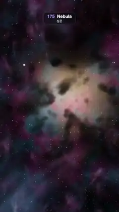

# 175 · Nebula · 성운



**EN** Drifting forward through glowing pink, teal and gold nebula gas, past dark dust globules and stars, toward a bright star cluster at its heart.  
**KO** 분홍·청록·금빛으로 빛나는 성운 가스 속을 천천히 날아가며, 검은 먼지 덩어리와 별들을 지나 성운 한가운데의 밝은 성단 쪽으로 다가간다.

[Video (mp4)](https://sueun-dev.github.io/motion-effects/videos/175-nebula.mp4) · [Code](../effects/175-nebula.js) · Atmosphere & volumes · 대기·볼륨

## Prompt (English)

```text
Create a "Nebula" motion effect: flying slowly through a glowing nebula. Raymarched emission gas in pink, teal and gold, backlit by a bright star cluster far ahead, dark dust globules silhouetted against it, a few stars inside the gas sliding past, and a fixed starfield behind.

Look
- Everything repeats every P = 10 units along the flight axis (z).
- Gas density: lattice coordinates q = p · 2 / P; domain warp q.xy += 0.7 · (n(q + (0, 4, 0)), n(q + (6, 1, 0))); n5 = 5-octave fbm of the warped 2q; g = clamp(2 · (n5 + 0.25 · warp.x − 0.04), 0, 1); density = g² × an open channel around the flight path, smoothstep(0.3, 1.6, distance from (0.2, −0.1)). n is gradient noise.
- Colour from another noise: pink #FF388C ↔ blue-teal #1F8CFF, with gold #FF9E47 where the noise is strongest.
- The cluster lies far ahead in direction L = (0.12, 0.08, −0.99). Each gas sample gets a rim term clamp(1.8 · (d(p) − d(p + 0.35L)), 0, 1): the edges that face the cluster glow. Emission = (0.22 · colour + 2.4 · rim · (0.6 · colour + 0.5)) · density, faded in from 0.3 to 2.5 units in front of the camera and dimmed by e^(−0.045 · distance). Extinction 0.45 · density.
- Dust: soft dark clouds where smoothstep(0.25, 0.7, n(1.5q + …) + 0.3 · n(4q + 1)) > 0; they only absorb (0.9 per unit), showing as dark globules against the bright core.
- Six stars inside the gas per repeat (x 0.2 ± 1.5, y −0.1 ± 1.2, one every P / 6 in z), warm or blue-white, drawn as soft dots of radius 0.01 (never under 1.4 px) with a faint halo, occluded by the gas in front of them.
- Backdrop at infinity (direction only): fbm glow in deep magenta #80144D and teal #0D5980, brightest around the cluster direction, where a warm core #FFBF80 shines; two layers of fixed background stars (cells about 20 and 35 px, 14 % filled).
- Camera: focal length 1.7, looking slightly up (direction normalize(uv.x, uv.y − 0.1, −1.7)) so the bright core sits a little above the middle.

Motion (0–5 s), a = 2π · t / 5
- The camera flies forward exactly 10 units per loop (z = −10 · t / 5) while drifting (0.12 · sin a, 0.08 · sin 2a) and rolling 0.06 · sin(a) rad. Gas, dust and stars repeat every 10 units, so frame 150 equals frame 0. Near gas and stars stream past faster than the far core: a real fly-through.

Technique
- A WebGL2 fragment shader with gradient noise made periodic along z (the lattice z coordinate wrapped with mod before hashing; each octave doubles both frequency and period).
- Steps that grow with distance: sample i sits at t = 0.2 + 2 · (e^(0.02 · (i + j)) − 1), so dt = 0.04 + 0.02t, up to 170 steps and 30 units. j is a fixed per-pixel random number (never time), which turns slicing bands into a fine still dither.
- Each step: absorb by the dust, then add gas emission × (1 − e^(−σ·dt)) / σ and absorb by the gas; a star is added in the step that contains its closest point to the ray.
- Tone curve 1 − e^(−1.5x), gamma pow(x, 0.95).

Output and rules
- One self-contained HTML file with no external assets (three.js from a CDN is fine if you use it), drawing on a 1080 × 1920 canvas (9:16) scaled to fit the window.
- Write a function renderFrame(t) that draws the frame for time t in seconds, and preview it with requestAnimationFrame. Everything must be a pure function of t and fixed seeds: no Math.random(), Date or state carried between frames, so frame i = renderFrame(i / 30) can be exported to a 30 fps video.
- Loop seamlessly every 5 seconds: renderFrame(5) must look exactly like renderFrame(0).
- No flicker of any kind: no noise or grain that changes from frame to frame, no strobing or blinking, no z-fighting, no shimmering 1 px lines. Any grain or texture stays fixed to the screen or to the object.
- Keep the top 280 px free of important content (a title label goes there) and fill the whole frame with a designed background.
```

## 프롬프트 (한국어)

```text
"성운" 모션 효과를 만들어 줘: 빛나는 성운 속을 천천히 날아간다. 레이마칭한 분홍·청록·금빛 발광 가스가 저 앞의 밝은 성단에 역광을 받고, 검은 먼지 덩어리가 그 빛을 등지고 실루엣으로 보이며, 가스 속 별 몇 개가 옆으로 지나가고, 뒤에는 고정된 별 하늘.

모양
- 모든 것이 비행 축(z) 방향으로 P = 10 단위마다 반복된다.
- 가스 밀도: 격자 좌표 q = p · 2 / P. 영역 왜곡 q.xy += 0.7 · (n(q + (0, 4, 0)), n(q + (6, 1, 0))). n5 = 왜곡한 2q의 5옥타브 fbm. g = clamp(2 · (n5 + 0.25 · 왜곡.x − 0.04), 0, 1). 밀도 = g² × 비행 경로 둘레의 빈 통로 smoothstep(0.3, 1.6, (0.2, −0.1)에서의 거리). n은 그라디언트 노이즈.
- 다른 노이즈로 색: 분홍 #FF388C ↔ 청록빛 파랑 #1F8CFF, 노이즈가 가장 센 곳은 금빛 #FF9E47.
- 성단은 저 앞 방향 L = (0.12, 0.08, −0.99)에 있다. 가스 샘플마다 테두리 항 clamp(1.8 · (d(p) − d(p + 0.35L)), 0, 1): 성단을 향한 가장자리가 빛난다. 발광 = (0.22 · 색 + 2.4 · 테두리 · (0.6 · 색 + 0.5)) · 밀도, 카메라 앞 0.3에서 2.5 사이에서 서서히 나타나고 e^(−0.045 · 거리)로 어두워진다. 소멸 0.45 · 밀도.
- 먼지: smoothstep(0.25, 0.7, n(1.5q + …) + 0.3 · n(4q + 1)) > 0인 곳의 부드러운 어두운 구름. 흡수만 하며(단위당 0.9) 밝은 중심을 등지고 검은 덩어리로 보인다.
- 반복 구간마다 가스 속 별 6개(x 0.2 ± 1.5, y −0.1 ± 1.2, z로 P / 6마다 하나), 따뜻한 색이나 푸른 흰색, 반지름 0.01(1.4px 아래로는 그리지 않음)의 부드러운 점과 옅은 후광, 앞의 가스에 가려진다.
- 무한히 먼 배경(방향만으로): 짙은 자홍 #80144D와 청록 #0D5980의 fbm 빛, 성단 방향 둘레가 가장 밝고 거기에 따뜻한 중심 #FFBF80. 고정 배경 별 두 겹(칸 약 20px과 35px, 14 %만 별).
- 카메라: 초점 거리 1.7, 살짝 위를 본다(방향 normalize(uv.x, uv.y − 0.1, −1.7)). 밝은 중심이 가운데보다 조금 위에 온다.

움직임 (0–5초), a = 2π · t / 5
- 카메라가 루프마다 정확히 10 단위 앞으로 난다(z = −10 · t / 5). 동시에 (0.12 · sin a, 0.08 · sin 2a)로 떠다니고 0.06 · sin(a) rad 기울어진다. 가스·먼지·별은 10 단위마다 반복되므로 150번째 프레임 = 0번째. 가까운 가스와 별이 먼 중심보다 빠르게 스쳐 지나가는 진짜 비행.

기법
- z 방향으로 주기적인 그라디언트 노이즈를 쓰는 WebGL2 프래그먼트 셰이더(해시하기 전에 격자 z 좌표를 mod로 감고, 옥타브마다 주파수와 주기를 함께 두 배로).
- 거리에 따라 커지는 걸음: i번째 샘플은 t = 0.2 + 2 · (e^(0.02 · (i + j)) − 1), 그래서 dt = 0.04 + 0.02t, 최대 170걸음, 30 단위. j는 픽셀마다 고정된 무작위 수(시간 아님)라서 걸음 띠가 고운 고정 디더가 된다.
- 걸음마다: 먼지로 흡수, 가스 발광 × (1 − e^(−σ·dt)) / σ를 더하고 가스로 흡수. 별은 광선에 가장 가까운 점이 들어 있는 걸음에서 더한다.
- 톤 곡선 1 − e^(−1.5x), 감마 pow(x, 0.95).

출력과 규칙
- 외부 파일 없는 HTML 파일 하나(three.js를 쓴다면 CDN은 괜찮다). 1080 × 1920(9:16) 캔버스에 그리고 창 크기에 맞춰 보이게 한다.
- 시간 t(초)의 프레임을 그리는 renderFrame(t) 함수를 만들고, 미리보기는 requestAnimationFrame으로 돌린다. 모든 것은 t와 고정 시드만으로 정해진다: Math.random(), Date, 프레임 사이에 쌓이는 상태 금지. 그래야 i번째 프레임 = renderFrame(i / 30)으로 30fps 영상을 뽑을 수 있다.
- 5초마다 끊김 없이 반복: renderFrame(5)는 renderFrame(0)과 똑같아 보여야 한다.
- 어떤 깜빡임도 금지: 프레임마다 바뀌는 노이즈·그레인, 번쩍임·깜빡임, z-fighting, 반짝이며 떨리는 1px 선 모두 금지. 그레인·질감은 화면이나 물체에 고정한다.
- 위쪽 280px에는 중요한 내용을 두지 않고(제목 라벨 자리), 화면 전체를 디자인된 배경으로 채운다.
```
