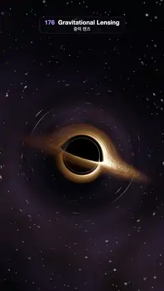

# 176 · Gravitational Lensing · 중력 렌즈



**EN** A black hole bends its glowing accretion disk into arches over and under its shadow, while lensed stars slide around a thin photon ring.  
**KO** 블랙홀이 빛나는 강착 원반을 그림자 위아래로 휘어 아치를 만들고, 중력 렌즈로 휜 별들이 가는 광자 고리 둘레를 따라 미끄러진다.

[Video (mp4)](https://sueun-dev.github.io/motion-effects/videos/176-gravitational-lensing.mp4) · [Code](../effects/176-gravitational-lensing.js) · Atmosphere & volumes · 대기·볼륨

## Prompt (English)

```text
Create a "Gravitational Lensing" motion effect: a black hole with a hot accretion disk, rendered by bending every light ray around it, so the far side of the disk arches over and under the black shadow, a thin photon ring hugs it, and the stars behind are stretched and slide around it.

Look
- Units: event horizon radius 1. Disk in the plane y = 0 from radius 2.6 to 11, fading in over 0.7 at the inner edge and out over the last 4 at the outer edge; brightness profile (2.6 / r)^1.6.
- Disk texture: streaks from two layers of simplex noise read on a circle (2.2r and 6r radially), rotating one turn per loop inside; outside r = 4–7 it blends into a pattern that repeats every half turn and so turns only half as fast (Keplerian-looking shear that still loops).
- Doppler beaming: the disk orbits counter-clockwise at speed √(0.5 / r); the factor D = √(1 − β²) / (1 − β · n_toCamera), times the gravitational redshift √(1 − 1 / r). Colour = heat(k) with k = (0.35 + 0.9 · profile) · D · (0.85 + 0.25 · noise), on a ramp red #E62E0A → orange #FF8C2E → pale yellow #FFDB9E → blue-white #BFD9FF; brightness × D³ × (0.7 + 2.6 · profile). The side coming toward us is bright and white, the receding side dim and red.
- The disk is semi-transparent: opacity clamp(1.4 · profile · (0.75 + 0.5 · noise), 0, 0.95), composited front to back at every crossing of the plane, so its lensed back side and secondary images show.
- Background, read in the ray's final direction: near-black #010103, a faint purple milky band, and fixed stars from a 3D grid on the sphere (cells of 1/70 and 1/32, 25 % filled, soft dots). Rays that came closer than 1.45–1.8 to the centre have their stars faded, since they are squeezed too thin to show cleanly.
- Camera 26 away, focal length 2.1, rolled 0.32 rad so the disk crosses the frame on a diagonal, view shifted 0.12 up; the hole sits in the middle with the disk about 80 % of the frame width.

Motion (0–5 s), a = 2π · t / 5
- The camera rises and falls and swings a little: elevation 0.13 + 0.06 · sin(a) rad above the disk plane (4°–11°), azimuth 0.1 · sin(a + 1) rad. As it moves, the arches change shape and the background stars smear into arcs and slide around the shadow.
- The disk streaks rotate as described (inner one turn, outer half a turn per loop).

Technique
- A WebGL2 fragment shader that integrates each ray backwards as a Schwarzschild photon orbit: acceleration −1.5 · h² · x / r⁵ with h = |x × v| (its constant angular momentum), step dt = clamp(0.045 · r² / (r + 2), 0.02, 1.2), up to 420 steps. Stop when r < 1 (captured: black) or r > 40 moving outward (escaped: read the background in direction v).
- Each time the step crosses y = 0, interpolate the crossing point and, if it is on the disk, add its emission × opacity × remaining transmittance.
- 2 × 2 supersampling; tone curve 1 − e^(−1.3x), gamma pow(x, 0.9).

Output and rules
- One self-contained HTML file with no external assets (three.js from a CDN is fine if you use it), drawing on a 1080 × 1920 canvas (9:16) scaled to fit the window.
- Write a function renderFrame(t) that draws the frame for time t in seconds, and preview it with requestAnimationFrame. Everything must be a pure function of t and fixed seeds: no Math.random(), Date or state carried between frames, so frame i = renderFrame(i / 30) can be exported to a 30 fps video.
- Loop seamlessly every 5 seconds: renderFrame(5) must look exactly like renderFrame(0).
- No flicker of any kind: no noise or grain that changes from frame to frame, no strobing or blinking, no z-fighting, no shimmering 1 px lines. Any grain or texture stays fixed to the screen or to the object.
- Keep the top 280 px free of important content (a title label goes there) and fill the whole frame with a designed background.
```

## 프롬프트 (한국어)

```text
"중력 렌즈" 모션 효과를 만들어 줘: 뜨거운 강착 원반을 두른 블랙홀. 모든 빛 광선을 블랙홀 둘레로 휘어 그려서, 원반의 먼 쪽이 검은 그림자 위아래로 아치를 이루고, 가는 광자 고리가 그림자를 감싸며, 뒤의 별들이 늘어나 그 둘레를 미끄러진다.

모양
- 단위: 사건의 지평선 반지름 1. 원반은 평면 y = 0, 반지름 2.6부터 11까지, 안쪽 가장자리는 0.7에 걸쳐 나타나고 바깥쪽은 마지막 4에 걸쳐 사라진다. 밝기 분포 (2.6 / r)^1.6.
- 원반 질감: 원을 따라 읽는 심플렉스 노이즈 두 겹(반지름 방향 2.2r과 6r)의 줄무늬. 안쪽은 루프마다 한 바퀴 돌고, r = 4–7 바깥에서는 반 바퀴마다 반복되는 무늬로 섞여 절반 빠르기로만 돈다(케플러 회전 같은 전단, 그래도 반복된다).
- 도플러 빔: 원반은 반시계 방향으로 속도 √(0.5 / r)로 돈다. 계수 D = √(1 − β²) / (1 − β · n카메라쪽)에 중력 적색편이 √(1 − 1 / r)을 곱한다. 색 = heat(k), k = (0.35 + 0.9 · 분포) · D · (0.85 + 0.25 · 노이즈), 램프는 빨강 #E62E0A → 주황 #FF8C2E → 옅은 노랑 #FFDB9E → 푸른 흰색 #BFD9FF. 밝기 × D³ × (0.7 + 2.6 · 분포). 다가오는 쪽은 밝고 하얗게, 멀어지는 쪽은 어둡고 붉게.
- 원반은 반투명: 불투명도 clamp(1.4 · 분포 · (0.75 + 0.5 · 노이즈), 0, 0.95), 평면을 지날 때마다 앞에서 뒤로 합성해 렌즈로 휜 뒷면과 2차 상이 보인다.
- 배경은 광선의 마지막 방향으로 읽는다: 거의 검정 #010103, 옅은 보라 은하수 띠, 구 위 3D 격자의 고정 별(칸 1/70과 1/32, 25 %만 별, 부드러운 점). 중심에 1.45–1.8보다 가까이 다가간 광선은 너무 가늘게 눌려 깨끗이 보일 수 없으므로 별을 흐리게 한다.
- 카메라 거리 26, 초점 거리 2.1, 0.32 rad 기울여 원반이 화면을 대각선으로 가로지르게 하고, 시야를 0.12 위로 옮긴다. 블랙홀은 가운데, 원반은 화면 너비의 약 80 %.

움직임 (0–5초), a = 2π · t / 5
- 카메라가 오르내리며 살짝 흔들린다: 원반 평면 위 고도 0.13 + 0.06 · sin(a) rad(4°–11°), 방위각 0.1 · sin(a + 1) rad. 움직이는 동안 아치 모양이 바뀌고 배경 별이 호처럼 번져 그림자 둘레로 미끄러진다.
- 원반 줄무늬는 위처럼 돈다(안쪽 루프마다 한 바퀴, 바깥 반 바퀴).

기법
- 광선마다 슈바르츠실트 광자 궤도로 거꾸로 적분하는 WebGL2 프래그먼트 셰이더: 가속도 −1.5 · h² · x / r⁵, h = |x × v|(보존되는 각운동량), 걸음 dt = clamp(0.045 · r² / (r + 2), 0.02, 1.2), 최대 420걸음. r < 1이면 멈춤(빨려 들어감: 검정), r > 40에서 바깥으로 가면 멈춤(빠져나감: 방향 v로 배경을 읽는다).
- 걸음이 y = 0을 지날 때마다 지나는 점을 보간하고, 원반 위라면 그 발광 × 불투명도 × 남은 투과율을 더한다.
- 2 × 2 슈퍼샘플링, 톤 곡선 1 − e^(−1.3x), 감마 pow(x, 0.9).

출력과 규칙
- 외부 파일 없는 HTML 파일 하나(three.js를 쓴다면 CDN은 괜찮다). 1080 × 1920(9:16) 캔버스에 그리고 창 크기에 맞춰 보이게 한다.
- 시간 t(초)의 프레임을 그리는 renderFrame(t) 함수를 만들고, 미리보기는 requestAnimationFrame으로 돌린다. 모든 것은 t와 고정 시드만으로 정해진다: Math.random(), Date, 프레임 사이에 쌓이는 상태 금지. 그래야 i번째 프레임 = renderFrame(i / 30)으로 30fps 영상을 뽑을 수 있다.
- 5초마다 끊김 없이 반복: renderFrame(5)는 renderFrame(0)과 똑같아 보여야 한다.
- 어떤 깜빡임도 금지: 프레임마다 바뀌는 노이즈·그레인, 번쩍임·깜빡임, z-fighting, 반짝이며 떨리는 1px 선 모두 금지. 그레인·질감은 화면이나 물체에 고정한다.
- 위쪽 280px에는 중요한 내용을 두지 않고(제목 라벨 자리), 화면 전체를 디자인된 배경으로 채운다.
```
