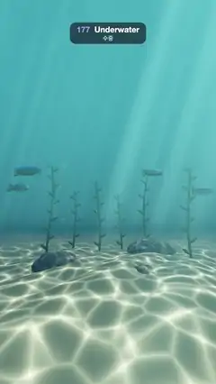

# 177 · Underwater · 수중



**EN** Light shafts slant through blue-green water onto a sand floor webbed with moving caustics, as kelp sways, bubbles rise and fish swim past.  
**KO** 청록빛 물속으로 빛줄기가 비스듬히 내려와 일렁이는 커스틱 무늬의 모래 바닥을 비추고, 다시마가 흔들리고 거품이 오르며 물고기가 지나간다.

[Video (mp4)](https://sueun-dev.github.io/motion-effects/videos/177-underwater.mp4) · [Code](../effects/177-underwater.js) · Atmosphere & volumes · 대기·볼륨

## Prompt (English)

```text
Create an "Underwater" motion effect: a raymarched sea floor. Sunlight through the wavy surface draws a moving web of caustics on the sand, rocks, kelp and fish; the same pattern projected down along the sun lights the water itself as slanted shafts; blue-green fog swallows the distance, bubbles rise and a few fish swim past.

Look
- Caustic pattern: two layers of a Voronoi "F2 − F1" edge pattern whose feature points circle (radius 0.32 of a cell, one turn per loop, the second layer turning the other way, rotated 0.7 rad and 1.4× finer): a = e^(−7 · edge₁), b = e^(−7 · edge₂), caustic = 0.7a + 0.5b + 1.6ab, a web of bright lines.
- Sunlight direction (0.28, 0.94, 0.18) (pointing up toward the sun); the surface is at y = 8. A point p is lit by the caustic at the surface point its sunbeam came through: caustic(0.8 · (p.xz + sun.xz / sun.y · (8 − p.y))).
- Sand floor y = 0.25 · sin(0.5x + 1) · cos(0.4z) + 0.08 · sin(2.1x + 1.3z), colour #D1B885; three rounded rocks #5C544D with a little noise; six kelp stalks (radius 0.05, 3.8–7 tall, #52661A) with leaf blades every 0.6 (ellipsoids 0.24 × 0.07 × 0.025, alternating sides, tilted 0.6 rad); seven fish (ellipsoid body 0.5 × 0.19 × 0.09 plus a thin tail fin), blue back #1F61BF and yellow belly #FFD159, with a specular glint.
- Shading: colour × (blue-green ambient #143847 · (0.6 + 0.4 · n.y) + (0.8, 0.95, 0.9) · max(n · sun, 0) · (0.35 + 1.6 · caustic)). Far away (9–22 units) the caustic fades to its average so it never shimmers.
- Water colour by view direction: deep #00172B looking down to #146B8C looking up, plus a glow toward the sun. Fog: mix to the water colour by 1 − e^(−0.085 · distance). Looking up past everything, the bright rippled surface shows the caustic pattern.
- Light shafts: march 36 steps along the view ray (up to 30 units); at each point add caustic(0.18 · (p.xz + sun.xz / sun.y · (8 − p.y)))^1.5 × e^(−0.09 · s), only above the floor, coloured (0.35, 0.7, 0.65).
- Bubbles: 24 small spheres (radius 0.05–0.12) in two columns, drawn as a bright rim (Fresnel) plus a specular dot, hidden behind closer objects.
- Camera looking at (0, 3.4, 0), focal length 1.5: the floor fills the lower half, kelp and fish in the middle, shafts and the bright water above.

Motion (0–5 s), a = 2π · t / 5
- The caustic web flows (its points circle once per loop). Kelp sways: the stalk at height y is offset (0.45 · sin(0.55y − a + k), 0.2 · cos(0.4y − a + k)) · y / 7.
- Fish swim left to right across the frame once per loop, x = −9 + 18 · fract(t / 5 + offset), wrapping off screen, bobbing ±0.15 and wagging their tails 8 times per loop.
- Bubbles rise from the floor to 8.5 once or twice per loop, wobbling side to side, and start again at the bottom.
- The camera drifts: (0.6 · sin a, 2 + 0.2 · sin 2a, 7.5).

Technique
- A WebGL2 fragment-shader raymarcher (up to 110 steps, hit when the distance < 0.0015 · t) over sand, rocks, kelp and fish signed distances, with normals by central differences; analytic ray–sphere tests for the bubbles.
- The shaft march uses a fixed per-pixel random start offset, different for each of the 2 × 2 supersamples (never changing over time), so it reads as smooth light, not grain.
- Tone curve 1 − e^(−1.6x), gamma pow(x, 0.9).

Output and rules
- One self-contained HTML file with no external assets (three.js from a CDN is fine if you use it), drawing on a 1080 × 1920 canvas (9:16) scaled to fit the window.
- Write a function renderFrame(t) that draws the frame for time t in seconds, and preview it with requestAnimationFrame. Everything must be a pure function of t and fixed seeds: no Math.random(), Date or state carried between frames, so frame i = renderFrame(i / 30) can be exported to a 30 fps video.
- Loop seamlessly every 5 seconds: renderFrame(5) must look exactly like renderFrame(0).
- No flicker of any kind: no noise or grain that changes from frame to frame, no strobing or blinking, no z-fighting, no shimmering 1 px lines. Any grain or texture stays fixed to the screen or to the object.
- Keep the top 280 px free of important content (a title label goes there) and fill the whole frame with a designed background.
```

## 프롬프트 (한국어)

```text
"수중" 모션 효과를 만들어 줘: 레이마칭한 바닷속 바닥. 일렁이는 수면을 지난 햇빛이 모래·바위·다시마·물고기 위에 움직이는 커스틱 그물을 그리고, 같은 무늬를 해 방향으로 내리비추어 물 자체를 비스듬한 빛줄기로 밝힌다. 청록빛 안개가 먼 곳을 삼키고, 거품이 오르며 물고기 몇 마리가 지나간다.

모양
- 커스틱 무늬: 특징점이 원을 그리며 도는(칸의 0.32 반지름, 루프마다 한 바퀴, 두 번째 겹은 반대로 돌고 0.7 rad 회전, 1.4배 촘촘) 보로노이 "F2 − F1" 경계 무늬 두 겹: a = e^(−7 · 경계₁), b = e^(−7 · 경계₂), 커스틱 = 0.7a + 0.5b + 1.6ab, 밝은 선의 그물.
- 햇빛 방향 (0.28, 0.94, 0.18)(해 쪽 위를 가리킨다), 수면은 y = 8. 점 p는 그 햇살이 지나온 수면 점의 커스틱으로 밝혀진다: caustic(0.8 · (p.xz + 해.xz / 해.y · (8 − p.y))).
- 모래 바닥 y = 0.25 · sin(0.5x + 1) · cos(0.4z) + 0.08 · sin(2.1x + 1.3z), 색 #D1B885. 노이즈를 살짝 준 둥근 바위 셋 #5C544D. 다시마 줄기 6개(반지름 0.05, 높이 3.8–7, #52661A)에 0.6마다 잎(0.24 × 0.07 × 0.025 타원체, 좌우 번갈아, 0.6 rad 기울임). 물고기 7마리(0.5 × 0.19 × 0.09 타원체 몸통과 얇은 꼬리지느러미), 등은 파랑 #1F61BF, 배는 노랑 #FFD159, 반짝이는 정반사.
- 셰이딩: 색 × (청록 환경광 #143847 · (0.6 + 0.4 · n.y) + (0.8, 0.95, 0.9) · max(n · 해, 0) · (0.35 + 1.6 · 커스틱)). 먼 곳(9–22 단위)은 커스틱이 평균값으로 바래서 반짝이며 떨리지 않는다.
- 시선 방향에 따른 물 색: 아래를 보면 깊은 #00172B, 위를 보면 #146B8C, 해 쪽으로 빛무리. 안개: 1 − e^(−0.085 · 거리)만큼 물 색으로 섞는다. 모든 것을 지나 위를 보면 커스틱 무늬가 비치는 밝은 물결 수면.
- 빛줄기: 시선 광선을 따라 36걸음(최대 30 단위) 행진하며 점마다 caustic(0.18 · (p.xz + 해.xz / 해.y · (8 − p.y)))^1.5 × e^(−0.09 · s)를 바닥 위에서만 더한다. 색 (0.35, 0.7, 0.65).
- 거품: 두 줄기로 오르는 작은 구 24개(반지름 0.05–0.12), 밝은 테두리(프레넬)와 정반사 점으로 그리고, 더 가까운 물체 뒤에서는 가린다.
- 카메라는 (0, 3.4, 0)을 본다, 초점 거리 1.5: 바닥이 아래 절반, 가운데에 다시마와 물고기, 위에는 빛줄기와 밝은 물.

움직임 (0–5초), a = 2π · t / 5
- 커스틱 그물이 흐른다(특징점이 루프마다 한 바퀴). 다시마가 흔들린다: 높이 y의 줄기는 (0.45 · sin(0.55y − a + k), 0.2 · cos(0.4y − a + k)) · y / 7만큼 비킨다.
- 물고기는 루프마다 한 번 왼쪽에서 오른쪽으로 화면을 가로지른다. x = −9 + 18 · fract(t / 5 + 오프셋), 화면 밖에서 되돌아가고, ±0.15 오르내리며 루프마다 꼬리를 8번 흔든다.
- 거품은 루프마다 한 번이나 두 번 바닥에서 8.5까지 좌우로 흔들리며 올라가고 다시 바닥에서 시작한다.
- 카메라가 떠다닌다: (0.6 · sin a, 2 + 0.2 · sin 2a, 7.5).

기법
- 모래·바위·다시마·물고기의 부호 거리 함수 위를 도는 WebGL2 프래그먼트 셰이더 레이마처(최대 110걸음, 거리 < 0.0015 · t면 맞음), 법선은 중앙 차분. 거품은 해석적 광선–구 검사.
- 빛줄기 행진은 픽셀마다 고정된 무작위 시작 오프셋을 쓰되 2 × 2 슈퍼샘플마다 다르게 해서(시간에 따라 바뀌지 않음) 알갱이가 아니라 매끄러운 빛으로 보이게 한다.
- 톤 곡선 1 − e^(−1.6x), 감마 pow(x, 0.9).

출력과 규칙
- 외부 파일 없는 HTML 파일 하나(three.js를 쓴다면 CDN은 괜찮다). 1080 × 1920(9:16) 캔버스에 그리고 창 크기에 맞춰 보이게 한다.
- 시간 t(초)의 프레임을 그리는 renderFrame(t) 함수를 만들고, 미리보기는 requestAnimationFrame으로 돌린다. 모든 것은 t와 고정 시드만으로 정해진다: Math.random(), Date, 프레임 사이에 쌓이는 상태 금지. 그래야 i번째 프레임 = renderFrame(i / 30)으로 30fps 영상을 뽑을 수 있다.
- 5초마다 끊김 없이 반복: renderFrame(5)는 renderFrame(0)과 똑같아 보여야 한다.
- 어떤 깜빡임도 금지: 프레임마다 바뀌는 노이즈·그레인, 번쩍임·깜빡임, z-fighting, 반짝이며 떨리는 1px 선 모두 금지. 그레인·질감은 화면이나 물체에 고정한다.
- 위쪽 280px에는 중요한 내용을 두지 않고(제목 라벨 자리), 화면 전체를 디자인된 배경으로 채운다.
```
