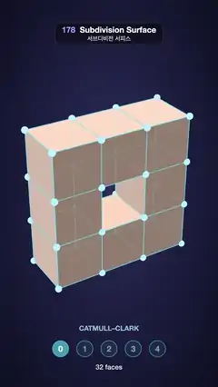

# 178 · Subdivision Surface · 서브디비전 서피스



**EN** A blocky square-ring cage of 32 quads is smoothed level by level with Catmull–Clark into a soft rounded donut, then glides back to the cage.  
**KO** 사각면 32개로 된 각진 네모 고리 케이지가 캐트멀-클라크로 한 단계씩 매끈해져 둥근 도넛이 되었다가 다시 케이지로 돌아간다.

[Video (mp4)](https://sueun-dev.github.io/motion-effects/videos/178-subdivision-surface.mp4) · [Code](../effects/178-subdivision-surface.js) · Geometry & modeling · 지오메트리·모델링

## Prompt (English)

```text
Create a "Subdivision Surface" motion effect: a blocky quad cage is refined with Catmull–Clark subdivision from level 0 to level 4, the surface always showing the edges of its current level while the original cage stays on as a cyan wire, then it glides straight back to the cage.

Look
- Background: a radial gradient, #2B2E5C near the centre (slightly above the middle) to #0C0D1F at the edges.
- The cage: the outside faces of a 3 × 3 ring of unit cubes with the middle cube left out (8 cubes, 1.1 deep), centred on the origin: 32 quads on 32 vertices. Drawn as cyan #5CE1FF fat lines 4 px wide, again at 30 % opacity and 3 px with no depth test (so hidden cage edges show through the surface), and a small sphere (radius 0.07, #BFF3FF) on every cage vertex.
- The surface: warm clay (linear 0.96, 0.66, 0.5) in a small custom shader: a key light from (−0.45, 0.75, 0.5) with 0.3 ambient + 0.8 diffuse, a blue back light (0.35, 0.55, 1.0) from (0.7, −0.2, −0.6) at 0.35, a specular highlight (power 36, 0.28) and a pale-blue fresnel rim (power 3, 0.35).
- Edges on the surface: every cage face carries a grid coordinate (u, v) from 0 to 1 that its children inherit; the edges of level k are where u or v is a multiple of 1/2^k. Draw them anti-aliased with fwidth in dark plum (linear 0.32, 0.12, 0.22) at 75 %: level-0 lines 1.6 px half-width, finer ones 1.1 px, level-3 lines at 55 % strength.
- Levels 0–3 are shaded flat: each tiny triangle uses the normal of its level-k ancestor quad, so the facets of that level read clearly. Level 4 is shaded smooth (averaged vertex normals).
- A read-out under the shape: "CATMULL–CLARK" (34 px, light cyan at 75 %) at y = 1630; five circles labelled 0–4 (radius 40, 120 px apart, cyan outline) at y = 1730, the current level filled cyan; "N faces" at y = 1822, with N = 32 × 4^level (32, 128, 512, 2048, 8192).
- Camera: perspective, fov 32°, at (0, 0.4, 13.6) looking at (0, −0.05, 0). The cage fills the middle of the frame (about y 480–1530 px).

Motion (0–5 s), a = 2π · t / 5
- level(t) = the sum over k = 0..3 of easeInOutCubic((t − 0.35 − 0.7k) / 0.45), clamped 0–1: up one level every 0.7 s, each step gliding in 0.45 s (level 4 at 2.9 s). Hold, then multiply by 1 − easeInOutCubic((t − 3.6) / 1.1): it glides straight back to level 0 by 4.7 s and holds.
- The surface morphs continuously: positions (and normals) blend from level ⌊level⌋ to ⌊level⌋ + 1. The edge lines of level k fade in as level goes from k − 1 to k.
- The shape rocks: tilt about x 0.5 + 0.08·sin(a), turn about y 0.55 + 0.42·sin(a) (never edge-on).

Technique
- Catmull–Clark in setup: face points (centroids), edge points ((v1 + v2 + f1 + f2) / 4), vertex points ((F + 2R + (n − 3)P) / n); every quad becomes four quads and each child keeps the grid coordinates of its corners. Compute levels 1–4.
- So that levels can blend, also subdivide each level L linearly (midpoints and centroids only) up to level 4. The vertex numbering is the same as Catmull–Clark's, so every level is a set of positions on one level-4 mesh and the surface can glide from level to level.
- Render the level-4 mesh unindexed (8192 quads, 16384 triangles) with per-corner grid coordinates. The cage is LineSegments2 fat lines; the surface material uses polygonOffset (factor 1, units 1) so the wire never z-fights it at level 0.

Output and rules
- One self-contained HTML file with no external assets (three.js from a CDN is fine if you use it), drawing on a 1080 × 1920 canvas (9:16) scaled to fit the window.
- Write a function renderFrame(t) that draws the frame for time t in seconds, and preview it with requestAnimationFrame. Everything must be a pure function of t and fixed seeds: no Math.random(), Date or state carried between frames, so frame i = renderFrame(i / 30) can be exported to a 30 fps video.
- Loop seamlessly every 5 seconds: renderFrame(5) must look exactly like renderFrame(0).
- No flicker of any kind: no noise or grain that changes from frame to frame, no strobing or blinking, no z-fighting, no shimmering 1 px lines. Any grain or texture stays fixed to the screen or to the object.
- Keep the top 280 px free of important content (a title label goes there) and fill the whole frame with a designed background.
```

## 프롬프트 (한국어)

```text
"서브디비전 서피스" 모션 효과를 만들어 줘: 각진 사각면 케이지를 캐트멀-클라크 서브디비전으로 레벨 0에서 4까지 다듬는다. 표면에는 늘 지금 레벨의 모서리가 보이고 원래 케이지는 하늘색 와이어로 남아 있으며, 끝나면 곧장 케이지로 미끄러지듯 돌아간다.

모양
- 배경: 방사형 그라디언트, 가운데(조금 위) #2B2E5C에서 가장자리 #0C0D1F.
- 케이지: 단위 정육면체를 3 × 3 고리로 놓고 가운데 하나를 뺀 것(8개, 깊이 1.1)의 바깥 면들, 원점 중심: 꼭짓점 32개 위의 사각면 32개. 하늘색 #5CE1FF 4px 굵은 선으로 그리고, 같은 선을 깊이 테스트 없이 30 % 불투명도·3px로 한 번 더 그려 표면 뒤에 가린 모서리도 비쳐 보이게 한다. 케이지 꼭짓점마다 작은 구(반지름 0.07, #BFF3FF).
- 표면: 따뜻한 점토색(선형 0.96, 0.66, 0.5)을 작은 커스텀 셰이더로 칠한다: (−0.45, 0.75, 0.5) 방향 키 라이트에 앰비언트 0.3 + 디퓨즈 0.8, (0.7, −0.2, −0.6) 방향 파란 역광 (0.35, 0.55, 1.0) 0.35, 스페큘러(지수 36, 0.28), 옅은 파랑 프레넬 림(지수 3, 0.35).
- 표면의 모서리: 케이지 면마다 0~1 격자 좌표 (u, v)를 주고 자식 면이 물려받는다. 레벨 k의 모서리는 u나 v가 1/2^k의 배수인 곳이다. fwidth로 안티에일리어싱해 짙은 자두색(선형 0.32, 0.12, 0.22), 75 %로 그린다: 레벨 0 선은 반폭 1.6px, 더 촘촘한 선은 1.1px, 레벨 3 선은 55 % 세기.
- 레벨 0~3은 평면 셰이딩: 작은 삼각형마다 그 레벨 조상 사각면의 법선을 써서 그 레벨의 면이 또렷이 보인다. 레벨 4는 부드러운 셰이딩(꼭짓점 법선 평균).
- 도형 아래 표시: y = 1630에 "CATMULL–CLARK"(34px, 75 % 연하늘), y = 1730에 0~4가 적힌 원 다섯 개(반지름 40, 120px 간격, 하늘색 테두리) 중 지금 레벨이 하늘색으로 채워지고, y = 1822에 "N faces", N = 32 × 4^레벨(32, 128, 512, 2048, 8192).
- 카메라: 원근, 시야각 32°, (0, 0.4, 13.6)에서 (0, −0.05, 0)을 본다. 케이지가 화면 가운데(대략 y 480–1530px)를 채운다.

움직임 (0–5초), a = 2π · t / 5
- level(t) = k = 0..3에 대해 easeInOutCubic((t − 0.35 − 0.7k) / 0.45)(0~1로 자름)의 합: 0.7초마다 한 레벨씩, 각 단계는 0.45초 동안 미끄러지듯 올라간다(2.9초에 레벨 4). 머문 뒤 1 − easeInOutCubic((t − 3.6) / 1.1)을 곱해 4.7초까지 곧장 레벨 0으로 돌아가 머문다.
- 표면은 끊김 없이 변한다: 위치(와 법선)를 레벨 ⌊level⌋에서 ⌊level⌋ + 1로 섞는다. 레벨 k의 모서리 선은 level이 k − 1에서 k로 갈 때 서서히 나타난다.
- 도형이 살짝 흔들린다: x축 기울기 0.5 + 0.08·sin(a), y축 회전 0.55 + 0.42·sin(a)(옆면이 정면으로 오지 않는다).

기법
- 설정 단계에서 캐트멀-클라크: 면 점(무게중심), 모서리 점((v1 + v2 + f1 + f2) / 4), 꼭짓점 점((F + 2R + (n − 3)P) / n). 사각면 하나가 넷이 되고, 자식은 모서리 격자 좌표를 물려받는다. 레벨 1~4를 미리 계산한다.
- 레벨끼리 섞을 수 있게 각 레벨 L을 선형으로도(중점과 무게중심만) 레벨 4까지 나눈다. 꼭짓점 번호가 캐트멀-클라크와 같아서 모든 레벨이 하나의 레벨-4 메시 위 위치 묶음이 되고, 표면이 레벨에서 레벨로 미끄러지듯 바뀐다.
- 레벨-4 메시(사각면 8192개, 삼각형 16384개)를 인덱스 없이 모서리별 격자 좌표와 함께 그린다. 케이지는 LineSegments2 굵은 선, 표면 재질은 polygonOffset(factor 1, units 1)으로 레벨 0에서 와이어와 z-fighting이 나지 않게 한다.

출력과 규칙
- 외부 파일 없는 HTML 파일 하나(three.js를 쓴다면 CDN은 괜찮다). 1080 × 1920(9:16) 캔버스에 그리고 창 크기에 맞춰 보이게 한다.
- 시간 t(초)의 프레임을 그리는 renderFrame(t) 함수를 만들고, 미리보기는 requestAnimationFrame으로 돌린다. 모든 것은 t와 고정 시드만으로 정해진다: Math.random(), Date, 프레임 사이에 쌓이는 상태 금지. 그래야 i번째 프레임 = renderFrame(i / 30)으로 30fps 영상을 뽑을 수 있다.
- 5초마다 끊김 없이 반복: renderFrame(5)는 renderFrame(0)과 똑같아 보여야 한다.
- 어떤 깜빡임도 금지: 프레임마다 바뀌는 노이즈·그레인, 번쩍임·깜빡임, z-fighting, 반짝이며 떨리는 1px 선 모두 금지. 그레인·질감은 화면이나 물체에 고정한다.
- 위쪽 280px에는 중요한 내용을 두지 않고(제목 라벨 자리), 화면 전체를 디자인된 배경으로 채운다.
```
