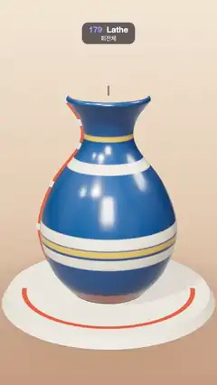

# 179 · Lathe · 회전체



**EN** A coral profile curve sweeps round a dashed axis on a potter's wheel and spins up a striped blue glazed vase, then a second arm sweeps it away.  
**KO** 산호색 단면 곡선이 물레 위 점선 축을 따라 한 바퀴 돌며 줄무늬 파란 유약 꽃병을 빚고, 뒤따르는 두 번째 팔이 다시 쓸어 지운다.

[Video (mp4)](https://sueun-dev.github.io/motion-effects/videos/179-lathe.mp4) · [Code](../effects/179-lathe.js) · Geometry & modeling · 지오메트리·모델링

## Prompt (English)

```text
Create a "Lathe" motion effect: a 2D profile curve (the outline of a vase) is spun round a vertical axis and sweeps a glazed vase into being on a potter's wheel; a second arm follows round the same way and sweeps it away again.

Look
- Background: a vertical gradient, #F4E6D4 at the top, #E6CDB2 at 55 %, #C99E7E at the bottom. A neutral room environment map (prefiltered) at 0.55 for reflections, ACES Filmic tone mapping.
- Potter's wheel: a cylinder, radius 1.75 at the top and 1.85 at the bottom, 0.16 tall, centred at y = −1.78; sides #E3D2BD, the top #EADBC8 with faint turning grooves (3 px rings every 26 px of a 512 px texture, brown at 13 %). Under it a soft contact shadow: a 5.2 × 5.2 plane with a radial gradient rgba(70, 40, 25, 0.45) → transparent.
- The profile (radius, height): a smooth spline through (0.62, −1.7), (0.98, −1.25), (1.16, −0.55), (0.92, 0.2), (0.46, 0.85), (0.44, 1.25), (0.68, 1.62), resampled to 151 points. The inner wall is that curve moved 0.07 inwards along its normal, a round lip of 11 points joins them at the top, and the profile closes on the axis at y = −1.7 (outside) and −1.62 (inside), so the vase has a real wall thickness.
- Glaze (a colour per profile point): outside deep blue #1D4F86 with cream #F3E7D0 bands at y = −0.8 (±0.09), −0.45 (±0.09) and 0.6 (±0.07), gold #E0A93B lines at y = −0.62 (±0.05) and 1.05 (±0.04), unglazed terracotta #C8784A below y = −1.45; inside a pale celadon #A9D1C2. Physical material, roughness 0.22, clearcoat 1 (roughness 0.12), double-sided.
- Both cut faces are capped with the closed cross-section (outer wall, lip, inner wall, axis) in terracotta #C8784A (roughness 0.85), so the wall reads as solid clay.
- The curve itself rides on each sweeping arm: a coral #FF5A36 tube (radius 0.03) along the outer wall, with white beads (radius 0.065) on the 7 spline keys.
- The axis of revolution: 13 dashes (radius 0.014, 0.16 long, one every 0.28 from y = −1.6), #5B3A2A at 55 %.
- A coral protractor arc on the wheel top (a ring from radius 1.42 to 1.5) covering exactly the angle that is swept at the moment.
- Lights: key #FFF1E0 at 2.6 from (−4, 8, 6) with soft shadows (2048 map), hemisphere #FFF4E8 / #8A5A3C at 0.6.
- Camera: perspective, fov 30°, on a circle of radius 11.5 at height 3.6, looking at (0, 0.05, 0); its angle is 0.2·sin(2π·t/5), a gentle drift round the wheel.

Motion (0–5 s)
- Work on a cycle clock u = (t + 1.2) mod 5, so the loop starts in the middle of the build.
- Leading arm angle = π/2 − 2π·easeInOutCubic((u − 0.3) / 1.8): the profile starts side-on (at the right, where its shape reads) and sweeps a full turn between u = 0.3 and 2.1, coming towards the camera first.
- Trailing arm angle = π/2 − 2π·easeInOutCubic((u − 2.95) / 1.75): between u = 2.95 and 4.7 a second arm follows round the same way and takes the surface away, so the loop ends where it began.
- The surface spans the angles from the leading to the trailing arm. When it is a full turn the caps hide and the vase is closed.
- The coral curve and beads fade out between u = 2.1 and 2.35 and back in between 2.7 and 2.95, so the finished vase stands alone for a moment.

Technique
- three.js LatheGeometry(profile, segments, phiStart, phiLength) rebuilt every frame: phiStart = leading angle, phiLength = trailing − leading (exactly 2π when whole), segments = ceil(180 · phiLength / 2π). A lathe point is (r·sin φ, y, r·cos φ), so the cap ShapeGeometry (drawn in the x = radius, y = height plane) is turned by φ − π/2 about y to sit on the cut, and the coral tube, built at φ = 0, is turned by φ.
- Vertex colours: the lathe repeats the profile once per segment, so vertex i takes the colour of profile point i mod (number of profile points).

Output and rules
- One self-contained HTML file with no external assets (three.js from a CDN is fine if you use it), drawing on a 1080 × 1920 canvas (9:16) scaled to fit the window.
- Write a function renderFrame(t) that draws the frame for time t in seconds, and preview it with requestAnimationFrame. Everything must be a pure function of t and fixed seeds: no Math.random(), Date or state carried between frames, so frame i = renderFrame(i / 30) can be exported to a 30 fps video.
- Loop seamlessly every 5 seconds: renderFrame(5) must look exactly like renderFrame(0).
- No flicker of any kind: no noise or grain that changes from frame to frame, no strobing or blinking, no z-fighting, no shimmering 1 px lines. Any grain or texture stays fixed to the screen or to the object.
- Keep the top 280 px free of important content (a title label goes there) and fill the whole frame with a designed background.
```

## 프롬프트 (한국어)

```text
"회전체(Lathe)" 모션 효과를 만들어 줘: 2D 단면 곡선(꽃병의 윤곽)을 세로축 둘레로 돌려 물레 위에 유약 바른 꽃병을 쓸어 만들고, 두 번째 팔이 같은 방향으로 뒤따라 돌며 다시 쓸어 지운다.

모양
- 배경: 세로 그라디언트, 위 #F4E6D4, 55 % #E6CDB2, 아래 #C99E7E. 반사용 중성 룸 환경맵(프리필터) 0.55, ACES Filmic 톤 매핑.
- 물레: 원기둥, 위 반지름 1.75·아래 1.85, 높이 0.16, 중심 y = −1.78. 옆면 #E3D2BD, 윗면 #EADBC8에 옅은 회전 홈(512px 텍스처에서 26px마다 3px 고리, 갈색 13 %). 아래에는 부드러운 접지 그림자: 5.2 × 5.2 평면에 rgba(70, 40, 25, 0.45) → 투명 방사형 그라디언트.
- 단면(반지름, 높이): (0.62, −1.7), (0.98, −1.25), (1.16, −0.55), (0.92, 0.2), (0.46, 0.85), (0.44, 1.25), (0.68, 1.62)을 지나는 부드러운 스플라인을 151점으로 다시 샘플링한다. 안쪽 벽은 그 곡선을 법선 방향으로 0.07 안으로 옮긴 것이고, 위에서 11점짜리 둥근 입술로 둘을 잇는다. 단면은 축 위 y = −1.7(바깥)과 −1.62(안)에서 닫혀서 꽃병에 실제 벽 두께가 생긴다.
- 유약(단면 점마다 색): 바깥은 짙은 파랑 #1D4F86에 크림 #F3E7D0 띠(y = −0.8 ±0.09, −0.45 ±0.09, 0.6 ±0.07), 금색 #E0A93B 선(y = −0.62 ±0.05, 1.05 ±0.04), y = −1.45 아래는 유약 없는 테라코타 #C8784A. 안쪽은 옅은 청자색 #A9D1C2. 물리 기반 재질, 거칠기 0.22, 클리어코트 1(거칠기 0.12), 양면.
- 잘린 두 면은 닫힌 단면(바깥 벽, 입술, 안쪽 벽, 축)으로 막고 테라코타 #C8784A(거칠기 0.85)로 칠해 벽이 단단한 흙으로 보이게 한다.
- 곡선 자체가 도는 팔마다 붙어 있다: 바깥 벽을 따라가는 산호색 #FF5A36 튜브(반지름 0.03), 스플라인 키 7곳에 흰 구슬(반지름 0.065).
- 회전축: 점선 13개(반지름 0.014, 길이 0.16, y = −1.6부터 0.28마다), #5B3A2A 55 %.
- 물레 윗면의 산호색 각도기 호(반지름 1.42~1.5 고리): 지금 쓸고 지나간 각도만큼만 그린다.
- 조명: 키 라이트 #FFF1E0 2.6, 위치 (−4, 8, 6), 부드러운 그림자(2048 맵). 반구광 #FFF4E8 / #8A5A3C 0.6.
- 카메라: 원근, 시야각 30°, 높이 3.6의 반지름 11.5 원 위에서 (0, 0.05, 0)을 본다. 각도는 0.2·sin(2π·t/5)로 물레 둘레를 살짝 오간다.

움직임 (0–5초)
- 주기 시계 u = (t + 1.2) mod 5를 쓴다. 그래서 루프가 빚는 도중에 시작한다.
- 앞 팔 각도 = π/2 − 2π·easeInOutCubic((u − 0.3) / 1.8): 단면이 옆모습(오른쪽, 모양이 잘 보이는 자리)에서 출발해 u = 0.3~2.1 동안 카메라 쪽으로 먼저 오며 한 바퀴 돈다.
- 뒤 팔 각도 = π/2 − 2π·easeInOutCubic((u − 2.95) / 1.75): u = 2.95~4.7 동안 두 번째 팔이 같은 방향으로 따라 돌며 표면을 거둬 가서, 루프가 시작과 같은 모습으로 끝난다.
- 표면은 앞 팔에서 뒤 팔까지의 각도를 덮는다. 한 바퀴를 다 덮으면 마개를 숨기고 꽃병이 닫힌다.
- 산호색 곡선과 구슬은 u = 2.1~2.35에 사라졌다가 2.7~2.95에 다시 나타나서, 완성된 꽃병이 잠시 혼자 서 있다.

기법
- three.js LatheGeometry(단면, 분할 수, phiStart, phiLength)를 매 프레임 다시 만든다: phiStart = 앞 팔 각도, phiLength = 뒤 − 앞(온전하면 정확히 2π), 분할 수 = ceil(180 · phiLength / 2π). 회전체 점은 (r·sin φ, y, r·cos φ)이므로, 마개 ShapeGeometry(x = 반지름, y = 높이 평면에 그림)는 y축으로 φ − π/2 돌려 잘린 면에 맞추고, φ = 0에서 만든 산호색 튜브는 φ만큼 돌린다.
- 꼭짓점 색: 회전체는 분할마다 단면을 한 번씩 되풀이하므로 꼭짓점 i는 단면 점 i mod (단면 점 수)의 색을 쓴다.

출력과 규칙
- 외부 파일 없는 HTML 파일 하나(three.js를 쓴다면 CDN은 괜찮다). 1080 × 1920(9:16) 캔버스에 그리고 창 크기에 맞춰 보이게 한다.
- 시간 t(초)의 프레임을 그리는 renderFrame(t) 함수를 만들고, 미리보기는 requestAnimationFrame으로 돌린다. 모든 것은 t와 고정 시드만으로 정해진다: Math.random(), Date, 프레임 사이에 쌓이는 상태 금지. 그래야 i번째 프레임 = renderFrame(i / 30)으로 30fps 영상을 뽑을 수 있다.
- 5초마다 끊김 없이 반복: renderFrame(5)는 renderFrame(0)과 똑같아 보여야 한다.
- 어떤 깜빡임도 금지: 프레임마다 바뀌는 노이즈·그레인, 번쩍임·깜빡임, z-fighting, 반짝이며 떨리는 1px 선 모두 금지. 그레인·질감은 화면이나 물체에 고정한다.
- 위쪽 280px에는 중요한 내용을 두지 않고(제목 라벨 자리), 화면 전체를 디자인된 배경으로 채운다.
```
