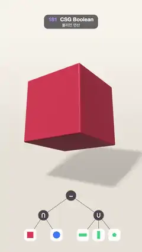

# 181 · CSG Boolean · 불리언 연산



**EN** A red cube is trimmed by a shrinking blue sphere and bored through by three green cylinders while the classic CSG tree lights up below, then it reopens.  
**KO** 빨간 정육면체를 줄어드는 파란 구가 깎고 초록 원기둥 셋이 차례로 뚫으며 아래의 CSG 트리가 불을 밝히고, 다시 원래 정육면체로 돌아간다.

[Video (mp4)](https://sueun-dev.github.io/motion-effects/videos/181-csg-boolean.mp4) · [Code](../effects/181-csg-boolean.js) · Geometry & modeling · 지오메트리·모델링

## Prompt (English)

```text
Create a "CSG Boolean" motion effect: the classic constructive solid geometry tree, (cube ∩ sphere) − (cylinder ∪ cylinder ∪ cylinder), built step by step on a turning object, each surface coloured by the operand it came from, with the tree drawn below and lighting up as each operation runs.

Look
- A full-screen fragment shader that raymarches signed distance fields, 2 × 2 supersampled per pixel, with a fixed per-pixel dither of ±0.5/255 against banding.
- The solid: a box of half-size 1 (corners rounded by 0.035), a sphere of radius R, and three infinite cylinders of radius r along x, y and z. Distance = max(max(box, sphere), max over the three of (r − distance to that axis)): intersection is a max, subtraction is the max with the negated distance.
- Colour each hit by the term that wins the max: the cube's faces red (0.91, 0.27, 0.31), the sphere's caps blue (0.22, 0.47, 1.0), the bores green (0.2, 0.78, 0.47).
- Shading: key light from (−0.5, 0.95, 0.45) with a raymarched soft shadow (k = 10), a fill from (0.8, 0.1, 0.6) at 0.3, ambient 0.24, one-probe ambient occlusion at 0.2, specular power 40 at 0.45 and a warm rim (power 3) at 0.18.
- The operands as see-through ghosts while they act: the sphere and three capped cylinders (half length 1.75), marched separately and tinted over the image with their colour, opacity ghost·(0.16 + 0.7·(1 − |n·d|)²), so their outlines glow.
- Floor at y = −2.05, warm grey (0.9, 0.87, 0.83), the object's soft shadow 22 % deep, fading into the background gradient (0.84, 0.81, 0.77) → (0.97, 0.95, 0.92) upwards.
- Camera: at (0, 1.3, 7.4), tilted down 0.17 rad, ray direction (uv·0.72, −2.4); the view is shifted so the object sits at about y = 860 px.
- The CSG tree drawn in 2D below: the "−" root at (540, 1490), "∩" at (330, 1640) and "∪" at (750, 1640) as dark circles (radius 40, white symbol 52 px) whose gold ring brightens while their operation runs; five leaves at y = 1790 as white rounded tiles (92 px): a red square (x 230), a blue circle (430), and green bars horizontal, vertical and a dot for the x, y and z cylinders (630, 750, 870), outlined in gold while their ghost shows. Grey edges join them.

Motion (0–5 s), all easing cubic ease-in-out
- The sphere radius goes from 1.8 (it does not touch the cube, whose corners are at √3 ≈ 1.73) to 1.36 between 0.35 and 1.1 s: its ghost shrinks into the cube and shaves the corners into blue caps.
- The bores open one by one, radius from −0.06 (no bore) to 0.56: x between 1.2 and 1.7 s, y 1.7–2.2 s, z 2.2–2.7 s.
- Hold the finished classic shape until 3.75 s; then everything reopens together (bores close, sphere grows away) by 4.6 s, all ghosts at 60 %, and the plain cube turns until 5 s.
- Each ghost fades in from 0.25 s before its step to 0.05 s after it starts, and out over the 0.25 s after the step ends.
- The object is tilted 0.5 rad about x and turns about y by 0.62 + (π/2)·t/5: a quarter turn per loop, a symmetry of the cube, so the loop is seamless.

Technique
- Signed distance functions combined with max / min (exact CSG in a raymarcher), central-difference normals, soft shadows by marching towards the light, the ghost layer as a second march to the operands' shells (stopping at the solid's depth).
- The animated values (R, three bore radii, ghost strengths, rotation) are computed in JavaScript per frame and passed as uniforms; the tree overlay is drawn with the 2D canvas from the same timeline.

Output and rules
- One self-contained HTML file with no external assets (three.js from a CDN is fine if you use it), drawing on a 1080 × 1920 canvas (9:16) scaled to fit the window.
- Write a function renderFrame(t) that draws the frame for time t in seconds, and preview it with requestAnimationFrame. Everything must be a pure function of t and fixed seeds: no Math.random(), Date or state carried between frames, so frame i = renderFrame(i / 30) can be exported to a 30 fps video.
- Loop seamlessly every 5 seconds: renderFrame(5) must look exactly like renderFrame(0).
- No flicker of any kind: no noise or grain that changes from frame to frame, no strobing or blinking, no z-fighting, no shimmering 1 px lines. Any grain or texture stays fixed to the screen or to the object.
- Keep the top 280 px free of important content (a title label goes there) and fill the whole frame with a designed background.
```

## 프롬프트 (한국어)

```text
"CSG 불리언 연산" 모션 효과를 만들어 줘: 고전적인 구성 입체 기하(CSG) 트리 (정육면체 ∩ 구) − (원기둥 ∪ 원기둥 ∪ 원기둥)을 도는 물체 위에서 한 단계씩 만든다. 각 면은 그 면을 만든 피연산자의 색을 띠고, 아래에 트리를 그려 연산이 진행될 때마다 해당 노드가 빛난다.

모양
- 부호 거리장(SDF)을 레이마칭하는 전체 화면 프래그먼트 셰이더, 픽셀마다 2 × 2 슈퍼샘플링, 밴딩을 막는 고정 픽셀 디더 ±0.5/255.
- 입체: 반 크기 1인 상자(모서리 0.035 둥글림), 반지름 R인 구, x·y·z축을 따라가는 반지름 r의 무한 원기둥 셋. 거리 = max(max(상자, 구), 세 원기둥의 (r − 축까지 거리) 중 최대): 교집합은 max, 빼기는 부호를 뒤집은 거리와의 max.
- 표면 색은 max에서 이긴 항으로 정한다: 정육면체 면은 빨강 (0.91, 0.27, 0.31), 구가 깎은 면은 파랑 (0.22, 0.47, 1.0), 뚫린 구멍은 초록 (0.2, 0.78, 0.47).
- 셰이딩: (−0.5, 0.95, 0.45) 방향 키 라이트와 레이마칭 소프트 그림자(k = 10), (0.8, 0.1, 0.6) 방향 보조광 0.3, 앰비언트 0.24, 탐침 하나짜리 앰비언트 오클루전 0.2, 스페큘러 지수 40·0.45, 따뜻한 림(지수 3) 0.18.
- 작동 중인 피연산자는 반투명 유령으로 보인다: 구와 뚜껑 있는 원기둥 셋(반 길이 1.75)을 따로 마칭해서 제 색으로 화면 위에 칠하고, 불투명도는 유령 세기·(0.16 + 0.7·(1 − |n·d|)²)라 윤곽이 빛난다.
- 바닥 y = −2.05, 따뜻한 회색 (0.9, 0.87, 0.83), 물체의 부드러운 그림자 22 %, 위로 갈수록 배경 그라디언트 (0.84, 0.81, 0.77) → (0.97, 0.95, 0.92)로 녹아든다.
- 카메라: (0, 1.3, 7.4)에서 0.17라디안 아래로 기울임, 광선 방향 (uv·0.72, −2.4). 화면을 옮겨 물체가 대략 y = 860px에 오게 한다.
- 아래쪽 2D CSG 트리: 루트 "−"는 (540, 1490), "∩"는 (330, 1640), "∪"는 (750, 1640)에 어두운 원(반지름 40, 흰 기호 52px)으로, 그 연산이 진행되는 동안 금색 테두리가 밝아진다. 잎 다섯은 y = 1790에 흰 둥근 타일(92px): 빨간 사각형(x 230), 파란 원(430), x·y·z 원기둥을 뜻하는 초록 가로 막대·세로 막대·점(630, 750, 870). 유령이 보이는 동안 금색 테두리를 두른다. 회색 선으로 잇는다.

움직임 (0–5초), 모든 이징은 큐빅 ease-in-out
- 구 반지름이 0.35~1.1초 동안 1.8(모서리가 √3 ≈ 1.73인 정육면체에 닿지 않음)에서 1.36으로 줄어든다: 유령 구가 정육면체 속으로 줄어들며 모서리를 파란 둥근 면으로 깎는다.
- 구멍이 하나씩 열린다, 반지름 −0.06(구멍 없음)에서 0.56: x는 1.2~1.7초, y는 1.7~2.2초, z는 2.2~2.7초.
- 완성된 고전 모양을 3.75초까지 유지하고, 4.6초까지 모두 함께 되돌린다(구멍이 닫히고 구가 다시 커진다, 유령은 모두 60 %). 5초까지 평범한 정육면체가 돈다.
- 각 유령은 자기 단계 시작 0.25초 전부터 시작 0.05초 뒤까지 나타나고, 단계가 끝난 뒤 0.25초 동안 사라진다.
- 물체는 x축으로 0.5라디안 기울어 있고 y축으로 0.62 + (π/2)·t/5만큼 돈다: 루프마다 4분의 1바퀴, 정육면체의 대칭이라 이음매가 없다.

기법
- max / min으로 합친 부호 거리 함수(레이마처 안의 정확한 CSG), 중심 차분 법선, 빛 쪽으로 마칭하는 소프트 그림자, 피연산자 껍질까지 두 번째로 마칭하는 유령 층(입체의 깊이에서 멈춤).
- 움직이는 값(R, 구멍 반지름 셋, 유령 세기, 회전)은 매 프레임 JavaScript에서 계산해 유니폼으로 넘기고, 트리는 같은 타임라인으로 2D 캔버스에 그린다.

출력과 규칙
- 외부 파일 없는 HTML 파일 하나(three.js를 쓴다면 CDN은 괜찮다). 1080 × 1920(9:16) 캔버스에 그리고 창 크기에 맞춰 보이게 한다.
- 시간 t(초)의 프레임을 그리는 renderFrame(t) 함수를 만들고, 미리보기는 requestAnimationFrame으로 돌린다. 모든 것은 t와 고정 시드만으로 정해진다: Math.random(), Date, 프레임 사이에 쌓이는 상태 금지. 그래야 i번째 프레임 = renderFrame(i / 30)으로 30fps 영상을 뽑을 수 있다.
- 5초마다 끊김 없이 반복: renderFrame(5)는 renderFrame(0)과 똑같아 보여야 한다.
- 어떤 깜빡임도 금지: 프레임마다 바뀌는 노이즈·그레인, 번쩍임·깜빡임, z-fighting, 반짝이며 떨리는 1px 선 모두 금지. 그레인·질감은 화면이나 물체에 고정한다.
- 위쪽 280px에는 중요한 내용을 두지 않고(제목 라벨 자리), 화면 전체를 디자인된 배경으로 채운다.
```
