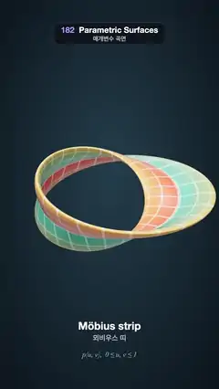

# 182 · Parametric Surfaces · 매개변수 곡면



**EN** A gridded ribbon morphs from a Möbius strip into a figure-8 Klein bottle and then a knotted Klein tube on a trefoil, its parameter lines drifting along it.  
**KO** 격자 무늬 띠가 뫼비우스 띠에서 8자 클라인 병으로, 다시 세잎매듭 위의 클라인 관으로 변하고, 매개변수 선이 표면을 따라 흘러간다.

[Video (mp4)](https://sueun-dev.github.io/motion-effects/videos/182-parametric-surfaces.mp4) · [Code](../effects/182-parametric-surfaces.js) · Geometry & modeling · 지오메트리·모델링

## Prompt (English)

```text
Create a "Parametric Surfaces" motion effect: three surfaces p(u, v) on one (u, v) grid — a Möbius strip, a figure-8 Klein bottle and a Klein tube tied in a trefoil knot — morph into one another by blending their points, with the iso-parameter lines drawn on the surface and its name shown below.

Look
- Background: a radial gradient, #213A4A near the centre to #0A121A at the edges. A neutral room environment map at 0.5, ACES Filmic tone mapping, a key light #FFF4E6 at 2.2 from (−3, 6, 5), a hemisphere light #BFE6FF / #1A1020 at 0.5.
- One recipe for all three surfaces, u and v from 0 to 1: a cross-section f(v) = (a·sin 2πv, b·sin 4πv) (a figure-8), turned by the angle πu (half a turn per lap), carried round a closed path C(2πu) in its frame (N, B): p(u, v) = C + N·x' + B·y'. Because of the half turn, p(u + 1, v) = p(u, 1 − v) for all three, so they all join their u = 0 and u = 1 edges the same way and a blend between them never tears.
  - Möbius strip: a circle of radius 1.55 (N radial, B = the z axis), a = 0.78, b = 0.07 (the figure-8 squashed flat into a band).
  - Klein bottle (the figure-8 immersion): a circle of radius 1.45, a = b = 0.62.
  - Trefoil Klein tube: the trefoil (sin s + 2 sin 2s, cos s − 2 cos 2s, −sin 3s) × 0.62, a = b = 0.3, with a rotation-minimising frame that is closed up.
- Mesh: 300 × 90 quads. Normals come from the partial derivatives of the blended surface (central differences, step 0.001), so the shading has no seam where the edges meet.
- Texture (2048 × 1024): a vertical gradient that depends only on |v − 1/2| — #F2553F at the edges, #FFB23E at 25 % and 75 %, #17B3AE in the middle — with white 55 % iso-parameter lines 10 px wide: 24 lines along u, 12 across v. Physical material, roughness 0.35, clearcoat 0.6 (roughness 0.25), double-sided.
- Below: the surface's name in white (52 px) at y = 1610 and in Korean (36 px, 75 %) at y = 1672, cross-fading as it morphs (뫼비우스 띠 / 클라인 병 / 세잎매듭 클라인 관), and "p(u, v),  0 ≤ u, v ≤ 1" in an italic serif (34 px, pale cyan at 70 %) at y = 1752.
- Camera: perspective, fov 30°, at (0, 0, 16) looking at the origin.

Motion (0–5 s), a = 2π · t / 5, easing cubic ease-in-out
- Möbius strip → Klein bottle between 0.85 and 1.6 s, Klein bottle → trefoil tube between 2.5 and 3.25 s, trefoil tube → Möbius strip between 4.1 and 4.85 s; each shape holds in between.
- The parameter lines drift: vertex i of the u direction takes the parameter u = i/300 − (2/24)·t/5 while its texture coordinate stays i/300, so the lines slide two cells along the surface per loop (and the grid looks the same again at 5 s).
- The surface rocks: rotation (x, y, z) = (−0.95 + 0.12·sin a, 0.35·sin a, 0.2·cos a).

Technique
- Evaluate the two surfaces being blended at every grid point each frame (position = mix(A, B, w)), and the partial derivatives by central differences of that blend; normal = ∂p/∂u × ∂p/∂v.
- The trefoil's frame: rotation-minimising frame sampled at 2400 points by double reflection, the leftover twist spread back along the lap so it closes.

Output and rules
- One self-contained HTML file with no external assets (three.js from a CDN is fine if you use it), drawing on a 1080 × 1920 canvas (9:16) scaled to fit the window.
- Write a function renderFrame(t) that draws the frame for time t in seconds, and preview it with requestAnimationFrame. Everything must be a pure function of t and fixed seeds: no Math.random(), Date or state carried between frames, so frame i = renderFrame(i / 30) can be exported to a 30 fps video.
- Loop seamlessly every 5 seconds: renderFrame(5) must look exactly like renderFrame(0).
- No flicker of any kind: no noise or grain that changes from frame to frame, no strobing or blinking, no z-fighting, no shimmering 1 px lines. Any grain or texture stays fixed to the screen or to the object.
- Keep the top 280 px free of important content (a title label goes there) and fill the whole frame with a designed background.
```

## 프롬프트 (한국어)

```text
"매개변수 곡면" 모션 효과를 만들어 줘: 하나의 (u, v) 격자 위의 세 곡면 p(u, v) — 뫼비우스 띠, 8자 클라인 병, 세잎매듭으로 묶인 클라인 관 — 이 점을 섞으며 서로 바뀐다. 표면에는 매개변수 선(등매개변수선)을 그리고, 아래에 곡면 이름을 보여 준다.

모양
- 배경: 방사형 그라디언트, 가운데 #213A4A에서 가장자리 #0A121A. 중성 룸 환경맵 0.5, ACES Filmic 톤 매핑, 키 라이트 #FFF4E6 2.2 위치 (−3, 6, 5), 반구광 #BFE6FF / #1A1020 0.5.
- 세 곡면 모두 같은 방법, u와 v는 0~1: 단면 f(v) = (a·sin 2πv, b·sin 4πv)(8자 모양)를 각도 πu만큼 돌려(한 바퀴에 반 바퀴) 닫힌 경로 C(2πu)를 따라 그 프레임 (N, B)로 옮긴다: p(u, v) = C + N·x' + B·y'. 반 바퀴 비틀림 때문에 세 곡면 모두 p(u + 1, v) = p(u, 1 − v)라서 u = 0과 u = 1 가장자리가 같은 방식으로 붙고, 둘을 섞어도 찢어지지 않는다.
  - 뫼비우스 띠: 반지름 1.55 원(N은 반지름 방향, B는 z축), a = 0.78, b = 0.07(8자를 납작하게 눌러 띠가 된다).
  - 클라인 병(8자 몰입): 반지름 1.45 원, a = b = 0.62.
  - 세잎매듭 클라인 관: 세잎매듭 (sin s + 2 sin 2s, cos s − 2 cos 2s, −sin 3s) × 0.62, a = b = 0.3, 닫힌 회전 최소 프레임 사용.
- 메시: 300 × 90 사각면. 법선은 섞인 곡면의 편미분(중심 차분, 간격 0.001)으로 구해서 가장자리가 만나는 곳에도 셰이딩 이음매가 없다.
- 텍스처(2048 × 1024): |v − 1/2|에만 따르는 세로 그라디언트 — 가장자리 #F2553F, 25 %·75 % #FFB23E, 가운데 #17B3AE — 위에 흰 55 % 매개변수 선 10px: u 방향 24개, v 방향 12개. 물리 기반 재질, 거칠기 0.35, 클리어코트 0.6(거칠기 0.25), 양면.
- 아래: 곡면 이름을 y = 1610에 흰색 영문(52px)으로, y = 1672에 한글(36px, 75 %)로, 모양이 바뀔 때 교차 페이드(Möbius strip / Klein bottle / Trefoil Klein tube, 뫼비우스 띠 / 클라인 병 / 세잎매듭 클라인 관). y = 1752에 이탤릭 세리프로 "p(u, v),  0 ≤ u, v ≤ 1"(34px, 70 % 연한 청록).
- 카메라: 원근, 시야각 30°, (0, 0, 16)에서 원점을 본다.

움직임 (0–5초), a = 2π · t / 5, 이징은 큐빅 ease-in-out
- 뫼비우스 띠 → 클라인 병 0.85~1.6초, 클라인 병 → 세잎매듭 관 2.5~3.25초, 세잎매듭 관 → 뫼비우스 띠 4.1~4.85초. 그 사이에는 모양이 머문다.
- 매개변수 선이 흐른다: u 방향 꼭짓점 i는 매개변수 u = i/300 − (2/24)·t/5를 쓰고 텍스처 좌표는 i/300 그대로라서, 선이 루프마다 두 칸씩 표면을 따라 미끄러진다(5초에 격자가 다시 같아진다).
- 곡면이 흔들린다: 회전 (x, y, z) = (−0.95 + 0.12·sin a, 0.35·sin a, 0.2·cos a).

기법
- 매 프레임 섞이는 두 곡면을 격자 점마다 계산하고(위치 = mix(A, B, w)), 그 섞인 함수의 중심 차분으로 편미분을 구한다. 법선 = ∂p/∂u × ∂p/∂v.
- 세잎매듭의 프레임: 2400점에서 이중 반사로 만든 회전 최소 프레임, 남는 비틀림을 바퀴 전체에 나눠 되돌려 닫는다.

출력과 규칙
- 외부 파일 없는 HTML 파일 하나(three.js를 쓴다면 CDN은 괜찮다). 1080 × 1920(9:16) 캔버스에 그리고 창 크기에 맞춰 보이게 한다.
- 시간 t(초)의 프레임을 그리는 renderFrame(t) 함수를 만들고, 미리보기는 requestAnimationFrame으로 돌린다. 모든 것은 t와 고정 시드만으로 정해진다: Math.random(), Date, 프레임 사이에 쌓이는 상태 금지. 그래야 i번째 프레임 = renderFrame(i / 30)으로 30fps 영상을 뽑을 수 있다.
- 5초마다 끊김 없이 반복: renderFrame(5)는 renderFrame(0)과 똑같아 보여야 한다.
- 어떤 깜빡임도 금지: 프레임마다 바뀌는 노이즈·그레인, 번쩍임·깜빡임, z-fighting, 반짝이며 떨리는 1px 선 모두 금지. 그레인·질감은 화면이나 물체에 고정한다.
- 위쪽 280px에는 중요한 내용을 두지 않고(제목 라벨 자리), 화면 전체를 디자인된 배경으로 채운다.
```
