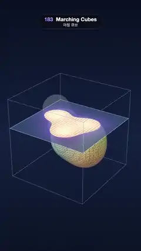

# 183 · Marching Cubes · 마칭 큐브



**EN** Six coloured metaballs are polygonised on a 32³ grid while a scan plane marches up the box, showing the field slice, its sample points and the faceted mesh.  
**KO** 색이 다른 메타볼 여섯 개가 32³ 격자에서 삼각형 메시로 바뀌고, 스캔 평면이 상자를 타고 오르며 필드 단면과 샘플 점, 각진 메시를 보여 준다.

[Video (mp4)](https://sueun-dev.github.io/motion-effects/videos/183-marching-cubes.mp4) · [Code](../effects/183-marching-cubes.js) · Geometry & modeling · 지오메트리·모델링

## Prompt (English)

```text
Create a "Marching Cubes" motion effect: six metaballs make a scalar field on a 32 × 32 × 32 grid, marching cubes turns it into a faceted triangle mesh, and a scan plane marches up through the box showing the 2D slice of the field the cubes work on.

Look
- Background: a vertical gradient #0A1022 → #14213F (55 %) → #0B1326. A neutral room environment map at 0.45, ACES Filmic tone mapping, key light #FFF3E8 at 2.4 from (−4, 7, 5), hemisphere #BFD4FF / #20182E at 0.5.
- The field: three.js MarchingCubes at resolution 32, isolation 80, six balls of strength 2.6 and subtract 12 (each adds max(0, 2.6 / d² − 12), d in box units 0–1), the mesh scaled ×2 so the box is [−2, 2]³.
- Ball k (k = 0..5, p = 1.7k), box units: x = 0.5 + 0.25·sin(a + p) + 0.05·cos(2a + 2p), y = 0.5 + 0.24·cos(±a + 1.3p) (the sign alternates with k), z = 0.5 + 0.25·sin(a + 0.7p + 1)·cos(a − p).
- Colours #FF6B6B, #FFC145, #2EC4B6, #8E7DFF, #FF7EDB, #9BE564: every mesh vertex mixes them with weights 1/d⁴ to each ball, so each lobe keeps its own hue and they blend where they merge.
- The mesh: flat shaded (standard material, roughness 0.55) with its triangle edges darkened to 68 % (a barycentric attribute and fwidth), so the triangle soup is visible.
- A clipping plane at height h: below it the solid mesh, and its inside (back faces) seen through the cut drawn flat #FFD9B0; above it the same mesh as a faint ghost (#C3CCFF, 28 % opacity, no depth write).
- The scan plane (4 × 4, at height h) shows the field on that slice with the same formula: v = field / 80; outside (v < 1) navy (0.05, 0.1, 0.25) → indigo (0.25, 0.2, 0.75) at 72 % opacity; inside (v ≥ 1) orange (1, 0.45, 0.25) → cream (1, 0.9, 0.55) at 92 %; a white anti-aliased contour where v = 1 (width 1.6·fwidth); the 32 × 32 grid sample points as cream dots, only inside the surface; a pale border.
- The box: its 12 edges as fat lines #7F95D6, 3 px, 45 % opacity.
- Camera: perspective, fov 30°, on a circle of radius 19.5 at height 10.3, angle 0.6 + 0.12·sin a, looking at (0, 0.45, 0).

Motion (0–5 s), a = 2π · t / 5
- The balls loop on their paths (whole-number frequencies), merging and splitting.
- Cycle clock u = (t + 1.8) mod 5 (the loop starts mid-march). Plane height h = −2 + 4.32·(easeInOutCubic((u − 0.2) / 3) − easeInOutCubic((u − 3.85) / 1.05)): it marches from the floor of the box to just above the top in 3 s (building the mesh slice by slice), the full mesh holds, then the plane sinks back down in 1.05 s.
- The plane fades out when it is above the box (over the last 0.12).

Technique
- Every frame: reset the field, add the six balls, polygonise (MarchingCubes.update), recolour the vertices, then draw the same geometry three times (solid below the plane, back faces below the plane, ghost above it) with material clipping planes y < h and y > h.
- The scan plane is a ShaderMaterial that evaluates the six-ball field per pixel, so its contour lines up exactly with the cut edge of the mesh.

Output and rules
- One self-contained HTML file with no external assets (three.js from a CDN is fine if you use it), drawing on a 1080 × 1920 canvas (9:16) scaled to fit the window.
- Write a function renderFrame(t) that draws the frame for time t in seconds, and preview it with requestAnimationFrame. Everything must be a pure function of t and fixed seeds: no Math.random(), Date or state carried between frames, so frame i = renderFrame(i / 30) can be exported to a 30 fps video.
- Loop seamlessly every 5 seconds: renderFrame(5) must look exactly like renderFrame(0).
- No flicker of any kind: no noise or grain that changes from frame to frame, no strobing or blinking, no z-fighting, no shimmering 1 px lines. Any grain or texture stays fixed to the screen or to the object.
- Keep the top 280 px free of important content (a title label goes there) and fill the whole frame with a designed background.
```

## 프롬프트 (한국어)

```text
"마칭 큐브" 모션 효과를 만들어 줘: 메타볼 여섯 개가 32 × 32 × 32 격자 위에 스칼라 필드를 만들고, 마칭 큐브가 이를 각진 삼각형 메시로 바꾼다. 스캔 평면이 상자 속을 타고 올라가며 큐브들이 다루는 필드의 2D 단면을 보여 준다.

모양
- 배경: 세로 그라디언트 #0A1022 → #14213F(55 %) → #0B1326. 중성 룸 환경맵 0.45, ACES Filmic 톤 매핑, 키 라이트 #FFF3E8 2.4 위치 (−4, 7, 5), 반구광 #BFD4FF / #20182E 0.5.
- 필드: three.js MarchingCubes, 해상도 32, 등값 80, 세기 2.6·빼기 12인 공 여섯 개(각각 max(0, 2.6 / d² − 12)를 더함, d는 0~1 상자 단위). 메시를 ×2 해서 상자는 [−2, 2]³.
- 공 k(k = 0..5, p = 1.7k), 상자 단위: x = 0.5 + 0.25·sin(a + p) + 0.05·cos(2a + 2p), y = 0.5 + 0.24·cos(±a + 1.3p)(k마다 부호가 바뀜), z = 0.5 + 0.25·sin(a + 0.7p + 1)·cos(a − p).
- 색 #FF6B6B, #FFC145, #2EC4B6, #8E7DFF, #FF7EDB, #9BE564: 메시 꼭짓점마다 각 공까지 거리의 1/d⁴ 가중치로 섞어서, 덩어리마다 제 색을 지키고 합쳐지는 곳에서 섞인다.
- 메시: 평면 셰이딩(표준 재질, 거칠기 0.55), 삼각형 모서리를 68 %로 어둡게(무게중심 좌표 속성과 fwidth) 해서 삼각형들이 보인다.
- 높이 h의 클리핑 평면: 그 아래는 단단한 메시, 잘린 곳으로 보이는 안쪽 면(뒷면)은 #FFD9B0 단색. 그 위는 같은 메시를 흐린 유령(#C3CCFF, 불투명도 28 %, 깊이 쓰기 없음)으로.
- 스캔 평면(4 × 4, 높이 h)은 같은 식으로 그 단면의 필드를 보여 준다: v = 필드 / 80. 바깥(v < 1)은 남색 (0.05, 0.1, 0.25) → 쪽빛 (0.25, 0.2, 0.75), 불투명도 72 %. 안(v ≥ 1)은 주황 (1, 0.45, 0.25) → 크림 (1, 0.9, 0.55), 92 %. v = 1에 흰 안티에일리어싱 등고선(폭 1.6·fwidth). 32 × 32 격자 샘플 점을 크림색 점으로, 표면 안쪽에만. 옅은 테두리.
- 상자: 모서리 12개를 굵은 선 #7F95D6, 3px, 불투명도 45 %.
- 카메라: 원근, 시야각 30°, 높이 10.3의 반지름 19.5 원 위, 각도 0.6 + 0.12·sin a, (0, 0.45, 0)을 본다.

움직임 (0–5초), a = 2π · t / 5
- 공들이 정수 주파수 궤도를 돌며 합쳐졌다 갈라진다.
- 주기 시계 u = (t + 1.8) mod 5(루프가 행진 도중에 시작). 평면 높이 h = −2 + 4.32·(easeInOutCubic((u − 0.2) / 3) − easeInOutCubic((u − 3.85) / 1.05)): 3초 동안 상자 바닥에서 꼭대기 바로 위까지 올라가며 메시를 한 층씩 쌓고, 완성된 메시가 머문 뒤, 1.05초 동안 평면이 다시 내려간다.
- 평면이 상자 위로 나가면 마지막 0.12 구간에서 사라진다.

기법
- 매 프레임: 필드를 지우고 공 여섯 개를 더하고 다각형화(MarchingCubes.update)한 뒤 꼭짓점 색을 다시 칠하고, 같은 지오메트리를 재질 클리핑 평면 y < h, y > h로 세 번 그린다(평면 아래 단단한 면, 평면 아래 뒷면, 평면 위 유령).
- 스캔 평면은 픽셀마다 여섯 공의 필드를 계산하는 ShaderMaterial이라, 등고선이 메시의 잘린 가장자리와 정확히 맞는다.

출력과 규칙
- 외부 파일 없는 HTML 파일 하나(three.js를 쓴다면 CDN은 괜찮다). 1080 × 1920(9:16) 캔버스에 그리고 창 크기에 맞춰 보이게 한다.
- 시간 t(초)의 프레임을 그리는 renderFrame(t) 함수를 만들고, 미리보기는 requestAnimationFrame으로 돌린다. 모든 것은 t와 고정 시드만으로 정해진다: Math.random(), Date, 프레임 사이에 쌓이는 상태 금지. 그래야 i번째 프레임 = renderFrame(i / 30)으로 30fps 영상을 뽑을 수 있다.
- 5초마다 끊김 없이 반복: renderFrame(5)는 renderFrame(0)과 똑같아 보여야 한다.
- 어떤 깜빡임도 금지: 프레임마다 바뀌는 노이즈·그레인, 번쩍임·깜빡임, z-fighting, 반짝이며 떨리는 1px 선 모두 금지. 그레인·질감은 화면이나 물체에 고정한다.
- 위쪽 280px에는 중요한 내용을 두지 않고(제목 라벨 자리), 화면 전체를 디자인된 배경으로 채운다.
```
