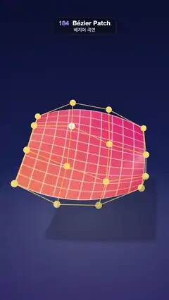

# 184 · Bézier Patch · 베지어 곡면



**EN** A coral bicubic Bézier sheet follows its gold 4 × 4 control net as the net ripples and each inner control point is lifted in turn, casting a soft shadow.  
**KO** 산호색 바이큐빅 베지어 곡면이 금색 4 × 4 조정망을 따라 움직인다. 조정망이 물결치고 안쪽 조정점이 하나씩 들어 올려지며 곡면이 부드러운 그림자를 드리운다.

[Video (mp4)](https://sueun-dev.github.io/motion-effects/videos/184-bezier-patch.mp4) · [Code](../effects/184-bezier-patch.js) · Geometry & modeling · 지오메트리·모델링

## Prompt (English)

```text
Create a "Bézier Patch" motion effect: one bicubic Bézier surface evaluated from a 4 × 4 control net; the net ripples, and each of its four inner control points is lifted in turn (highlighted, with a drop line to the floor), so the smooth surface is seen following its control points.

Look
- Background: a vertical gradient #0B1030 (top) → #1A2458 (60 %) → #2C2A62. A neutral room environment map at 0.35, ACES Filmic tone mapping, hemisphere light #B9C6FF / #2A1E40 at 0.7.
- Control points P_ij (i, j = 0..3) over a 3.5 × 3.5 square: x and z from −1.75 to 1.75 in thirds, plus a little sideways wobble x += 0.15·sin(a + j), z += 0.15·cos(a + i); height y = 0.55·sin(a + 1.3i + 0.9j) + 0.3·cos(2a − 1.1j), plus the lift below.
- The surface: an 81 × 81 grid, B(u, v) = Σ Bi(u)·Bj(v)·P_ij with the cubic Bernstein polynomials (1 − u)³, 3u(1 − u)², 3u²(1 − u), u³; normal = ∂B/∂v × ∂B/∂u from their derivatives (exact, no finite differences).
- Material: front a diagonal gradient #F25C3B → #C8205E with 11 × 11 isoparametric lines (u, v = k/10, 10 px of a 1024 texture, cream at 42 %); back side a separate mesh with #1FA6B0 → #2B4FD8 and the same lines. Physical, roughness 0.38, clearcoat 0.8 (roughness 0.2).
- The control net, drawn on top of everything: 24 segments as gold #FFC94A fat lines 4.5 px (90 %) and 16 beads (radius 0.1, #FFD873). The lifted point's bead turns white and grows (×1 + 0.45k), with a white ring (radius 0.2–0.225, scale 0.6 + 0.8k, opacity k) facing the camera and a dashed white drop line (3 px, dash 0.14, gap 0.1, opacity 0.8k) down to the floor.
- Floor at y = −2.6: a soft blue pool (9 × 9 plane, radial rgba(120, 140, 255, 0.28) → transparent) and the sheet's soft shadow (VSM shadow map, radius 22, 24 samples, shadow opacity 22 %) from a sun #FFF0E0 at 2.2 from (−2, 9, 3).
- Camera: perspective, fov 32°, on a circle of radius 13.8 at height 8.0, angle 0.12 + 0.2·sin a, looking at (0, 0.05, 0).

Motion (0–5 s), a = 2π · t / 5
- The ripple runs all the time (the sines above).
- The lift: the inner points (1, 1), (1, 2), (2, 2), (2, 1) take turns, one every 1.25 s; inside its window (local time τ from 0 to 1.25 s) the point rises by 2.3·sin²(π·(τ − 0.1) / 1.05) (0 before 0.1 s and after 1.15 s), so it lifts and settles smoothly and the surface swells after it.
- At 5 s the first point's turn begins again, so the loop is seamless.

Technique
- three.js: positions and normals of the grid are recomputed from the 16 control points every frame (Bernstein weights and their derivatives); the net is LineSegments2, the drop line a dashed LineSegments2.
- The front mesh writes both sides into the shadow map (shadowSide double), since the sheet is open.

Output and rules
- One self-contained HTML file with no external assets (three.js from a CDN is fine if you use it), drawing on a 1080 × 1920 canvas (9:16) scaled to fit the window.
- Write a function renderFrame(t) that draws the frame for time t in seconds, and preview it with requestAnimationFrame. Everything must be a pure function of t and fixed seeds: no Math.random(), Date or state carried between frames, so frame i = renderFrame(i / 30) can be exported to a 30 fps video.
- Loop seamlessly every 5 seconds: renderFrame(5) must look exactly like renderFrame(0).
- No flicker of any kind: no noise or grain that changes from frame to frame, no strobing or blinking, no z-fighting, no shimmering 1 px lines. Any grain or texture stays fixed to the screen or to the object.
- Keep the top 280 px free of important content (a title label goes there) and fill the whole frame with a designed background.
```

## 프롬프트 (한국어)

```text
"베지어 곡면" 모션 효과를 만들어 줘: 4 × 4 조정망으로 계산한 바이큐빅 베지어 곡면 하나. 조정망이 물결치고 안쪽 조정점 네 개가 차례로 들어 올려져서(강조 표시, 바닥까지 점선), 매끈한 곡면이 조정점을 따라가는 모습이 보인다.

모양
- 배경: 세로 그라디언트 #0B1030(위) → #1A2458(60 %) → #2C2A62. 중성 룸 환경맵 0.35, ACES Filmic 톤 매핑, 반구광 #B9C6FF / #2A1E40 0.7.
- 조정점 P_ij(i, j = 0..3)는 3.5 × 3.5 정사각형 위: x와 z는 −1.75~1.75를 3등분, 옆으로 살짝 흔들림 x += 0.15·sin(a + j), z += 0.15·cos(a + i). 높이 y = 0.55·sin(a + 1.3i + 0.9j) + 0.3·cos(2a − 1.1j)에 아래의 들어 올림을 더한다.
- 곡면: 81 × 81 격자, B(u, v) = Σ Bi(u)·Bj(v)·P_ij, 큐빅 베른슈타인 다항식 (1 − u)³, 3u(1 − u)², 3u²(1 − u), u³. 법선 = 그 도함수로 구한 ∂B/∂v × ∂B/∂u(정확한 값, 유한 차분 아님).
- 재질: 앞면은 대각 그라디언트 #F25C3B → #C8205E 위에 11 × 11 등매개변수선(u, v = k/10, 1024 텍스처에서 10px, 크림색 42 %). 뒷면은 따로 메시를 두고 #1FA6B0 → #2B4FD8에 같은 선. 물리 기반, 거칠기 0.38, 클리어코트 0.8(거칠기 0.2).
- 조정망은 모든 것 위에 그린다: 선분 24개를 금색 #FFC94A 4.5px 굵은 선(90 %)으로, 구슬 16개(반지름 0.1, #FFD873). 들어 올려지는 점의 구슬은 하얘지고 커지며(×1 + 0.45k), 카메라를 보는 흰 고리(반지름 0.2~0.225, 크기 0.6 + 0.8k, 불투명도 k)와 바닥까지 흰 점선(3px, 대시 0.14, 간격 0.1, 불투명도 0.8k)이 붙는다.
- 바닥 y = −2.6: 부드러운 파란 빛 웅덩이(9 × 9 평면, 방사형 rgba(120, 140, 255, 0.28) → 투명)와 곡면의 부드러운 그림자(VSM 그림자 맵, 반지름 22, 샘플 24, 그림자 불투명도 22 %), 햇빛 #FFF0E0 2.2 위치 (−2, 9, 3).
- 카메라: 원근, 시야각 32°, 높이 8.0의 반지름 13.8 원 위, 각도 0.12 + 0.2·sin a, (0, 0.05, 0)을 본다.

움직임 (0–5초), a = 2π · t / 5
- 물결은 계속 움직인다(위의 사인들).
- 들어 올림: 안쪽 점 (1, 1), (1, 2), (2, 2), (2, 1)이 1.25초마다 차례로. 자기 구간 안(지역 시간 τ = 0~1.25초)에서 2.3·sin²(π·(τ − 0.1) / 1.05)만큼 올라간다(0.1초 전과 1.15초 뒤에는 0). 그래서 매끄럽게 올라갔다 내려앉고 곡면이 그 뒤를 따라 부푼다.
- 5초에 첫 점의 차례가 다시 시작되어 이음매가 없다.

기법
- three.js: 격자의 위치와 법선을 매 프레임 16개 조정점으로부터 다시 계산한다(베른슈타인 가중치와 그 도함수). 조정망은 LineSegments2, 바닥 점선은 점선 LineSegments2.
- 곡면이 열린 판이므로 앞면 메시가 그림자 맵에 양면을 모두 쓴다(shadowSide 양면).

출력과 규칙
- 외부 파일 없는 HTML 파일 하나(three.js를 쓴다면 CDN은 괜찮다). 1080 × 1920(9:16) 캔버스에 그리고 창 크기에 맞춰 보이게 한다.
- 시간 t(초)의 프레임을 그리는 renderFrame(t) 함수를 만들고, 미리보기는 requestAnimationFrame으로 돌린다. 모든 것은 t와 고정 시드만으로 정해진다: Math.random(), Date, 프레임 사이에 쌓이는 상태 금지. 그래야 i번째 프레임 = renderFrame(i / 30)으로 30fps 영상을 뽑을 수 있다.
- 5초마다 끊김 없이 반복: renderFrame(5)는 renderFrame(0)과 똑같아 보여야 한다.
- 어떤 깜빡임도 금지: 프레임마다 바뀌는 노이즈·그레인, 번쩍임·깜빡임, z-fighting, 반짝이며 떨리는 1px 선 모두 금지. 그레인·질감은 화면이나 물체에 고정한다.
- 위쪽 280px에는 중요한 내용을 두지 않고(제목 라벨 자리), 화면 전체를 디자인된 배경으로 채운다.
```
