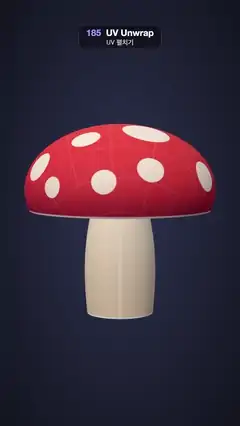

# 185 · UV Unwrap · UV 펼치기



**EN** A smiling spotted mushroom turns to face us, then its cap, gills and stem peel apart and lie flat as UV islands on their texture atlas before folding back.  
**KO** 웃는 점박이 버섯이 돌아서 정면을 보고, 갓·주름·대가 떨어져 나와 텍스처 아틀라스 위 UV 섬으로 평평하게 펼쳐졌다가 다시 접혀 돌아간다.

[Video (mp4)](https://sueun-dev.github.io/motion-effects/videos/185-uv-unwrap.mp4) · [Code](../effects/185-uv-unwrap.js) · Geometry & modeling · 지오메트리·모델링

## Prompt (English)

```text
Create a "UV Unwrap" motion effect: a textured 3D mushroom made of three parts (cap, gills, stem) that share one texture atlas. Every vertex has two places, its 3D position and its (u, v) in the atlas; blending between them lays the parts flat as UV islands on the UV square, over a faint copy of the texture they sample, and folds them back.

Look
- Background: a radial gradient #2E3350 (centre) → #10121C. Lights: hemisphere #FFFFFF / #5A4A6A at 1.6 and a key #FFF1E2 at 1.6 from (−3, 5, 6). Standard material with the atlas, roughness 0.75, double-sided.
- The atlas (1024 × 1024, v up):
  - background #272B3D;
  - cap island: a disc at (0.30, 0.70), radius 0.25, red radial gradient #FF5A4F → #E83A3F (75 %) → #B9233A, with 16 cream #FFF6EC spots of radius 0.016–0.036 that never touch (seeded placement, at least 0.022 apart);
  - gills island: a ring at (0.76, 0.71), radius 0.19 outside and 0.055 inside, cream #F4E3C8 with 48 brown radial lines (3 px, 55 %);
  - stem island: a strip u 0.07–0.93, v 0.07–0.38, cream gradient #E9D6B8 (bottom) → #FFF4E2 (top), with a face in its middle at 60 % of its height: two dark #3A2A2A oval eyes, a small smile and pink cheeks;
  - a 16 × 16 check grid in white at 13 % over everything, and white outlines round each island.
- The model, each island a grid of (a, b) with a 3D point and a uv:
  - cap dome (40 × 96): angle θ = 1.9·a, radius ρ = 1.6·sin θ, height 0.55 + 1.1·cos θ, point (ρ sin 2πb, y, ρ cos 2πb); uv = centre + 0.25·a·(sin 2πb, −cos 2πb) (its front edge goes to the bottom of the disc, as if tipped towards us);
  - gills (16 × 96): from the cap's rim in to radius 0.42, rising 0.26; uv ring from radius 0.19 to 0.055 with the front edge at the top (as if flipped up from below);
  - stem (30 × 96): radius 0.56 − 0.14a + 0.1·sin πa, height −1.55 → 0.5, cut down the back (b = 0 at the back, the face at b = 0.5 in front), point (−ρ sin 2πb, y, −ρ cos 2πb); uv = the strip.
- Flat place of a vertex: x = (u − 0.5)·3.5, y = (v − 0.5)·3.5 + 0.15, z = 0, facing the camera.
- Behind the flat islands (z = −0.02): the atlas again with a 120 px margin, a white border round the unit square and the labels 0, 1, u, v, at up to 32 % opacity, so each island lands on the part of the texture it samples.
- Camera: perspective, fov 30°, at (0, 1.35, 13.4) looking at (0, 0.15, 0).

Motion (0–5 s), sine(k) = sin(k·π/2)
- Turn of the 3D model about y: 2π·(0.5 + 0.5·sine((t − 0) / 1.0) + 0.5·(1 − sine(1 − (t − 4.0) / 1.0))), each term clamped: half a turn into the front pose in the first second, still while flat, half a turn on in the last second (the model is round, so a half turn plus a half turn lands on the start).
- Unwrap: island k (cap 0, gills 1, stem 2) blends with f = easeInOutCubic((t − 1.1 − 0.15k) / 0.8) − easeInOutCubic((t − 3.2 + 0.15k) / 0.8): out one after another from 1.1 s, flat by about 2.2 s, back in the reverse order from 2.9 s, home by 4.0 s.
- Each vertex = mix(3D point turned, flat place, f), with a bow towards the camera of lift·sin(πf) (cap 0.9, gills 0.5, stem 0) so the islands do not pass through each other; normals recomputed every frame.
- The backdrop fades in 1.6–2.2 s and out 2.9–3.4 s.

Technique
- three.js: three indexed grid geometries that keep their 3D points and uvs in arrays and write blended positions each frame (computeVertexNormals after). The texture is a canvas drawn once; the islands sample it through their uvs in both states, so the artwork rides along unchanged.

Output and rules
- One self-contained HTML file with no external assets (three.js from a CDN is fine if you use it), drawing on a 1080 × 1920 canvas (9:16) scaled to fit the window.
- Write a function renderFrame(t) that draws the frame for time t in seconds, and preview it with requestAnimationFrame. Everything must be a pure function of t and fixed seeds: no Math.random(), Date or state carried between frames, so frame i = renderFrame(i / 30) can be exported to a 30 fps video.
- Loop seamlessly every 5 seconds: renderFrame(5) must look exactly like renderFrame(0).
- No flicker of any kind: no noise or grain that changes from frame to frame, no strobing or blinking, no z-fighting, no shimmering 1 px lines. Any grain or texture stays fixed to the screen or to the object.
- Keep the top 280 px free of important content (a title label goes there) and fill the whole frame with a designed background.
```

## 프롬프트 (한국어)

```text
"UV 펼치기" 모션 효과를 만들어 줘: 세 부분(갓, 주름, 대)으로 된 텍스처 입힌 3D 버섯이 하나의 텍스처 아틀라스를 함께 쓴다. 꼭짓점마다 두 자리, 즉 3D 위치와 아틀라스 속 (u, v)가 있고, 그 사이를 섞으면 부분들이 UV 정사각형 위에 UV 섬으로 평평하게 놓였다가(아래에 자기가 쓰는 텍스처가 흐리게 깔린다) 다시 접혀 돌아간다.

모양
- 배경: 방사형 그라디언트 #2E3350(가운데) → #10121C. 조명: 반구광 #FFFFFF / #5A4A6A 1.6, 키 라이트 #FFF1E2 1.6 위치 (−3, 5, 6). 아틀라스를 입힌 표준 재질, 거칠기 0.75, 양면.
- 아틀라스(1024 × 1024, v는 위로):
  - 바탕 #272B3D;
  - 갓 섬: (0.30, 0.70)에 반지름 0.25 원, 빨강 방사형 그라디언트 #FF5A4F → #E83A3F(75 %) → #B9233A, 크림색 #FFF6EC 점 16개(반지름 0.016~0.036, 시드로 배치, 서로 0.022 이상 떨어져 닿지 않음);
  - 주름 섬: (0.76, 0.71)에 바깥 반지름 0.19·안 반지름 0.055 고리, 크림 #F4E3C8에 갈색 방사선 48개(3px, 55 %);
  - 대 섬: u 0.07~0.93, v 0.07~0.38 띠, 크림 그라디언트 #E9D6B8(아래) → #FFF4E2(위), 가운데 높이 60 % 자리에 얼굴: 짙은 #3A2A2A 타원 눈 둘, 작은 미소, 분홍 볼;
  - 전체 위에 흰 13 % 16 × 16 격자, 섬마다 흰 테두리.
- 모델, 섬마다 (a, b) 격자에 3D 점과 uv:
  - 갓 돔(40 × 96): 각도 θ = 1.9·a, 반지름 ρ = 1.6·sin θ, 높이 0.55 + 1.1·cos θ, 점 (ρ sin 2πb, y, ρ cos 2πb). uv = 중심 + 0.25·a·(sin 2πb, −cos 2πb)(앞쪽 가장자리가 원의 아래로 가서 우리 쪽으로 기울인 것처럼);
  - 주름(16 × 96): 갓 가장자리에서 반지름 0.42까지 안쪽으로, 0.26 올라감. uv는 반지름 0.19에서 0.055까지의 고리, 앞쪽 가장자리가 위(아래에서 뒤집어 올린 것처럼);
  - 대(30 × 96): 반지름 0.56 − 0.14a + 0.1·sin πa, 높이 −1.55 → 0.5, 뒤쪽을 따라 잘림(b = 0이 뒤, 얼굴은 앞쪽 b = 0.5), 점 (−ρ sin 2πb, y, −ρ cos 2πb). uv = 띠.
- 꼭짓점의 평평한 자리: x = (u − 0.5)·3.5, y = (v − 0.5)·3.5 + 0.15, z = 0, 카메라를 향함.
- 평평한 섬 뒤(z = −0.02): 120px 여백을 둔 아틀라스를 한 번 더, 단위 정사각형 흰 테두리와 0, 1, u, v 표시까지, 최대 불투명도 32 %. 그래서 섬마다 자기가 샘플링하는 텍스처 자리 위에 내려앉는다.
- 카메라: 원근, 시야각 30°, (0, 1.35, 13.4)에서 (0, 0.15, 0)을 본다.

움직임 (0–5초), sine(k) = sin(k·π/2)
- 3D 모델의 y축 회전: 2π·(0.5 + 0.5·sine(t / 1.0) + 0.5·(1 − sine(1 − (t − 4.0) / 1.0))), 각 항은 0~1로 자름: 처음 1초에 반 바퀴 돌아 정면 자세가 되고, 펼쳐진 동안은 멈추고, 마지막 1초에 반 바퀴 더 돈다(모델이 둥글어서 반 바퀴 + 반 바퀴가 시작과 맞물린다).
- 펼치기: 섬 k(갓 0, 주름 1, 대 2)의 섞임 f = easeInOutCubic((t − 1.1 − 0.15k) / 0.8) − easeInOutCubic((t − 3.2 + 0.15k) / 0.8): 1.1초부터 차례로 나와 약 2.2초에 평평해지고, 2.9초부터 반대 순서로 돌아가 4.0초에 제자리.
- 꼭짓점 = mix(돌린 3D 점, 평평한 자리, f)에 카메라 쪽으로 휘는 lift·sin(πf)(갓 0.9, 주름 0.5, 대 0)를 더해 섬끼리 뚫고 지나가지 않게 한다. 법선은 매 프레임 다시 계산.
- 뒤 배경판은 1.6~2.2초에 나타나고 2.9~3.4초에 사라진다.

기법
- three.js: 3D 점과 uv를 배열로 가진 인덱스 격자 지오메트리 셋에 매 프레임 섞은 위치를 쓴다(그 뒤 computeVertexNormals). 텍스처는 한 번 그린 캔버스이고, 섬들은 두 상태 모두 uv로 같은 텍스처를 읽어서 그림이 그대로 따라간다.

출력과 규칙
- 외부 파일 없는 HTML 파일 하나(three.js를 쓴다면 CDN은 괜찮다). 1080 × 1920(9:16) 캔버스에 그리고 창 크기에 맞춰 보이게 한다.
- 시간 t(초)의 프레임을 그리는 renderFrame(t) 함수를 만들고, 미리보기는 requestAnimationFrame으로 돌린다. 모든 것은 t와 고정 시드만으로 정해진다: Math.random(), Date, 프레임 사이에 쌓이는 상태 금지. 그래야 i번째 프레임 = renderFrame(i / 30)으로 30fps 영상을 뽑을 수 있다.
- 5초마다 끊김 없이 반복: renderFrame(5)는 renderFrame(0)과 똑같아 보여야 한다.
- 어떤 깜빡임도 금지: 프레임마다 바뀌는 노이즈·그레인, 번쩍임·깜빡임, z-fighting, 반짝이며 떨리는 1px 선 모두 금지. 그레인·질감은 화면이나 물체에 고정한다.
- 위쪽 280px에는 중요한 내용을 두지 않고(제목 라벨 자리), 화면 전체를 디자인된 배경으로 채운다.
```
