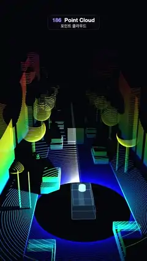

# 186 · Point Cloud · 포인트 클라우드



**EN** A spinning LiDAR on a car roof scans a night street; rings of height-coloured points flash white as the beam sweeps past, then dim until the next turn.  
**KO** 자동차 지붕의 회전 라이다가 밤거리를 스캔한다. 높이별로 물든 점의 고리들이 빔이 지날 때 하얗게 번쩍이고 다음 바퀴까지 서서히 어두워진다.

[Video (mp4)](https://sueun-dev.github.io/motion-effects/videos/186-point-cloud.mp4) · [Code](../effects/186-point-cloud.js) · Geometry & modeling · 지오메트리·모델링

## Prompt (English)

```text
Create a "Point Cloud" motion effect: a LiDAR scan of a street, made only of coloured points. A spinning sensor on a car roof is simulated by casting rays at a simple street scene; every hit becomes a point. The beam sweeps round, each point flares as it is scanned and fades until the next pass.

Look
- Background #04060B (near black).
- The street (all seeded, seed 186), simple solids: the road plane y = 0; pavements as boxes 0.18 high at |x| = 4.2–7.2; buildings on both sides starting at |x| = 7.6–9.1 and 7 deep, each 6–15 long and 5–18 high with gaps of 1.5–5.5 between them, half of them with a smaller box on the roof; trees every 9–12 along |x| = 5.6 (trunk: cylinder radius 0.18, crown: sphere radius 1.3–1.7 just above it); lamp posts (radius 0.09, 5.5 high) at |x| = 4.6; parked cars (a body box and a cabin box) at |x| = 3; five people (a cylinder 1.45 high and a head sphere); a car behind us and a van ahead in the middle of the road.
- The sensor at (0, 2, 0): 96 channels from −25° to +20° elevation, spaced −25 + 45·(k / 95)^1.25 so they are denser low down, and 3000 azimuth steps (a = 0 looks along −z). Each ray is cast analytically against the plane, boxes (slab test), spheres and upright cylinders, from 1.6 m out to 70 m. About 200,000 points: on the road they form the classic concentric rings, and there are empty scan shadows behind every obstacle.
- Colour by height: #2246FF at 0 m, #14C7FF at 0.25, #1EE68C at 1.5, #D8F23A at 4, #FFA62B at 8, #FF4A6E at 13, #D25BFF at 19 (linear blend between stops).
- Points: additive blending, round soft sprites (smoothstep falloff), size clamp(190 / depth, 2.3, 4.5) px.
- Our car: a see-through box pair (body 1.9 × 0.75 × 4.4, cabin 1.7 × 0.6 × 2.4) filled #4FA8FF at 16 % (additive) with #9FE8FF edges at 80 %, and a glowing sensor puck #BFFBFF on the roof.
- A faint beam on the road: a 0.5 × 60 strip from the sensor along the current azimuth, #7FF6FF at 12 %, additive.
- Camera: perspective, fov 62°, still, at (−1.2, 12, 17) looking at (0, −1.5, −30): behind and above our car, looking down the street, the façades rising on both sides.

Motion (0–5 s)
- The sensor turns twice per loop: scan = 2·2π·t/5.
- Per point: age = fract((scan − its azimuth) / 2π) (0 = the beam just passed). glow = 0.3 + 0.7·e^(−2.2·age), flash = e^(−40·age); colour = mix(height colour · glow, white, 0.75·flash) · (0.7 + 0.3·flash). So a white front sweeps round and leaves a fading trail; the whole cloud stays faintly visible.
- The beam strip turns with the scan.

Technique
- Ray casting runs once in setup in JavaScript (no GPU): nearest hit of each ray against all solids. The points are one THREE.Points with position, colour and azimuth attributes, and a small ShaderMaterial computes the flash and fade from a uniform scan angle, so a frame costs nothing but the draw.

Output and rules
- One self-contained HTML file with no external assets (three.js from a CDN is fine if you use it), drawing on a 1080 × 1920 canvas (9:16) scaled to fit the window.
- Write a function renderFrame(t) that draws the frame for time t in seconds, and preview it with requestAnimationFrame. Everything must be a pure function of t and fixed seeds: no Math.random(), Date or state carried between frames, so frame i = renderFrame(i / 30) can be exported to a 30 fps video.
- Loop seamlessly every 5 seconds: renderFrame(5) must look exactly like renderFrame(0).
- No flicker of any kind: no noise or grain that changes from frame to frame, no strobing or blinking, no z-fighting, no shimmering 1 px lines. Any grain or texture stays fixed to the screen or to the object.
- Keep the top 280 px free of important content (a title label goes there) and fill the whole frame with a designed background.
```

## 프롬프트 (한국어)

```text
"포인트 클라우드" 모션 효과를 만들어 줘: 색 점만으로 된 거리의 라이다 스캔. 자동차 지붕에서 도는 센서를 간단한 거리 장면에 광선을 쏘는 방식으로 흉내 내고, 맞은 곳마다 점이 하나 생긴다. 빔이 빙 돌면 점이 스캔될 때 번쩍이고 다음 바퀴까지 서서히 어두워진다.

모양
- 배경 #04060B(거의 검정).
- 거리(전부 시드 186), 간단한 입체들: 도로 평면 y = 0. 보도는 |x| = 4.2~7.2에 높이 0.18인 상자. 양쪽 건물은 |x| = 7.6~9.1에서 시작해 깊이 7, 길이 6~15, 높이 5~18, 건물 사이 1.5~5.5 간격, 절반은 지붕에 작은 상자. 나무는 |x| = 5.6을 따라 9~12마다(줄기: 반지름 0.18 원기둥, 수관: 그 위의 반지름 1.3~1.7 구). 가로등(반지름 0.09, 높이 5.5)은 |x| = 4.6. 주차된 차(차체 상자 + 객실 상자)는 |x| = 3. 사람 다섯(높이 1.45 원기둥 + 머리 구). 도로 가운데 뒤쪽 차 한 대와 앞쪽 승합차 한 대.
- 센서 위치 (0, 2, 0): 고도 −25°~+20°의 채널 96개(−25 + 45·(k / 95)^1.25로 아래쪽이 더 촘촘), 방위각 3000단계(a = 0은 −z 방향). 광선마다 평면, 상자(슬랩 검사), 구, 세운 원기둥과 해석적으로 교차시키고, 1.6m부터 70m까지만 본다. 점은 약 20만 개: 도로에는 전형적인 동심원 고리가 생기고 장애물 뒤에는 빈 스캔 그림자가 남는다.
- 높이별 색: 0m #2246FF, 0.25 #14C7FF, 1.5 #1EE68C, 4 #D8F23A, 8 #FFA62B, 13 #FF4A6E, 19 #D25BFF(사이는 선형 보간).
- 점: 가산 혼합, 둥글고 부드러운 스프라이트(smoothstep 감쇠), 크기 clamp(190 / 깊이, 2.3, 4.5)px.
- 우리 차: 비쳐 보이는 상자 둘(차체 1.9 × 0.75 × 4.4, 객실 1.7 × 0.6 × 2.4), #4FA8FF 16 % 채움(가산), #9FE8FF 80 % 모서리, 지붕에 빛나는 센서 #BFFBFF.
- 도로 위 흐린 빔: 센서에서 지금 방위각 방향으로 0.5 × 60 띠, #7FF6FF 12 %, 가산.
- 카메라: 원근, 시야각 62°, 고정, (−1.2, 12, 17)에서 (0, −1.5, −30)을 본다: 우리 차 뒤 위에서 거리를 내려다보고, 양쪽으로 건물 벽이 솟아 있다.

움직임 (0–5초)
- 센서는 루프마다 두 바퀴: scan = 2·2π·t/5.
- 점마다: age = fract((scan − 그 점의 방위각) / 2π)(0 = 빔이 막 지나감). glow = 0.3 + 0.7·e^(−2.2·age), flash = e^(−40·age). 색 = mix(높이 색 · glow, 흰색, 0.75·flash) · (0.7 + 0.3·flash). 그래서 흰 앞머리가 빙 돌며 서서히 식는 꼬리를 남기고, 구름 전체는 늘 희미하게 보인다.
- 빔 띠가 스캔과 함께 돈다.

기법
- 광선 투사는 설정 단계에서 JavaScript로 한 번만(GPU 없이): 광선마다 모든 입체와의 가장 가까운 교점. 점들은 위치·색·방위각 속성을 가진 THREE.Points 하나이고, 작은 ShaderMaterial이 유니폼 스캔 각도로 번쩍임과 감쇠를 계산하므로 프레임마다 드는 일은 그리기뿐이다.

출력과 규칙
- 외부 파일 없는 HTML 파일 하나(three.js를 쓴다면 CDN은 괜찮다). 1080 × 1920(9:16) 캔버스에 그리고 창 크기에 맞춰 보이게 한다.
- 시간 t(초)의 프레임을 그리는 renderFrame(t) 함수를 만들고, 미리보기는 requestAnimationFrame으로 돌린다. 모든 것은 t와 고정 시드만으로 정해진다: Math.random(), Date, 프레임 사이에 쌓이는 상태 금지. 그래야 i번째 프레임 = renderFrame(i / 30)으로 30fps 영상을 뽑을 수 있다.
- 5초마다 끊김 없이 반복: renderFrame(5)는 renderFrame(0)과 똑같아 보여야 한다.
- 어떤 깜빡임도 금지: 프레임마다 바뀌는 노이즈·그레인, 번쩍임·깜빡임, z-fighting, 반짝이며 떨리는 1px 선 모두 금지. 그레인·질감은 화면이나 물체에 고정한다.
- 위쪽 280px에는 중요한 내용을 두지 않고(제목 라벨 자리), 화면 전체를 디자인된 배경으로 채운다.
```
