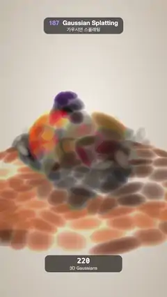

# 187 · Gaussian Splatting · 가우시안 스플래팅



**EN** A fruit bowl made only of 3D Gaussians sharpens from about 220 soft coloured blobs into about 33,000 crisp surface splats, then melts back as the view sways.  
**KO** 3D 가우시안만으로 만든 과일 그릇이 약 220개의 흐릿한 색 덩어리에서 3만 3천여 개의 선명한 표면 스플랫으로 또렷해졌다가, 흔들리는 시점 속에서 다시 녹아내린다.

[Video (mp4)](https://sueun-dev.github.io/motion-effects/videos/187-gaussian-splatting.mp4) · [Code](../effects/187-gaussian-splatting.js) · Geometry & modeling · 지오메트리·모델링

## Prompt (English)

```text
Create a "Gaussian Splatting" motion effect: a still life (wooden board, blue bowl, orange, apple, lemon, grapes) stored only as 3D Gaussians — position, 3 × 3 covariance, colour with the lighting baked in, opacity — projected to 2D ellipses, sorted and alpha-blended every frame. It starts as a couple of hundred big blobs that split into finer ones and sharpen into a crisp capture, the way training refines a scan, then melts back.

Look
- Background: a radial gradient #F2ECE3 (centre, a little high) → #BDB2A4.
- The scene (y up): a wooden board, a disc of radius 2.5 with its top at y = 0, grain blending #C89464 → #9A6640 along sin(5x + 2.5·sin 1.3z), its edge #7A4A28; a bowl, a spherical shell of radius 1.4 ± 0.05 centred at (0, 1.45, 0), cut at the rim y = 1.0: outside #2D5BAE darkening to #1B3A78 underneath with cream #F3ECDD bands at y = 0.78 (±0.06) and 0.6 (±0.025), inside #EFE7DA, rim #F7F1E6; an orange (centre (−0.45, 0.97, 0.25), radius 0.55, #F08A1C with a faint #F5A640 dimple pattern); an apple ((0.5, 0.95, 0.22), radius 0.5, #C61F37 blushing to #E2C24A on one side); a lemon (an ellipsoid with radii 0.46, 0.3, 0.3 at (0.05, 1.02, −0.52), turned 0.5 rad, #F4D23C); 13 grapes (radius 0.14–0.16, #5A2370 → #8E4BA8) heaped on top (seed 187).
- Sharp splats: 640 surface samples per unit area (Fibonacci points on spheres, a golden-angle spiral on the disc), dropped if buried inside another solid, about 33,000 in all. Each is a flat disc in the surface: covariance = σt²(t tᵀ + b bᵀ) + σn²·n nᵀ with σt = 0.8 / √640 ≈ 0.032 and σn = 0.004, opacity 0.95. Splats at the bowl's rim and the board's edge are squeezed in their up-down axis so nothing sticks out.
- Baked light per splat: sun from (−0.6, 1, 0.55) with a soft shadow marched through the scene's signed distance field (26 steps, k = 7), sky term (0.32 + 0.14·n.y) × ambient occlusion (3 probes along the normal), diffuse 0.95, a small white sheen.
- Coarse levels: pick 220 and 2,600 seeds at random among the splats (seed 5); every splat joins its nearest seed. A group's Gaussian is the moment-matched fit of its members (mean position; covariance = average of (Σi + d dᵀ)), swollen ×2.0 at the coarsest level and ×1.4 at the middle one, with the average colour. Every member takes its group's Gaussian with opacity 1 − (1 − 0.85)^(1/n) (coarsest) or 1 − (1 − 0.9)^(1/n), so n stacked copies look like one blob.
- A read-out under the scene: a dark rounded panel (500 × 110 at y = 1650, rgba(40, 34, 30, 0.72)) with the number of distinct Gaussians in a mono font (46 px) and "3D Gaussians" (28 px).
- Camera: perspective, fov 30°, on a circle of radius 10.4, height 4.9 + 0.3·cos a, angle 0.25 + 0.32·sin a, looking at (0, 0.75, 0).

Motion (0–5 s), a = 2π · t / 5, easing cubic ease-in-out
- level(t) = e((t − 0.4) / 0.95) + e((t − 1.35) / 0.95) − e((t − 3.3) / 0.78) − e((t − 4.08) / 0.78): blobs (0) → middle (1) at 1.35 s → sharp (2) at 2.3 s, hold, back to the middle at 4.08 s and to blobs at 4.86 s. Every step eases in and out, so no splat changes direction while it moves.
- Each splat's position, covariance, colour and opacity blend linearly between the two neighbouring levels; the read-out counts 220 → about 2,500 → about 33,000 (blended on a log scale).
- The camera sways gently (see above).

Technique
- One instanced quad (corners ±3σ) per splat. The vertex shader takes the camera-space covariance W Σ Wᵀ and the projection Jacobian rows j1 = (f / −z, 0, f·x / z²), j2 = (0, f / −z, f·y / z²) (f = 960 / tan 15°) to get the 2D covariance in pixels (plus 0.3 px² so nothing gets thinner than a pixel), and its eigenvectors / eigenvalues give the ellipse axes. The fragment shader outputs exp(−½ r²) · opacity, premultiplied, discarding below 1/90.
- Each frame, sort the splats by camera depth far to near in JavaScript and write the instance buffers in that order; blend ONE, ONE_MINUS_SRC_ALPHA with depth test off.

Output and rules
- One self-contained HTML file with no external assets (three.js from a CDN is fine if you use it), drawing on a 1080 × 1920 canvas (9:16) scaled to fit the window.
- Write a function renderFrame(t) that draws the frame for time t in seconds, and preview it with requestAnimationFrame. Everything must be a pure function of t and fixed seeds: no Math.random(), Date or state carried between frames, so frame i = renderFrame(i / 30) can be exported to a 30 fps video.
- Loop seamlessly every 5 seconds: renderFrame(5) must look exactly like renderFrame(0).
- No flicker of any kind: no noise or grain that changes from frame to frame, no strobing or blinking, no z-fighting, no shimmering 1 px lines. Any grain or texture stays fixed to the screen or to the object.
- Keep the top 280 px free of important content (a title label goes there) and fill the whole frame with a designed background.
```

## 프롬프트 (한국어)

```text
"가우시안 스플래팅" 모션 효과를 만들어 줘: 정물(나무 받침, 파란 그릇, 오렌지, 사과, 레몬, 포도)을 오직 3D 가우시안 — 위치, 3 × 3 공분산, 조명이 구워진 색, 불투명도 — 으로만 저장하고, 매 프레임 2D 타원으로 투영해 정렬하고 알파 블렌딩한다. 처음엔 큰 덩어리 수백 개였다가 더 작은 것들로 쪼개지며 선명한 캡처로 또렷해지고(학습이 스캔을 다듬듯), 다시 녹아내린다.

모양
- 배경: 방사형 그라디언트 #F2ECE3(가운데, 조금 위) → #BDB2A4.
- 장면(y가 위): 나무 받침은 윗면이 y = 0인 반지름 2.5 원판, 나뭇결 #C89464 → #9A6640(sin(5x + 2.5·sin 1.3z)을 따라), 옆 테두리 #7A4A28. 그릇은 (0, 1.45, 0) 중심 반지름 1.4 ± 0.05 구 껍질을 테두리 y = 1.0에서 자른 것: 바깥 #2D5BAE(아래로 갈수록 #1B3A78), 크림 #F3ECDD 띠 y = 0.78(±0.06)과 0.6(±0.025), 안쪽 #EFE7DA, 테두리 #F7F1E6. 오렌지(중심 (−0.45, 0.97, 0.25), 반지름 0.55, #F08A1C에 옅은 #F5A640 무늬). 사과((0.5, 0.95, 0.22), 반지름 0.5, #C61F37이 한쪽에서 #E2C24A로). 레몬((0.05, 1.02, −0.52)의 반지름 0.46, 0.3, 0.3 타원체, 0.5라디안 돌림, #F4D23C). 위에 쌓인 포도 13알(반지름 0.14~0.16, #5A2370 → #8E4BA8, 시드 187).
- 선명한 스플랫: 단위 넓이당 640개의 표면 샘플(구는 피보나치 점, 원판은 황금각 나선), 다른 입체 속에 묻힌 것은 버리고 모두 약 33,000개. 각각 표면에 놓인 납작한 원반: 공분산 = σt²(t tᵀ + b bᵀ) + σn²·n nᵀ, σt = 0.8 / √640 ≈ 0.032, σn = 0.004, 불투명도 0.95. 그릇 테두리와 받침 가장자리의 스플랫은 위아래 축만 눌러서 튀어나오지 않게 한다.
- 스플랫마다 구운 빛: (−0.6, 1, 0.55) 방향 햇빛과 장면의 부호 거리장을 따라 마칭한 부드러운 그림자(26단계, k = 7), 하늘 항 (0.32 + 0.14·n.y) × 앰비언트 오클루전(법선 방향 탐침 3개), 디퓨즈 0.95, 작은 흰 광택.
- 거친 단계: 스플랫 중에서 무작위로 씨앗 220개와 2,600개를 고르고(시드 5), 모든 스플랫이 가장 가까운 씨앗에 모인다. 무리의 가우시안은 구성원의 모멘트 맞춤(평균 위치, 공분산 = (Σi + d dᵀ)의 평균)이고, 가장 거친 단계는 ×2.0, 중간은 ×1.4로 부풀리며 색은 평균. 구성원은 모두 무리의 가우시안을 받고 불투명도는 1 − (1 − 0.85)^(1/n)(가장 거친 단계) 또는 1 − (1 − 0.9)^(1/n)이라, n개가 겹치면 덩어리 하나로 보인다.
- 장면 아래 표시: 어두운 둥근 판(500 × 110, y = 1650, rgba(40, 34, 30, 0.72))에 지금 서로 다른 가우시안 수를 고정폭 글꼴(46px)로, 그 아래 "3D Gaussians"(28px).
- 카메라: 원근, 시야각 30°, 반지름 10.4 원 위, 높이 4.9 + 0.3·cos a, 각도 0.25 + 0.32·sin a, (0, 0.75, 0)을 본다.

움직임 (0–5초), a = 2π · t / 5, 이징은 큐빅 ease-in-out
- level(t) = e((t − 0.4) / 0.95) + e((t − 1.35) / 0.95) − e((t − 3.3) / 0.78) − e((t − 4.08) / 0.78): 덩어리(0) → 1.35초에 중간(1) → 2.3초에 선명(2), 머문 뒤 4.08초에 중간, 4.86초에 덩어리로. 단계마다 천천히 시작해 천천히 멈추므로 움직이는 도중 방향을 트는 스플랫이 없다.
- 스플랫마다 위치·공분산·색·불투명도를 이웃한 두 단계 사이에서 선형으로 섞는다. 표시 숫자는 220 → 약 2,500 → 약 33,000(로그 눈금으로 섞음).
- 카메라가 부드럽게 흔들린다(위 참고).

기법
- 스플랫마다 인스턴스 사각형 하나(모서리 ±3σ). 버텍스 셰이더는 카메라 공간 공분산 W Σ Wᵀ와 투영 야코비안의 행 j1 = (f / −z, 0, f·x / z²), j2 = (0, f / −z, f·y / z²)(f = 960 / tan 15°)로 픽셀 단위 2D 공분산을 구하고(픽셀보다 얇아지지 않게 0.3 px²를 더함), 그 고유벡터·고윳값으로 타원 축을 정한다. 프래그먼트 셰이더는 exp(−½ r²) · 불투명도를 미리 곱한 알파로 내보내고 1/90 아래는 버린다.
- 매 프레임 JavaScript에서 카메라 깊이로 먼 것부터 가까운 것 순으로 정렬해 그 순서대로 인스턴스 버퍼에 쓰고, ONE, ONE_MINUS_SRC_ALPHA로 블렌딩, 깊이 테스트는 끈다.

출력과 규칙
- 외부 파일 없는 HTML 파일 하나(three.js를 쓴다면 CDN은 괜찮다). 1080 × 1920(9:16) 캔버스에 그리고 창 크기에 맞춰 보이게 한다.
- 시간 t(초)의 프레임을 그리는 renderFrame(t) 함수를 만들고, 미리보기는 requestAnimationFrame으로 돌린다. 모든 것은 t와 고정 시드만으로 정해진다: Math.random(), Date, 프레임 사이에 쌓이는 상태 금지. 그래야 i번째 프레임 = renderFrame(i / 30)으로 30fps 영상을 뽑을 수 있다.
- 5초마다 끊김 없이 반복: renderFrame(5)는 renderFrame(0)과 똑같아 보여야 한다.
- 어떤 깜빡임도 금지: 프레임마다 바뀌는 노이즈·그레인, 번쩍임·깜빡임, z-fighting, 반짝이며 떨리는 1px 선 모두 금지. 그레인·질감은 화면이나 물체에 고정한다.
- 위쪽 280px에는 중요한 내용을 두지 않고(제목 라벨 자리), 화면 전체를 디자인된 배경으로 채운다.
```
