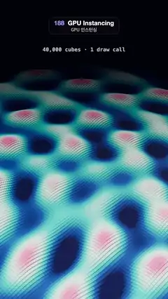

# 188 · GPU Instancing · GPU 인스턴싱



**EN** A diamond field of 40,000 cubes, all one instanced draw call, rises and falls in interfering ripples, tinted from deep navy through teal to pink crests.  
**KO** 4만 개의 큐브를 한 번의 인스턴스 드로 콜로 그린 마름모 들판이 서로 겹치는 물결로 오르내리고, 짙은 남색에서 청록을 지나 분홍 마루까지 물든다.

[Video (mp4)](https://sueun-dev.github.io/motion-effects/videos/188-gpu-instancing.mp4) · [Code](../effects/188-gpu-instancing.js) · Geometry & modeling · 지오메트리·모델링

## Prompt (English)

```text
Create a "GPU Instancing" motion effect: a huge field of 40,000 cubes, drawn as one instanced mesh in a single draw call, ripples like water.

Look
- A 200 × 200 grid of cubes, 1 unit apart, each 0.97 × 0.97 wide with its base on the floor (it grows upward when scaled in y). The whole grid is turned 45° about the vertical axis, so it reads as a diamond with one corner pointing away.
- Each cube's height comes from three ripple sources (x, z, wave number k, amplitude A): (−45, −40, 0.30, 1.1), (50, 20, 0.24, 0.9), (−10, 60, 0.36, 0.6). Height = 1.6 + Σ A · sin(k · distance − a), at least 0.15.
- Colour by height (height / 4 along the ramp): navy #0B1B4D → blue #1F5FAF → teal #2FC6C9 → mint #C8F2E6 → pink #FF8FB1 at the crests.
- Material: standard, roughness 0.38, metalness 0.15, lit by a neutral room environment (intensity 0.45), a warm sun #FFF1E0 at intensity 2.6 from (−30, 60, 20) and a hemisphere light (#9FB8FF over #141026, 0.5).
- Background and fog: #070A1C; linear fog from 120 to 260 units, so the far corner fades into the dark.
- Camera: perspective, 38° vertical field of view, still, at (0, 120, 120) looking at (0, 0, −34).
- A caption under the title area, centred at y = 330 px: "40,000 cubes · 1 draw call", 600-weight 34 px monospace, rgba(220, 235, 255, 0.82).

Motion (0–5 s), a = 2π · t / 5
- Every ripple moves outward by exactly one wavelength per loop (phase − a), so the interference pattern drifts and returns to its start at 5 s.
- The camera does not move: a moving camera would slide the fine grid of cube edges across the pixels and shimmer.

Technique
- three.js InstancedMesh with 40,000 instances of one BoxGeometry: each frame only the instance matrices (a y-scale and a position) and the instance colours are rewritten, then uploaded once.
- Distances from every cube to every ripple source are computed once in setup.
- ACES Filmic tone mapping. Each video frame averages five renders spread over the frame time (1/30 s) into half-float targets with 4× MSAA, then tone maps: a small film-shutter blur that keeps the stair-stepped cube tops from crawling.

Output and rules
- One self-contained HTML file with no external assets (three.js from a CDN is fine if you use it), drawing on a 1080 × 1920 canvas (9:16) scaled to fit the window.
- Write a function renderFrame(t) that draws the frame for time t in seconds, and preview it with requestAnimationFrame. Everything must be a pure function of t and fixed seeds: no Math.random(), Date or state carried between frames, so frame i = renderFrame(i / 30) can be exported to a 30 fps video.
- Loop seamlessly every 5 seconds: renderFrame(5) must look exactly like renderFrame(0).
- No flicker of any kind: no noise or grain that changes from frame to frame, no strobing or blinking, no z-fighting, no shimmering 1 px lines. Any grain or texture stays fixed to the screen or to the object.
- Keep the top 280 px free of important content (a title label goes there) and fill the whole frame with a designed background.
```

## 프롬프트 (한국어)

```text
"GPU 인스턴싱" 모션 효과를 만들어 줘: 4만 개의 큐브를 인스턴스 메시 하나, 드로 콜 한 번으로 그린 거대한 들판이 물결처럼 출렁이는 효과.

모양
- 1단위 간격 200 × 200 격자의 큐브. 가로세로 0.97, 밑면이 바닥에 붙어 있어 y로 늘리면 위로 자란다. 격자 전체를 세로축으로 45° 돌려 한 모서리가 멀리 향하는 마름모로 보이게 한다.
- 각 큐브의 높이는 세 물결 원점(x, z, 파수 k, 진폭 A)에서 온다: (−45, −40, 0.30, 1.1), (50, 20, 0.24, 0.9), (−10, 60, 0.36, 0.6). 높이 = 1.6 + Σ A · sin(k · 거리 − a), 최소 0.15.
- 높이에 따른 색(높이 / 4 위치의 그라디언트): 남색 #0B1B4D → 파랑 #1F5FAF → 청록 #2FC6C9 → 민트 #C8F2E6 → 마루의 분홍 #FF8FB1.
- 재질: 표준, 거칠기 0.38, 금속성 0.15. 중성 룸 환경맵(세기 0.45), 따뜻한 해 #FFF1E0 세기 2.6 위치 (−30, 60, 20), 반구광(#9FB8FF / #141026, 0.5).
- 배경과 안개: #070A1C, 120~260단위 선형 안개로 먼 모서리가 어둠에 묻힌다.
- 카메라: 원근, 세로 시야각 38°, 고정, 위치 (0, 120, 120)에서 (0, 0, −34)를 본다.
- 제목 영역 아래 y = 330 px 가운데에 캡션 "40,000 cubes · 1 draw call", 600 굵기 34 px 고정폭 글꼴, rgba(220, 235, 255, 0.82).

움직임 (0–5초), a = 2π · t / 5
- 모든 물결이 한 루프에 정확히 한 파장씩 바깥으로 퍼진다(위상 − a). 그래서 간섭 무늬가 흘러가다 5초에 처음 모습으로 돌아온다.
- 카메라는 움직이지 않는다: 카메라가 움직이면 촘촘한 큐브 모서리 격자가 픽셀 위로 미끄러지며 반짝인다.

기법
- three.js InstancedMesh에 BoxGeometry 하나를 4만 번 인스턴스. 프레임마다 인스턴스 행렬(y 스케일과 위치)과 인스턴스 색만 다시 써서 한 번에 올린다.
- 각 큐브에서 각 물결 원점까지의 거리는 처음에 한 번만 계산한다.
- ACES Filmic 톤 매핑. 영상 한 프레임은 프레임 시간(1/30초)에 고르게 나눈 다섯 번의 렌더를 4× MSAA 하프 플로트 타깃에 그려 평균한 뒤 톤 매핑한다: 계단진 큐브 윗면이 기어가듯 떨리지 않게 하는 작은 셔터 블러.

출력과 규칙
- 외부 파일 없는 HTML 파일 하나(three.js를 쓴다면 CDN은 괜찮다). 1080 × 1920(9:16) 캔버스에 그리고 창 크기에 맞춰 보이게 한다.
- 시간 t(초)의 프레임을 그리는 renderFrame(t) 함수를 만들고, 미리보기는 requestAnimationFrame으로 돌린다. 모든 것은 t와 고정 시드만으로 정해진다: Math.random(), Date, 프레임 사이에 쌓이는 상태 금지. 그래야 i번째 프레임 = renderFrame(i / 30)으로 30fps 영상을 뽑을 수 있다.
- 5초마다 끊김 없이 반복: renderFrame(5)는 renderFrame(0)과 똑같아 보여야 한다.
- 어떤 깜빡임도 금지: 프레임마다 바뀌는 노이즈·그레인, 번쩍임·깜빡임, z-fighting, 반짝이며 떨리는 1px 선 모두 금지. 그레인·질감은 화면이나 물체에 고정한다.
- 위쪽 280px에는 중요한 내용을 두지 않고(제목 라벨 자리), 화면 전체를 디자인된 배경으로 채운다.
```
