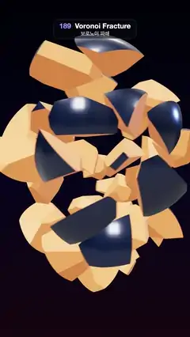

# 189 · Voronoi Fracture · 보로노이 파쇄



**EN** A glossy navy ball splits into 40 convex Voronoi chunks with glowing orange cut faces, tumbles apart in slow motion, then flies back together whole.  
**KO** 광택 나는 남색 공이 주황빛 단면을 드러낸 40개의 볼록한 보로노이 조각으로 쪼개져 천천히 흩어져 구르다가, 다시 날아와 온전한 공으로 합쳐진다.

[Video (mp4)](https://sueun-dev.github.io/motion-effects/videos/189-voronoi-fracture.mp4) · [Code](../effects/189-voronoi-fracture.js) · Geometry & modeling · 지오메트리·모델링

## Prompt (English)

```text
Create a "Voronoi Fracture" motion effect: a ball breaks into convex Voronoi cells, the pieces drift apart, and they reassemble.

Look
- A ball of radius 1.6 cut into 40 cells. 40 seed points are taken uniformly inside the ball (seeded random, within 0.95 of the radius).
- Each cell starts as a cube (half-size 1.76), is clipped by the bisecting plane between its seed and every other seed, then by the 5,120 face planes of a geodesic sphere of radius 1.6. Every clip adds a cap polygon (the cut points sorted by angle around their centre).
- Two materials per chunk: the outer skin, glossy navy #1C2A4A (physical, roughness 0.22, metalness 0.3, clearcoat 1) shaded with smooth sphere normals; the cut faces, warm orange #F7A04F with a faint emissive #FF5A1F (intensity 0.22, roughness 0.6), flat per face.
- Background: a vertical gradient #0A0C1A → #1A1530 at 55 % → #2A1622 at the bottom. Room environment (intensity 0.6), a white key light (2.0) from (−3, 5, 4), a blue rim light #7FA8FF (1.6) from (4, 1, −3).
- Camera: perspective, 30° vertical field of view, at (0, 0.6, 16) looking at (0, −0.1, 0); the whole ball group is tipped 0.25 rad toward the camera.

Motion (0–5 s), a = 2π · t / 5, local time u = (t + 2.5) mod 5 (so 0 s and 5 s fall in the middle of the drift)
- u 0–0.3 s: the ball is whole.
- u 0.3–2.2 s: the chunks move out along their direction from the centre (plus a seeded random tilt, then stretched × 0.75, 1.5, 0.75 so the cloud is taller than wide), 0.6–1.3 units each, ease-in-out; each turns about its own random axis, by up to ±1.6 rad.
- They hang and drift (an extra 0.1 · sin(a + seed) along their direction), then from u 2.7 to 4.6 s fly back in (ease-in-out) and lock together; whole again until 5 s.
- The group swings about the vertical axis by 0.6 · sin(a) the whole time.

Technique
- Voronoi cells built directly by clipping a convex polyhedron with planes (no CSG library): a polygon-by-plane clip that keeps the inside part and collects the cut points into a new face.
- One BufferGeometry per chunk with two groups (skin, cut) and a material array; positions are relative to the chunk's centroid so it can turn in place.
- ACES Filmic tone mapping. Each video frame averages eight renders spread over the frame time (1/30 s), so the fast break and return blur a little instead of strobing.

Output and rules
- One self-contained HTML file with no external assets (three.js from a CDN is fine if you use it), drawing on a 1080 × 1920 canvas (9:16) scaled to fit the window.
- Write a function renderFrame(t) that draws the frame for time t in seconds, and preview it with requestAnimationFrame. Everything must be a pure function of t and fixed seeds: no Math.random(), Date or state carried between frames, so frame i = renderFrame(i / 30) can be exported to a 30 fps video.
- Loop seamlessly every 5 seconds: renderFrame(5) must look exactly like renderFrame(0).
- No flicker of any kind: no noise or grain that changes from frame to frame, no strobing or blinking, no z-fighting, no shimmering 1 px lines. Any grain or texture stays fixed to the screen or to the object.
- Keep the top 280 px free of important content (a title label goes there) and fill the whole frame with a designed background.
```

## 프롬프트 (한국어)

```text
"보로노이 파쇄" 모션 효과를 만들어 줘: 공이 볼록한 보로노이 셀로 쪼개지고, 조각들이 흩어졌다가 다시 맞춰지는 효과.

모양
- 반지름 1.6인 공을 40개 셀로 자른다. 씨앗 점 40개는 공 안(반지름의 0.95 이내)에 고르게, 고정 시드 난수로 뽑는다.
- 각 셀은 정육면체(반 크기 1.76)에서 시작해, 자기 씨앗과 다른 모든 씨앗 사이의 이등분 평면으로 자르고, 다시 반지름 1.6인 지오데식 구의 면 평면 5,120개로 자른다. 자를 때마다 잘린 점들을 중심 둘레 각도로 정렬해 새 면을 붙인다.
- 조각마다 재질 둘: 바깥 껍질은 광택 남색 #1C2A4A(물리 기반, 거칠기 0.22, 금속성 0.3, 클리어코트 1), 구의 매끈한 법선으로 칠한다. 잘린 면은 따뜻한 주황 #F7A04F에 옅은 자체발광 #FF5A1F(세기 0.22, 거칠기 0.6), 면마다 평평하게.
- 배경: 세로 그라디언트 #0A0C1A → 55 %에서 #1A1530 → 아래 #2A1622. 룸 환경맵(세기 0.6), 흰 키 라이트(2.0) 위치 (−3, 5, 4), 파란 림 라이트 #7FA8FF(1.6) 위치 (4, 1, −3).
- 카메라: 원근, 세로 시야각 30°, 위치 (0, 0.6, 16)에서 (0, −0.1, 0)을 본다. 공 그룹 전체는 카메라 쪽으로 0.25 rad 기울인다.

움직임 (0–5초), a = 2π · t / 5, 로컬 시간 u = (t + 2.5) mod 5 (0초와 5초가 흩어진 구간 한가운데 오도록)
- u 0–0.3초: 온전한 공.
- u 0.3–2.2초: 조각들이 중심에서 자기 방향(고정 시드 난수로 살짝 비틀고 × 0.75, 1.5, 0.75로 늘려 세로로 긴 무리가 되게)으로 0.6~1.3단위씩 이즈 인아웃으로 나가고, 각자 무작위 축으로 최대 ±1.6 rad 돈다.
- 떠서 흘러가다(방향을 따라 0.1 · sin(a + 시드) 추가), u 2.7초부터 4.6초까지 이즈 인아웃으로 날아 돌아와 맞물린다. 5초까지 다시 온전한 공.
- 그룹 전체는 내내 세로축으로 0.6 · sin(a)만큼 흔들린다.

기법
- 보로노이 셀은 CSG 라이브러리 없이 볼록 다면체를 평면으로 직접 잘라 만든다: 다각형을 평면으로 잘라 안쪽만 남기고, 잘린 점들을 모아 새 면을 만든다.
- 조각마다 BufferGeometry 하나에 그룹 둘(껍질, 단면)과 재질 배열. 위치는 조각의 무게중심 기준이라 제자리에서 돈다.
- ACES Filmic 톤 매핑. 영상 한 프레임은 프레임 시간(1/30초)에 나눈 여덟 번의 렌더를 평균해, 빠르게 깨지고 돌아오는 순간이 번쩍이지 않고 살짝 흐려진다.

출력과 규칙
- 외부 파일 없는 HTML 파일 하나(three.js를 쓴다면 CDN은 괜찮다). 1080 × 1920(9:16) 캔버스에 그리고 창 크기에 맞춰 보이게 한다.
- 시간 t(초)의 프레임을 그리는 renderFrame(t) 함수를 만들고, 미리보기는 requestAnimationFrame으로 돌린다. 모든 것은 t와 고정 시드만으로 정해진다: Math.random(), Date, 프레임 사이에 쌓이는 상태 금지. 그래야 i번째 프레임 = renderFrame(i / 30)으로 30fps 영상을 뽑을 수 있다.
- 5초마다 끊김 없이 반복: renderFrame(5)는 renderFrame(0)과 똑같아 보여야 한다.
- 어떤 깜빡임도 금지: 프레임마다 바뀌는 노이즈·그레인, 번쩍임·깜빡임, z-fighting, 반짝이며 떨리는 1px 선 모두 금지. 그레인·질감은 화면이나 물체에 고정한다.
- 위쪽 280px에는 중요한 내용을 두지 않고(제목 라벨 자리), 화면 전체를 디자인된 배경으로 채운다.
```
