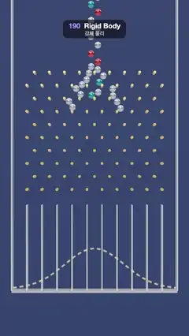

# 190 · Rigid Body · 강체 물리



**EN** Seventy steel balls stream through a Galton board of gold pegs, bounce and stack into a bell curve in eleven bins, then a trapdoor drops them out.  
**KO** 강철 구슬 70개가 금빛 못이 박힌 골턴 보드를 흘러내리며 튕기고 11칸에 종 모양으로 쌓인 뒤, 바닥 덮개가 열리며 아래로 쏟아진다.

[Video (mp4)](https://sueun-dev.github.io/motion-effects/videos/190-rigid-body.mp4) · [Code](../effects/190-rigid-body.js) · Simulation & physics · 시뮬레이션·물리

## Prompt (English)

```text
Create a "Rigid Body" motion effect: a Galton board run by a small 2D rigid-body solver, balls colliding with pegs, walls and each other until they settle into a bell curve.

Look
- A tall board (deep blue #1D2C4D panel on a #14213A background) seen straight on. 10 staggered rows of gold pegs (#F2C66D, metalness 0.8, radius 0.04), 0.44 apart, rows 0.38 apart (0.44 · √3 / 2), filling the board's width.
- Below them 11 bins made by thin clear dividers (0.035 thick), 2.5 units tall; the board's side walls rise from the floor to the top.
- 70 steel balls (radius 0.1, metalness 0.95, roughness 0.18), most silver #D9DEE6, one in four tinted red, gold, teal or violet.
- Behind the bins a dashed golden curve (rgba(255, 207, 120, 0.55), 4 px dashes) shows the bell this board settles into: a Gaussian with σ = 2 bins, scaled to the 70 balls.
- The floor is a steel trapdoor hinged at its left end.
- Lighting: room environment (0.9) and a warm key light #FFF3E2 (1.8) from (−3, 5, 8). Camera: perspective, 30°, at (0, 0.6, 18.5) looking at (0, 0.6, 0).

Motion (0–5 s)
- The balls drop one after another from above the frame in two lanes 0.2 apart (10 cm either side of the centre), starting 0.6 s before 0 s, 70 balls over 1.6 s, falling at 9 units/s.
- They rattle down through the pegs and pile up in the bins by about 3.5 s, roughly in a bell shape.
- At 3.85 s the trapdoor swings down (0.18 s, ease-in), every ball drops out of the frame, and the door closes again by 4.7 s. Meanwhile the next stream has already started from the top, so 5 s matches 0 s.

Technique
- Fixed-step 2D solver, 600 steps per second, gravity 60 units/s²: integrate, then three passes of position corrections (ball–ball on a spatial hash grid, ball–peg, ball–wall segments, the closed floor), then velocity from the corrected motion.
- At a peg hit faster than 0.5 units/s a ball keeps 5 % of its normal speed as bounce and 30 % of its sliding speed; resting contacts get no bounce, so piles stay still. Speeds are capped at 14 units/s and damped by 0.8 % per step.
- The whole run (from 0.6 s before the loop to 5 s) is simulated once in setup and played back from t; balls of the next cycle are drawn as a second set during the last 0.6 s. They never meet the old balls, so the result is the same either way.

Output and rules
- One self-contained HTML file with no external assets (three.js from a CDN is fine if you use it), drawing on a 1080 × 1920 canvas (9:16) scaled to fit the window.
- Write a function renderFrame(t) that draws the frame for time t in seconds, and preview it with requestAnimationFrame. Everything must be a pure function of t and fixed seeds: no Math.random(), Date or state carried between frames, so frame i = renderFrame(i / 30) can be exported to a 30 fps video.
- Loop seamlessly every 5 seconds: renderFrame(5) must look exactly like renderFrame(0).
- No flicker of any kind: no noise or grain that changes from frame to frame, no strobing or blinking, no z-fighting, no shimmering 1 px lines. Any grain or texture stays fixed to the screen or to the object.
- Keep the top 280 px free of important content (a title label goes there) and fill the whole frame with a designed background.
```

## 프롬프트 (한국어)

```text
"강체 물리" 모션 효과를 만들어 줘: 작은 2D 강체 솔버로 돌리는 골턴 보드. 구슬이 못·벽·서로와 부딪히며 종 모양으로 쌓인다.

모양
- 정면에서 본 세로로 긴 판(짙은 파랑 #1D2C4D 판, 배경 #14213A). 금빛 못(#F2C66D, 금속성 0.8, 반지름 0.04)이 엇갈린 10줄, 가로 간격 0.44, 줄 간격 0.38(0.44 · √3 / 2)로 판 너비를 채운다.
- 그 아래 얇은 투명 칸막이(두께 0.035)로 나눈 11칸, 높이 2.5. 판 양옆 벽은 바닥부터 꼭대기까지 올라간다.
- 강철 구슬 70개(반지름 0.1, 금속성 0.95, 거칠기 0.18). 대부분 은색 #D9DEE6, 네 개 중 하나꼴로 빨강·금색·청록·보라.
- 칸 뒤에는 이 판이 쌓게 되는 종 모양을 금빛 점선(rgba(255, 207, 120, 0.55), 4 px)으로 그린다: σ = 2칸인 가우스, 구슬 70개에 맞춘 높이.
- 바닥은 왼쪽 끝에 경첩이 달린 강철 덮개다.
- 조명: 룸 환경맵(0.9), 따뜻한 키 라이트 #FFF3E2(1.8) 위치 (−3, 5, 8). 카메라: 원근, 30°, 위치 (0, 0.6, 18.5)에서 (0, 0.6, 0)을 본다.

움직임 (0–5초)
- 구슬이 화면 위에서 가운데 양옆 0.1(두 줄, 간격 0.2)로 하나씩 떨어진다. 0초보다 0.6초 먼저 시작해 1.6초 동안 70개, 떨어지는 속도 9단위/초.
- 못 사이를 덜그럭거리며 내려가 약 3.5초까지 칸에 대략 종 모양으로 쌓인다.
- 3.85초에 바닥 덮개가 아래로 열리고(0.18초, 이즈 인) 구슬이 모두 화면 밖으로 빠진 뒤 4.7초까지 다시 닫힌다. 그 사이 다음 구슬 줄이 이미 위에서 떨어지기 시작해 5초가 0초와 이어진다.

기법
- 초당 600스텝 고정 간격 2D 솔버, 중력 60단위/초²: 적분한 뒤 위치 보정을 세 번(공간 해시 격자로 구슬끼리, 구슬–못, 구슬–벽 선분, 닫힌 바닥), 그다음 보정된 이동에서 속도를 구한다.
- 0.5단위/초보다 빠르게 못에 부딪히면 법선 속도의 5 %만 튕기고 미끄러지는 속도는 30 %만 남는다. 정지 접촉은 튕기지 않아 쌓인 더미가 가만히 있다. 속도는 14단위/초로 제한하고 스텝마다 0.8 % 감쇠.
- 루프 0.6초 전부터 5초까지 전체를 처음에 한 번 시뮬레이션하고 t로 재생한다. 마지막 0.6초에는 다음 주기의 구슬을 두 번째 세트로 함께 그린다. 옛 구슬과 만나지 않으니 결과는 같다.

출력과 규칙
- 외부 파일 없는 HTML 파일 하나(three.js를 쓴다면 CDN은 괜찮다). 1080 × 1920(9:16) 캔버스에 그리고 창 크기에 맞춰 보이게 한다.
- 시간 t(초)의 프레임을 그리는 renderFrame(t) 함수를 만들고, 미리보기는 requestAnimationFrame으로 돌린다. 모든 것은 t와 고정 시드만으로 정해진다: Math.random(), Date, 프레임 사이에 쌓이는 상태 금지. 그래야 i번째 프레임 = renderFrame(i / 30)으로 30fps 영상을 뽑을 수 있다.
- 5초마다 끊김 없이 반복: renderFrame(5)는 renderFrame(0)과 똑같아 보여야 한다.
- 어떤 깜빡임도 금지: 프레임마다 바뀌는 노이즈·그레인, 번쩍임·깜빡임, z-fighting, 반짝이며 떨리는 1px 선 모두 금지. 그레인·질감은 화면이나 물체에 고정한다.
- 위쪽 280px에는 중요한 내용을 두지 않고(제목 라벨 자리), 화면 전체를 디자인된 배경으로 채운다.
```
