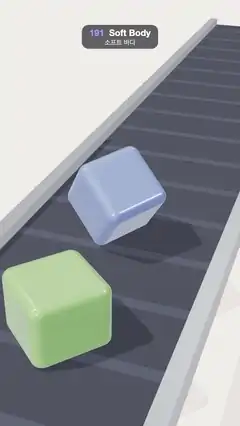

# 191 · Soft Body · 소프트 바디



**EN** Translucent pink, green and blue jelly cubes drop onto a moving conveyor belt, squash on landing, wobble back into shape and ride toward the camera.  
**KO** 반투명한 분홍·초록·파랑 젤리 큐브가 움직이는 컨베이어 벨트 위로 떨어져 착지하며 찌그러지고, 출렁이다 제 모양을 찾은 뒤 카메라 쪽으로 실려 온다.

[Video (mp4)](https://sueun-dev.github.io/motion-effects/videos/191-soft-body.mp4) · [Code](../effects/191-soft-body.js) · Simulation & physics · 시뮬레이션·물리

## Prompt (English)

```text
Create a "Soft Body" motion effect: jelly cubes simulated with shape matching drop onto a conveyor belt, squash, wobble and settle.

Look
- A dark conveyor belt (4 wide, #2B2F3A with a lighter rib #353A47 every 1.5 units) between two brushed-steel rails (#C9CED6), running from the far top of the frame to the near bottom, over a warm cream floor #E9DCCB under a #F3E7D9 background.
- Jelly cubes 1.3 units on a side with rounded edges (radius 0.18): translucent physical material (transmission 0.75, thickness 1.3, IOR 1.33, clearcoat 1, roughness 0.1), light tint with a deep attenuation colour: pink #FFB3C6 / #FF3D6E, green #D2F7B0 / #5FD43A, blue #B9D3FF / #3F86FF.
- Lighting: room environment (0.8), a warm key light #FFF6EA (2.4) from (−5, 9, 3) with a soft 2048² shadow, a hemisphere light #FFFFFF / #CDB8A0 (0.5).
- Camera: perspective, 38°, at (3.6, 6.6, 8.6) looking at (0, 0.5, −1.4).

Motion (0–5 s)
- A new jelly every 5/3 s, in the order pink, green, blue (three per loop). Each enters from above the frame tilted (three different starting tilts), falls from 5.2 units with an initial 1.5 units/s downward, lands on a corner or edge, squashes flat, rebounds and wobbles at about 4 Hz, then settles square in about 2 s.
- The belt carries every jelly toward the camera at 1.8 units/s, starting 4.2 units back; the ribs move with it (6 ribs per loop). Each jelly lives exactly 5 s, so at 5 s every jelly is where the next one of its colour was at 0 s.

Technique
- Shape matching (Müller et al. 2005): each jelly is a 4 × 4 × 4 lattice of particles. Every step, the best-fit rotation of the deformed lattice is found (polar decomposition by quaternion iteration), mixed with 60 % of the best-fit linear stretch (volume kept to 1), and every particle is pulled 0.15 % of the way to its goal position per step (600 steps per second).
- Wobble damping acts on velocities relative to the jelly's mean velocity only (×0.98 per step), so the fall is not slowed. The belt is a floor at y = 0 that cancels downward speed and 15 % of sliding per step.
- The three drops are simulated once in setup (150 frames each); the rendered rounded box (6 segments per side) is bent through the lattice with trilinear weights from its rest position, and normals are recomputed every frame.

Output and rules
- One self-contained HTML file with no external assets (three.js from a CDN is fine if you use it), drawing on a 1080 × 1920 canvas (9:16) scaled to fit the window.
- Write a function renderFrame(t) that draws the frame for time t in seconds, and preview it with requestAnimationFrame. Everything must be a pure function of t and fixed seeds: no Math.random(), Date or state carried between frames, so frame i = renderFrame(i / 30) can be exported to a 30 fps video.
- Loop seamlessly every 5 seconds: renderFrame(5) must look exactly like renderFrame(0).
- No flicker of any kind: no noise or grain that changes from frame to frame, no strobing or blinking, no z-fighting, no shimmering 1 px lines. Any grain or texture stays fixed to the screen or to the object.
- Keep the top 280 px free of important content (a title label goes there) and fill the whole frame with a designed background.
```

## 프롬프트 (한국어)

```text
"소프트 바디" 모션 효과를 만들어 줘: 셰이프 매칭으로 시뮬레이션한 젤리 큐브가 컨베이어 벨트에 떨어져 찌그러지고 출렁이다 자리 잡는 효과.

모양
- 어두운 컨베이어 벨트(폭 4, #2B2F3A, 1.5단위마다 밝은 줄 #353A47)가 브러시드 스틸 레일(#C9CED6) 둘 사이로 화면 위쪽 먼 곳에서 아래쪽 가까운 곳까지 이어진다. 바닥은 따뜻한 크림색 #E9DCCB, 배경 #F3E7D9.
- 한 변 1.3인 둥근 모서리(반지름 0.18) 젤리 큐브: 반투명 물리 재질(투과 0.75, 두께 1.3, IOR 1.33, 클리어코트 1, 거칠기 0.1), 옅은 색에 짙은 감쇠색: 분홍 #FFB3C6 / #FF3D6E, 초록 #D2F7B0 / #5FD43A, 파랑 #B9D3FF / #3F86FF.
- 조명: 룸 환경맵(0.8), 따뜻한 키 라이트 #FFF6EA(2.4) 위치 (−5, 9, 3)에 부드러운 2048² 그림자, 반구광 #FFFFFF / #CDB8A0(0.5).
- 카메라: 원근, 38°, 위치 (3.6, 6.6, 8.6)에서 (0, 0.5, −1.4)를 본다.

움직임 (0–5초)
- 5/3초마다 새 젤리 하나, 분홍·초록·파랑 순서(루프당 셋). 각각 기울어진 채(세 가지 시작 기울기) 화면 위에서 들어와 높이 5.2에서 초속 1.5로 떨어지기 시작하고, 모서리나 변으로 착지해 납작하게 찌그러졌다 튀어 오르며 약 4 Hz로 출렁이다 약 2초 만에 반듯하게 자리 잡는다.
- 벨트는 모든 젤리를 초속 1.8로 카메라 쪽에 실어 온다(4.2단위 뒤에서 출발). 벨트 줄도 함께 움직인다(루프당 6줄). 젤리 하나는 정확히 5초를 살아서, 5초에는 모든 젤리가 0초에 같은 색 다음 젤리가 있던 자리에 있다.

기법
- 셰이프 매칭(Müller et al. 2005): 젤리마다 4 × 4 × 4 입자 격자. 스텝마다 변형된 격자에 가장 잘 맞는 회전을 구하고(쿼터니언 반복으로 극분해), 가장 잘 맞는 선형 늘어남을 60 % 섞은 뒤(부피는 1로 유지), 모든 입자를 목표 위치 쪽으로 스텝당 0.15 %씩 당긴다(초당 600스텝).
- 출렁임 감쇠는 젤리 평균 속도에 대한 상대 속도에만 준다(스텝당 ×0.98). 그래서 떨어지는 속도는 줄지 않는다. 벨트는 y = 0 바닥으로, 아래로 향하는 속도를 없애고 미끄러짐을 스텝당 15 % 줄인다.
- 세 번의 낙하를 처음에 한 번씩(각 150프레임) 시뮬레이션한다. 그리는 둥근 상자(변마다 6분할)는 정지 위치의 삼선형 가중치로 격자를 따라 휘고, 법선은 매 프레임 다시 계산한다.

출력과 규칙
- 외부 파일 없는 HTML 파일 하나(three.js를 쓴다면 CDN은 괜찮다). 1080 × 1920(9:16) 캔버스에 그리고 창 크기에 맞춰 보이게 한다.
- 시간 t(초)의 프레임을 그리는 renderFrame(t) 함수를 만들고, 미리보기는 requestAnimationFrame으로 돌린다. 모든 것은 t와 고정 시드만으로 정해진다: Math.random(), Date, 프레임 사이에 쌓이는 상태 금지. 그래야 i번째 프레임 = renderFrame(i / 30)으로 30fps 영상을 뽑을 수 있다.
- 5초마다 끊김 없이 반복: renderFrame(5)는 renderFrame(0)과 똑같아 보여야 한다.
- 어떤 깜빡임도 금지: 프레임마다 바뀌는 노이즈·그레인, 번쩍임·깜빡임, z-fighting, 반짝이며 떨리는 1px 선 모두 금지. 그레인·질감은 화면이나 물체에 고정한다.
- 위쪽 280px에는 중요한 내용을 두지 않고(제목 라벨 자리), 화면 전체를 디자인된 배경으로 채운다.
```
