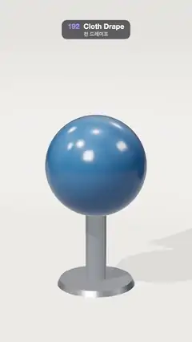

# 192 · Cloth Drape · 천 드레이프



**EN** A red plaid cloth falls onto a blue ball on a steel stand, drapes into soft folds and hanging corners, then is pinched in the middle and lifted away.  
**KO** 빨간 체크무늬 천이 강철 받침 위의 파란 공에 떨어져 부드러운 주름과 늘어진 모서리로 덮이고, 가운데를 집혀 위로 들려 나간다.

[Video (mp4)](https://sueun-dev.github.io/motion-effects/videos/192-cloth-drape.mp4) · [Code](../effects/192-cloth-drape.js) · Simulation & physics · 시뮬레이션·물리

## Prompt (English)

```text
Create a "Cloth Drape" motion effect: a square of cloth simulated with a small position-based solver falls onto a ball, drapes, and is lifted off again.

Look
- A soft studio sweep (floor curving up into a back wall, #E9E1D6) with a matching background. On it a steel stand (#C9CED6, metalness 0.9): a round base, a slim post (radius 0.2) and a glossy blue ball #2E5E8C (radius 0.95, clearcoat 1) whose centre is 2.3 units up.
- The cloth: 3.4 × 3.4 units, a 64 × 64 grid of particles. Fabric texture: crimson #C8344F with crossing bands (every fourth band a pale gold stripe at 55 % opacity, the others dark wine at 28 %), a cream border and faint fixed slubs; material with sheen 1 (#FFC9C0, sheen roughness 0.45), roughness 0.75, double-sided.
- Lighting: room environment (0.55), a warm key light #FFF4E6 (2.8) from (−4, 8, 5) with a soft 2048² shadow, a hemisphere light #FFFFFF / #B9A994 (0.6).
- Camera: perspective, 32°, 11 units from the stand at height 4.2, looking at (0, 2.2, 0), swinging round it by 0.3 + 0.22 · sin(a) rad.

Motion (0–5 s), a = 2π · t / 5
- 0 s: the cloth is above the frame, flat, turned 0.5 rad and slightly tilted, already falling at 4.5 units/s.
- About 0.7 s: it lands on the ball, slides and drapes; the corners swing down and the sides buckle into folds; by 2.5 s it hangs still with its corners near the post.
- 2.9 s: a hook pinches the middle of the cloth and pulls it straight up, speeding up (position ∝ time²), to 9.5 units high at 4.95 s: the cloth peels off the ball, hangs in long vertical folds and leaves the top of the frame. The empty stand at 5 s matches 0 s.

Technique
- Position-based dynamics / Verlet: 16 substeps per frame (480 per second), gravity −9.8, 0.5 % air drag per substep.
- Distance constraints: stretch between neighbours (stiffness 1), shear across diagonals (0.04), bending to the particle two away (0.0003); compressed links push back with only 0.8 % of their strength, so the cloth buckles into folds instead of crumpling. Two constraint passes per substep, six for the stretch links while the hook carries the weight; the hooked particle does not move under the constraints.
- Collisions: the ball (radius + 0.02) with Coulomb-like friction that cancels sliding up to 0.8 × the push-out distance, the post, and the floor with friction.
- The whole run is simulated once in setup and stored; frames are interpolated between stored states. Each video frame averages five renders spread over the frame time (1/30 s), so the fast lift blurs instead of strobing.

Output and rules
- One self-contained HTML file with no external assets (three.js from a CDN is fine if you use it), drawing on a 1080 × 1920 canvas (9:16) scaled to fit the window.
- Write a function renderFrame(t) that draws the frame for time t in seconds, and preview it with requestAnimationFrame. Everything must be a pure function of t and fixed seeds: no Math.random(), Date or state carried between frames, so frame i = renderFrame(i / 30) can be exported to a 30 fps video.
- Loop seamlessly every 5 seconds: renderFrame(5) must look exactly like renderFrame(0).
- No flicker of any kind: no noise or grain that changes from frame to frame, no strobing or blinking, no z-fighting, no shimmering 1 px lines. Any grain or texture stays fixed to the screen or to the object.
- Keep the top 280 px free of important content (a title label goes there) and fill the whole frame with a designed background.
```

## 프롬프트 (한국어)

```text
"천 드레이프" 모션 효과를 만들어 줘: 작은 위치 기반 솔버로 시뮬레이션한 정사각형 천이 공 위에 떨어져 덮였다가 다시 들려 나가는 효과.

모양
- 바닥이 뒷벽으로 둥글게 이어지는 부드러운 스튜디오 배경(#E9E1D6). 그 위에 강철 받침(#C9CED6, 금속성 0.9): 둥근 밑판, 가는 기둥(반지름 0.2), 중심 높이 2.3인 광택 파란 공 #2E5E8C(반지름 0.95, 클리어코트 1).
- 천: 3.4 × 3.4단위, 64 × 64 입자 격자. 천 무늬: 진홍 #C8344F 바탕에 가로세로 띠(네 번째마다 55 % 불투명 연금색 줄, 나머지는 28 % 짙은 와인색), 크림색 테두리, 천에 고정된 옅은 결. 재질은 시인 1(#FFC9C0, 시인 거칠기 0.45), 거칠기 0.75, 양면.
- 조명: 룸 환경맵(0.55), 따뜻한 키 라이트 #FFF4E6(2.8) 위치 (−4, 8, 5)에 부드러운 2048² 그림자, 반구광 #FFFFFF / #B9A994(0.6).
- 카메라: 원근, 32°, 받침에서 11단위 떨어진 높이 4.2에서 (0, 2.2, 0)을 보고, 0.3 + 0.22 · sin(a) rad만큼 둘레를 오간다.

움직임 (0–5초), a = 2π · t / 5
- 0초: 천은 화면 위, 평평하게 0.5 rad 돌고 살짝 기운 채 이미 초속 4.5로 떨어지고 있다.
- 약 0.7초: 공에 닿아 미끄러지며 덮이고, 모서리가 아래로 흔들리며 옆면이 주름으로 접힌다. 2.5초쯤 모서리가 기둥 근처에 늘어진 채 가만히 걸린다.
- 2.9초: 고리가 천 한가운데를 집어 점점 빠르게(위치 ∝ 시간²) 곧장 끌어올려 4.95초에 높이 9.5에 이른다. 천이 공에서 벗겨져 긴 세로 주름으로 늘어지며 화면 위로 나간다. 5초의 빈 받침이 0초와 같다.

기법
- 위치 기반 동역학 / 베를레: 프레임당 16 서브스텝(초당 480), 중력 −9.8, 서브스텝마다 공기 저항 0.5 %.
- 거리 제약: 이웃 사이 늘어남(강성 1), 대각선 전단(0.04), 두 칸 건너 굽힘(0.0003). 줄어든 링크는 힘의 0.8 %만으로 밀어내서, 천이 구겨지지 않고 주름으로 접힌다. 서브스텝마다 제약 두 번, 고리가 무게를 들 때는 늘어남 링크만 여섯 번. 고리에 걸린 입자는 제약에 끌려가지 않는다.
- 충돌: 공(반지름 + 0.02), 밀려난 거리의 0.8배까지 미끄러짐을 없애는 쿨롱식 마찰; 기둥; 마찰 있는 바닥.
- 전체를 처음에 한 번 시뮬레이션해 저장하고, 프레임은 저장된 상태 사이를 보간한다. 영상 한 프레임은 프레임 시간(1/30초)에 나눈 다섯 번의 렌더를 평균해 빠르게 들리는 순간이 번쩍이지 않고 흐려진다.

출력과 규칙
- 외부 파일 없는 HTML 파일 하나(three.js를 쓴다면 CDN은 괜찮다). 1080 × 1920(9:16) 캔버스에 그리고 창 크기에 맞춰 보이게 한다.
- 시간 t(초)의 프레임을 그리는 renderFrame(t) 함수를 만들고, 미리보기는 requestAnimationFrame으로 돌린다. 모든 것은 t와 고정 시드만으로 정해진다: Math.random(), Date, 프레임 사이에 쌓이는 상태 금지. 그래야 i번째 프레임 = renderFrame(i / 30)으로 30fps 영상을 뽑을 수 있다.
- 5초마다 끊김 없이 반복: renderFrame(5)는 renderFrame(0)과 똑같아 보여야 한다.
- 어떤 깜빡임도 금지: 프레임마다 바뀌는 노이즈·그레인, 번쩍임·깜빡임, z-fighting, 반짝이며 떨리는 1px 선 모두 금지. 그레인·질감은 화면이나 물체에 고정한다.
- 위쪽 280px에는 중요한 내용을 두지 않고(제목 라벨 자리), 화면 전체를 디자인된 배경으로 채운다.
```
