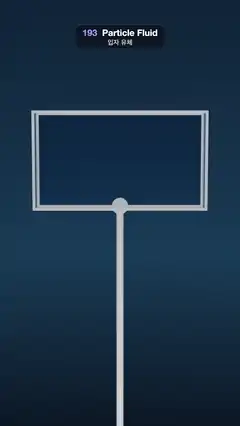

# 193 · Particle Fluid · 입자 유체



**EN** A stream of 2,400 blue water particles pours into a glass tank, splashes and sloshes as it rocks, then the tank tips and pours it all out below.  
**KO** 파란 물 입자 2,400개가 유리 수조로 쏟아져 튀고, 수조가 흔들리면 출렁이다가, 수조가 기울며 물을 전부 아래로 쏟아 낸다.

[Video (mp4)](https://sueun-dev.github.io/motion-effects/videos/193-particle-fluid.mp4) · [Code](../effects/193-particle-fluid.js) · Simulation & physics · 시뮬레이션·물리

## Prompt (English)

```text
Create a "Particle Fluid" motion effect: position-based fluid particles pour into a tilting glass tank, slosh, and are tipped out.

Look
- A dark blue gradient background (#0E2238 at the top, #173A57 at 60 %, #0B1726 at the bottom).
- An open-topped glass tank, 3.2 wide × 1.8 tall × 0.64 deep (inner), glass #DFF3FF (transmission, opacity 0.35) with bright steel edges #E7EBF0, on an axle at its bottom centre (y = −0.5) carried by a thin steel pole and a round hub.
- 2,400 water particles drawn as spheres of radius 0.072 (0.72 × the 0.1 spacing, so they overlap into a body), material #2E9BFF with roughness 0.3 and a pale sheen; each tinted from deep blue #1260D8 when slow to foam #BFEAFF at 6 units/s.
- Lighting: room environment (1.0) and a white key light (2.0) from (−3, 6, 5). Camera: perspective, 36°, at (0.7 · sin a, 0.6, 12.5) looking at (0, −0.6, 0).

Motion (0–5 s), a = 2π · t / 5
- 0–1.1 s: a wide stream (12 × 5 particles across) pours from a spout just above the frame, 0.7 left of centre, leaving at 3.5 units/s; it hits the tank floor, splashes up the walls and fills it.
- 1.3–2.5 s: the tank rocks ±0.12 rad (sin at 5 rad/s) and the water sloshes from side to side.
- 2.5–3.4 s: the tank tips 2.4 rad (ease-in-out) so its left rim drops and the water pours out over it and falls out of the frame; 4.0–4.8 s it swings back upright, empty. Frame 150 matches frame 0 (the empty tank, the stream not yet in view).

Technique
- Position-based fluids (Macklin & Müller 2013): predict positions, then three solver iterations per step of the density constraint C = ρ/ρ₀ − 1 (poly6 kernel for density, spiky gradient, kernel radius 0.2, rest density one particle per 0.1³), relaxation 600, a small artificial-pressure term, and only C > 0 is corrected (no surface tension pulling).
- 120 steps per second, gravity −9.8; corrections larger than 0.03 per iteration and speeds above 8 units/s are capped; XSPH viscosity 0.25.
- The tank is a box in its own rotating frame: a particle that has entered it is kept inside (walls and floor) until it leaves over the rim. Neighbours come from a hash grid of 0.2 cells.
- The whole 5 s is simulated once in setup (about 5 s) and played back from t; particles not yet poured wait far away and are skipped.

Output and rules
- One self-contained HTML file with no external assets (three.js from a CDN is fine if you use it), drawing on a 1080 × 1920 canvas (9:16) scaled to fit the window.
- Write a function renderFrame(t) that draws the frame for time t in seconds, and preview it with requestAnimationFrame. Everything must be a pure function of t and fixed seeds: no Math.random(), Date or state carried between frames, so frame i = renderFrame(i / 30) can be exported to a 30 fps video.
- Loop seamlessly every 5 seconds: renderFrame(5) must look exactly like renderFrame(0).
- No flicker of any kind: no noise or grain that changes from frame to frame, no strobing or blinking, no z-fighting, no shimmering 1 px lines. Any grain or texture stays fixed to the screen or to the object.
- Keep the top 280 px free of important content (a title label goes there) and fill the whole frame with a designed background.
```

## 프롬프트 (한국어)

```text
"입자 유체" 모션 효과를 만들어 줘: 위치 기반 유체 입자가 기울어지는 유리 수조에 쏟아져 출렁이다가 쏟아져 나가는 효과.

모양
- 짙은 파랑 그라디언트 배경(위 #0E2238, 60 %에서 #173A57, 아래 #0B1726).
- 뚜껑 없는 유리 수조, 안쪽 크기 너비 3.2 × 높이 1.8 × 깊이 0.64. 유리 #DFF3FF(투과, 불투명도 0.35)에 밝은 강철 모서리 #E7EBF0. 바닥 가운데(y = −0.5)의 축에 걸려 가는 강철 기둥과 둥근 허브가 받친다.
- 물 입자 2,400개를 반지름 0.072(간격 0.1의 0.72배라 서로 겹쳐 덩어리로 보인다) 구로 그린다. 재질 #2E9BFF, 거칠기 0.3, 옅은 시인. 느릴 때 짙은 파랑 #1260D8, 초속 6에서 거품색 #BFEAFF로 물든다.
- 조명: 룸 환경맵(1.0), 흰 키 라이트(2.0) 위치 (−3, 6, 5). 카메라: 원근, 36°, 위치 (0.7 · sin a, 0.6, 12.5)에서 (0, −0.6, 0)을 본다.

움직임 (0–5초), a = 2π · t / 5
- 0–1.1초: 화면 바로 위, 가운데에서 왼쪽으로 0.7 떨어진 주둥이에서 넓은 물줄기(가로 12 × 깊이 5 입자)가 초속 3.5로 나와 수조 바닥을 때리고 벽을 타고 튀어 오르며 채운다.
- 1.3–2.5초: 수조가 ±0.12 rad(5 rad/s 사인)로 흔들리고 물이 좌우로 출렁인다.
- 2.5–3.4초: 수조가 2.4 rad 기울어(이즈 인아웃) 왼쪽 테두리가 내려가고, 물이 그 위로 넘쳐 화면 밖으로 떨어진다. 4.0–4.8초에 빈 수조가 똑바로 돌아온다. 150번째 프레임은 0번째(빈 수조, 물줄기는 아직 화면 밖)와 같다.

기법
- 위치 기반 유체(Macklin & Müller 2013): 위치를 예측한 뒤 스텝마다 밀도 제약 C = ρ/ρ₀ − 1을 세 번 반복해 푼다(밀도는 poly6 커널, 기울기는 spiky, 커널 반지름 0.2, 정지 밀도는 0.1³마다 입자 하나), 완화값 600, 작은 인공 압력 항, C > 0만 보정(표면을 당기는 장력 없음).
- 초당 120스텝, 중력 −9.8. 한 번에 0.03보다 큰 보정과 초속 8보다 빠른 속도는 잘라 낸다. XSPH 점성 0.25.
- 수조는 자기 회전 좌표계의 상자다: 안에 들어온 입자는 테두리 위로 넘어갈 때까지 벽과 바닥 안에 붙잡아 둔다. 이웃은 0.2 크기 해시 격자에서 찾는다.
- 5초 전체를 처음에 한 번(약 5초) 시뮬레이션하고 t로 재생한다. 아직 쏟아지지 않은 입자는 멀리서 기다리며 계산에서 빠진다.

출력과 규칙
- 외부 파일 없는 HTML 파일 하나(three.js를 쓴다면 CDN은 괜찮다). 1080 × 1920(9:16) 캔버스에 그리고 창 크기에 맞춰 보이게 한다.
- 시간 t(초)의 프레임을 그리는 renderFrame(t) 함수를 만들고, 미리보기는 requestAnimationFrame으로 돌린다. 모든 것은 t와 고정 시드만으로 정해진다: Math.random(), Date, 프레임 사이에 쌓이는 상태 금지. 그래야 i번째 프레임 = renderFrame(i / 30)으로 30fps 영상을 뽑을 수 있다.
- 5초마다 끊김 없이 반복: renderFrame(5)는 renderFrame(0)과 똑같아 보여야 한다.
- 어떤 깜빡임도 금지: 프레임마다 바뀌는 노이즈·그레인, 번쩍임·깜빡임, z-fighting, 반짝이며 떨리는 1px 선 모두 금지. 그레인·질감은 화면이나 물체에 고정한다.
- 위쪽 280px에는 중요한 내용을 두지 않고(제목 라벨 자리), 화면 전체를 디자인된 배경으로 채운다.
```
