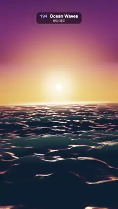

# 194 · Ocean Waves · 바다 파도



**EN** A Gerstner ocean rolls toward the camera under an orange sunset: sharp crests, wide troughs, foam where the waves pinch and a golden sun path.  
**KO** 주황빛 노을 아래 게르스트너 바다가 카메라 쪽으로 밀려온다: 뾰족한 마루, 넓은 골, 파도가 조여드는 곳의 물거품, 금빛 해 길.

[Video (mp4)](https://sueun-dev.github.io/motion-effects/videos/194-ocean-waves.mp4) · [Code](../effects/194-ocean-waves.js) · Simulation & physics · 시뮬레이션·물리

## Prompt (English)

```text
Create an "Ocean Waves" motion effect: an open sea built from Gerstner waves at sunset, seen from just above the water.

Look
- Sky (a shader on a big sphere): horizon orange (1.0, 0.33, 0.1 in linear) to magenta-plum (0.22, 0.06, 0.18) by 0.2 up, to deep navy (0.018, 0.022, 0.08) higher; a glow round the sun and a small bright sun disc just above the horizon (direction (0, 0.055, −1)); long streaks of dark cloud lit orange near the sun, between 0.03 and 0.32 up.
- Sea: a fan-shaped mesh 400 × 480 vertices, dense near the camera and sparse toward the horizon (out to 1,200 m).
- Swell, nine Gerstner waves [cycles per 5 s, direction°, amplitude, steepness]: [1, 8, 1.0, 0.8], [2, −24, 0.32, 0.8], [2, 33, 0.26, 0.8], [3, −6, 0.15, 0.8], [3, 48, 0.12, 0.75], [4, −40, 0.07, 0.75], [4, 18, 0.06, 0.75], [5, 10, 0.03, 0.7], [5, −58, 0.025, 0.7]; ω = 2π · cycles / 5 and k = ω² / 9.81.
- Ripples on the normal only: 24 waves of wave number 3 to 12 (log-spaced), slope 0.022 each, random directions within ±75°, drifting 2 to 6 cycles per 5 s.
- Shading: Fresnel mix (0.02 + 0.98 · (1 − n·v)⁵, n·v at least 0.12) of a near-black blue body and the reflected sky (without the sun disc), sun glitter (power 300 near, 90 far), a soft glow on high crests facing the sun, foam where the surface Jacobian drops below about 0.7, broken by value noise fixed to the water (warm pink-white, fading out by 120 m), haze toward the horizon from 60 to 600 m, then an ACES fit.
- Camera: perspective, 50°, at (0.3 · sin a, 7 + 0.3 · sin(a + 0.6), 3) looking at (0, 6 + 0.2 · sin a, −40), with a slight roll of 0.025 · sin(a + 1.2).

Motion (0–5 s), a = 2π · t / 5
- All the waves travel; because each makes a whole number of cycles in 5 s, the whole sea returns exactly to its first frame.
- The camera bobs and rolls a little, like riding a buoy.

Technique
- three.js ShaderMaterial: the vertex shader adds the Gerstner displacements (horizontal q·A·d·cos θ, vertical A·sin θ); the fragment shader recomputes the normal and the Jacobian analytically per pixel.
- Level of detail by screen footprint: each swell wave fades out when its wavelength is under about 10 pixels, each ripple under about 15, so far waves never shimmer.
- A film shutter: each frame averages six renders spread over 1/30 s.

Output and rules
- One self-contained HTML file with no external assets (three.js from a CDN is fine if you use it), drawing on a 1080 × 1920 canvas (9:16) scaled to fit the window.
- Write a function renderFrame(t) that draws the frame for time t in seconds, and preview it with requestAnimationFrame. Everything must be a pure function of t and fixed seeds: no Math.random(), Date or state carried between frames, so frame i = renderFrame(i / 30) can be exported to a 30 fps video.
- Loop seamlessly every 5 seconds: renderFrame(5) must look exactly like renderFrame(0).
- No flicker of any kind: no noise or grain that changes from frame to frame, no strobing or blinking, no z-fighting, no shimmering 1 px lines. Any grain or texture stays fixed to the screen or to the object.
- Keep the top 280 px free of important content (a title label goes there) and fill the whole frame with a designed background.
```

## 프롬프트 (한국어)

```text
"바다 파도" 모션 효과를 만들어 줘: 노을 아래 게르스트너 파도로 만든 넓은 바다를 수면 바로 위에서 보는 효과.

모양
- 하늘(큰 구에 셰이더): 수평선 주황(선형 1.0, 0.33, 0.1)에서 0.2 높이까지 자주빛(0.22, 0.06, 0.18), 더 위로 짙은 남색(0.018, 0.022, 0.08). 해 둘레의 빛무리와 수평선 바로 위 작고 밝은 해(방향 (0, 0.055, −1)). 높이 0.03~0.32 사이에 해 근처만 주황빛으로 물든 길고 어두운 구름 줄.
- 바다: 400 × 480 정점의 부채꼴 메시, 카메라 근처는 촘촘하고 수평선(1,200 m) 쪽은 성기다.
- 너울, 게르스트너 파 9개 [5초당 주기, 방향°, 진폭, 가파름]: [1, 8, 1.0, 0.8], [2, −24, 0.32, 0.8], [2, 33, 0.26, 0.8], [3, −6, 0.15, 0.8], [3, 48, 0.12, 0.75], [4, −40, 0.07, 0.75], [4, 18, 0.06, 0.75], [5, 10, 0.03, 0.7], [5, −58, 0.025, 0.7]. ω = 2π · 주기 / 5, k = ω² / 9.81.
- 법선에만 더하는 잔물결: 파수 3~12(로그 간격) 24개, 각각 기울기 0.022, ±75° 안의 무작위 방향, 5초에 2~6주기.
- 셰이딩: 거의 검은 파랑 물빛과 반사된 하늘(해 원반 제외)을 프레넬(0.02 + 0.98 · (1 − n·v)⁵, n·v 최소 0.12)로 섞고, 해 반짝임(가까이 지수 300, 멀리 90), 해를 향한 높은 마루의 은은한 빛, 표면 야코비안이 약 0.7 아래로 떨어지는 곳의 물거품(물에 고정된 값 노이즈로 끊고, 따뜻한 분홍빛 흰색, 120 m까지 사라짐), 60~600 m 수평선 안개, 마지막에 ACES 근사.
- 카메라: 원근, 50°, 위치 (0.3 · sin a, 7 + 0.3 · sin(a + 0.6), 3)에서 (0, 6 + 0.2 · sin a, −40)을 보고, 0.025 · sin(a + 1.2)만큼 살짝 기운다.

움직임 (0–5초), a = 2π · t / 5
- 모든 파도가 나아간다. 파도마다 5초에 정수 주기를 돌아서 바다 전체가 정확히 첫 프레임으로 돌아온다.
- 카메라는 부표에 탄 듯 살짝 오르내리고 기운다.

기법
- three.js ShaderMaterial: 정점 셰이더가 게르스트너 변위(수평 q·A·d·cos θ, 수직 A·sin θ)를 더하고, 프래그먼트 셰이더가 법선과 야코비안을 픽셀마다 해석적으로 다시 계산한다.
- 화면 크기 기준 LOD: 너울은 파장이 약 10픽셀, 잔물결은 약 15픽셀보다 작아지면 사라져서 먼 파도가 반짝이며 떨리지 않는다.
- 필름 셔터: 프레임마다 1/30초에 나눈 여섯 번의 렌더를 평균한다.

출력과 규칙
- 외부 파일 없는 HTML 파일 하나(three.js를 쓴다면 CDN은 괜찮다). 1080 × 1920(9:16) 캔버스에 그리고 창 크기에 맞춰 보이게 한다.
- 시간 t(초)의 프레임을 그리는 renderFrame(t) 함수를 만들고, 미리보기는 requestAnimationFrame으로 돌린다. 모든 것은 t와 고정 시드만으로 정해진다: Math.random(), Date, 프레임 사이에 쌓이는 상태 금지. 그래야 i번째 프레임 = renderFrame(i / 30)으로 30fps 영상을 뽑을 수 있다.
- 5초마다 끊김 없이 반복: renderFrame(5)는 renderFrame(0)과 똑같아 보여야 한다.
- 어떤 깜빡임도 금지: 프레임마다 바뀌는 노이즈·그레인, 번쩍임·깜빡임, z-fighting, 반짝이며 떨리는 1px 선 모두 금지. 그레인·질감은 화면이나 물체에 고정한다.
- 위쪽 280px에는 중요한 내용을 두지 않고(제목 라벨 자리), 화면 전체를 디자인된 배경으로 채운다.
```
