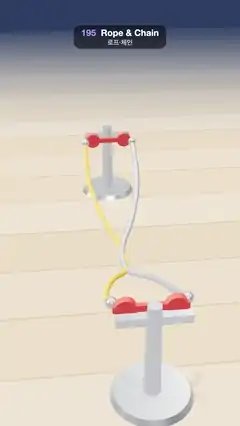

# 195 · Rope & Chain · 로프·체인



**EN** Two red cranks turn a yellow rope and a steel ball chain like a double-dutch pair: they swing out in loops, sag and slap the wooden floor every turn.  
**KO** 빨간 크랭크 두 쌍이 노란 밧줄과 강철 볼 체인을 쌍줄넘기처럼 돌린다: 줄이 고리를 그리며 휘어 나가고 처지며 한 바퀴마다 나무 바닥을 친다.

[Video (mp4)](https://sueun-dev.github.io/motion-effects/videos/195-verlet-rope.mp4) · [Code](../effects/195-verlet-rope.js) · Simulation & physics · 시뮬레이션·물리

## Prompt (English)

```text
Create a "Rope & Chain" motion effect: two lines simulated with Verlet integration and distance constraints, turned by cranks like a double-dutch jump rope.

Look
- A light wooden floor (boards in #D9B48A, #D2AC80, #DDBA92, #CFA87D with thin dark seams) fading into a dusky blue background #2C3E63 (fog from 14 to 30 units).
- Two steel posts (#E8ECF2) 5.9 apart, each with a cross bar at height 1.25 holding two red cranks (#E2483D): a hub, an arm 0.8 long and a steel knob where the line is tied. The two cranks on a post sit 0.64 apart.
- Line 1: a yellow rope (#FFB020, tube radius 0.042). Line 2: a steel ball chain (140 beads of radius 0.05 along its curve).
- Lighting: room environment (0.9), a warm sun #FFF1DE (1.7) almost overhead (−1, 10, 1.5) with soft shadows from the posts and cranks only, a hemisphere light #CFE0FF / #5A4630 (0.6).
- Camera: perspective, 42°, at (8, 5.6, 1) looking at (−0.6, 0.7, 0): down the span, near cranks at the bottom of the frame, far cranks near the top.

Motion (0–5 s)
- Each line's two ends turn on their cranks four times per loop, the two lines in opposite directions and half a turn apart (an eggbeater).
- The lines swing out into big loops (their middles rise to about 2.4 units), sag on the way down and lie briefly along the floor at the bottom of each turn before being pulled up again.

Technique
- Each line is 48 particles over 5.9 units of length (span 5.2). Verlet integration with gravity −9.8 and 0.5 % air drag per step, 720 steps per second; six passes of distance constraints per step, with the two end particles fixed to the crank handles.
- Floor at y = 0.03: a particle below it is lifted back and loses 10 % of its sliding motion.
- Driven and damped, the lines settle onto a periodic motion: setup runs 30 s (24 turns) of warm-up, keeps the next two loops, and blends the second into the first over the loop so frame 150 meets frame 0 (they differ by under a millimetre).
- Each frame the rope is a TubeGeometry through a Catmull-Rom curve of its particles; the chain's beads are placed evenly along its curve.

Output and rules
- One self-contained HTML file with no external assets (three.js from a CDN is fine if you use it), drawing on a 1080 × 1920 canvas (9:16) scaled to fit the window.
- Write a function renderFrame(t) that draws the frame for time t in seconds, and preview it with requestAnimationFrame. Everything must be a pure function of t and fixed seeds: no Math.random(), Date or state carried between frames, so frame i = renderFrame(i / 30) can be exported to a 30 fps video.
- Loop seamlessly every 5 seconds: renderFrame(5) must look exactly like renderFrame(0).
- No flicker of any kind: no noise or grain that changes from frame to frame, no strobing or blinking, no z-fighting, no shimmering 1 px lines. Any grain or texture stays fixed to the screen or to the object.
- Keep the top 280 px free of important content (a title label goes there) and fill the whole frame with a designed background.
```

## 프롬프트 (한국어)

```text
"로프·체인" 모션 효과를 만들어 줘: 베를레 적분과 거리 제약으로 시뮬레이션한 두 줄을 크랭크가 쌍줄넘기처럼 돌리는 효과.

모양
- 밝은 나무 바닥(판 색 #D9B48A, #D2AC80, #DDBA92, #CFA87D, 가는 어두운 이음매)이 어스름한 파랑 배경 #2C3E63으로 사라진다(안개 14~30단위).
- 5.9 떨어진 강철 기둥 둘(#E8ECF2). 각 기둥의 높이 1.25 가로대에 빨간 크랭크(#E2483D) 둘: 허브, 길이 0.8 팔, 줄을 묶는 강철 손잡이. 한 기둥의 두 크랭크 간격은 0.64.
- 줄 1: 노란 밧줄(#FFB020, 튜브 반지름 0.042). 줄 2: 강철 볼 체인(곡선을 따라 반지름 0.05 구슬 140개).
- 조명: 룸 환경맵(0.9), 거의 머리 위 (−1, 10, 1.5)의 따뜻한 해 #FFF1DE(1.7)는 기둥과 크랭크에만 부드러운 그림자, 반구광 #CFE0FF / #5A4630(0.6).
- 카메라: 원근, 42°, 위치 (8, 5.6, 1)에서 (−0.6, 0.7, 0)을 본다: 줄 방향으로 내려다봐서 가까운 크랭크는 화면 아래, 먼 크랭크는 위쪽.

움직임 (0–5초)
- 줄마다 두 끝이 크랭크를 따라 루프당 네 바퀴 돈다. 두 줄은 서로 반대 방향, 반 바퀴 차이(에그비터).
- 줄이 크게 고리를 그리며 휘어 나가고(가운데가 약 2.4까지 올라감), 내려오며 처지고, 한 바퀴의 바닥에서 잠깐 바닥을 따라 눕다가 다시 끌려 올라간다.

기법
- 줄마다 입자 48개, 길이 5.9(두 끝 거리 5.2). 중력 −9.8, 스텝마다 공기 저항 0.5 %, 초당 720스텝 베를레 적분. 스텝마다 거리 제약 여섯 번, 양 끝 입자는 크랭크 손잡이에 고정.
- y = 0.03 바닥: 그 아래로 내려간 입자는 다시 올리고 미끄러짐의 10 %를 잃는다.
- 구동과 감쇠가 있어 줄은 주기 운동으로 수렴한다: 처음에 30초(24바퀴) 예열한 뒤 다음 두 루프를 저장하고, 루프에 걸쳐 둘째를 첫째로 섞어 150번째 프레임이 0번째와 만난다(차이는 1 mm 미만).
- 프레임마다 밧줄은 입자들을 지나는 캣멀롬 곡선의 TubeGeometry, 체인 구슬은 곡선을 따라 고르게 놓는다.

출력과 규칙
- 외부 파일 없는 HTML 파일 하나(three.js를 쓴다면 CDN은 괜찮다). 1080 × 1920(9:16) 캔버스에 그리고 창 크기에 맞춰 보이게 한다.
- 시간 t(초)의 프레임을 그리는 renderFrame(t) 함수를 만들고, 미리보기는 requestAnimationFrame으로 돌린다. 모든 것은 t와 고정 시드만으로 정해진다: Math.random(), Date, 프레임 사이에 쌓이는 상태 금지. 그래야 i번째 프레임 = renderFrame(i / 30)으로 30fps 영상을 뽑을 수 있다.
- 5초마다 끊김 없이 반복: renderFrame(5)는 renderFrame(0)과 똑같아 보여야 한다.
- 어떤 깜빡임도 금지: 프레임마다 바뀌는 노이즈·그레인, 번쩍임·깜빡임, z-fighting, 반짝이며 떨리는 1px 선 모두 금지. 그레인·질감은 화면이나 물체에 고정한다.
- 위쪽 280px에는 중요한 내용을 두지 않고(제목 라벨 자리), 화면 전체를 디자인된 배경으로 채운다.
```
