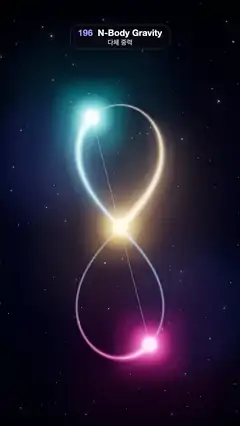

# 196 · N-Body Gravity · 다체 중력



**EN** Three glowing stars of equal mass chase each other around one upright figure-eight orbit, trailing cyan, pink and gold light, and loop exactly.  
**KO** 질량이 같은 빛나는 별 셋이 세로로 선 8자 궤도 하나를 따라 서로를 쫓으며 청록·분홍·금빛 꼬리를 남기고, 정확히 처음 자리로 돌아온다.

[Video (mp4)](https://sueun-dev.github.io/motion-effects/videos/196-n-body-gravity.mp4) · [Code](../effects/196-n-body-gravity.js) · Simulation & physics · 시뮬레이션·물리

## Prompt (English)

```text
Create an "N-Body Gravity" motion effect: the three-body figure-eight choreography (Chenciner & Montgomery 2000), integrated with Newtonian gravity and played as an exact loop.

Look
- Background: a fixed starfield canvas — a radial gradient (#141A3A centre at 55 % height, #090C1E, #04050C at the edges), three large blurred colour clouds (violet, blue, magenta at 12–22 % opacity) and 700 small stars (radius 0.5–2.3 px, fixed seed).
- The figure-eight stands upright: its long axis runs vertically, about 2.16 units tall, drawn faintly as a thin ribbon (0.024 wide, dim blue).
- Three stars (spheres of radius 0.055, very bright) in cyan #5BE7FF, pink #FF5FA8 and gold #FFC857, each with a soft additive glow sprite (0.42 across).
- Each star trails a flat ribbon over the last 30 % of the orbit: its width grows from 0.024 at the tail to 0.084 at the star and its colour fades in (fade^1.6), additive blending with a soft edge-to-edge profile.
- A faint triangle (2 px, #9AA6D8 at 35 %) joins the three stars, and a small ring marks the centre of mass, which never moves.
- Camera: perspective, 35°, at (0, 0.12, 5.7) looking at (0, 0.12, 0). Bloom (strength 0.9, radius 0.55, threshold 0.35) on a 4× MSAA half-float target, ACES Filmic tone mapping.

Motion (0–5 s), a = 2π · t / 5
- The bodies make exactly one period of the orbit per loop, each a third of a period behind the next, always following the same curve.
- The orbit plane sways: rotation about the vertical axis 0.42 · sin(a), about the horizontal axis −0.18 + 0.08 · sin(2a), showing it is a flat curve in space.

Technique
- G = m = 1. Initial state: x₁ = (0.97000436, −0.24308753) = −x₂, x₃ = 0, v₃ = (−0.93240737, −0.86473146), v₁ = v₂ = −v₃ / 2; period T = 6.32591398.
- RK4 with 24,000 steps over one period in setup (it closes to about 10⁻⁸), sampled at 2,400 points; a body's position at loop time t is the sample at fraction t / 5, linearly interpolated, so frame 150 is frame 0.
- Ribbons and the faint orbit are BufferGeometry strips rebuilt each frame in the orbit plane; EffectComposer with RenderPass, UnrealBloomPass and OutputPass.

Output and rules
- One self-contained HTML file with no external assets (three.js from a CDN is fine if you use it), drawing on a 1080 × 1920 canvas (9:16) scaled to fit the window.
- Write a function renderFrame(t) that draws the frame for time t in seconds, and preview it with requestAnimationFrame. Everything must be a pure function of t and fixed seeds: no Math.random(), Date or state carried between frames, so frame i = renderFrame(i / 30) can be exported to a 30 fps video.
- Loop seamlessly every 5 seconds: renderFrame(5) must look exactly like renderFrame(0).
- No flicker of any kind: no noise or grain that changes from frame to frame, no strobing or blinking, no z-fighting, no shimmering 1 px lines. Any grain or texture stays fixed to the screen or to the object.
- Keep the top 280 px free of important content (a title label goes there) and fill the whole frame with a designed background.
```

## 프롬프트 (한국어)

```text
"다체 중력" 모션 효과를 만들어 줘: 3체 문제의 8자 안무 궤도(Chenciner & Montgomery 2000)를 뉴턴 중력으로 적분해 정확한 루프로 재생하는 효과.

모양
- 배경: 고정된 별밭 캔버스 — 방사형 그라디언트(높이 55 % 중심 #141A3A, #090C1E, 가장자리 #04050C), 크게 흐린 색 구름 셋(보라·파랑·자홍, 불투명도 12~22 %), 작은 별 700개(반지름 0.5~2.3 px, 고정 시드).
- 8자 궤도는 세로로 서 있다: 긴 축이 세로로 약 2.16단위, 가는 리본(폭 0.024, 흐린 파랑)으로 옅게 그린다.
- 별 셋(반지름 0.055 구, 아주 밝게): 청록 #5BE7FF, 분홍 #FF5FA8, 금빛 #FFC857, 각각 부드러운 가산 블렌딩 빛 스프라이트(지름 0.42).
- 별마다 궤도의 마지막 30 %에 납작한 리본 꼬리: 폭은 꼬리 0.024에서 별 쪽 0.084로 넓어지고 색은 fade^1.6으로 짙어진다. 가산 블렌딩, 가장자리가 부드러운 단면.
- 세 별을 잇는 옅은 삼각형(2 px, #9AA6D8 35 %)과, 움직이지 않는 질량 중심을 표시하는 작은 고리.
- 카메라: 원근, 35°, 위치 (0, 0.12, 5.7)에서 (0, 0.12, 0)을 본다. 블룸(세기 0.9, 반경 0.55, 문턱 0.35)을 4× MSAA 하프 플로트 타깃에, ACES Filmic 톤 매핑.

움직임 (0–5초), a = 2π · t / 5
- 루프마다 정확히 궤도 한 주기를 돈다. 별들은 서로 1/3주기씩 떨어져 늘 같은 곡선을 따른다.
- 궤도면이 흔들린다: 세로축 회전 0.42 · sin(a), 가로축 −0.18 + 0.08 · sin(2a). 평평한 곡선이 공간에 떠 있음을 보여 준다.

기법
- G = m = 1. 초기 상태: x₁ = (0.97000436, −0.24308753) = −x₂, x₃ = 0, v₃ = (−0.93240737, −0.86473146), v₁ = v₂ = −v₃ / 2. 주기 T = 6.32591398.
- 처음에 한 주기를 RK4 24,000스텝으로 적분(약 10⁻⁸로 닫힌다)하고 2,400점으로 저장. 루프 시간 t의 위치는 t / 5 비율의 표본을 선형 보간한다. 그래서 150번째 프레임이 0번째다.
- 리본과 옅은 궤도는 궤도면에서 매 프레임 다시 만드는 BufferGeometry 띠. EffectComposer에 RenderPass, UnrealBloomPass, OutputPass.

출력과 규칙
- 외부 파일 없는 HTML 파일 하나(three.js를 쓴다면 CDN은 괜찮다). 1080 × 1920(9:16) 캔버스에 그리고 창 크기에 맞춰 보이게 한다.
- 시간 t(초)의 프레임을 그리는 renderFrame(t) 함수를 만들고, 미리보기는 requestAnimationFrame으로 돌린다. 모든 것은 t와 고정 시드만으로 정해진다: Math.random(), Date, 프레임 사이에 쌓이는 상태 금지. 그래야 i번째 프레임 = renderFrame(i / 30)으로 30fps 영상을 뽑을 수 있다.
- 5초마다 끊김 없이 반복: renderFrame(5)는 renderFrame(0)과 똑같아 보여야 한다.
- 어떤 깜빡임도 금지: 프레임마다 바뀌는 노이즈·그레인, 번쩍임·깜빡임, z-fighting, 반짝이며 떨리는 1px 선 모두 금지. 그레인·질감은 화면이나 물체에 고정한다.
- 위쪽 280px에는 중요한 내용을 두지 않고(제목 라벨 자리), 화면 전체를 디자인된 배경으로 채운다.
```
