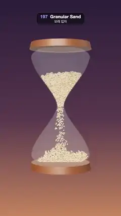

# 197 · Granular Sand · 모래 입자



**EN** Sand grains pour through an hourglass in a thin stream and build a cone that rests perfectly still, then the glass turns over and the pour starts again.  
**KO** 모래알이 모래시계 목을 지나 가는 줄기로 쏟아져 원뿔로 쌓이고 그대로 꼼짝 않고 멈춘 뒤, 유리가 뒤집히면 다시 쏟아지기 시작한다.

[Video (mp4)](https://sueun-dev.github.io/motion-effects/videos/197-granular-sand.mp4) · [Code](../effects/197-granular-sand.js) · Simulation & physics · 시뮬레이션·물리

## Prompt (English)

```text
Create a "Granular Sand" motion effect: individual sand grains, simulated with a small position-based granular solver with sleeping grains, pour through an hourglass that then turns over.

Look
- Background: a vertical gradient, plum #2B1E3A at the top, #5A3A4E at 55 %, warm clay #C7865E at the bottom.
- The hourglass, 2.7 tall inside: a glass lathe of the profile w(y) = 0.074 + 0.62 · sin(min(1, 1.08 u) · π/2)^1.6 (u = |y| / 1.35; above u = 0.85 the width shrinks by up to 35 % toward the caps), white, opacity 0.16, roughness 0.1, no transmission, between two wooden caps (#7A4A2A, radius 0.74 tapering to 0.7, 0.16 thick). No pillars: thin bars sweeping round in the turn would strobe.
- 1,300 grains of radius 0.0105–0.0145 (drawn 1.25 × larger), in five sand tones #E9C38B, #DDB070, #F2D3A0, #C99A5E, #E4BA7E, roughness 0.9. They lie in the glass's middle plane.
- Lighting: room environment (0.8) and a warm key light #FFE9CC (2.4) from (−3, 4, 5). Camera: perspective, 30°, still at (0, 0.25, 9.6) looking at (0, −0.05, 0), so resting sand is still on screen too.

Motion (0–5 s)
- 0–2.4 s: the sand pours through the neck in a thin stream and builds a cone in the lower bulb; only the cone's surface slides, the sand under it lies perfectly still.
- By about 2.8 s the surface has stopped sliding too, and the whole pile rests, frozen, until 3.15 s (a few grains stay behind on the upper walls).
- 3.15–4.75 s: the glass turns half a turn (smoothstep, so its top speed is 1.5 × the average); the pile holds together until the tilt passes its angle of repose, then from 100° to 176° all of it slides and falls toward the neck and starts the next pour. Upside down it looks the same, so the loop runs on.

Technique
- Grains are circles in the glass's own frame, 300 steps per second; gravity 18 units/s² turned by the glass angle, 0.1 % drag, falling speed capped at 4 units/s. Three passes per step, solved from the bottom of the sand upward: overlapping pairs pushed apart (hash grid) with friction that cancels 70 % of their relative sliding, wall pieces of the profile (80 per side) with a little friction, and a clamp to the profile.
- Sleeping: a grain whose smoothed position (an average with 5 % weight per step) moves less than 0.003 in 12 steps, and that has a contact within about 37° of straight down or contacts on both sides of the line of gravity, freezes exactly and becomes immovable for the others, remembering what it touches. It wakes from rest when one of those contacts moves 8 % apart, when gravity has turned more than 15° since it fell asleep, when a grain flying in (more than a third of a radius per step) digs over 10 % into it, or from 100° to 176° into a turn. Grains in the neck (and the funnel above it) never sleep.
- Two full cycles are simulated in setup (about 10 s) after a 1 s settle with the neck plugged; the video plays the second. From 4.05 to 4.45 s, while every grain is falling, each glides (ease-in-out) onto its nearest partner in the first cycle (found once, greedily, comparing the first cycle turned half a turn) and takes on its colour and size; from 4.45 s the first cycle plays, and it runs straight on into the second, so frame 150 meets frame 0.

Output and rules
- One self-contained HTML file with no external assets (three.js from a CDN is fine if you use it), drawing on a 1080 × 1920 canvas (9:16) scaled to fit the window.
- Write a function renderFrame(t) that draws the frame for time t in seconds, and preview it with requestAnimationFrame. Everything must be a pure function of t and fixed seeds: no Math.random(), Date or state carried between frames, so frame i = renderFrame(i / 30) can be exported to a 30 fps video.
- Loop seamlessly every 5 seconds: renderFrame(5) must look exactly like renderFrame(0).
- No flicker of any kind: no noise or grain that changes from frame to frame, no strobing or blinking, no z-fighting, no shimmering 1 px lines. Any grain or texture stays fixed to the screen or to the object.
- Keep the top 280 px free of important content (a title label goes there) and fill the whole frame with a designed background.
```

## 프롬프트 (한국어)

```text
"모래 입자" 모션 효과를 만들어 줘: 잠드는 입자가 있는 작은 위치 기반 입자 솔버로 시뮬레이션한 모래알 하나하나가 모래시계를 지나 쏟아지고, 모래시계가 뒤집히는 효과.

모양
- 배경: 세로 그라디언트, 위 자두색 #2B1E3A, 55 %에서 #5A3A4E, 아래 따뜻한 점토색 #C7865E.
- 안쪽 높이 2.7인 모래시계: 단면 w(y) = 0.074 + 0.62 · sin(min(1, 1.08 u) · π/2)^1.6 (u = |y| / 1.35, u = 0.85 위로는 마개 쪽으로 최대 35 % 좁아짐)을 회전시킨 유리, 흰색, 불투명도 0.16, 거칠기 0.1, 투과 없음. 위아래 나무 마개(#7A4A2A, 반지름 0.74에서 0.7로 좁아짐, 두께 0.16) 사이에 있다. 기둥은 없다: 뒤집힐 때 가는 막대가 휩쓸고 지나가면 번쩍인다.
- 모래알 1,300개, 반지름 0.0105~0.0145(그릴 때는 1.25배), 모래색 다섯 가지 #E9C38B, #DDB070, #F2D3A0, #C99A5E, #E4BA7E, 거칠기 0.9. 유리의 가운데 평면에 놓인다.
- 조명: 룸 환경맵(0.8), 따뜻한 키 라이트 #FFE9CC(2.4) 위치 (−3, 4, 5). 카메라: 원근, 30°, (0, 0.25, 9.6)에 고정해 (0, −0.05, 0)을 본다. 그래서 멈춘 모래는 화면에서도 멈춰 있다.

움직임 (0–5초)
- 0–2.4초: 모래가 목을 지나 가는 줄기로 쏟아져 아래 칸에 원뿔로 쌓인다. 원뿔 표면만 미끄러지고 그 아래 모래는 꼼짝 않는다.
- 약 2.8초면 표면도 미끄러지기를 멈추고, 3.15초까지 더미 전체가 얼어붙은 듯 멈춰 있다(위 칸 벽에 몇 알이 남는다).
- 3.15–4.75초: 유리가 반 바퀴 돈다(스무스스텝, 최고 속도가 평균의 1.5배). 더미는 기울기가 안식각을 넘을 때까지 뭉쳐 있다가, 100°에서 176° 사이에 통째로 미끄러져 목 쪽으로 떨어지며 다음 쏟아짐을 시작한다. 뒤집힌 모습이 처음과 같아 루프가 이어진다.

기법
- 모래알은 유리 자신의 좌표계 안의 원, 초당 300스텝. 중력 18단위/초²(유리 각도만큼 돌림), 0.1 % 감쇠, 떨어지는 속도 최대 4단위/초. 스텝마다 세 번, 모래 아래쪽부터 위로 푼다: 공간 해시 격자로 겹친 쌍을 밀어내며 상대 미끄러짐의 70 %를 없애는 마찰, 단면을 따라 놓은 벽 조각(한쪽 80개)과 약한 벽 마찰, 단면 안으로 가두기.
- 잠들기: 부드럽게 평균한 위치(스텝마다 5 % 가중)가 12스텝 동안 0.003보다 덜 움직이고, 거의 바로 아래(약 37° 이내)에 닿은 것이 있거나 중력선 양쪽에 접촉이 있는 모래알은 정확히 멈추고 다른 알에게는 움직이지 않는 벽이 되며, 닿아 있던 것들을 기억한다. 그 접촉 중 하나가 8 % 벌어지거나, 잠든 뒤 중력이 15° 넘게 돌거나, 날아든 알(스텝당 반지름의 1/3 넘게 이동)이 10 % 넘게 파고들거나, 뒤집기 100°~176° 구간이면 그 자리에서 깨어난다. 목(과 그 위 깔때기)의 모래알은 잠들지 않는다.
- 처음에 목을 막고 1초 가라앉힌 뒤 두 주기를 통째로(약 10초) 시뮬레이션하고, 영상은 둘째 주기를 보여 준다. 4.05초부터 4.45초까지, 모든 알이 떨어지고 있는 동안 각 알이 첫 주기의 가장 가까운 짝(첫 주기를 반 바퀴 돌려 비교해 한 번에 탐욕적으로 찾음) 자리로 이즈 인아웃으로 옮겨 가며 색과 크기도 따라간다. 4.45초부터는 첫 주기가 재생되고, 그것이 그대로 둘째 주기로 이어져 150번째 프레임이 0번째와 만난다.

출력과 규칙
- 외부 파일 없는 HTML 파일 하나(three.js를 쓴다면 CDN은 괜찮다). 1080 × 1920(9:16) 캔버스에 그리고 창 크기에 맞춰 보이게 한다.
- 시간 t(초)의 프레임을 그리는 renderFrame(t) 함수를 만들고, 미리보기는 requestAnimationFrame으로 돌린다. 모든 것은 t와 고정 시드만으로 정해진다: Math.random(), Date, 프레임 사이에 쌓이는 상태 금지. 그래야 i번째 프레임 = renderFrame(i / 30)으로 30fps 영상을 뽑을 수 있다.
- 5초마다 끊김 없이 반복: renderFrame(5)는 renderFrame(0)과 똑같아 보여야 한다.
- 어떤 깜빡임도 금지: 프레임마다 바뀌는 노이즈·그레인, 번쩍임·깜빡임, z-fighting, 반짝이며 떨리는 1px 선 모두 금지. 그레인·질감은 화면이나 물체에 고정한다.
- 위쪽 280px에는 중요한 내용을 두지 않고(제목 라벨 자리), 화면 전체를 디자인된 배경으로 채운다.
```
