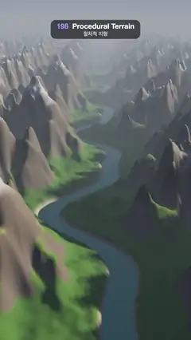

# 198 · Procedural Terrain · 절차적 지형



**EN** A fly-over follows a river valley through ridged fBm mountains: grassy floors, rock on steep faces, snow on high slopes, sun shadows and haze.  
**KO** 리지드 fBm 산맥 사이 강 계곡을 따라 날아간다: 낮은 곳은 풀밭, 가파른 면은 바위, 높은 완사면은 눈, 햇빛 그림자와 푸른 연무.

[Video (mp4)](https://sueun-dev.github.io/motion-effects/videos/198-procedural-terrain.mp4) · [Code](../effects/198-procedural-terrain.js) · Nature & procedural worlds · 자연·절차적 세계

## Prompt (English)

```text
Create a "Procedural Terrain" motion effect: an endless aerial fly-over of a mountain range generated from noise, with a river winding along the valley floor.

Look
- The heightmap h(x, z) is built from gradient (Perlin-style) noise that repeats every 64 units along z (the flight direction): octave k uses lattice cells of 16 / 2^k units with 4 · 2^k cells per period, so every octave tiles exactly.
  - rolling land: big = sum of 3 octaves (k = 0..2) with weights 1, 0.5, 0.25;
  - ridges: a ridged multifractal of 4 octaves, r = 1 − |noise| (softened as 1 − sqrt(noise² + 0.002)), summed as a · r² · w with a = 0.5, 0.275, … and w = clamp(1.3 · previous r), on a domain warped by ±5 units of noise;
  - land = 2.5 + 8 · (big + 0.5) + 21 · smoothstep(−0.3, 0.4, big) · ridge^1.2.
- A river valley winds along z: centre x = 8 · sin(2π z / 64) + 3 · sin(4π z / 64 + 1.3). Within 4–26 units of it the land eases down to a meadow floor at height 1.2 (± a little noise), and within 1.3–4 units it drops to a riverbed at −1. A flat water plane at height 0 fills it.
- The ground is a grid with 0.5-unit spacing, 220 units wide, one 64-unit tile repeated 8 times along z. Per vertex, in setup: a normal from central differences, a soft sun shadow (march 120 steps of 1.2 units towards the sun over the heightmap, visibility = min of (ray height − ground) / (0.05 · distance) + 0.5) and a cavity value from the local Laplacian.
- Colour per pixel: grass from deep green #2B541A (low) to olive #667333 (higher); rock #544A42 → #80756B with height; rock wherever slope (1 − normal.y) > 0.34–0.48 or height > 12–17; a sandy bank #B39E7A at height 0.2–1.2; snow #F5F7FF above height 16–21 on slopes gentler than 0.45–0.75. Hollows (low cavity) pull the bands lower, so the boundaries look natural.
- Light: sun direction (0.78, 0.42, −0.22) normalised, warm (2.3, 1.95, 1.5) × diffuse × shadow, plus a cool sky fill (0.26, 0.36, 0.55) × (0.55 + 0.45 · normal.y), dimmed in hollows.
- Sky: pale blue-white #CCDBF0 at the horizon to deep blue #386ED9 overhead, with a warm glow round the sun. Haze: 1 − exp(−(distance / 230)^1.6) towards the sky colour.
- The river mirrors the sky: Schlick Fresnel 0.03 + 0.97 · (1 − |view.y|)^5 between dark water #0D2933 and the reflected sky.
- Tone: 1 − exp(−1.15 · colour), then gamma 0.92.
- Camera: 50° vertical field of view, 46 units up (± 2), looking 95 units ahead at height 5, so the valley runs up the middle of the frame and the far ranges fade into haze at the top.

Motion (0–5 s)
- The camera flies along −z exactly one period (64 units) per loop, following 0.6 × the river's bends sideways and rolling slightly into them (up vector tilted by 0.006 × the bend 30 units ahead). Its height bobs 2 · sin(2π t / 5).
- Because the terrain repeats every 64 units, the view at 5 s is exactly the view at 0 s.

Technique
- three.js: the heightmap tile is computed once in JavaScript (noise, normals, shadow march, cavity) and stored as vertex attributes; one BufferGeometry is drawn 8 times along z. A ShaderMaterial colours by height and slope, lights and hazes it. The sky is a back-faced sphere with the same sky function.
- Motion blur: each frame renders 6 moments spread over 3/4 of its 1/30 s into a 4× multisampled half-float target and averages them, which keeps the fast-moving ridges from strobing.

Output and rules
- One self-contained HTML file with no external assets (three.js from a CDN is fine if you use it), drawing on a 1080 × 1920 canvas (9:16) scaled to fit the window.
- Write a function renderFrame(t) that draws the frame for time t in seconds, and preview it with requestAnimationFrame. Everything must be a pure function of t and fixed seeds: no Math.random(), Date or state carried between frames, so frame i = renderFrame(i / 30) can be exported to a 30 fps video.
- Loop seamlessly every 5 seconds: renderFrame(5) must look exactly like renderFrame(0).
- No flicker of any kind: no noise or grain that changes from frame to frame, no strobing or blinking, no z-fighting, no shimmering 1 px lines. Any grain or texture stays fixed to the screen or to the object.
- Keep the top 280 px free of important content (a title label goes there) and fill the whole frame with a designed background.
```

## 프롬프트 (한국어)

```text
"절차적 지형" 모션 효과를 만들어 줘: 노이즈로 만든 산맥 위를 끝없이 날아가는 항공 장면, 계곡 바닥에는 강이 굽이친다.

모양
- 높이맵 h(x, z)는 비행 방향 z로 64마다 반복되는 그래디언트(펄린식) 노이즈로 만든다: k번째 옥타브는 격자 칸 크기 16 / 2^k, 한 주기에 4 · 2^k칸이라 모든 옥타브가 정확히 이어진다.
  - 완만한 땅: big = 옥타브 3개(k = 0..2)를 가중치 1, 0.5, 0.25로 합한 것;
  - 능선: 옥타브 4개짜리 리지드 멀티프랙털, r = 1 − |노이즈|(1 − sqrt(노이즈² + 0.002)로 살짝 부드럽게), a · r² · w로 합산(a = 0.5, 0.275, …, w = clamp(1.3 · 이전 r)), 좌표는 노이즈로 ±5만큼 비튼다;
  - land = 2.5 + 8 · (big + 0.5) + 21 · smoothstep(−0.3, 0.4, big) · ridge^1.2.
- 강 계곡이 z를 따라 굽이친다: 중심 x = 8 · sin(2π z / 64) + 3 · sin(4π z / 64 + 1.3). 중심에서 4–26 안쪽은 높이 1.2(± 약간의 노이즈)의 초원 바닥으로 내려가고, 1.3–4 안쪽은 높이 −1의 강바닥이 된다. 높이 0의 평평한 물이 그 안을 채운다.
- 땅은 간격 0.5, 폭 220의 격자이고, 64 길이 타일 하나를 z로 8번 반복한다. 꼭짓점마다 설정 단계에서: 중앙 차분 법선, 부드러운 햇빛 그림자(높이맵 위를 해 쪽으로 1.2씩 120걸음 진행, 가시도 = (광선 높이 − 지면) / (0.05 · 거리) + 0.5의 최솟값), 국소 라플라시안으로 구한 오목함 값.
- 픽셀마다 색: 풀은 짙은 초록 #2B541A(낮은 곳)에서 올리브 #667333(높은 곳)으로; 바위는 높이에 따라 #544A42 → #80756B; 경사(1 − 법선.y)가 0.34–0.48보다 크거나 높이가 12–17보다 높으면 바위; 높이 0.2–1.2는 모래 강둑 #B39E7A; 높이 16–21 이상이고 경사가 0.45–0.75보다 완만하면 눈 #F5F7FF. 오목한 곳은 경계를 더 낮게 끌어내려 자연스럽게 보인다.
- 빛: 해 방향 (0.78, 0.42, −0.22) 정규화, 따뜻한 (2.3, 1.95, 1.5) × 난반사 × 그림자, 여기에 차가운 하늘빛 (0.26, 0.36, 0.55) × (0.55 + 0.45 · 법선.y)을 더하고 오목한 곳은 어둡게.
- 하늘: 지평선의 옅은 청백색 #CCDBF0에서 머리 위 짙은 파랑 #386ED9로, 해 주변은 따뜻하게 빛난다. 연무: 1 − exp(−(거리 / 230)^1.6)만큼 하늘색으로.
- 강은 하늘을 비춘다: 슐릭 프레넬 0.03 + 0.97 · (1 − |시선.y|)^5로 어두운 물 #0D2933과 반사된 하늘을 섞는다.
- 톤: 1 − exp(−1.15 · 색), 이어서 감마 0.92.
- 카메라: 세로 시야각 50°, 높이 46(± 2), 95만큼 앞쪽 높이 5 지점을 본다. 계곡이 화면 가운데를 타고 올라가고, 먼 산맥은 위쪽에서 연무 속으로 사라진다.

움직임 (0–5초)
- 카메라는 루프마다 정확히 한 주기(64)만큼 −z로 날아가며, 강의 굽이를 옆으로 0.6배 따라가고 굽이 쪽으로 살짝 기운다(30 앞 굽이의 0.006배만큼 위 벡터를 기울임). 높이는 2 · sin(2π t / 5)로 오르내린다.
- 지형이 64마다 반복되므로 5초의 장면은 0초와 정확히 같다.

기법
- three.js: 높이맵 타일은 자바스크립트에서 한 번만 계산(노이즈, 법선, 그림자 진행, 오목함)해 꼭짓점 속성에 넣고, BufferGeometry 하나를 z로 8번 그린다. ShaderMaterial이 높이와 경사로 색을 칠하고 조명과 연무를 더한다. 하늘은 같은 하늘 함수를 쓰는 안쪽 면 구.
- 모션 블러: 프레임마다 1/30초의 3/4에 걸친 6순간을 4× 멀티샘플 half-float 타깃에 그려 평균한다. 빠르게 지나가는 능선이 끊겨 보이지 않는다.

출력과 규칙
- 외부 파일 없는 HTML 파일 하나(three.js를 쓴다면 CDN은 괜찮다). 1080 × 1920(9:16) 캔버스에 그리고 창 크기에 맞춰 보이게 한다.
- 시간 t(초)의 프레임을 그리는 renderFrame(t) 함수를 만들고, 미리보기는 requestAnimationFrame으로 돌린다. 모든 것은 t와 고정 시드만으로 정해진다: Math.random(), Date, 프레임 사이에 쌓이는 상태 금지. 그래야 i번째 프레임 = renderFrame(i / 30)으로 30fps 영상을 뽑을 수 있다.
- 5초마다 끊김 없이 반복: renderFrame(5)는 renderFrame(0)과 똑같아 보여야 한다.
- 어떤 깜빡임도 금지: 프레임마다 바뀌는 노이즈·그레인, 번쩍임·깜빡임, z-fighting, 반짝이며 떨리는 1px 선 모두 금지. 그레인·질감은 화면이나 물체에 고정한다.
- 위쪽 280px에는 중요한 내용을 두지 않고(제목 라벨 자리), 화면 전체를 디자인된 배경으로 채운다.
```
