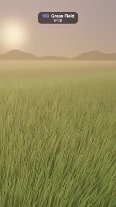

# 199 · Grass Field · 잔디밭



**EN** About 80,000 instanced grass blades sway in a backlit meadow as broad gusts roll across it, each gust a band of bent, brighter blades.  
**KO** 역광의 초원에서 인스턴싱된 풀잎 약 8만 개가 흔들리고, 넓은 돌풍이 지나갈 때마다 휘어져 밝아진 풀잎 띠가 물결처럼 번져 간다.

[Video (mp4)](https://sueun-dev.github.io/motion-effects/videos/199-grass-field.mp4) · [Code](../effects/199-grass-field.js) · Nature & procedural worlds · 자연·절차적 세계

## Prompt (English)

```text
Create a "Grass Field" motion effect: a golden-hour meadow of tens of thousands of individual grass blades, drawn in one instanced draw call, swaying as gusts of wind roll across it.

Look
- Blades: about 80,000 instances of one tapered strip (6 segments, 14 vertices). They are scattered by distance d from 1.2 to 70 units in front of the camera, at 520 / (1 + (d / 5)^1.35) blades per square unit, across a wedge 0.8 · d + 3 units wide (seeded random). Each blade has its own turn (0–180°), height 0.32 + 0.32 · r + 0.15 · r² and two random seeds.
- Width 0.028 · max(1, 0.055 · distance) at the root, tapering to 10 % at the tip (far blades are widened so they never get thinner than a pixel).
- Colour: root #1F330D to tip #668524 … #949433 (by seed), brightened by 0.72 + 0.85 · gust · height, so bent blades show a lighter side. Between 6 and 22 units away the blades blend into the field's average colour (#42591A × (0.8 + 0.75 · gust)), which also colours the ground under them.
- Backlight: a low sun ahead-left (direction (−0.25, 0.10, −1)) shines through the blades: add #FFB34D × (view · sun)^4 × height² × 0.6.
- Sky: warm horizon #FFB873 to dusky blue #5C75C7 overhead (by elevation^0.45), with a soft glow and a bright core round the sun. Haze towards the horizon colour: 1 − exp(−distance / 34).
- Far hills: a ring of radius 150 whose top edge is 3.6 + 1.8 · sin(17a + 1) + 1.0 · sin(41a) + 0.4 · sin(89a), coloured 72 % sky, 28 % dark green-grey.
- Tone: 1 − exp(−1.2 · colour), gamma 0.9.
- Camera: still, 48° vertical field of view, at (0, 2, 1) looking at (−0.6, 0, −9); the horizon sits a little above the middle, the sun glow at the upper left.

Motion (0–5 s), phase = t / 5
- Wind blows towards the camera and to the right, direction W = (0.54, 0.84).
- Gusts are two broad bands rolling along the ground: g1 = 0.5 + 0.5 · sin(0.30 · (root · W) − 2π · phase + 1.2 · sin(0.11 · x)) and g2 = 0.5 + 0.5 · sin(0.21 · (root · (0.85, 0.5)) − 4π · phase + 2); gust = 0.75 · g1² + 0.3 · g2².
- Each blade leans by lean = W · (0.3 + 0.38 · gust + 0.015 · sin(2π · seed + 4π · phase + 0.7 · z) + 0.2 · (seed2 − 0.5)) plus a small sideways lean from its seed. A vertex at height fraction h moves by lean · h² · height · 0.75 and drops to h · height · (1 − 0.28 · |lean|² · h²), so blades curve rather than tilt and keep their length.
- All motion uses whole cycles of the phase (1 and 2 per loop), so 5 s meets 0 s exactly.

Technique
- three.js InstancedBufferGeometry with one interleaved per-instance buffer (x, z, turn, height, seed, seed2); the bending, gusts and widening happen in the vertex shader, the colour in the fragment shader (ShaderMaterial, double-sided). One draw call for all blades.
- Motion blur: each frame averages 8 renders spread over its 1/30 s (4× multisampled half-float target, added up and divided by 8), so thin blades sweep smoothly instead of jittering.

Output and rules
- One self-contained HTML file with no external assets (three.js from a CDN is fine if you use it), drawing on a 1080 × 1920 canvas (9:16) scaled to fit the window.
- Write a function renderFrame(t) that draws the frame for time t in seconds, and preview it with requestAnimationFrame. Everything must be a pure function of t and fixed seeds: no Math.random(), Date or state carried between frames, so frame i = renderFrame(i / 30) can be exported to a 30 fps video.
- Loop seamlessly every 5 seconds: renderFrame(5) must look exactly like renderFrame(0).
- No flicker of any kind: no noise or grain that changes from frame to frame, no strobing or blinking, no z-fighting, no shimmering 1 px lines. Any grain or texture stays fixed to the screen or to the object.
- Keep the top 280 px free of important content (a title label goes there) and fill the whole frame with a designed background.
```

## 프롬프트 (한국어)

```text
"잔디밭" 모션 효과를 만들어 줘: 해 질 녘 초원의 풀잎 수만 개를 인스턴싱 한 번의 드로 콜로 그리고, 돌풍이 지나갈 때마다 물결치듯 흔들리는 효과.

모양
- 풀잎: 끝으로 갈수록 가늘어지는 띠 하나(6마디, 꼭짓점 14개)를 약 8만 개 인스턴스로 그린다. 카메라 앞 거리 d = 1.2–70 사이에, 단위 면적당 520 / (1 + (d / 5)^1.35)개, 폭 0.8 · d + 3의 쐐기꼴 영역에 시드 난수로 흩뿌린다. 풀잎마다 방향(0–180°), 높이 0.32 + 0.32 · r + 0.15 · r², 시드 두 개를 가진다.
- 폭은 뿌리에서 0.028 · max(1, 0.055 · 거리), 끝에서 10 %로 가늘어진다(먼 풀잎은 넓혀서 1픽셀보다 가늘어지지 않게).
- 색: 뿌리 #1F330D에서 끝 #668524 … #949433(시드에 따라)으로, 0.72 + 0.85 · 돌풍 · 높이만큼 밝게 해서 휜 풀잎은 밝은 면을 보인다. 거리 6–22 사이에서 풀잎은 들판의 평균색(#42591A × (0.8 + 0.75 · 돌풍))으로 섞이고, 그 아래 땅도 같은 색으로 칠한다.
- 역광: 앞 왼쪽 낮은 해(방향 (−0.25, 0.10, −1))가 풀잎을 비쳐 #FFB34D × (시선 · 해)^4 × 높이² × 0.6을 더한다.
- 하늘: 따뜻한 지평선 #FFB873에서 머리 위 저녁 파랑 #5C75C7로(고도^0.45), 해 주변에 부드러운 빛무리와 밝은 중심. 지평선 색으로 연무: 1 − exp(−거리 / 34).
- 먼 언덕: 반지름 150의 고리, 윗선 높이 3.6 + 1.8 · sin(17a + 1) + 1.0 · sin(41a) + 0.4 · sin(89a), 색은 하늘 72 %, 어두운 녹회색 28 %.
- 톤: 1 − exp(−1.2 · 색), 감마 0.9.
- 카메라: 고정, 세로 시야각 48°, (0, 2, 1)에서 (−0.6, 0, −9)를 본다. 지평선은 가운데보다 조금 위, 해의 빛무리는 왼쪽 위.

움직임 (0–5초), phase = t / 5
- 바람은 카메라 쪽 오른쪽으로 분다, 방향 W = (0.54, 0.84).
- 돌풍은 땅 위를 굴러가는 넓은 띠 두 개: g1 = 0.5 + 0.5 · sin(0.30 · (뿌리 · W) − 2π · phase + 1.2 · sin(0.11 · x)), g2 = 0.5 + 0.5 · sin(0.21 · (뿌리 · (0.85, 0.5)) − 4π · phase + 2); 돌풍 = 0.75 · g1² + 0.3 · g2².
- 풀잎은 lean = W · (0.3 + 0.38 · 돌풍 + 0.015 · sin(2π · 시드 + 4π · phase + 0.7 · z) + 0.2 · (시드2 − 0.5))만큼 기울고 시드에 따라 옆으로도 조금 기운다. 높이 비율 h인 꼭짓점은 lean · h² · 높이 · 0.75만큼 움직이고 높이는 h · 높이 · (1 − 0.28 · |lean|² · h²)로 낮아져, 풀잎이 꺾이지 않고 휘며 길이를 유지한다.
- 모든 움직임이 phase의 정수 주기(루프당 1번, 2번)라 5초가 0초와 정확히 맞물린다.

기법
- three.js InstancedBufferGeometry, 인스턴스 속성은 인터리브 버퍼 하나(x, z, 방향, 높이, 시드, 시드2). 휘기·돌풍·폭 넓히기는 버텍스 셰이더에서, 색은 프래그먼트 셰이더에서(ShaderMaterial, 양면). 모든 풀잎이 드로 콜 하나.
- 모션 블러: 프레임마다 1/30초에 걸친 8번의 렌더를 평균한다(4× 멀티샘플 half-float 타깃에 그려 더하고 8로 나눔). 가는 풀잎이 떨리지 않고 부드럽게 쓸려 간다.

출력과 규칙
- 외부 파일 없는 HTML 파일 하나(three.js를 쓴다면 CDN은 괜찮다). 1080 × 1920(9:16) 캔버스에 그리고 창 크기에 맞춰 보이게 한다.
- 시간 t(초)의 프레임을 그리는 renderFrame(t) 함수를 만들고, 미리보기는 requestAnimationFrame으로 돌린다. 모든 것은 t와 고정 시드만으로 정해진다: Math.random(), Date, 프레임 사이에 쌓이는 상태 금지. 그래야 i번째 프레임 = renderFrame(i / 30)으로 30fps 영상을 뽑을 수 있다.
- 5초마다 끊김 없이 반복: renderFrame(5)는 renderFrame(0)과 똑같아 보여야 한다.
- 어떤 깜빡임도 금지: 프레임마다 바뀌는 노이즈·그레인, 번쩍임·깜빡임, z-fighting, 반짝이며 떨리는 1px 선 모두 금지. 그레인·질감은 화면이나 물체에 고정한다.
- 위쪽 280px에는 중요한 내용을 두지 않고(제목 라벨 자리), 화면 전체를 디자인된 배경으로 채운다.
```
