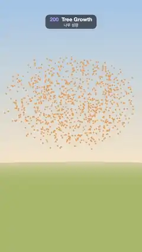

# 200 · Tree Growth · 나무 성장



**EN** A tree grows into a cloud of glowing attraction points, eating them branch by branch (space colonization); leaves pop open, then it all retracts.  
**KO** 나무가 빛나는 끌림점 구름 속으로 자라 가지마다 점을 먹어 치우고(공간 군집화), 잎이 톡톡 피어난 뒤 모두 땅속으로 되감긴다.

[Video (mp4)](https://sueun-dev.github.io/motion-effects/videos/200-tree-growth.mp4) · [Code](../effects/200-tree-growth.js) · Nature & procedural worlds · 자연·절차적 세계

## Prompt (English)

```text
Create a "Tree Growth" motion effect: a 3D tree grown by the space colonization algorithm, so you can watch its branches reach out for, and consume, a cloud of attraction points.

Look
- Attraction points: 1,000 seeded random points inside the crown, an ellipsoid with horizontal radius 3.4 and vertical radius 2.6, its lower part pinched in a little, centred 5.4 units above the ground. They are drawn as small glowing orange spheres (radius 0.04, #FF8C4A, unlit), each drifting on its own small loop of radius 0.14.
- Space colonization (computed once in setup, fixed seed): segment length 0.2, a point pulls branch nodes within 2.0, a point is removed when a new node comes within 0.36.
  - The trunk grows straight up from the ground (tiny ±0.03 wobble) until a point is within reach.
  - Each step, every live point finds its nearest node within 2.0. Each pulled node grows one new node 0.2 along the normalised sum of its pull directions plus a 0.12 upward lift. Skip a node whose pulls cancel out (sum shorter than 0.15) or that already has a child there. Then remove the points the new nodes reached.
  - It ends after about 46 steps with roughly 1,060 nodes and 230 twig tips; every node remembers the step it was born at.
- Branches: one open cylinder (8 sides) per node, from its parent to it, plus a sphere at each joint; bark #6B4A33. Thickness by the pipe model: a node's radius^2.6 is the sum of its children's, twig tips 0.024, counting only the part of the tree grown so far.
- Leaves: three on every twig tip and one on each of the two nodes behind it, a pointed leaf shape (two quadratic curves, about 0.17 wide and 0.42 long) scaled 0.64–0.96, random orientation, colour HSL(hue 0.24–0.32, 60 %, 38–50 %), double-sided, casting shadows.
- Scene: sky gradient #9FC3E8 (top) → #F4E3C9 (62 %) → #E7C79E (bottom); fog #EBD9BD from 26 to 60; hemisphere light #FFF4E0 / #6E7F55 at 1.3; a sun #FFE7C4 at 2.6 from (−6, 12, 7) with a 2048 PCF soft shadow map; a grass-green ground disc #8FA86A of radius 30. ACES Filmic tone mapping.
- Camera: 38° vertical field of view, 19 units from the trunk at height 4, looking at (0, 4.3, 0); the crown fills the upper middle of the frame.

Motion (0–5 s)
- A growth clock T (in algorithm steps) drives everything: T = 46 · easeInOut over 0.1–2.6 s, holds, then runs back to 0 over 3.75–4.95 s.
- A node's segment grows from 0 to full length as T passes its birth step (it scales along the branch from the parent), and its joint sphere appears when it is complete. Radii are recomputed from the pipe model every frame, so the trunk thickens as the crown fills out.
- A point disappears (shrinks over one step) when T passes the step it was consumed; on the way back down it reappears. The points left over fade out at 2.5–3.0 s and the cloud fades back in at 4.2–4.8 s.
- Leaves pop open with an ease-out-back when their node is 3–8 steps old, and fall away (shrink) at 3.35–3.8 s before the branches retract.
- The camera swings round the tree: angle = 0.5 · sin(2π t / 5) rad (about ±29°).
- At 0 s and 5 s there is no tree, only the full point cloud, so the loop is seamless.

Technique
- three.js. The colonization runs in plain JavaScript in setup; per frame only instance matrices change: InstancedMesh for the branch cylinders (scaled radius × length × radius and turned from +y to the segment direction), the joints, the leaves (ShapeGeometry) and the points.

Output and rules
- One self-contained HTML file with no external assets (three.js from a CDN is fine if you use it), drawing on a 1080 × 1920 canvas (9:16) scaled to fit the window.
- Write a function renderFrame(t) that draws the frame for time t in seconds, and preview it with requestAnimationFrame. Everything must be a pure function of t and fixed seeds: no Math.random(), Date or state carried between frames, so frame i = renderFrame(i / 30) can be exported to a 30 fps video.
- Loop seamlessly every 5 seconds: renderFrame(5) must look exactly like renderFrame(0).
- No flicker of any kind: no noise or grain that changes from frame to frame, no strobing or blinking, no z-fighting, no shimmering 1 px lines. Any grain or texture stays fixed to the screen or to the object.
- Keep the top 280 px free of important content (a title label goes there) and fill the whole frame with a designed background.
```

## 프롬프트 (한국어)

```text
"나무 성장" 모션 효과를 만들어 줘: 공간 군집화(space colonization) 알고리즘으로 자라는 3D 나무. 가지가 끌림점 구름을 향해 뻗어 나가 점을 먹어 치우는 모습이 보인다.

모양
- 끌림점: 수관 안의 시드 난수 점 1,000개. 수관은 가로 반지름 3.4, 세로 반지름 2.6의 타원체로 아래쪽이 조금 오므라들고, 중심은 땅 위 5.4. 작은 주황 구(반지름 0.04, #FF8C4A, 조명 없음)로 그리고, 점마다 반지름 0.14의 작은 고리를 따라 떠다닌다.
- 공간 군집화(설정 단계에서 한 번, 고정 시드): 마디 길이 0.2, 점은 2.0 안의 가지 마디를 끌어당기고, 새 마디가 0.36 안으로 오면 그 점은 사라진다.
  - 줄기는 땅에서 곧게(±0.03의 작은 흔들림) 자라다가 점이 닿을 거리에 들어오면 멈춘다.
  - 매 단계, 살아 있는 점마다 2.0 안에서 가장 가까운 마디를 찾는다. 끌린 마디는 끌림 방향들의 정규화 합 + 위로 0.12만큼 들어 올린 방향으로 0.2 떨어진 새 마디를 하나 만든다. 끌림이 서로 상쇄되면(합이 0.15보다 짧으면) 또는 그 자리에 이미 자식이 있으면 건너뛴다. 그다음 새 마디가 닿은 점을 지운다.
  - 약 46단계 만에 끝나고, 마디 약 1,060개와 잔가지 끝 약 230개가 생긴다. 마디마다 태어난 단계를 기억한다.
- 가지: 마디마다 부모에서 자기까지 열린 원기둥(8면) 하나와 이음매 구 하나, 나무껍질 #6B4A33. 굵기는 파이프 모델: 마디 반지름^2.6 = 자식들 반지름^2.6의 합, 잔가지 끝 0.024, 지금까지 자란 부분만 센다.
- 잎: 잔가지 끝마다 세 장, 그 뒤 마디 두 개에 한 장씩. 뾰족한 잎 모양(2차 곡선 두 개, 폭 약 0.17, 길이 0.42), 크기 0.64–0.96배, 방향은 무작위, 색 HSL(색상 0.24–0.32, 채도 60 %, 명도 38–50 %), 양면, 그림자를 드리운다.
- 장면: 하늘 그라디언트 #9FC3E8(위) → #F4E3C9(62 %) → #E7C79E(아래); 안개 #EBD9BD 26–60; 반구광 #FFF4E0 / #6E7F55 세기 1.3; 해 #FFE7C4 세기 2.6, 위치 (−6, 12, 7), 2048 PCF 소프트 그림자; 반지름 30의 풀빛 땅 원판 #8FA86A. ACES Filmic 톤 매핑.
- 카메라: 세로 시야각 38°, 줄기에서 19 떨어진 높이 4에서 (0, 4.3, 0)을 본다. 수관이 화면 가운데 위쪽을 채운다.

움직임 (0–5초)
- 성장 시계 T(알고리즘 단계 단위)가 모든 것을 움직인다: 0.1–2.6초에 T = 46 · easeInOut, 잠시 멈췄다가 3.75–4.95초에 0으로 되감긴다.
- 마디의 원기둥은 T가 그 마디의 탄생 단계를 지날 때 길이 0에서 끝까지 자라고(부모에서 가지 방향으로 늘어남), 다 자라면 이음매 구가 나타난다. 반지름은 매 프레임 파이프 모델로 다시 계산해서 수관이 찰수록 줄기가 굵어진다.
- 점은 T가 자신이 먹힌 단계를 지나면 한 단계에 걸쳐 작아져 사라지고, 되감길 때 다시 나타난다. 남은 점은 2.5–3.0초에 사라지고 구름은 4.2–4.8초에 다시 나타난다.
- 잎은 자기 마디가 3–8단계 자랐을 때 ease-out-back으로 톡 피어나고, 가지가 되감기기 전 3.35–3.8초에 작아지며 떨어진다.
- 카메라는 나무 주위를 흔들며 돈다: 각도 = 0.5 · sin(2π t / 5) rad(약 ±29°).
- 0초와 5초에는 나무 없이 점 구름만 있어 끊김 없이 반복된다.

기법
- three.js. 군집화는 설정 단계에서 순수 자바스크립트로 돌리고, 매 프레임에는 인스턴스 행렬만 바꾼다: 가지 원기둥(반지름 × 길이 × 반지름으로 늘리고 +y에서 마디 방향으로 회전), 이음매, 잎(ShapeGeometry), 점 모두 InstancedMesh.

출력과 규칙
- 외부 파일 없는 HTML 파일 하나(three.js를 쓴다면 CDN은 괜찮다). 1080 × 1920(9:16) 캔버스에 그리고 창 크기에 맞춰 보이게 한다.
- 시간 t(초)의 프레임을 그리는 renderFrame(t) 함수를 만들고, 미리보기는 requestAnimationFrame으로 돌린다. 모든 것은 t와 고정 시드만으로 정해진다: Math.random(), Date, 프레임 사이에 쌓이는 상태 금지. 그래야 i번째 프레임 = renderFrame(i / 30)으로 30fps 영상을 뽑을 수 있다.
- 5초마다 끊김 없이 반복: renderFrame(5)는 renderFrame(0)과 똑같아 보여야 한다.
- 어떤 깜빡임도 금지: 프레임마다 바뀌는 노이즈·그레인, 번쩍임·깜빡임, z-fighting, 반짝이며 떨리는 1px 선 모두 금지. 그레인·질감은 화면이나 물체에 고정한다.
- 위쪽 280px에는 중요한 내용을 두지 않고(제목 라벨 자리), 화면 전체를 디자인된 배경으로 채운다.
```
