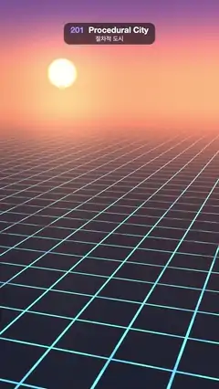

# 201 · Procedural City · 절차적 도시



**EN** A round city rises out of a glowing street-plan grid at dusk, lot by lot from downtown outwards, its lit windows warm against the setting sun.  
**KO** 해 질 녘 빛나는 도로 설계도 격자에서 둥근 도시가 도심부터 바깥으로 필지마다 솟아오르고, 지는 해를 배경으로 창문 불빛이 켜진다.

[Video (mp4)](https://sueun-dev.github.io/motion-effects/videos/201-procedural-city.mp4) · [Code](../effects/201-procedural-city.js) · Nature & procedural worlds · 자연·절차적 세계

## Prompt (English)

```text
Create a "Procedural City" motion effect: a city generated from a street grid and a few seeded rules, rising out of a glowing plan at dusk while the camera glides above it.

Look
- Layout (seeded random, computed once): square blocks of 7 units including a 1.6-unit street, blocks −6..6 each way, kept inside a radius of 6.5 blocks so the city is round.
  - Each lot is one building (45 %), two halves or four quarters; each building is inset 0.25–0.55 from its part of the lot.
  - Height = 1.2 + 3 · r + downtown · (6 + 20 · r²), with downtown = exp(−(bx² + bz²) / 9), so towers cluster in the middle.
  - Buildings taller than 10 get a stepped top 60 % of the time: a second box with 66 % of the footprint and 1.18–1.38 × the height.
  - All buildings are one instanced unit box (pivot at its base), with a per-instance height, seed and distance from the centre.
- Facades are drawn in the fragment shader from the position on the building: window cells 0.44–0.58 wide (per building) and 0.5 tall, each window 60 % × 55 % of its cell, box-filtered over 1.5 × the pixel footprint (fwidth). A hash per window decides lit or dark (each building has its own share of lit windows); as a cell shrinks from about 7 to 2.5 pixels across, the windows fade to their average (35 % lit), so far facades never sparkle.
  - Lit windows: warm #FFB866 × 1.4, or cool #B3D9FF for a quarter of the buildings. Dark windows reflect the sky (× 0.35).
  - Walls: dark blue-grey #1A1C29 to plum-brown #332B2E by seed, lit 0.7 + 0.5 · max(n · (0.3, 0.4, −1), 0) from the bright west; roofs at 70 %.
- Ground: streets are warm amber bands #6B4224 between dark lots #0D0D14. Wherever the buildings have not risen (and everywhere beyond the city), it is a plan instead: deep blue #0D1A2E with glowing cyan street lines (#40BFFF × 1.4, 4 % of a block wide), filtered the same way and faded out where a block is less than about 12 pixels across, before the lines get thinner than half a pixel.
- Dusk sky: horizon #FA946B to violet #735494 by elevation 0.16 to night blue #141C47 by 0.5, a warm glow towards the city's far side and a low setting sun disc at direction (−0.45, 0.018, −1). Haze towards the sky: 1 − exp(−(distance / 260)^1.8).
- Camera: 44° vertical field of view, 84 units from the centre at height about 31, looking at (0, 8, −6): the downtown towers stand in the middle of the frame with the sun and the plan grid behind.

Motion (0–5 s)
- A building at distance ρ from the centre rises: u = clamp((t − 0.25 − 1.6 · ρ / 48 − 0.2 · seed) / 0.9), eased out with a small overshoot (1 + 2.2 · (u − 1)³ + 1.2 · (u − 1)²). Its box is scaled in height by that amount from the ground up, so the windows stay put and the roof climbs past them. Downtown first, the edge by about 2.9 s.
- From 3.7 s (edge first) to 4.8 s (centre last) every building sinks back (smoothstep over 0.5 s each) and the plan grid glows again: empty at 0 s and 5 s.
- The camera glides: orbit angle 0.35 + 0.045 · sin(2π t / 5) rad (about ±2.6°), height 31 − 2 · cos(2π t / 5).

Technique
- three.js: one InstancedMesh of boxes with a ShaderMaterial; the rise is done in the vertex shader (scale y by rise), the windows in the fragment shader with an analytic box-filtered pulse train (integrate the pulse over the pixel's footprint) instead of a texture.
- The ground is one big plane with the same filtered pulses for streets and plan lines; the sky is a back-faced sphere.
- Motion blur: each frame averages 8 renders spread over its 1/30 s (4× multisampled half-float target).

Output and rules
- One self-contained HTML file with no external assets (three.js from a CDN is fine if you use it), drawing on a 1080 × 1920 canvas (9:16) scaled to fit the window.
- Write a function renderFrame(t) that draws the frame for time t in seconds, and preview it with requestAnimationFrame. Everything must be a pure function of t and fixed seeds: no Math.random(), Date or state carried between frames, so frame i = renderFrame(i / 30) can be exported to a 30 fps video.
- Loop seamlessly every 5 seconds: renderFrame(5) must look exactly like renderFrame(0).
- No flicker of any kind: no noise or grain that changes from frame to frame, no strobing or blinking, no z-fighting, no shimmering 1 px lines. Any grain or texture stays fixed to the screen or to the object.
- Keep the top 280 px free of important content (a title label goes there) and fill the whole frame with a designed background.
```

## 프롬프트 (한국어)

```text
"절차적 도시" 모션 효과를 만들어 줘: 도로 격자와 시드 규칙 몇 개로 만든 도시가 해 질 녘 빛나는 설계도에서 솟아오르고, 카메라가 그 위를 미끄러지듯 지나간다.

모양
- 배치(시드 난수, 한 번만 계산): 도로 1.6을 포함해 한 변 7인 정사각 블록, 블록 좌표 −6..6, 반지름 6.5블록 안만 남겨 도시가 둥글다.
  - 필지마다 건물 하나(45 %), 반으로 둘, 또는 넷으로 나눈다. 건물은 자기 몫의 필지에서 0.25–0.55 안쪽으로 물러선다.
  - 높이 = 1.2 + 3 · r + 도심 · (6 + 20 · r²), 도심 = exp(−(bx² + bz²) / 9). 그래서 고층이 가운데에 모인다.
  - 높이 10이 넘는 건물은 60 % 확률로 계단식 꼭대기를 얹는다: 바닥 면적 66 %, 높이 1.18–1.38배인 상자 하나 더.
  - 모든 건물은 인스턴싱한 단위 상자 하나(기준점은 밑면), 인스턴스마다 높이, 시드, 중심에서의 거리를 가진다.
- 외벽은 건물 위 위치로 프래그먼트 셰이더에서 그린다: 창 칸 폭 0.44–0.58(건물마다), 높이 0.5, 창은 칸의 60 % × 55 %, 픽셀 영역(fwidth)의 1.5배로 상자 필터링. 창마다 해시로 켜짐/꺼짐을 정한다(건물마다 켜진 비율이 다름). 칸 크기가 약 7픽셀에서 2.5픽셀로 줄어드는 사이 창이 평균(35 % 켜짐)으로 바뀌어 먼 외벽이 반짝이지 않는다.
  - 켜진 창: 따뜻한 #FFB866 × 1.4, 건물 4분의 1은 차가운 #B3D9FF. 꺼진 창은 하늘을 비춘다(× 0.35).
  - 벽: 시드에 따라 어두운 청회색 #1A1C29에서 자줏빛 갈색 #332B2E, 밝은 서쪽에서 0.7 + 0.5 · max(n · (0.3, 0.4, −1), 0)로 비춘다. 지붕은 70 %.
- 땅: 도로는 어두운 필지 #0D0D14 사이의 따뜻한 호박색 띠 #6B4224. 건물이 아직 솟지 않은 곳(그리고 도시 밖 전부)은 설계도: 짙은 파랑 #0D1A2E 위에 빛나는 하늘색 도로선(#40BFFF × 1.4, 블록 폭의 4 %), 같은 방식으로 필터링하고, 블록이 약 12픽셀보다 작아지는 곳에서는 선이 반 픽셀보다 가늘어지기 전에 흐려진다.
- 해 질 녘 하늘: 지평선 #FA946B에서 고도 0.16의 보라 #735494, 고도 0.5의 밤하늘 #141C47로, 도시 너머 쪽으로 따뜻한 빛, 방향 (−0.45, 0.018, −1)에 낮게 지는 해. 하늘색으로 연무: 1 − exp(−(거리 / 260)^1.8).
- 카메라: 세로 시야각 44°, 중심에서 84 떨어진 높이 약 31에서 (0, 8, −6)을 본다. 도심 고층 건물이 화면 가운데 서고, 뒤로 해와 설계도 격자가 보인다.

움직임 (0–5초)
- 중심에서 거리 ρ인 건물이 솟는다: u = clamp((t − 0.25 − 1.6 · ρ / 48 − 0.2 · 시드) / 0.9), 살짝 넘쳤다 돌아오는 ease-out(1 + 2.2 · (u − 1)³ + 1.2 · (u − 1)²). 상자를 땅에서부터 그만큼 높이로 늘려서 창은 제자리에 있고 지붕이 창을 지나 올라간다. 도심이 먼저, 가장자리는 약 2.9초까지.
- 3.7초(가장자리 먼저)부터 4.8초(중심 마지막)까지 모든 건물이 다시 내려가고(각각 0.5초 smoothstep) 설계도 격자가 다시 빛난다: 0초와 5초에는 비어 있다.
- 카메라가 미끄러진다: 궤도 각 0.35 + 0.045 · sin(2π t / 5) rad(약 ±2.6°), 높이 31 − 2 · cos(2π t / 5).

기법
- three.js: 상자 InstancedMesh 하나와 ShaderMaterial. 솟아오름은 버텍스 셰이더에서(y를 rise만큼 늘림), 창은 프래그먼트 셰이더에서 텍스처 대신 해석적으로 상자 필터링한 펄스 열(픽셀 영역에 걸쳐 펄스를 적분)로 그린다.
- 땅은 큰 평면 하나, 도로와 설계도 선도 같은 필터링 펄스. 하늘은 안쪽 면 구.
- 모션 블러: 프레임마다 1/30초에 걸친 8번의 렌더를 평균한다(4× 멀티샘플 half-float 타깃).

출력과 규칙
- 외부 파일 없는 HTML 파일 하나(three.js를 쓴다면 CDN은 괜찮다). 1080 × 1920(9:16) 캔버스에 그리고 창 크기에 맞춰 보이게 한다.
- 시간 t(초)의 프레임을 그리는 renderFrame(t) 함수를 만들고, 미리보기는 requestAnimationFrame으로 돌린다. 모든 것은 t와 고정 시드만으로 정해진다: Math.random(), Date, 프레임 사이에 쌓이는 상태 금지. 그래야 i번째 프레임 = renderFrame(i / 30)으로 30fps 영상을 뽑을 수 있다.
- 5초마다 끊김 없이 반복: renderFrame(5)는 renderFrame(0)과 똑같아 보여야 한다.
- 어떤 깜빡임도 금지: 프레임마다 바뀌는 노이즈·그레인, 번쩍임·깜빡임, z-fighting, 반짝이며 떨리는 1px 선 모두 금지. 그레인·질감은 화면이나 물체에 고정한다.
- 위쪽 280px에는 중요한 내용을 두지 않고(제목 라벨 자리), 화면 전체를 디자인된 배경으로 채운다.
```
