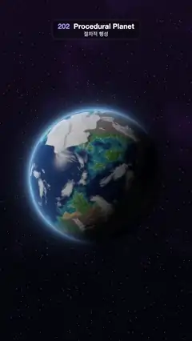

# 202 · Procedural Planet · 절차적 행성



**EN** A noise-built planet turns once: fBm continents with beaches, forests, deserts and peaks, polar ice, drifting clouds and a blue atmosphere rim.  
**KO** 노이즈로 만든 행성이 한 바퀴 돈다: 해변·숲·사막·봉우리가 있는 fBm 대륙, 극지 얼음, 흘러가는 구름, 푸른 대기 테두리.

[Video (mp4)](https://sueun-dev.github.io/motion-effects/videos/202-procedural-planet.mp4) · [Code](../effects/202-procedural-planet.js) · Nature & procedural worlds · 자연·절차적 세계

## Prompt (English)

```text
Create a "Procedural Planet" motion effect: an Earth-like planet whose every feature comes from 3D noise sampled on a sphere, turning once in space.

Look
- One full-screen fragment shader. A unit sphere is hit analytically; the camera sits at (0, 0, 3.9) with focal length 2.6 (uv = (2 · pixel − resolution) / width, shifted by +0.06 so the planet sits a little below the middle). The planet is about 740 px across.
- Planet space: the spin axis is tilted 0.8 rad towards the camera and rolled 0.35 rad, so the north pole leans towards us.
- Height from 3D simplex noise at the surface point q:
  - continents c = fBm(4 octaves, lacunarity 2.03) of 0.95 · q + 0.06 · noise(16 q) + 0.03 · noise(32 q) − 0.04 (the last two give crinkly coastlines);
  - mountain chains: ridged noise r = 1 − |noise(2.6 q + 7)|, added as 0.22 · r³ · smoothstep(0, 0.2, c);
  - sea level is 0.
- Colours: sea from shallow teal #0F7394 to deep navy #041238 over depth 0–0.16; land forest #2E6624 or desert #BD9452 by a noise mask (no deserts towards the poles); beach #DBCC94 for heights 0–0.025; rock #665445 from 0.16 to 0.30; snow #E0E0E6 above 0.44–0.52; ice caps #EBF5FF above latitude 0.93–0.95 (± a little noise).
- Bump lighting on land: finite differences of the height 0.01 along two tangents tilt the normal (n = normalize(q − 2 · (t1 · Δh1 + t2 · Δh2))); the sea stays smooth and gets a sun glint (Phong power 50, × 0.7, warm white).
- Clouds: a second noise field, domain-warped by 0.14 · noise(1.6 q), fBm at 2 · q plus fine detail, density smoothstep(0.14, 0.42, f), thinner at the equator. White clouds cover the ground by 90 % of their density and cast shadows (density sampled 0.04 towards the sun darkens the ground by up to 55 %).
- Light: sun direction (−0.80, 0.42, 0.43) normalised, a soft terminator smoothstep(−0.1, 0.25, n · sun), a faint blue ambient on the night side.
- Atmosphere: a blue rim #4D8CFF where rays graze the sphere, exp(−|b − 1| / 0.03) + 0.25 · exp(−(b − 1) / 0.12) for the closest approach b of the ray, only on the sunlit side, plus a Fresnel haze (1 − n · v)^2.5 on the disc.
- Space: a dark gradient #030308 → #0B0613 upward, a faint violet nebula from fBm at pixel / 700, and fixed stars: one Gaussian dot (radius about 1.2 px) in 7 % of the 9 × 9 px cells, fixed to the screen.
- Tone: 1 − exp(−1.25 · colour), gamma 0.9, a fixed grain of ±0.5/255.

Motion (0–5 s)
- The planet turns exactly once about its tilted axis per loop (2π · t / 5). The clouds turn with it and drift on a small closed loop (0.05 · (cos, sin) of 2π t / 5 added to their noise coordinates), so they slide over the ground and come back.

Technique
- Ray–sphere intersection instead of marching; all surface detail is noise evaluated at the hit point in planet space (3D noise on the sphere, so there is no seam or pole pinch).
- 8 samples per pixel: 8 spots inside the pixel (golden-ratio offsets) and 8 moments spread over a third of a frame, which smooths edges and adds a touch of motion blur to the turning detail.

Output and rules
- One self-contained HTML file with no external assets (three.js from a CDN is fine if you use it), drawing on a 1080 × 1920 canvas (9:16) scaled to fit the window.
- Write a function renderFrame(t) that draws the frame for time t in seconds, and preview it with requestAnimationFrame. Everything must be a pure function of t and fixed seeds: no Math.random(), Date or state carried between frames, so frame i = renderFrame(i / 30) can be exported to a 30 fps video.
- Loop seamlessly every 5 seconds: renderFrame(5) must look exactly like renderFrame(0).
- No flicker of any kind: no noise or grain that changes from frame to frame, no strobing or blinking, no z-fighting, no shimmering 1 px lines. Any grain or texture stays fixed to the screen or to the object.
- Keep the top 280 px free of important content (a title label goes there) and fill the whole frame with a designed background.
```

## 프롬프트 (한국어)

```text
"절차적 행성" 모션 효과를 만들어 줘: 모든 지형이 구 위에서 읽은 3D 노이즈로 만들어진 지구 같은 행성이 우주에서 한 바퀴 도는 효과.

모양
- 전체 화면 프래그먼트 셰이더 하나. 단위 구와의 교차를 해석적으로 구하고, 카메라는 (0, 0, 3.9), 초점 거리 2.6(uv = (2 · 픽셀 − 해상도) / 너비, +0.06만큼 옮겨 행성이 가운데보다 조금 아래). 행성 지름은 약 740px.
- 행성 공간: 자전축을 카메라 쪽으로 0.8 rad 기울이고 0.35 rad 돌려서 북극이 우리 쪽으로 기운다.
- 표면점 q에서 3D 심플렉스 노이즈로 높이:
  - 대륙 c = 0.95 · q의 fBm(옥타브 4개, 배율 2.03) + 0.06 · noise(16 q) + 0.03 · noise(32 q) − 0.04(뒤의 두 항이 해안선을 들쭉날쭉하게);
  - 산맥: 리지드 노이즈 r = 1 − |noise(2.6 q + 7)|, 0.22 · r³ · smoothstep(0, 0.2, c)로 더한다;
  - 해수면은 0.
- 색: 바다는 깊이 0–0.16에 따라 얕은 청록 #0F7394에서 짙은 남색 #041238로; 육지는 노이즈 마스크로 숲 #2E6624 또는 사막 #BD9452(극지 쪽엔 사막 없음); 높이 0–0.025는 해변 #DBCC94; 0.16–0.30은 바위 #665445; 0.44–0.52 이상은 눈 #E0E0E6; 위도 0.93–0.95 이상(약간의 노이즈)은 극관 #EBF5FF.
- 육지의 범프 조명: 두 접선 방향으로 0.01 떨어진 높이 차로 법선을 기울인다(n = normalize(q − 2 · (t1 · Δh1 + t2 · Δh2))). 바다는 매끈하게 두고 햇빛 반짝임(퐁 지수 50, × 0.7, 따뜻한 흰색)을 준다.
- 구름: 두 번째 노이즈 장, 0.14 · noise(1.6 q)로 좌표를 비틀고 2 · q의 fBm에 잔 디테일을 더해 밀도 smoothstep(0.14, 0.42, f), 적도에서 옅게. 흰 구름이 밀도의 90 %만큼 땅을 덮고 그림자를 드리운다(해 쪽으로 0.04 옮긴 곳의 밀도로 땅을 최대 55 % 어둡게).
- 빛: 해 방향 (−0.80, 0.42, 0.43) 정규화, 부드러운 명암 경계 smoothstep(−0.1, 0.25, n · 해), 밤 쪽엔 옅은 푸른 주변광.
- 대기: 광선이 구를 스칠 때 파란 테두리 #4D8CFF, 광선의 최근접 거리 b에 대해 exp(−|b − 1| / 0.03) + 0.25 · exp(−(b − 1) / 0.12), 햇빛 받는 쪽에만. 원반 위에는 프레넬 연무 (1 − n · v)^2.5.
- 우주: 위로 갈수록 어두운 그라디언트 #030308 → #0B0613, 픽셀 / 700의 fBm으로 옅은 보라 성운, 고정된 별: 9 × 9px 칸의 7 %에 가우스 점(반지름 약 1.2px) 하나, 화면에 고정.
- 톤: 1 − exp(−1.25 · 색), 감마 0.9, ±0.5/255의 고정 그레인.

움직임 (0–5초)
- 행성이 기울어진 축을 중심으로 루프마다 정확히 한 바퀴 돈다(2π · t / 5). 구름은 행성과 함께 돌면서 작은 닫힌 고리를 따라 흘러(노이즈 좌표에 2π t / 5의 0.05 · (cos, sin)을 더함) 땅 위를 미끄러졌다 돌아온다.

기법
- 레이마칭 대신 광선-구 교차. 표면 디테일은 모두 행성 공간의 교차점에서 계산한 노이즈(구 위의 3D 노이즈라 이음매나 극점 뭉침이 없다).
- 픽셀당 8샘플: 픽셀 안 8곳(황금비 오프셋)과 프레임의 3분의 1에 걸친 8순간. 가장자리가 매끈해지고 도는 디테일에 살짝 모션 블러가 생긴다.

출력과 규칙
- 외부 파일 없는 HTML 파일 하나(three.js를 쓴다면 CDN은 괜찮다). 1080 × 1920(9:16) 캔버스에 그리고 창 크기에 맞춰 보이게 한다.
- 시간 t(초)의 프레임을 그리는 renderFrame(t) 함수를 만들고, 미리보기는 requestAnimationFrame으로 돌린다. 모든 것은 t와 고정 시드만으로 정해진다: Math.random(), Date, 프레임 사이에 쌓이는 상태 금지. 그래야 i번째 프레임 = renderFrame(i / 30)으로 30fps 영상을 뽑을 수 있다.
- 5초마다 끊김 없이 반복: renderFrame(5)는 renderFrame(0)과 똑같아 보여야 한다.
- 어떤 깜빡임도 금지: 프레임마다 바뀌는 노이즈·그레인, 번쩍임·깜빡임, z-fighting, 반짝이며 떨리는 1px 선 모두 금지. 그레인·질감은 화면이나 물체에 고정한다.
- 위쪽 280px에는 중요한 내용을 두지 않고(제목 라벨 자리), 화면 전체를 디자인된 배경으로 채운다.
```
