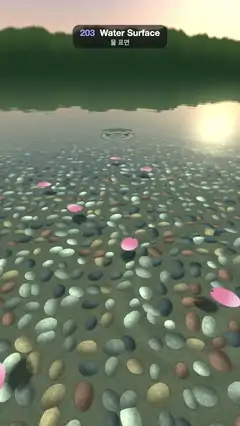

# 203 · Water Surface · 물 표면



**EN** Drops ring a clear pond: near water shows pebbles bent by refraction, far water mirrors the tree line (Fresnel), and petals ride the ripples.  
**KO** 물방울이 맑은 연못에 동심원을 그린다: 가까운 물은 굴절로 일렁이는 조약돌이, 먼 물은 숲을 비추는 거울이 되고(프레넬), 꽃잎이 물결을 탄다.

[Video (mp4)](https://sueun-dev.github.io/motion-effects/videos/203-water-surface.mp4) · [Code](../effects/203-water-surface.js) · Nature & procedural worlds · 자연·절차적 세계

## Prompt (English)

```text
Create a "Water Surface" motion effect: a clear pond seen from the bank, where every pixel's view ray is both reflected and refracted at the rippled surface and the two are mixed by the Fresnel term.

Look
- One full-screen fragment shader. Camera at height 1.0, looking down 0.53 rad (about 30°), focal length 2.0 (uv = (2 · pixel − resolution) / width). The horizon sits about 330 px from the top: a far bank of trees above it, water below.
- Water: the plane y = 0 with a height field h(x, z) (below). Normal from central differences of h (step 0.003), the ripples faded by 1 / (1 + 0.05 · distance²) far away so they never alias.
- Reflection: reflect the view ray off the normal and look up the sky: warm peach #FFCC9E at the horizon to soft blue #6B94DB by elevation 0.45, a glow round a low sun at direction (0.35, 0.20, −0.92), and a tree line of dark greens (#1A301F → #384D29) up to elevation 0.11 + 0.05 · fBm(2 · azimuth) + 0.015 · fBm(14 · azimuth), with a 0.006 soft edge. The same sky is drawn directly above the horizon.
- Refraction: refract the view ray with index 1/1.33 and hit a bed 0.42 below. The bed is river stones: one oval stone per cell of a 0.12 grid (jittered centre, radius 0.36–0.56 of a cell, random angle, stretched 1.35×; the tallest dome wins where they overlap), coloured from six stone colours (warm grey, slate, ochre, rust, charcoal, cream) with a fine speckle, shaded as a dome lit from the upper left, with a dark contact edge on sandy gaps. Beyond 2–5.5 units the stones blend to their average colour #807569 (no moiré).
- Caustics: brightness × clamp(1 − 0.03 · Laplacian(h) / e², 0.4, 2.2) at the stone's point (e = 0.012), so light bunches under the rings.
- Water colour: absorption exp(−path · (0.38, 0.16, 0.15)) plus a teal scatter #0D2124 × (1 − exp(−0.6 · path)).
- Fresnel (Schlick, F0 = 0.02): colour = mix(refracted, reflected, 0.02 + 0.98 · (1 − n · v)^5). Near the camera the water is clear; towards the horizon it turns into a mirror of the trees and sky. Plus a small sun glint (power 300).
- Seven pink petals float on the surface: soft ovals 0.11 × 0.15 with a notch at the tip, colour #FFDBE6 → #F28CAD, lit by the rippled normal, and their shadows darken the stones below.

Motion (0–5 s)
- Seven drops land at fixed places and times (0.25, 0.95, 1.65, 2.25, 3.0, 3.65 and 4.3 s). Each sends out a ring packet: front = 0.30 · τ + 0.03, width 0.07 + 0.08 · τ, h += 0.04 · strength · exp(−((r − front) / width)²) · exp(−1.1 · τ) / (1 + 3r) · sin(34 · (r − front)), with τ the time since the drop. Each drop's ring from the previous loop (τ + 5) is added too, so 5 s meets 0 s.
- A faint breeze: 0.001 · sin(p · (7, 4) − 2 · 2π t / 5) + 0.0008 · sin(p · (−5, 8) + 2π t / 5).
- The petals drift on small circles of radius 0.06 and rock ±0.35 rad, once per loop.

Technique
- Per pixel: ray–plane hit, analytic height field with finite-difference normals, reflect() into a procedural sky, refract() onto a procedural stone bed, Beer–Lambert absorption and the Schlick Fresnel mix. 2 × 2 supersampling, gamma 0.95, a fixed grain of ±0.5/255.

Output and rules
- One self-contained HTML file with no external assets (three.js from a CDN is fine if you use it), drawing on a 1080 × 1920 canvas (9:16) scaled to fit the window.
- Write a function renderFrame(t) that draws the frame for time t in seconds, and preview it with requestAnimationFrame. Everything must be a pure function of t and fixed seeds: no Math.random(), Date or state carried between frames, so frame i = renderFrame(i / 30) can be exported to a 30 fps video.
- Loop seamlessly every 5 seconds: renderFrame(5) must look exactly like renderFrame(0).
- No flicker of any kind: no noise or grain that changes from frame to frame, no strobing or blinking, no z-fighting, no shimmering 1 px lines. Any grain or texture stays fixed to the screen or to the object.
- Keep the top 280 px free of important content (a title label goes there) and fill the whole frame with a designed background.
```

## 프롬프트 (한국어)

```text
"물 표면" 모션 효과를 만들어 줘: 물가에서 내려다본 맑은 연못. 픽셀마다 시선 광선이 물결치는 수면에서 반사와 굴절을 함께 하고, 둘을 프레넬 항으로 섞는다.

모양
- 전체 화면 프래그먼트 셰이더 하나. 카메라 높이 1.0, 아래로 0.53 rad(약 30°), 초점 거리 2.0(uv = (2 · 픽셀 − 해상도) / 너비). 지평선은 위에서 약 330px: 그 위로 먼 숲, 아래는 물.
- 물: 높이장 h(x, z)(아래)를 가진 평면 y = 0. 법선은 h의 중앙 차분(간격 0.003), 멀리서는 물결을 1 / (1 + 0.05 · 거리²)로 줄여 에일리어싱이 생기지 않게.
- 반사: 시선을 법선에 반사해 하늘을 읽는다: 지평선의 복숭아색 #FFCC9E에서 고도 0.45의 부드러운 파랑 #6B94DB로, 방향 (0.35, 0.20, −0.92)의 낮은 해 주변 빛무리, 고도 0.11 + 0.05 · fBm(2 · 방위각) + 0.015 · fBm(14 · 방위각)까지 올라오는 짙은 초록(#1A301F → #384D29) 숲 선, 가장자리 0.006 부드럽게. 지평선 위에는 같은 하늘을 직접 그린다.
- 굴절: 굴절률 1/1.33으로 시선을 꺾어 0.42 아래 바닥에 닿게 한다. 바닥은 강돌: 0.12 격자 칸마다 타원 돌 하나(중심 흔들림, 반지름 칸의 0.36–0.56, 무작위 각도, 1.35배 늘림, 겹치면 더 높은 돔이 이긴다), 여섯 가지 돌 색(따뜻한 회색, 슬레이트, 황토, 녹슨 붉은색, 숯색, 크림) 중 하나에 잔 반점, 왼쪽 위에서 비춘 돔처럼 음영, 모래 틈과 닿는 곳은 어둡게. 거리 2–5.5 너머에서는 돌이 평균색 #807569로 섞인다(모아레 없음).
- 커스틱: 돌 위 지점에서 밝기 × clamp(1 − 0.03 · 라플라시안(h) / e², 0.4, 2.2)(e = 0.012). 물결 밑으로 빛이 모인다.
- 물색: 흡수 exp(−경로 · (0.38, 0.16, 0.15)) + 청록 산란 #0D2124 × (1 − exp(−0.6 · 경로)).
- 프레넬(슐릭, F0 = 0.02): 색 = mix(굴절, 반사, 0.02 + 0.98 · (1 − n · v)^5). 카메라 가까이는 맑고, 지평선 쪽으로 갈수록 숲과 하늘을 비추는 거울이 된다. 작은 햇빛 반짝임(지수 300)을 더한다.
- 분홍 꽃잎 일곱 장이 떠 있다: 끝이 살짝 파인 0.11 × 0.15의 부드러운 타원, 색 #FFDBE6 → #F28CAD, 물결 법선으로 음영, 그림자가 아래 돌을 어둡게 한다.

움직임 (0–5초)
- 물방울 일곱 개가 정해진 곳과 시각(0.25, 0.95, 1.65, 2.25, 3.0, 3.65, 4.3초)에 떨어진다. 각각 고리 묶음을 내보낸다: 앞선 = 0.30 · τ + 0.03, 폭 0.07 + 0.08 · τ, h += 0.04 · 세기 · exp(−((r − 앞선) / 폭)²) · exp(−1.1 · τ) / (1 + 3r) · sin(34 · (r − 앞선)), τ는 떨어진 뒤 시간. 지난 루프의 고리(τ + 5)도 더해서 5초가 0초와 맞물린다.
- 옅은 미풍: 0.001 · sin(p · (7, 4) − 2 · 2π t / 5) + 0.0008 · sin(p · (−5, 8) + 2π t / 5).
- 꽃잎은 루프마다 한 번, 반지름 0.06의 작은 원을 그리며 떠다니고 ±0.35 rad 흔들린다.

기법
- 픽셀마다: 광선-평면 교차, 해석적 높이장과 유한 차분 법선, reflect()로 절차적 하늘, refract()로 절차적 돌 바닥, 비어-람베르트 흡수, 슐릭 프레넬 섞기. 2 × 2 슈퍼샘플링, 감마 0.95, ±0.5/255의 고정 그레인.

출력과 규칙
- 외부 파일 없는 HTML 파일 하나(three.js를 쓴다면 CDN은 괜찮다). 1080 × 1920(9:16) 캔버스에 그리고 창 크기에 맞춰 보이게 한다.
- 시간 t(초)의 프레임을 그리는 renderFrame(t) 함수를 만들고, 미리보기는 requestAnimationFrame으로 돌린다. 모든 것은 t와 고정 시드만으로 정해진다: Math.random(), Date, 프레임 사이에 쌓이는 상태 금지. 그래야 i번째 프레임 = renderFrame(i / 30)으로 30fps 영상을 뽑을 수 있다.
- 5초마다 끊김 없이 반복: renderFrame(5)는 renderFrame(0)과 똑같아 보여야 한다.
- 어떤 깜빡임도 금지: 프레임마다 바뀌는 노이즈·그레인, 번쩍임·깜빡임, z-fighting, 반짝이며 떨리는 1px 선 모두 금지. 그레인·질감은 화면이나 물체에 고정한다.
- 위쪽 280px에는 중요한 내용을 두지 않고(제목 라벨 자리), 화면 전체를 디자인된 배경으로 채운다.
```
