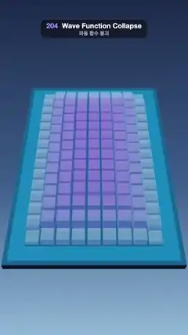

# 204 · Wave Function Collapse · 파동 함수 붕괴



**EN** Glass columns of possibilities shrink as wave function collapse picks tiles one cell at a time, and an island of sand, grass and forest drops into place.  
**KO** 가능성의 유리 기둥이 줄어드는 동안 파동 함수 붕괴가 칸마다 타일을 하나씩 골라, 모래·풀밭·숲으로 된 섬이 차례로 내려앉는다.

[Video (mp4)](https://sueun-dev.github.io/motion-effects/videos/204-wave-function-collapse.mp4) · [Code](../effects/204-wave-function-collapse.js) · Nature & procedural worlds · 자연·절차적 세계

## Prompt (English)

```text
Create a "Wave Function Collapse" motion effect: a 3D tile island assembled by the WFC algorithm, with each undecided cell shown as a glass column whose height is its remaining number of options.

Look
- Board: 11 × 17 cells of size 1 on a dark slab (#2B3E5E, 0.5 thick) under a translucent sea plane #2A86C8 (opacity 0.6).
- Tile set: a tile is defined by the terrain level of its four corners [nw, ne, se, sw], levels 0 sea, 1 sand, 2 grass, 3 forest, with all four corners within one level of each other: 46 tiles. Two neighbours fit when they agree on the two corners of their shared edge.
- Each tile is a small block of land: its top is a 4 × 4 patch whose height blends bilinearly between the corner heights (−0.05, 0.16, 0.42, 0.8 for the four levels), flat-shaded, each triangle coloured by its height: sea #2A86C8, sand #F0CF7E, grass #6DC25A, forest #2F7F45. Pines (cones of radius 0.12, 0.34–0.52 tall, #2E6E44 on a brown stem) stand on forest: four on all-forest tiles, one where at least two corners are forest. A cottage (white walls #F4EDE2, a red-orange pyramid roof #D9644A) sits on 60 % of the flat grass tiles.
- Superposition columns: every undecided cell shows a glass box 0.84 wide whose height is 0.06 + 1.6 · ln(options) / ln(46): 1.66 when anything is possible, gone when one tile is left. Colour from violet #9C86FF (tall) to cyan #7FE7FF (short), opacity 0.55, a violet glow #4A33B0.
- Scene: background gradient #1B2A4A (top) → #3C5E8C (55 %) → #8FB7D6 (bottom); hemisphere light #EAF2FF / #2A3B55 at 1.5; a warm sun #FFF0D8 at 2.2 from (−7, 6, 2); ACES Filmic tone mapping.
- Camera: 50° vertical field of view, at (0, 21, 18.5) looking at (0, 0, 0.9): the whole board fills the middle of the frame at a steep angle.

The algorithm (run once in setup with a fixed seed; retry the next seed on a contradiction)
- Border cells are fixed to open sea; then propagate.
- Repeat: pick the undecided cell with the fewest options (ties broken by a small seeded jitter); choose one of its tiles at random, weighted by exp(−(mean level − want)² / 0.35), × 3 for flat tiles, with want = 4.4 · (1 − hypot(x / 5.4, z / 8.4)) + 0.2 (high in the middle, sea at the rim). The first two picks plant forest at the two hill centres (5, 5) and (5, 11).
- Propagate: from the changed cell, every neighbour keeps only the tiles that fit some remaining tile of the cell; when a neighbour shrinks, its neighbours are checked in turn (a queue).
- Record each cell's option count after every step. With seed 204 the island is finished in 47 steps.

Motion (0–5 s)
- A clock s in steps runs from 0 to 53 (47 + 6) with easeInOut over 0.3–3.7 s, holds, then rewinds to 0 over 4.25–4.9 s.
- Column heights follow the recorded option counts, interpolated between steps, so you see the neighbours of each new tile shrink as constraints propagate.
- A decided tile drops in over the next 6 steps: from 0.9 above with an ease-out-bounce, growing from 40 % to full size. On the rewind they lift away and the columns grow back.
- The board turns gently: 0.2 · sin(2π t / 5) rad about the vertical axis. At 0 s and 5 s the board is back to its starting state (sea round the rim, columns everywhere else), so the loop is seamless.

Technique
- three.js. The solver is plain JavaScript (arrays of tile indices per cell, arc-consistency propagation with a queue). Each tile geometry is built once and shared; the columns are one InstancedMesh with per-instance colour, transparent, depthWrite off.

Output and rules
- One self-contained HTML file with no external assets (three.js from a CDN is fine if you use it), drawing on a 1080 × 1920 canvas (9:16) scaled to fit the window.
- Write a function renderFrame(t) that draws the frame for time t in seconds, and preview it with requestAnimationFrame. Everything must be a pure function of t and fixed seeds: no Math.random(), Date or state carried between frames, so frame i = renderFrame(i / 30) can be exported to a 30 fps video.
- Loop seamlessly every 5 seconds: renderFrame(5) must look exactly like renderFrame(0).
- No flicker of any kind: no noise or grain that changes from frame to frame, no strobing or blinking, no z-fighting, no shimmering 1 px lines. Any grain or texture stays fixed to the screen or to the object.
- Keep the top 280 px free of important content (a title label goes there) and fill the whole frame with a designed background.
```

## 프롬프트 (한국어)

```text
"파동 함수 붕괴" 모션 효과를 만들어 줘: WFC 알고리즘이 조립하는 3D 타일 섬. 아직 정해지지 않은 칸은 남은 선택지 수만큼의 높이를 가진 유리 기둥으로 보인다.

모양
- 판: 크기 1인 칸 11 × 17개, 어두운 받침(#2B3E5E, 두께 0.5) 위에 반투명 바다 평면 #2A86C8(불투명도 0.6).
- 타일 세트: 타일은 네 모서리 [북서, 북동, 남동, 남서]의 지형 단계로 정한다. 단계 0 바다, 1 모래, 2 풀밭, 3 숲, 네 모서리가 서로 한 단계 이내: 타일 46개. 두 이웃은 맞닿은 변의 두 모서리가 같을 때 들어맞는다.
- 타일은 작은 땅 블록: 윗면은 모서리 높이(네 단계 순서대로 −0.05, 0.16, 0.42, 0.8)를 쌍선형으로 섞은 4 × 4 패치, 플랫 셰이딩, 삼각형마다 높이로 색: 바다 #2A86C8, 모래 #F0CF7E, 풀밭 #6DC25A, 숲 #2F7F45. 숲에는 소나무(반지름 0.12, 높이 0.34–0.52의 원뿔 #2E6E44, 갈색 줄기): 전부 숲인 타일에 넷, 모서리 둘 이상이 숲이면 하나. 평평한 풀밭 타일의 60 %에 오두막(흰 벽 #F4EDE2, 주황빛 붉은 사각뿔 지붕 #D9644A).
- 중첩 기둥: 정해지지 않은 칸마다 폭 0.84의 유리 상자, 높이 0.06 + 1.6 · ln(선택지 수) / ln(46): 무엇이든 가능하면 1.66, 하나만 남으면 사라진다. 색은 보라 #9C86FF(높을 때)에서 하늘색 #7FE7FF(낮을 때), 불투명도 0.55, 보랏빛 발광 #4A33B0.
- 장면: 배경 그라디언트 #1B2A4A(위) → #3C5E8C(55 %) → #8FB7D6(아래); 반구광 #EAF2FF / #2A3B55 세기 1.5; 따뜻한 해 #FFF0D8 세기 2.2, 위치 (−7, 6, 2); ACES Filmic 톤 매핑.
- 카메라: 세로 시야각 50°, (0, 21, 18.5)에서 (0, 0, 0.9)를 본다: 판 전체가 가파른 각도로 화면 가운데를 채운다.

알고리즘 (설정 단계에서 고정 시드로 한 번; 모순이 생기면 다음 시드로 다시)
- 테두리 칸은 넓은 바다로 고정하고 전파한다.
- 반복: 선택지가 가장 적은 미정 칸을 고른다(동점은 작은 시드 흔들림으로). 그 칸의 타일 하나를 exp(−(평균 단계 − 목표)² / 0.35), 평평한 타일은 × 3의 가중치로 무작위로 고른다. 목표 = 4.4 · (1 − hypot(x / 5.4, z / 8.4)) + 0.2(가운데는 높고 가장자리는 바다). 처음 두 번은 언덕 중심 (5, 5)와 (5, 11)에 숲을 심는다.
- 전파: 바뀐 칸에서 시작해, 이웃마다 그 칸의 남은 타일 중 하나와 들어맞는 타일만 남긴다. 이웃이 줄어들면 그 이웃의 이웃도 차례로 확인한다(큐).
- 매 단계 뒤 칸마다 선택지 수를 기록한다. 시드 204로는 47단계 만에 섬이 완성된다.

움직임 (0–5초)
- 단계 단위 시계 s가 0.3–3.7초에 easeInOut으로 0에서 53(47 + 6)까지 가고, 멈췄다가 4.25–4.9초에 0으로 되감긴다.
- 기둥 높이는 기록된 선택지 수를 단계 사이에서 보간해 따라간다. 새 타일이 놓일 때마다 제약이 전파되며 이웃 기둥이 줄어드는 모습이 보인다.
- 정해진 타일은 다음 6단계에 걸쳐 내려앉는다: 0.9 위에서 ease-out-bounce로, 크기 40 %에서 100 %로. 되감길 때는 떠올라 사라지고 기둥이 다시 자란다.
- 판이 세로축으로 0.2 · sin(2π t / 5) rad 천천히 흔들린다. 0초와 5초에는 판이 처음 상태(테두리는 바다, 나머지는 모두 기둥)로 돌아와 끊김 없이 반복된다.

기법
- three.js. 풀이기는 순수 자바스크립트(칸마다 타일 번호 배열, 큐를 쓰는 아크 일관성 전파). 타일 지오메트리는 한 번 만들어 공유하고, 기둥은 인스턴스별 색을 가진 InstancedMesh 하나(투명, depthWrite 끔).

출력과 규칙
- 외부 파일 없는 HTML 파일 하나(three.js를 쓴다면 CDN은 괜찮다). 1080 × 1920(9:16) 캔버스에 그리고 창 크기에 맞춰 보이게 한다.
- 시간 t(초)의 프레임을 그리는 renderFrame(t) 함수를 만들고, 미리보기는 requestAnimationFrame으로 돌린다. 모든 것은 t와 고정 시드만으로 정해진다: Math.random(), Date, 프레임 사이에 쌓이는 상태 금지. 그래야 i번째 프레임 = renderFrame(i / 30)으로 30fps 영상을 뽑을 수 있다.
- 5초마다 끊김 없이 반복: renderFrame(5)는 renderFrame(0)과 똑같아 보여야 한다.
- 어떤 깜빡임도 금지: 프레임마다 바뀌는 노이즈·그레인, 번쩍임·깜빡임, z-fighting, 반짝이며 떨리는 1px 선 모두 금지. 그레인·질감은 화면이나 물체에 고정한다.
- 위쪽 280px에는 중요한 내용을 두지 않고(제목 라벨 자리), 화면 전체를 디자인된 배경으로 채운다.
```
