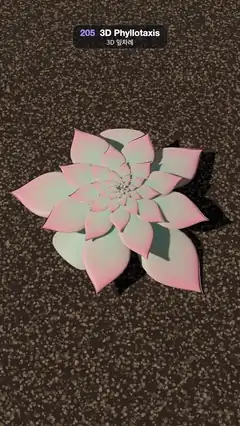

# 205 · 3D Phyllotaxis · 3D 잎차례



**EN** Succulent leaves emerge 137.5° apart and unfurl outwards, endlessly, while the rosette's interlocking golden-angle spirals slowly turn.  
**KO** 다육식물 잎이 137.5°씩 돌아가며 돋아나 끝없이 바깥으로 펼쳐지고, 황금각이 만든 맞물린 나선 무늬가 천천히 돈다.

[Video (mp4)](https://sueun-dev.github.io/motion-effects/videos/205-phyllotaxis-3d.mp4) · [Code](../effects/205-phyllotaxis-3d.js) · Nature & procedural worlds · 자연·절차적 세계

## Prompt (English)

```text
Create a "3D Phyllotaxis" motion effect: an echeveria-like succulent rosette that grows without end, each new leaf placed one golden angle (137.508°) round from the last.

Look
- One leaf mesh, reused for every leaf: a sphere (40 × 24 segments) reshaped into a fleshy spoon pointing along +x. With u = 0 at the base and 1 at the tip: half-width 0.30 · sin(0.92π u + 0.12)^0.7 · (0.45 + 0.75 u) · (1 − 0.85 u^6) (widest near the tip, then a point), thickness 0.11 · (1 − 0.55 u), the tip curling up by 0.16 u², the upper side cupped down 0.10 along the midline.
- Vertex colour from sea-green #8FC0A6 to pink #EE8E98 at the tip and the edges (blush = 1.3 u³ + 0.6 · |z| · u). Physical material: roughness 0.45, sheen 0.6 with a pale blue sheen #E8F0FF, like the powdery bloom on a real succulent.
- Leaf n (n = …, −1, 0, 1, 2, …, born at n · 5/13 s) at age a:
  - size = 0.05 · e^(0.17 · a), so every leaf keeps growing;
  - it turns −n · 137.508° about the vertical axis and sits 0.1 · size out from it, 0.12 · size lower than the centre;
  - open = e^(−a / 2.4): tilt = −0.12 + 1.45 · open rad, so a young leaf stands upright in the bud and an old one lies almost flat; its scale is (size, size · (1 + 0.4 · open), size · (0.8 + 0.2 · (1 − open))), slim when young, broad when open;
  - after age 17–25.5 the oldest leaves bow 0.55 rad further and sink 0.9 into the gravel; leaves older than 26 s are hidden (they are under the gravel and the younger leaves by then). About 70 leaves are visible.
- Ground: a gravel top-dressing at y = −0.55, a 1024 px canvas texture of 9,000 small elliptical stones (radius 2.5–6.5 px, warm grey-browns, lightness 24–44 %) on #3A3330, drawn wrapped so it tiles, repeated 4 × over a 14-unit plane.
- Light: a warm key #FFF0DC at 3.4 from (−5, 4.5, 1.5) with a 2048 PCF soft shadow map (radius 5), so each leaf shades the ones below; a dim hemisphere light #E8EEFF / #3A2E28 at 0.75. ACES Filmic tone mapping.
- Camera: 42° vertical field of view, at (0, 6.2, 3.4) looking at (0, 0, 0.35): a three-quarter view from above, the rosette filling the middle of the frame.

Motion (0–5 s)
- 13 new leaves per loop (one every 5/13 s) appear at the centre, each 137.5° round from the one before, grow and unfurl outwards. The spirals that run both ways across the rosette (parastichies) appear by themselves.
- Self-similarity: after one loop every leaf has the size and pose the leaf 13 places older had, but it sits 13 golden angles further round: 13 × 137.508° = 1787.6°, which is −12.4° after whole turns. So the whole plant turns by −12.4° · t / 5 about the vertical axis, which cancels it: 5 s looks exactly like 0 s, an endless growth with no rewind.

Technique
- three.js: one shared BufferGeometry and material, ~70 meshes each in a pivot group (rotation y = −n · golden angle); per frame only pivots and leaf transforms change, computed from t alone (n of the youngest leaf = floor(t · 13 / 5)).

Output and rules
- One self-contained HTML file with no external assets (three.js from a CDN is fine if you use it), drawing on a 1080 × 1920 canvas (9:16) scaled to fit the window.
- Write a function renderFrame(t) that draws the frame for time t in seconds, and preview it with requestAnimationFrame. Everything must be a pure function of t and fixed seeds: no Math.random(), Date or state carried between frames, so frame i = renderFrame(i / 30) can be exported to a 30 fps video.
- Loop seamlessly every 5 seconds: renderFrame(5) must look exactly like renderFrame(0).
- No flicker of any kind: no noise or grain that changes from frame to frame, no strobing or blinking, no z-fighting, no shimmering 1 px lines. Any grain or texture stays fixed to the screen or to the object.
- Keep the top 280 px free of important content (a title label goes there) and fill the whole frame with a designed background.
```

## 프롬프트 (한국어)

```text
"3D 잎차례" 모션 효과를 만들어 줘: 에케베리아 같은 다육식물 로제트가 끝없이 자라고, 새 잎은 매번 앞 잎에서 황금각(137.508°)만큼 돌아간 자리에 난다.

모양
- 모든 잎이 같은 잎 메시 하나를 쓴다: 구(40 × 24 분할)를 +x 쪽을 향한 도톰한 숟가락 모양으로 바꾼다. 밑동 u = 0, 끝 u = 1일 때: 반폭 0.30 · sin(0.92π u + 0.12)^0.7 · (0.45 + 0.75 u) · (1 − 0.85 u^6)(끝 가까이에서 가장 넓다가 뾰족하게), 두께 0.11 · (1 − 0.55 u), 끝이 0.16 u²만큼 위로 말리고, 윗면은 가운데선을 따라 0.10 오목하게.
- 꼭짓점 색은 청록빛 초록 #8FC0A6에서 끝과 가장자리의 분홍 #EE8E98로(홍조 = 1.3 u³ + 0.6 · |z| · u). 물리 기반 재질: 거칠기 0.45, 옅은 파랑 #E8F0FF의 시닝 0.6, 실제 다육식물의 분가루 같은 느낌.
- n번째 잎(n = …, −1, 0, 1, 2, …, n · 5/13초에 태어남), 나이 a일 때:
  - 크기 = 0.05 · e^(0.17 · a), 모든 잎이 계속 자란다;
  - 세로축으로 −n · 137.508° 돌고, 축에서 0.1 · 크기만큼 바깥, 중심보다 0.12 · 크기만큼 아래에 놓인다;
  - open = e^(−a / 2.4): 기울기 = −0.12 + 1.45 · open rad. 어린 잎은 눈 속에서 곧게 서고 늙은 잎은 거의 눕는다. 크기 비율은 (크기, 크기 · (1 + 0.4 · open), 크기 · (0.8 + 0.2 · (1 − open))), 어릴 땐 가늘고 펼치면 넓다;
  - 나이 17–25.5 사이에 가장 늙은 잎은 0.55 rad 더 숙이고 자갈 속으로 0.9 가라앉는다. 26초보다 늙은 잎은 숨긴다(그때는 이미 자갈과 어린 잎들 아래에 있다). 보이는 잎은 약 70장.
- 바닥: y = −0.55의 자갈 덮개. #3A3330 바탕의 1024px 캔버스에 작은 타원 돌 9,000개(반지름 2.5–6.5px, 따뜻한 회갈색, 명도 24–44 %)를 이어지게 감싸 그린 텍스처를 14 크기 평면에 4 × 반복.
- 빛: 따뜻한 키 라이트 #FFF0DC 세기 3.4, 위치 (−5, 4.5, 1.5), 2048 PCF 소프트 그림자(반지름 5)라 잎마다 아래 잎에 그림자를 드리운다; 어두운 반구광 #E8EEFF / #3A2E28 세기 0.75. ACES Filmic 톤 매핑.
- 카메라: 세로 시야각 42°, (0, 6.2, 3.4)에서 (0, 0, 0.35)를 본다: 위에서 비스듬히 본 시점, 로제트가 화면 가운데를 채운다.

움직임 (0–5초)
- 루프마다 새 잎 13장(5/13초마다 한 장)이 가운데에서 앞 잎보다 137.5° 돌아간 자리에 나와 자라며 바깥으로 펼쳐진다. 로제트를 양방향으로 가로지르는 나선(병렬선)은 저절로 나타난다.
- 자기 닮음: 한 루프 뒤 모든 잎은 13장 더 늙은 잎의 크기와 자세를 갖지만, 황금각 13번만큼 더 돌아간 자리에 있다: 13 × 137.508° = 1787.6°, 온전한 바퀴를 빼면 −12.4°. 그래서 식물 전체를 세로축으로 −12.4° · t / 5만큼 돌려 이를 상쇄하면 5초가 0초와 정확히 같아진다. 되감기 없는 끝없는 성장.

기법
- three.js: 지오메트리와 재질을 하나씩 공유하는 메시 약 70개, 각각 피벗 그룹 안(회전 y = −n · 황금각). 매 프레임 피벗과 잎 변환만 t에서 바로 계산한다(가장 어린 잎 번호 n = floor(t · 13 / 5)).

출력과 규칙
- 외부 파일 없는 HTML 파일 하나(three.js를 쓴다면 CDN은 괜찮다). 1080 × 1920(9:16) 캔버스에 그리고 창 크기에 맞춰 보이게 한다.
- 시간 t(초)의 프레임을 그리는 renderFrame(t) 함수를 만들고, 미리보기는 requestAnimationFrame으로 돌린다. 모든 것은 t와 고정 시드만으로 정해진다: Math.random(), Date, 프레임 사이에 쌓이는 상태 금지. 그래야 i번째 프레임 = renderFrame(i / 30)으로 30fps 영상을 뽑을 수 있다.
- 5초마다 끊김 없이 반복: renderFrame(5)는 renderFrame(0)과 똑같아 보여야 한다.
- 어떤 깜빡임도 금지: 프레임마다 바뀌는 노이즈·그레인, 번쩍임·깜빡임, z-fighting, 반짝이며 떨리는 1px 선 모두 금지. 그레인·질감은 화면이나 물체에 고정한다.
- 위쪽 280px에는 중요한 내용을 두지 않고(제목 라벨 자리), 화면 전체를 디자인된 배경으로 채운다.
```
