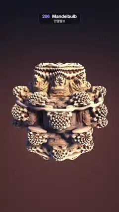

# 206 · Mandelbulb · 만델벌브



**EN** A raymarched power-8 Mandelbulb in ivory and amber, its bulbs and crevices swept by a key light circling round, soft shadows moving across it.  
**KO** 레이마칭으로 그린 8제곱 만델벌브가 상아색과 호박색으로 빛나고, 주위를 도는 키 라이트에 부드러운 그림자가 구근과 틈 사이를 쓸고 지나간다.

[Video (mp4)](https://sueun-dev.github.io/motion-effects/videos/206-mandelbulb.mp4) · [Code](../effects/206-mandelbulb.js) · Raymarching & fractals · 레이마칭·프랙털

## Prompt (English)

```text
Create a "Mandelbulb" motion effect: the 3D Mandelbrot-like fractal z → z^8 + c, raymarched with its distance estimate and lit like a carved ivory sculpture, while a light circles it.

Look
- The fractal: for a point c, iterate w ← w^8 + c in spherical coordinates with y as the polar axis: r = |w|, θ = 8 · acos(w.y / r), φ = 8 · atan(w.x, w.z), w = c + r^8 · (sin θ sin φ, cos θ, sin θ cos φ). 5 iterations, stop when |w|² > 256. Track the derivative dr ← 8 · r^7 · dr + 1; distance estimate = 0.25 · log(|w|²) · |w| / dr.
- Orbit traps during the iteration: the smallest |w.x|, |w.y|, |w.z| and |w|² reached.
- Colour from the traps: dark rust #4D1A0A, mixed to amber #F2B86B by 1.6 · trap.y, to deep blue #1F407A by 1.4 · trap.z², and to cream #FFEBCC by trap.w^4. Ambient occlusion from the orbit: occ = clamp(1.25 · trap.w^0.8, 0.08, 1) (points whose orbit stays near the origin sit in crevices).
- Lighting: a warm key light (1.75, 1.32, 0.90) with soft shadows (40 steps, penumbra factor 10), a cool sky fill (0.16, 0.24, 0.42) × (0.6 + 0.4 · n.y) × occ, a warm bounce (0.36, 0.17, 0.12) on the side away from the key, Blinn specular (power 28, × 0.25) and a blue-grey Fresnel rim (1 + d · n)² × 0.25.
- Background: deep night blue #080D1A at the top to warm brown #4D2B29 at the bottom (by ray direction y), plus a soft warm glow (0.20, 0.11, 0.10) · exp(−2.2 · |uv|) behind the bulb.
- Camera: at (0, 1.05, 2.75) looking at (0, −0.08, 0), focal length 2.15 (uv = (2 · pixel − resolution) / width, shifted +0.14 so the bulb sits a little below the middle). The bulb is about 900 px wide.
- Tone: c / (1 + 0.15 · c), gamma 0.85, a vignette 1 − 0.35 · |screen − centre|², a fixed grain of ±0.5/255.

Motion (0–5 s), a = 2π · t / 5
- The key light circles the view axis once per loop: direction = normalize(0.62 · cos a · right + (0.62 · sin a + 0.30) · up − forward), always from the camera's side, so the shadows sweep round every bulb and crevice.
- The camera sways round the bulb by 0.04 · sin a rad and breathes in and out by 1.2 % (· cos a). All periodic in a, so the loop is seamless.

Technique
- One full-screen fragment shader. Intersect the bounding sphere (radius 1.25) first and march only inside it: up to 200 steps of the full distance, hit when the distance < 0.0005 · t (the pixel's footprint grows with distance, so detail stops at about pixel size instead of crawling). Normals from a 4-tap tetrahedral difference with step 0.0012 · t.
- 3 × 3 supersampling per pixel keeps the fine fractal detail and the silhouettes from shimmering.

Output and rules
- One self-contained HTML file with no external assets (three.js from a CDN is fine if you use it), drawing on a 1080 × 1920 canvas (9:16) scaled to fit the window.
- Write a function renderFrame(t) that draws the frame for time t in seconds, and preview it with requestAnimationFrame. Everything must be a pure function of t and fixed seeds: no Math.random(), Date or state carried between frames, so frame i = renderFrame(i / 30) can be exported to a 30 fps video.
- Loop seamlessly every 5 seconds: renderFrame(5) must look exactly like renderFrame(0).
- No flicker of any kind: no noise or grain that changes from frame to frame, no strobing or blinking, no z-fighting, no shimmering 1 px lines. Any grain or texture stays fixed to the screen or to the object.
- Keep the top 280 px free of important content (a title label goes there) and fill the whole frame with a designed background.
```

## 프롬프트 (한국어)

```text
"만델벌브" 모션 효과를 만들어 줘: 3D 만델브로트 같은 프랙털 z → z^8 + c를 거리 추정으로 레이마칭하고, 상아 조각처럼 비춘 채 빛이 주위를 도는 효과.

모양
- 프랙털: 점 c마다 y를 극축으로 하는 구면 좌표에서 w ← w^8 + c를 반복한다: r = |w|, θ = 8 · acos(w.y / r), φ = 8 · atan(w.x, w.z), w = c + r^8 · (sin θ sin φ, cos θ, sin θ cos φ). 5번 반복, |w|² > 256이면 멈춘다. 도함수 dr ← 8 · r^7 · dr + 1을 따라가고, 거리 추정 = 0.25 · log(|w|²) · |w| / dr.
- 반복하는 동안 궤도 트랩: 도달한 |w.x|, |w.y|, |w.z|, |w|²의 최솟값.
- 트랩으로 색: 어두운 녹슨 갈색 #4D1A0A에서 1.6 · trap.y만큼 호박색 #F2B86B로, 1.4 · trap.z²만큼 짙은 파랑 #1F407A로, trap.w^4만큼 크림색 #FFEBCC로 섞는다. 궤도로 구한 주변 차폐: occ = clamp(1.25 · trap.w^0.8, 0.08, 1)(궤도가 원점 가까이 머무는 점은 틈 속에 있다).
- 조명: 따뜻한 키 라이트 (1.75, 1.32, 0.90)와 소프트 섀도(40걸음, 반그림자 계수 10), 차가운 하늘빛 (0.16, 0.24, 0.42) × (0.6 + 0.4 · n.y) × occ, 키 라이트 반대쪽의 따뜻한 반사광 (0.36, 0.17, 0.12), 블린 정반사(지수 28, × 0.25), 청회색 프레넬 테두리 (1 + d · n)² × 0.25.
- 배경: 광선 방향 y에 따라 위는 짙은 밤하늘 파랑 #080D1A, 아래는 따뜻한 갈색 #4D2B29, 벌브 뒤에 부드럽고 따뜻한 빛무리 (0.20, 0.11, 0.10) · exp(−2.2 · |uv|).
- 카메라: (0, 1.05, 2.75)에서 (0, −0.08, 0)을 본다, 초점 거리 2.15(uv = (2 · 픽셀 − 해상도) / 너비, +0.14만큼 옮겨 벌브가 가운데보다 조금 아래). 벌브 폭은 약 900px.
- 톤: c / (1 + 0.15 · c), 감마 0.85, 비네트 1 − 0.35 · |화면 − 중심|², ±0.5/255의 고정 그레인.

움직임 (0–5초), a = 2π · t / 5
- 키 라이트가 루프마다 한 번 시선 축 주위를 돈다: 방향 = normalize(0.62 · cos a · 오른쪽 + (0.62 · sin a + 0.30) · 위 − 앞), 언제나 카메라 쪽에서 비춰서 그림자가 구근과 틈마다 빙 돌며 쓸고 지나간다.
- 카메라는 벌브 주위로 0.04 · sin a rad 흔들리고 1.2 %(· cos a)만큼 다가왔다 멀어진다. 모두 a의 주기 함수라 끊김 없이 반복된다.

기법
- 전체 화면 프래그먼트 셰이더 하나. 먼저 경계 구(반지름 1.25)와 교차하고 그 안에서만 진행: 거리만큼 최대 200걸음, 거리 < 0.0005 · t이면 맞은 것으로(픽셀이 덮는 크기가 거리에 따라 커지므로 디테일이 픽셀 크기에서 멈추고 꿈틀거리지 않는다). 법선은 간격 0.0012 · t의 4점 사면체 차분.
- 픽셀당 3 × 3 슈퍼샘플링으로 잔 프랙털 디테일과 윤곽이 반짝이지 않게 한다.

출력과 규칙
- 외부 파일 없는 HTML 파일 하나(three.js를 쓴다면 CDN은 괜찮다). 1080 × 1920(9:16) 캔버스에 그리고 창 크기에 맞춰 보이게 한다.
- 시간 t(초)의 프레임을 그리는 renderFrame(t) 함수를 만들고, 미리보기는 requestAnimationFrame으로 돌린다. 모든 것은 t와 고정 시드만으로 정해진다: Math.random(), Date, 프레임 사이에 쌓이는 상태 금지. 그래야 i번째 프레임 = renderFrame(i / 30)으로 30fps 영상을 뽑을 수 있다.
- 5초마다 끊김 없이 반복: renderFrame(5)는 renderFrame(0)과 똑같아 보여야 한다.
- 어떤 깜빡임도 금지: 프레임마다 바뀌는 노이즈·그레인, 번쩍임·깜빡임, z-fighting, 반짝이며 떨리는 1px 선 모두 금지. 그레인·질감은 화면이나 물체에 고정한다.
- 위쪽 280px에는 중요한 내용을 두지 않고(제목 라벨 자리), 화면 전체를 디자인된 배경으로 채운다.
```
