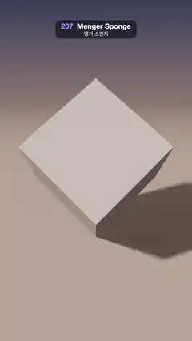

# 207 · Menger Sponge · 멩거 스펀지



**EN** A cube balanced on its corner turns as square tunnels punch through it level by level, each level its own colour, into a Menger sponge and back.  
**KO** 모서리로 선 정육면체가 돌면서 사각 터널이 단계마다 다른 색으로 뚫려 멩거 스펀지가 되었다가 다시 메워진다.

[Video (mp4)](https://sueun-dev.github.io/motion-effects/videos/207-menger-sponge.mp4) · [Code](../effects/207-menger-sponge.js) · Raymarching & fractals · 레이마칭·프랙털

## Prompt (English)

```text
Create a "Menger Sponge" motion effect: a raymarched cube that becomes a Menger sponge level by level, so the recursion is visible, standing on one corner and casting a perforated shadow.

Look
- The sponge, in its own space, is the cube [−1, 1]³ minus, at each level k = 0..3, a cross of three square bars cut through every cell: the cell coordinates are q = |mod(p · 3^k + 1, 2) − 1| (cells of half-size 3^−k), and the cut removes everything where min(max(qx, qy), max(qy, qz), max(qz, qx)) < hole_k / 3. Its distance: d = max(box distance, (hole_k / 3 − that min) / 3^k) for each level. Four levels (the finest holes are about 7 px wide).
- Remember which cut made the surface and colour it: outer faces warm ivory #F2E6D1, level 1 tunnels terracotta #E66654, level 2 saffron #F2AD4D, level 3 sea green #459E94, level 4 slate blue #4D61B8.
- Balanced on a corner: the body diagonal (1, 1, 1) points straight up (sponge-space point = x · (0.707, −0.707, 0) + y · (0.577, 0.577, 0.577) + z · (−0.408, −0.408, 0.816) for a world point (x, y, z)), the bottom corner touching a floor at y = −√3.
- Light: key light from normalize(−0.707, 0.577, 0.408), warm (1.25, 1.08, 0.88) × diffuse × soft shadow (80 steps, penumbra factor 14, so the shadow keeps the holes); ambient = cool sky (0.26, 0.30, 0.46) · (0.6 + 0.4 · n.y) + warm floor bounce (0.42, 0.30, 0.24) · max(−n.y, 0) + a little front fill, all × (0.25 + 0.75 · AO) with a 5-tap AO along the normal; a small specular highlight (power 40).
- Floor: #DBB399 × (0.38 + 0.72 · shadow), fading into the background between distance 7 and 30. Background: warm sand #CC9E85 at the bottom to dusk blue #1F294D at the top (by ray direction y).
- Camera: at (0, 2.2, 6.9) looking at (0, −0.05, 0), focal length 3.6 (uv shifted −0.05): the sponge is about 890 px tall in the middle of the frame, with its shadow spreading to the right.
- Tone: 1 − exp(−1.35 · colour), a fixed grain of ±0.5/255.

Motion (0–5 s)
- Hole size per level k (0..1, times the full 1/3): opens with a smoothstep over 0.6 s starting at 0.05 + 0.55 · k s (level 1 at 0.05 s … level 4 at 1.7 s, all open by 2.3 s), holds, then closes with a smoothstep over 0.45 s starting at 4.5 − 0.3 · k s (finest first, from 3.6 s; level 1 last, done by 4.95 s). The holes grow from pinholes to full squares.
- The sponge turns about the vertical axis by 2π/3 · t / 5 + 0.28 · sin(2π t / 5) rad: a third of a turn per loop (the cube's three-fold symmetry about its diagonal, so 5 s matches 0 s), slowest at mid-loop, when one sponge axis lines up with the light and light streams through the tunnels onto the floor.
- At 0 s and 5 s it is a solid cube.

Technique
- One full-screen fragment shader; the hole sizes are a vec4 uniform from JavaScript. Sphere-trace from t = 5 (just before the bounding sphere): up to 180 steps, hit when the distance < 0.0003 · t, far limit 11. The floor is a plane hit analytically. Normals by central differences (0.0007).
- 2 × 2 supersampling per pixel.

Output and rules
- One self-contained HTML file with no external assets (three.js from a CDN is fine if you use it), drawing on a 1080 × 1920 canvas (9:16) scaled to fit the window.
- Write a function renderFrame(t) that draws the frame for time t in seconds, and preview it with requestAnimationFrame. Everything must be a pure function of t and fixed seeds: no Math.random(), Date or state carried between frames, so frame i = renderFrame(i / 30) can be exported to a 30 fps video.
- Loop seamlessly every 5 seconds: renderFrame(5) must look exactly like renderFrame(0).
- No flicker of any kind: no noise or grain that changes from frame to frame, no strobing or blinking, no z-fighting, no shimmering 1 px lines. Any grain or texture stays fixed to the screen or to the object.
- Keep the top 280 px free of important content (a title label goes there) and fill the whole frame with a designed background.
```

## 프롬프트 (한국어)

```text
"멩거 스펀지" 모션 효과를 만들어 줘: 레이마칭한 정육면체가 단계별로 멩거 스펀지가 되어 재귀가 눈에 보이고, 한 모서리로 선 채 구멍 뚫린 그림자를 드리우는 효과.

모양
- 스펀지는 자기 공간에서 정육면체 [−1, 1]³에서, 단계 k = 0..3마다 모든 칸을 관통하는 사각 막대 세 개의 십자를 빼낸 것: 칸 좌표 q = |mod(p · 3^k + 1, 2) − 1|(칸 반크기 3^−k), min(max(qx, qy), max(qy, qz), max(qz, qx)) < 구멍_k / 3인 곳을 모두 지운다. 거리: 단계마다 d = max(상자 거리, (구멍_k / 3 − 그 최솟값) / 3^k). 네 단계(가장 작은 구멍은 폭 약 7px).
- 어느 절단이 그 면을 만들었는지 기억해 색을 칠한다: 바깥면 따뜻한 상아색 #F2E6D1, 1단계 터널 테라코타 #E66654, 2단계 사프란 #F2AD4D, 3단계 바다 초록 #459E94, 4단계 슬레이트 파랑 #4D61B8.
- 모서리로 서기: 몸체 대각선 (1, 1, 1)이 똑바로 위를 향한다(월드 점 (x, y, z)의 스펀지 공간 좌표 = x · (0.707, −0.707, 0) + y · (0.577, 0.577, 0.577) + z · (−0.408, −0.408, 0.816)). 아래 꼭짓점이 y = −√3의 바닥에 닿는다.
- 빛: 방향 normalize(−0.707, 0.577, 0.408)의 키 라이트, 따뜻한 (1.25, 1.08, 0.88) × 난반사 × 소프트 섀도(80걸음, 반그림자 계수 14, 그래서 그림자에 구멍이 남는다); 주변광 = 차가운 하늘빛 (0.26, 0.30, 0.46) · (0.6 + 0.4 · n.y) + 따뜻한 바닥 반사 (0.42, 0.30, 0.24) · max(−n.y, 0) + 약한 정면광, 모두 × (0.25 + 0.75 · AO), AO는 법선 방향 5점; 작은 정반사(지수 40).
- 바닥: #DBB399 × (0.38 + 0.72 · 그림자), 거리 7–30 사이에서 배경으로 녹아든다. 배경: 광선 방향 y에 따라 아래는 따뜻한 모래색 #CC9E85, 위는 저녁 파랑 #1F294D.
- 카메라: (0, 2.2, 6.9)에서 (0, −0.05, 0)을 본다, 초점 거리 3.6(uv −0.05 이동): 스펀지는 화면 가운데에 높이 약 890px, 그림자는 오른쪽으로 퍼진다.
- 톤: 1 − exp(−1.35 · 색), ±0.5/255의 고정 그레인.

움직임 (0–5초)
- 단계 k의 구멍 크기(0..1, 전체 1/3에 곱함): 0.05 + 0.55 · k초부터 0.6초 동안 smoothstep으로 열린다(1단계 0.05초 … 4단계 1.7초, 2.3초면 모두 열림). 잠시 멈췄다가 4.5 − 0.3 · k초부터 0.45초 동안 smoothstep으로 닫힌다(가장 작은 것부터 3.6초에, 1단계가 마지막으로 4.95초에 끝). 구멍은 바늘구멍에서 완전한 정사각형으로 자란다.
- 스펀지는 세로축으로 2π/3 · t / 5 + 0.28 · sin(2π t / 5) rad 돈다: 루프마다 3분의 1바퀴(대각선에 대한 정육면체의 3중 대칭이라 5초가 0초와 맞는다), 가운데 시점에 가장 느리고, 그때 스펀지의 한 축이 빛과 나란해져 빛이 터널을 지나 바닥에 쏟아진다.
- 0초와 5초에는 꽉 찬 정육면체.

기법
- 전체 화면 프래그먼트 셰이더 하나. 구멍 크기는 자바스크립트에서 넘기는 vec4 유니폼. t = 5(경계 구 바로 앞)부터 스피어 트레이싱: 최대 180걸음, 거리 < 0.0003 · t이면 맞은 것, 최대 거리 11. 바닥은 평면을 해석적으로 교차. 법선은 중앙 차분(0.0007).
- 픽셀당 2 × 2 슈퍼샘플링.

출력과 규칙
- 외부 파일 없는 HTML 파일 하나(three.js를 쓴다면 CDN은 괜찮다). 1080 × 1920(9:16) 캔버스에 그리고 창 크기에 맞춰 보이게 한다.
- 시간 t(초)의 프레임을 그리는 renderFrame(t) 함수를 만들고, 미리보기는 requestAnimationFrame으로 돌린다. 모든 것은 t와 고정 시드만으로 정해진다: Math.random(), Date, 프레임 사이에 쌓이는 상태 금지. 그래야 i번째 프레임 = renderFrame(i / 30)으로 30fps 영상을 뽑을 수 있다.
- 5초마다 끊김 없이 반복: renderFrame(5)는 renderFrame(0)과 똑같아 보여야 한다.
- 어떤 깜빡임도 금지: 프레임마다 바뀌는 노이즈·그레인, 번쩍임·깜빡임, z-fighting, 반짝이며 떨리는 1px 선 모두 금지. 그레인·질감은 화면이나 물체에 고정한다.
- 위쪽 280px에는 중요한 내용을 두지 않고(제목 라벨 자리), 화면 전체를 디자인된 배경으로 채운다.
```
