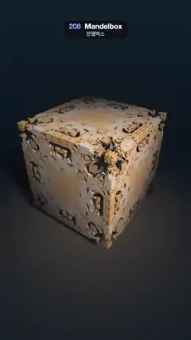

# 208 · Mandelbox · 만델박스



**EN** A brass-and-ivory Mandelbox hangs over a dark floor; a circling warm light rakes its folded cubes and sweeps a long shadow round it.  
**KO** 황동과 상아색 만델박스가 어두운 바닥 위에 떠 있고, 둘레를 도는 따뜻한 빛이 접힌 큐브 무늬를 훑으며 긴 그림자를 한 바퀴 돌린다.

[Video (mp4)](https://sueun-dev.github.io/motion-effects/videos/208-mandelbox.mp4) · [Code](../effects/208-mandelbox.js) · Raymarching & fractals · 레이마칭·프랙털

## Prompt (English)

```text
Create a "Mandelbox" motion effect: the box-and-sphere-folding fractal, raymarched as an ornate brass-and-ivory cube floating over a dark floor while a warm light circles it.

Look
- The Mandelbox with scale −1.8, minimum radius² 0.25 and fixed radius² 1, 10 iterations. Its faces are carved with recessed rings, tiny cubes and spiky balls at the corners; it spans about −2 to 2 on each axis.
- Colour from an orbit trap: the smallest |z|² during the first 3 iterations, k = smoothstep(0.1, 1.3, sqrt(trap)); mix brass #F2A85C (deep in the folds) to ivory #EBE6DB (on the faces).
- Lighting: a warm key light (colour 1.5, 1.22, 0.92) with a soft shadow (48-step march, res = min(res, 10h / t)); a cool sky fill #293857 (facing down) to #6B94C7 (facing up) × 0.8 × AO; everything × (0.25 + 0.75 · AO); a soft specular (power 24, × 0.3) and a cool fresnel rim #4D8CD9 ((1 − n·v)⁴ × 0.35).
- Ambient occlusion: 5 taps along the normal at 0.03 · i², weights × 0.6 each, AO = 1 − 1.6 · sum.
- Background: a vertical gradient #050A12 → #122433 with a faint warm glow straight behind the box. A floor at y = −2.75: dark slate #0D141F with a warm pool #4D4238 round the box (weight exp(−0.06 · r²)), × (0.3 + 0.7 · shadow), fading into the background between distance 8 and 22.
- Camera: on a sphere round the origin, yaw 0.62 rad, pitch 0.58 rad, distance 9.3, looking at the centre; lens: direction = normalize(1.9 · forward + 0.8 · uv.x · right + 0.8 · uv.y · up), with uv shifted down 0.08. The box fills the width, centred near y ≈ 1000 px, its shadow on the floor below.

Motion (0–5 s), a = 2π · t / 5
- The key light circles once per loop: direction normalize(0.9 cos a, 0.75, 0.9 sin a + 0.4), so the faces light up in turn and the long floor shadow swings all the way round.
- The camera only sways: yaw + 0.06 sin a, pitch + 0.05 sin 2a, distance + 0.3 cos a. Fine fractal detail would crawl under faster camera motion.

Technique
- WebGL2 fragment-shader raymarcher with the standard Mandelbox distance estimate: box fold z = clamp(z, −1, 1) · 2 − z, sphere fold z *= clamp(max(0.25 / r², 0.25), 0, 1), then z = z · scale / 0.25 + c (with the running derivative in w); distance = (|z| − |scale − 1|) / w − |scale|^−9.
- Up to 200 steps of 0.9 × the distance; stop when the distance < one pixel's width at that depth (cone stop), so detail smaller than a pixel is not chased and does not sparkle. Normals by 4-tap tetrahedral differences with an epsilon of 3 pixels.
- The floor is hit analytically. 3 × 3 supersampling, a soft roll-off col / (1 + 0.3 · col), gamma 0.92 and a fixed 1/255 dither.

Output and rules
- One self-contained HTML file with no external assets (three.js from a CDN is fine if you use it), drawing on a 1080 × 1920 canvas (9:16) scaled to fit the window.
- Write a function renderFrame(t) that draws the frame for time t in seconds, and preview it with requestAnimationFrame. Everything must be a pure function of t and fixed seeds: no Math.random(), Date or state carried between frames, so frame i = renderFrame(i / 30) can be exported to a 30 fps video.
- Loop seamlessly every 5 seconds: renderFrame(5) must look exactly like renderFrame(0).
- No flicker of any kind: no noise or grain that changes from frame to frame, no strobing or blinking, no z-fighting, no shimmering 1 px lines. Any grain or texture stays fixed to the screen or to the object.
- Keep the top 280 px free of important content (a title label goes there) and fill the whole frame with a designed background.
```

## 프롬프트 (한국어)

```text
"만델박스" 모션 효과를 만들어 줘: 상자 접기와 구 접기로 만드는 프랙털을 레이마칭해서, 황동과 상아색의 화려한 큐브가 어두운 바닥 위에 떠 있고 따뜻한 빛이 그 둘레를 도는 효과.

모양
- 만델박스: 스케일 −1.8, 최소 반지름² 0.25, 고정 반지름² 1, 반복 10번. 면에는 움푹한 고리, 작은 큐브, 모서리의 가시 공이 새겨지고, 각 축으로 대략 −2~2 크기다.
- 색은 오비트 트랩: 처음 3번 반복 동안의 가장 작은 |z|², k = smoothstep(0.1, 1.3, sqrt(trap)). 접힌 골 깊은 곳은 황동 #F2A85C, 면은 상아색 #EBE6DB로 섞는다.
- 조명: 따뜻한 키 라이트(색 1.5, 1.22, 0.92)와 소프트 섀도(48걸음 행진, res = min(res, 10h / t)); 차가운 하늘 채움광(아래쪽 #293857 → 위쪽 #6B94C7) × 0.8 × AO; 전체에 (0.25 + 0.75 · AO)를 곱한다; 부드러운 스페큘러(지수 24, × 0.3)와 차가운 프레넬 림 #4D8CD9((1 − n·v)⁴ × 0.35).
- 앰비언트 오클루전: 법선 방향 0.03 · i² 위치 5곳, 가중치는 매번 × 0.6, AO = 1 − 1.6 · 합.
- 배경: 세로 그라디언트 #050A12 → #122433, 상자 바로 뒤에 은은한 따뜻한 빛. y = −2.75에 바닥: 어두운 청회색 #0D141F에 상자 둘레로 따뜻한 빛 웅덩이 #4D4238(가중치 exp(−0.06 · r²)), × (0.3 + 0.7 · 그림자), 거리 8~22에서 배경으로 사라진다.
- 카메라: 원점을 둘러싼 구 위, 요 0.62 rad, 피치 0.58 rad, 거리 9.3에서 중심을 본다. 렌즈: 방향 = normalize(1.9 · 앞 + 0.8 · uv.x · 오른쪽 + 0.8 · uv.y · 위), uv는 0.08 아래로. 상자가 화면 폭을 채우고 y ≈ 1000 px 근처에 오며, 그 아래 바닥에 그림자가 진다.

움직임 (0–5초), a = 2π · t / 5
- 키 라이트가 한 루프에 한 바퀴 돈다: 방향 normalize(0.9 cos a, 0.75, 0.9 sin a + 0.4). 면이 차례로 밝아지고 바닥의 긴 그림자가 한 바퀴 돌아간다.
- 카메라는 살짝만 흔들린다: 요 + 0.06 sin a, 피치 + 0.05 sin 2a, 거리 + 0.3 cos a. 카메라가 더 빨리 움직이면 프랙털의 잔무늬가 지글거린다.

기법
- WebGL2 프래그먼트 셰이더 레이마처, 표준 만델박스 거리 추정: 상자 접기 z = clamp(z, −1, 1) · 2 − z, 구 접기 z *= clamp(max(0.25 / r², 0.25), 0, 1), 그다음 z = z · scale / 0.25 + c(w에 누적 미분). 거리 = (|z| − |scale − 1|) / w − |scale|^−9.
- 최대 200걸음, 걸음은 거리의 0.9배. 거리가 그 깊이에서 픽셀 하나 폭보다 작으면 멈춘다(콘 정지): 픽셀보다 작은 디테일을 쫓지 않으니 반짝이지 않는다. 법선은 4탭 사면체 차분, 엡실론은 3픽셀.
- 바닥은 해석적으로 맞힌다. 3 × 3 슈퍼샘플링, 부드러운 롤오프 col / (1 + 0.3 · col), 감마 0.92, 고정 1/255 디더.

출력과 규칙
- 외부 파일 없는 HTML 파일 하나(three.js를 쓴다면 CDN은 괜찮다). 1080 × 1920(9:16) 캔버스에 그리고 창 크기에 맞춰 보이게 한다.
- 시간 t(초)의 프레임을 그리는 renderFrame(t) 함수를 만들고, 미리보기는 requestAnimationFrame으로 돌린다. 모든 것은 t와 고정 시드만으로 정해진다: Math.random(), Date, 프레임 사이에 쌓이는 상태 금지. 그래야 i번째 프레임 = renderFrame(i / 30)으로 30fps 영상을 뽑을 수 있다.
- 5초마다 끊김 없이 반복: renderFrame(5)는 renderFrame(0)과 똑같아 보여야 한다.
- 어떤 깜빡임도 금지: 프레임마다 바뀌는 노이즈·그레인, 번쩍임·깜빡임, z-fighting, 반짝이며 떨리는 1px 선 모두 금지. 그레인·질감은 화면이나 물체에 고정한다.
- 위쪽 280px에는 중요한 내용을 두지 않고(제목 라벨 자리), 화면 전체를 디자인된 배경으로 채운다.
```
