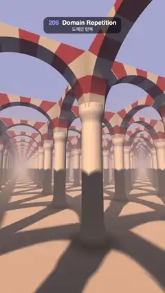

# 209 · Domain Repetition · 도메인 반복



**EN** One pillar with striped arches is repeated forever; the camera walks down an endless hall as sun shadows stripe the floor and the rows fade into a warm haze.  
**KO** 줄무늬 아치를 얹은 기둥 하나가 끝없이 반복되고, 카메라가 끝없는 회랑을 걸어가는 동안 햇빛 그림자가 바닥에 줄을 긋고 줄지은 기둥은 따뜻한 안개로 사라진다.

[Video (mp4)](https://sueun-dev.github.io/motion-effects/videos/209-domain-repetition.mp4) · [Code](../effects/209-domain-repetition.js) · Raymarching & fractals · 레이마칭·프랙털

## Prompt (English)

```text
Create a "Domain Repetition" motion effect: a single pillar with two striped arches, modelled once as a signed distance field and copied into every cell of an endless grid, so the camera walks through a hall that never ends.

Look
- One cell is 3 × 3 units on the floor. In it, centred: a pillar of radius 0.24 up to y = 3, with a flared base (+0.08 below y = 0.45) and capital (+0.07 from y = 2.55 to 2.85). Two walls cross over it, one along x and one along z: 0.4 thick, from y = 2.9 to 4.3, each cut by a round opening of radius 1.25 centred at (±1.5, 2.85), so neighbouring pillars are joined by semicircular arches and the crossing reads as a vault.
- Repeat with q.xz = p.xz − 3 · floor(p.xz / 3 + 0.5). Floor at y = 0. There is no roof: sky shows between the arches.
- Colours: limestone #EDDEC7 pillars; arches striped with 11 voussoirs over each half-circle opening, alternating brick red #B83D29 and cream #F2DBB3 (smoothstep over ±0.08 of sin(11 · angle)); a polished floor #CCB39E with a faint sheen towards grazing angles.
- Light: a low sun from behind on the left, direction normalize(−0.55, 0.62, 0.55), colour (1.6, 1.22, 0.86), with crisp soft-edged shadows, so the floor is striped with the shadows of pillars and arches; sky fill #8C809E → #BFCCFA × 0.34 × AO.
- Haze: everything fades with distance, 1 − exp(−0.055 · d), into a gradient from peach #FAC7A8 (low) to periwinkle #B3B8EB (high), which is also the sky.
- Camera at height 1.55 in the middle of an aisle (x = 1.5), looking down it and a little to the right and up: direction (0.42, 0.16, −1), lens normalize(1.4 · forward + 0.8 · uv). Rows of pillars run to a vanishing point; arches fill the top half.

Motion (0–5 s), a = 2π · t / 5
- The camera walks along −z exactly two cells (6 units) per loop, so the last frame meets the first. It sways 0.2 · sin a sideways and 0.05 · sin 2a up and down, and the view turns 0.05 · sin a.
- Shadows and arches are fixed to the world; only the walk moves.

Technique
- WebGL2 fragment-shader raymarcher, one map() that returns the pillar, the two arched walls and the floor of the local cell (the cell contents are symmetric, so the local cell is always the nearest). The flared pillar's distance is scaled by 0.8 so the march never oversteps.
- Up to 180 steps of 0.9 × the distance, hit when < 0.0004 · t; normals by tetrahedral differences. Soft shadows with the improved penumbra estimate (track the previous step's distance; res = min(res, 64 · d / (t − y))), 160 steps, smoothstepped: no banding, edges stay crisp.
- AO from one tap at 0.35 along the normal. 2 × 2 supersampling, a soft roll-off and a fixed 1/255 dither.

Output and rules
- One self-contained HTML file with no external assets (three.js from a CDN is fine if you use it), drawing on a 1080 × 1920 canvas (9:16) scaled to fit the window.
- Write a function renderFrame(t) that draws the frame for time t in seconds, and preview it with requestAnimationFrame. Everything must be a pure function of t and fixed seeds: no Math.random(), Date or state carried between frames, so frame i = renderFrame(i / 30) can be exported to a 30 fps video.
- Loop seamlessly every 5 seconds: renderFrame(5) must look exactly like renderFrame(0).
- No flicker of any kind: no noise or grain that changes from frame to frame, no strobing or blinking, no z-fighting, no shimmering 1 px lines. Any grain or texture stays fixed to the screen or to the object.
- Keep the top 280 px free of important content (a title label goes there) and fill the whole frame with a designed background.
```

## 프롬프트 (한국어)

```text
"도메인 반복" 모션 효과를 만들어 줘: 줄무늬 아치 두 개를 얹은 기둥 하나를 부호 있는 거리 함수로 한 번만 만들고, 끝없는 격자의 모든 칸에 복사해서 카메라가 끝나지 않는 회랑을 걸어가는 효과.

모양
- 한 칸은 바닥에서 3 × 3. 가운데에 반지름 0.24, 높이 y = 3까지의 기둥, 아래는 퍼진 받침(y = 0.45 아래로 +0.08), 위는 주두(y = 2.55~2.85에서 +0.07). 그 위로 x 방향과 z 방향의 벽 두 개가 교차한다: 두께 0.4, y = 2.9~4.3, 각각 (±1.5, 2.85)를 중심으로 한 반지름 1.25의 둥근 구멍이 뚫려서 이웃 기둥이 반원 아치로 이어지고, 교차 부분은 볼트처럼 보인다.
- 반복은 q.xz = p.xz − 3 · floor(p.xz / 3 + 0.5). 바닥은 y = 0. 지붕은 없어서 아치 사이로 하늘이 보인다.
- 색: 기둥은 석회석 #EDDEC7; 아치는 반원 구멍 둘레에 11개씩 벽돌빨강 #B83D29와 크림 #F2DBB3이 번갈아 가는 홍예석 줄무늬(sin(11 · 각도)의 ±0.08 구간을 smoothstep); 바닥은 광택 있는 #CCB39E, 비스듬히 볼수록 은은한 광택.
- 빛: 왼쪽 뒤에서 낮게 드는 해, 방향 normalize(−0.55, 0.62, 0.55), 색 (1.6, 1.22, 0.86), 가장자리가 살짝 부드러운 선명한 그림자. 바닥에 기둥과 아치의 그림자 줄무늬가 진다. 하늘 채움광 #8C809E → #BFCCFA × 0.34 × AO.
- 안개: 모든 것이 거리에 따라 1 − exp(−0.055 · d)로 복숭아색 #FAC7A8(아래) → 연보라 #B3B8EB(위) 그라디언트에 녹아든다. 이 그라디언트가 하늘이기도 하다.
- 카메라: 높이 1.55, 통로 한가운데(x = 1.5)에서 통로를 따라 약간 오른쪽 위를 본다: 방향 (0.42, 0.16, −1), 렌즈 normalize(1.4 · 앞 + 0.8 · uv). 기둥 줄이 소실점으로 이어지고 화면 위쪽 절반을 아치가 채운다.

움직임 (0–5초), a = 2π · t / 5
- 카메라가 −z 방향으로 루프마다 정확히 두 칸(6)을 걸어가서 마지막 프레임이 첫 프레임과 이어진다. 옆으로 0.2 · sin a, 위아래로 0.05 · sin 2a 흔들리고, 시선이 0.05 · sin a 돈다.
- 그림자와 아치는 세계에 고정되어 있고 걷는 움직임만 있다.

기법
- WebGL2 프래그먼트 셰이더 레이마처. map() 하나가 지금 칸의 기둥, 아치 벽 두 개, 바닥을 돌려준다(칸 내용이 대칭이라 지금 칸이 언제나 가장 가깝다). 퍼진 기둥의 거리는 0.8을 곱해 걸음이 넘치지 않게 한다.
- 최대 180걸음, 걸음은 거리의 0.9배, 거리 < 0.0004 · t이면 충돌. 법선은 사면체 차분. 소프트 섀도는 개선된 반그림자 추정(직전 걸음의 거리를 기억해 res = min(res, 64 · d / (t − y))), 160걸음, smoothstep: 띠가 생기지 않고 가장자리는 선명하다.
- AO는 법선 방향 0.35 한 곳. 2 × 2 슈퍼샘플링, 부드러운 롤오프, 고정 1/255 디더.

출력과 규칙
- 외부 파일 없는 HTML 파일 하나(three.js를 쓴다면 CDN은 괜찮다). 1080 × 1920(9:16) 캔버스에 그리고 창 크기에 맞춰 보이게 한다.
- 시간 t(초)의 프레임을 그리는 renderFrame(t) 함수를 만들고, 미리보기는 requestAnimationFrame으로 돌린다. 모든 것은 t와 고정 시드만으로 정해진다: Math.random(), Date, 프레임 사이에 쌓이는 상태 금지. 그래야 i번째 프레임 = renderFrame(i / 30)으로 30fps 영상을 뽑을 수 있다.
- 5초마다 끊김 없이 반복: renderFrame(5)는 renderFrame(0)과 똑같아 보여야 한다.
- 어떤 깜빡임도 금지: 프레임마다 바뀌는 노이즈·그레인, 번쩍임·깜빡임, z-fighting, 반짝이며 떨리는 1px 선 모두 금지. 그레인·질감은 화면이나 물체에 고정한다.
- 위쪽 280px에는 중요한 내용을 두지 않고(제목 라벨 자리), 화면 전체를 디자인된 배경으로 채운다.
```
