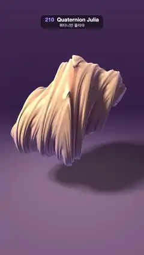

# 210 · Quaternion Julia · 쿼터니언 줄리아



**EN** A coral-and-gold slice of a 4D Julia set floats over a lilac floor and melts from a draped mass into an open lattice and back as it slowly swings.  
**KO** 산호색과 금색의 4차원 줄리아 집합 단면이 라일락빛 바닥 위에 떠서, 천천히 흔들리며 드리운 덩어리에서 뚫린 격자로 녹아내렸다가 돌아온다.

[Video (mp4)](https://sueun-dev.github.io/motion-effects/videos/210-quaternion-julia.mp4) · [Code](../effects/210-quaternion-julia.js) · Raymarching & fractals · 레이마칭·프랙털

## Prompt (English)

```text
Create a "Quaternion Julia" motion effect: the Julia set of z → z² + c with quaternions (4D numbers), shown as its 3D slice w = 0, raymarched as a glossy sculpture that morphs while c travels round a loop in 4D.

Look
- z starts as (x, y, z, 0); quaternion square (a, b) → (a² − |b|², 2ab); 9 iterations, escape when |z|² > 4. Distance estimate 0.5 · |z| · log|z| / |z′| (track |z′|² ← 4 |z|² |z′|²). March only inside a bounding sphere of radius 1.61.
- The shape: flowing sheets and ridges that swirl round one axis, like draped silk, opening into a lattice of rings at some values of c.
- Colour from the orbit trap m = the smallest |z|²: coral #FF7557 in the creases to gold #FFD68F on the swells (smoothstep(0.05, 0.5, m)), then 35 % lilac #8C9EFF on the undersides.
- Lighting: key direction normalize(−0.6, 0.8, 0.45), colour (1.3, 1.15, 1.0) × a soft self-shadow (48 steps, res = min(res, 9h / t)); ambient violet (0.30, 0.24, 0.42) × occlusion, where occlusion = clamp(2m + 0.25, 0, 1); white specular (power 40, × 0.6); a lilac fresnel rim (0.65, 0.55, 0.95) × (1 − n·v)³ × 0.45.
- Background gradient #1A122E (low) to #523361 (high). A floor at y = −1.55: #573D66 brightening to #9E7A9E under the shape (exp(−0.12 · r²)), × (0.45 + 0.55 · shadow) so the shape casts a soft shadow, fading out between distance 4 and 14.
- Camera at (0, 0.7, 3.3) looking at (0, −0.32, 0), lens normalize(1.9 · forward + 0.8 · uv). The shape fills most of the width, centred a little above the middle, with its shadow below right.

Motion (0–5 s), a = 2π · t / 5
- c = (−0.291 + 0.12 cos a, −0.399 + 0.12 sin a, 0.339 + 0.08 sin a, 0.437 − 0.08 cos a): a small circle in 4D round a well-known value, once per loop. The sculpture melts from a closed, draped mass (0 s) into an open lattice of loops (about 2.5 s) and back.
- The shape turns about the vertical axis by 0.25 · sin a rad; the floor and light stay put.

Technique
- WebGL2 fragment-shader raymarcher: up to 160 steps, stop when the distance < one pixel's width at that depth (cone stop). Normals by 4-tap tetrahedral differences with an epsilon of 3 pixels, so the thin ridges shade smoothly instead of sparkling as they morph.
- c is a uniform computed per frame. The shape is marched in its own turned space; the floor is hit analytically and its shadow is marched in the same turned space.
- 2 × 2 supersampling, roll-off col / (1 + 0.2 · col), gamma 0.95, a fixed 1/255 dither.

Output and rules
- One self-contained HTML file with no external assets (three.js from a CDN is fine if you use it), drawing on a 1080 × 1920 canvas (9:16) scaled to fit the window.
- Write a function renderFrame(t) that draws the frame for time t in seconds, and preview it with requestAnimationFrame. Everything must be a pure function of t and fixed seeds: no Math.random(), Date or state carried between frames, so frame i = renderFrame(i / 30) can be exported to a 30 fps video.
- Loop seamlessly every 5 seconds: renderFrame(5) must look exactly like renderFrame(0).
- No flicker of any kind: no noise or grain that changes from frame to frame, no strobing or blinking, no z-fighting, no shimmering 1 px lines. Any grain or texture stays fixed to the screen or to the object.
- Keep the top 280 px free of important content (a title label goes there) and fill the whole frame with a designed background.
```

## 프롬프트 (한국어)

```text
"쿼터니언 줄리아" 모션 효과를 만들어 줘: 사원수(4차원 수)로 계산한 z → z² + c의 줄리아 집합을 3차원 단면 w = 0으로 잘라 광택 있는 조각처럼 레이마칭하고, c가 4차원에서 고리를 돌며 모양이 변하는 효과.

모양
- z는 (x, y, z, 0)에서 시작한다. 사원수 제곱 (a, b) → (a² − |b|², 2ab), 반복 9번, |z|² > 4이면 탈출. 거리 추정은 0.5 · |z| · log|z| / |z′|(|z′|² ← 4 |z|² |z′|²로 누적). 반지름 1.61의 경계 구 안에서만 행진한다.
- 모양: 한 축을 따라 소용돌이치는 흐르는 막과 능선, 드리운 비단 같은 덩어리. c에 따라 고리 격자로 열리기도 한다.
- 색은 오비트 트랩 m = 가장 작은 |z|²: 골짜기는 산호색 #FF7557, 부푼 곳은 금색 #FFD68F(smoothstep(0.05, 0.5, m)), 아래를 향한 면은 라일락 #8C9EFF를 35 % 섞는다.
- 조명: 키 라이트 방향 normalize(−0.6, 0.8, 0.45), 색 (1.3, 1.15, 1.0) × 부드러운 자기 그림자(48걸음, res = min(res, 9h / t)); 보라 환경광 (0.30, 0.24, 0.42) × 차폐, 차폐 = clamp(2m + 0.25, 0, 1); 흰 스페큘러(지수 40, × 0.6); 라일락 프레넬 림 (0.65, 0.55, 0.95) × (1 − n·v)³ × 0.45.
- 배경 그라디언트 #1A122E(아래) → #523361(위). y = −1.55에 바닥: #573D66이 모양 아래에서 #9E7A9E로 밝아지고(exp(−0.12 · r²)), × (0.45 + 0.55 · 그림자)로 부드러운 그림자가 지며, 거리 4~14에서 사라진다.
- 카메라는 (0, 0.7, 3.3)에서 (0, −0.32, 0)을 본다, 렌즈 normalize(1.9 · 앞 + 0.8 · uv). 모양이 화면 폭 대부분을 채우고 가운데보다 조금 위에 있으며, 그림자는 오른쪽 아래에 진다.

움직임 (0–5초), a = 2π · t / 5
- c = (−0.291 + 0.12 cos a, −0.399 + 0.12 sin a, 0.339 + 0.08 sin a, 0.437 − 0.08 cos a): 잘 알려진 값 둘레의 작은 4차원 원을 루프마다 한 바퀴. 조각이 닫힌 덩어리(0초)에서 열린 고리 격자(약 2.5초)로 녹았다가 돌아온다.
- 모양은 세로축으로 0.25 · sin a rad 돈다. 바닥과 빛은 그대로다.

기법
- WebGL2 프래그먼트 셰이더 레이마처: 최대 160걸음, 거리가 그 깊이의 픽셀 하나 폭보다 작으면 멈춘다(콘 정지). 법선은 4탭 사면체 차분, 엡실론 3픽셀: 얇은 능선이 변할 때 반짝이지 않고 부드럽게 음영진다.
- c는 프레임마다 계산하는 유니폼. 모양은 돌린 자기 공간에서 행진하고, 바닥은 해석적으로 맞힌 뒤 그 그림자도 같은 돌린 공간에서 행진한다.
- 2 × 2 슈퍼샘플링, 롤오프 col / (1 + 0.2 · col), 감마 0.95, 고정 1/255 디더.

출력과 규칙
- 외부 파일 없는 HTML 파일 하나(three.js를 쓴다면 CDN은 괜찮다). 1080 × 1920(9:16) 캔버스에 그리고 창 크기에 맞춰 보이게 한다.
- 시간 t(초)의 프레임을 그리는 renderFrame(t) 함수를 만들고, 미리보기는 requestAnimationFrame으로 돌린다. 모든 것은 t와 고정 시드만으로 정해진다: Math.random(), Date, 프레임 사이에 쌓이는 상태 금지. 그래야 i번째 프레임 = renderFrame(i / 30)으로 30fps 영상을 뽑을 수 있다.
- 5초마다 끊김 없이 반복: renderFrame(5)는 renderFrame(0)과 똑같아 보여야 한다.
- 어떤 깜빡임도 금지: 프레임마다 바뀌는 노이즈·그레인, 번쩍임·깜빡임, z-fighting, 반짝이며 떨리는 1px 선 모두 금지. 그레인·질감은 화면이나 물체에 고정한다.
- 위쪽 280px에는 중요한 내용을 두지 않고(제목 라벨 자리), 화면 전체를 디자인된 배경으로 채운다.
```
