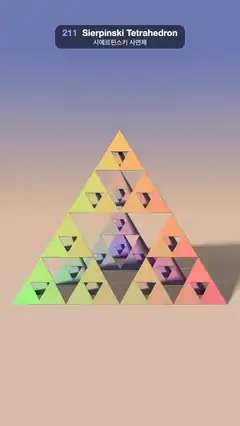

# 211 · Sierpinski Tetrahedron · 시에르핀스키 사면체



**EN** A pastel Sierpinski pyramid splits into 4, 16, then 64 smaller ones and folds back into one solid tetrahedron while it turns a third of a circle.  
**KO** 파스텔빛 시에르핀스키 피라미드가 4개, 16개, 64개의 작은 사면체로 쪼개졌다가 다시 하나의 사면체로 합쳐지며 3분의 1바퀴 돈다.

[Video (mp4)](https://sueun-dev.github.io/motion-effects/videos/211-sierpinski-tetrahedron.mp4) · [Code](../effects/211-sierpinski-tetrahedron.js) · Raymarching & fractals · 레이마칭·프랙털

## Prompt (English)

```text
Create a "Sierpinski Tetrahedron" motion effect: the 3D Sierpinski pyramid built by folding space (an IFS), shown growing level by level and collapsing back to one solid tetrahedron, coloured by which corner each piece came from.

Look
- A tetrahedron with corners (1, 1, 1), (1, −1, −1), (−1, 1, −1), (−1, −1, 1), turned so that (1, 1, 1) points straight up: apex at y = 1.73, flat base at y = −0.58 resting on the floor.
- Each level: fold with three mirrors (if x + y < 0 then (x, y) = (−y, −x); the same for x + z and y + z), then z = 2z − 1 (scale 2 away from the top corner). After n levels the distance is sdTetrahedron(z) / 2ⁿ, so every tetrahedron becomes four half-size ones.
- Colour per piece: start from ivory #F2E0C7 (weight 0.15), then at every level add the colour of the corner the point sits in, weights 0.6, 0.42, 0.29 … (× 0.7 per level): the top corner is gold #FFC761, the three base corners take three hues a third of the colour wheel apart (cosine palette 0.66 + 0.34 · cos(2π(h + (0, 0.33, 0.67)))). The corner is judged in the unfolded space, so colours turn with the shape.
- Background: a sky from peach #FCCC9E at the horizon to soft blue #6B80C7 above; a floor #F5D1B8 × (0.5 + 0.5 · shadow) fading into the sky between distance 3 and 16.
- Light from normalize(−0.75, 0.6, 0.5), colour (1.45, 1.2, 0.95), with a soft shadow (64 steps, res = min(res, 16h / t)) that falls through the holes onto the floor; sky fill #8C7A85 → #9EB3F2 × 0.5 × AO (one tap at 0.06); a soft specular (power 30, × 0.35).
- Camera at (0, 1.25, 4.3) looking at (0, 0.5, 0), lens normalize(1.9 · forward + 0.8 · uv). The pyramid is about 900 px wide, centred.

Motion (0–5 s), a = 2π · t / 5
- Level L = 2.75 + 2.75 · sin a: 2.75 → 5.5 (1.25 s) → 0 (3.75 s) → 2.75. With n = floor(L), f = L − n, the last fold scales by g = 1 + smoothstep(f) instead of 2, so its four children shrink smoothly from overlapping (one piece) to half size, opening the hole in the middle.
- The pyramid turns about the vertical axis by yaw = a / 3 + (0.8 / 3)(cos a − 1): a third of a turn per loop (its own 3-fold symmetry, so it looks the same again), moving slowest when the detail is finest.
- The base-corner hues drift by a third of the wheel per loop (h += t / 15), so after the third of a turn each corner wears the colour of the one whose place it took and the loop is seamless.

Technique
- WebGL2 fragment-shader raymarcher: up to 160 steps, hit when < 0.0004 · t; normals by tetrahedral differences (e = 0.0008). The level and the yaw are uniforms.
- 2 × 2 supersampling, roll-off col / (1 + 0.15 · col), gamma 0.95, a fixed 1/255 dither.

Output and rules
- One self-contained HTML file with no external assets (three.js from a CDN is fine if you use it), drawing on a 1080 × 1920 canvas (9:16) scaled to fit the window.
- Write a function renderFrame(t) that draws the frame for time t in seconds, and preview it with requestAnimationFrame. Everything must be a pure function of t and fixed seeds: no Math.random(), Date or state carried between frames, so frame i = renderFrame(i / 30) can be exported to a 30 fps video.
- Loop seamlessly every 5 seconds: renderFrame(5) must look exactly like renderFrame(0).
- No flicker of any kind: no noise or grain that changes from frame to frame, no strobing or blinking, no z-fighting, no shimmering 1 px lines. Any grain or texture stays fixed to the screen or to the object.
- Keep the top 280 px free of important content (a title label goes there) and fill the whole frame with a designed background.
```

## 프롬프트 (한국어)

```text
"시에르핀스키 사면체" 모션 효과를 만들어 줘: 공간을 접어서(IFS) 만드는 3D 시에르핀스키 피라미드가 단계마다 자라났다가 다시 하나의 사면체로 합쳐지고, 조각마다 어느 꼭짓점에서 왔는지로 색을 칠하는 효과.

모양
- 꼭짓점 (1, 1, 1), (1, −1, −1), (−1, 1, −1), (−1, −1, 1)의 사면체를 (1, 1, 1)이 위를 향하게 돌린다: 꼭대기는 y = 1.73, 평평한 밑면은 y = −0.58에서 바닥에 놓인다.
- 단계마다: 거울 세 개로 접고(x + y < 0이면 (x, y) = (−y, −x), x + z와 y + z도 같은 방식), z = 2z − 1(위 꼭짓점에서 멀어지게 2배). n단계 뒤 거리는 sdTetrahedron(z) / 2ⁿ이라 사면체 하나가 절반 크기 넷으로 바뀐다.
- 조각의 색: 상아색 #F2E0C7(가중치 0.15)에서 시작해 단계마다 점이 있는 꼭짓점의 색을 더한다. 가중치 0.6, 0.42, 0.29 …(단계마다 × 0.7). 위 꼭짓점은 금색 #FFC761, 밑면 세 꼭짓점은 색상환에서 3분의 1씩 떨어진 세 색(코사인 팔레트 0.66 + 0.34 · cos(2π(h + (0, 0.33, 0.67)))). 꼭짓점은 접기 전 공간에서 판단해서 색이 모양과 함께 돈다.
- 배경: 지평선의 복숭아색 #FCCC9E에서 위쪽 연파랑 #6B80C7로 가는 하늘; 바닥 #F5D1B8 × (0.5 + 0.5 · 그림자), 거리 3~16에서 하늘로 사라진다.
- 빛은 normalize(−0.75, 0.6, 0.5)에서, 색 (1.45, 1.2, 0.95), 구멍 사이로 바닥까지 떨어지는 소프트 섀도(64걸음, res = min(res, 16h / t)); 하늘 채움광 #8C7A85 → #9EB3F2 × 0.5 × AO(0.06 한 곳); 부드러운 스페큘러(지수 30, × 0.35).
- 카메라는 (0, 1.25, 4.3)에서 (0, 0.5, 0)을 본다, 렌즈 normalize(1.9 · 앞 + 0.8 · uv). 피라미드는 폭 약 900 px로 가운데에 있다.

움직임 (0–5초), a = 2π · t / 5
- 단계 L = 2.75 + 2.75 · sin a: 2.75 → 5.5(1.25초) → 0(3.75초) → 2.75. n = floor(L), f = L − n일 때 마지막 접기는 2 대신 g = 1 + smoothstep(f)로 키운다: 네 자식이 겹친 한 덩어리에서 절반 크기로 부드럽게 줄어들며 가운데 구멍이 열린다.
- 피라미드가 세로축으로 yaw = a / 3 + (0.8 / 3)(cos a − 1)만큼 돈다: 루프마다 3분의 1바퀴(자기 3회 대칭이라 다시 같은 모양), 디테일이 가장 잘 때 가장 느리다.
- 밑면 꼭짓점의 색상은 루프마다 색상환 3분의 1씩 흐른다(h += t / 15). 3분의 1바퀴 뒤에 각 꼭짓점이 자리를 넘겨받은 꼭짓점의 색을 입어서 루프가 끊김 없이 이어진다.

기법
- WebGL2 프래그먼트 셰이더 레이마처: 최대 160걸음, < 0.0004 · t이면 충돌. 법선은 사면체 차분(e = 0.0008). 단계와 회전각은 유니폼.
- 2 × 2 슈퍼샘플링, 롤오프 col / (1 + 0.15 · col), 감마 0.95, 고정 1/255 디더.

출력과 규칙
- 외부 파일 없는 HTML 파일 하나(three.js를 쓴다면 CDN은 괜찮다). 1080 × 1920(9:16) 캔버스에 그리고 창 크기에 맞춰 보이게 한다.
- 시간 t(초)의 프레임을 그리는 renderFrame(t) 함수를 만들고, 미리보기는 requestAnimationFrame으로 돌린다. 모든 것은 t와 고정 시드만으로 정해진다: Math.random(), Date, 프레임 사이에 쌓이는 상태 금지. 그래야 i번째 프레임 = renderFrame(i / 30)으로 30fps 영상을 뽑을 수 있다.
- 5초마다 끊김 없이 반복: renderFrame(5)는 renderFrame(0)과 똑같아 보여야 한다.
- 어떤 깜빡임도 금지: 프레임마다 바뀌는 노이즈·그레인, 번쩍임·깜빡임, z-fighting, 반짝이며 떨리는 1px 선 모두 금지. 그레인·질감은 화면이나 물체에 고정한다.
- 위쪽 280px에는 중요한 내용을 두지 않고(제목 라벨 자리), 화면 전체를 디자인된 배경으로 채운다.
```
