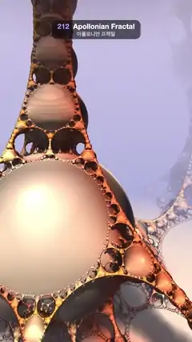

# 212 · Apollonian Fractal · 아폴로니안 프랙털



**EN** Inside an endless cave of pearly spheres packed in spheres and laced with copper filigree, a swinging sun slides shadows as far spheres melt into lilac haze.  
**KO** 구 안에 구가 빽빽이 들어찬 끝없는 진주빛 동굴에 구리빛 레이스가 엉켜 있고, 흔들리는 햇빛이 그림자를 밀어 가는 동안 먼 구들은 라일락빛 안개로 녹아든다.

[Video (mp4)](https://sueun-dev.github.io/motion-effects/videos/212-apollonian-fractal.mp4) · [Code](../effects/212-apollonian-fractal.js) · Raymarching & fractals · 레이마칭·프랙털

## Prompt (English)

```text
Create an "Apollonian Fractal" motion effect: the sphere-inversion fractal, an endless cave of pearly spheres packed inside spheres and joined by copper filigree, lit by a sun that swings across.

Look
- Distance estimate, 8 iterations: p = −1 + 2 · fract(0.5 p + 0.5) (fold space into a cube of side 2), r² = |p|², k = 1.15 / r², p *= k, scale *= k; distance = 0.25 · |p.y| / scale. Big smooth spheres, chains of smaller ones between them, and lace-like filigree of tinier spheres along every seam.
- Colour from the orbit trap (the smallest |x|, |y|, |z| and r² seen): pearl #F5F0E6, mixed to amber #FFB84D by clamp(6 · trap.y, 0, 1) and to coral #F26638 by clamp(1 − 2 · trap.z, 0, 1)⁸, so the filigree reads copper and the big spheres pearl.
- Lighting: sun colour (1.1, 0.96, 0.80) with a soft shadow (improved penumbra estimate, 64 steps, k = 10); sky fill #6B6685 (facing down) → #D9CCD9 (facing up) × 0.7 × AO; everything × (0.35 + 0.65 · AO); a soft specular (power 20, × 0.25).
- AO: two taps along the normal at e and 2e (e = 0.02 + 0.02 · distance), each measured relative to the distance at the hit point itself.
- Haze: far surfaces fade, smoothstep(0.4, 3.0, distance), into a lilac gradient #8C99D1 (low) → #D9CCEB (high), which is also the background.
- Camera inside the cave at (2.55, 0.55, 2.4) looking at (1.35, 0.42, 1.05), lens normalize(1.5 · forward + 0.8 · uv): a tower of spheres rises on the left, a big pearl sphere fills the lower left, filigree bridges cross to the right and fade into haze.

Motion (0–5 s), a = 2π · t / 5
- The sun swings across the camera's side: direction normalize((0.40, 0.8, 0.45) + 0.75 · sin a · (0.75, 0, −0.66)), so highlights roll over the pearls and shadows slide through the filigree.
- The camera only drifts on a tiny closed loop (radius 0.007, roll 0.01 · sin a): any faster camera motion makes the filigree crawl.

Technique
- WebGL2 fragment-shader raymarcher: up to 220 steps, stop when the distance < one pixel's width at that depth (cone stop). Then 24 more steps of t += distance to settle onto the true surface (this distance field bends away from the surface, and shading from the stop point would show rings on the big spheres). Normals by tetrahedral differences with an epsilon of 3 pixels.
- 2 × 2 supersampling, gamma 0.95, a fixed 1/255 dither.

Output and rules
- One self-contained HTML file with no external assets (three.js from a CDN is fine if you use it), drawing on a 1080 × 1920 canvas (9:16) scaled to fit the window.
- Write a function renderFrame(t) that draws the frame for time t in seconds, and preview it with requestAnimationFrame. Everything must be a pure function of t and fixed seeds: no Math.random(), Date or state carried between frames, so frame i = renderFrame(i / 30) can be exported to a 30 fps video.
- Loop seamlessly every 5 seconds: renderFrame(5) must look exactly like renderFrame(0).
- No flicker of any kind: no noise or grain that changes from frame to frame, no strobing or blinking, no z-fighting, no shimmering 1 px lines. Any grain or texture stays fixed to the screen or to the object.
- Keep the top 280 px free of important content (a title label goes there) and fill the whole frame with a designed background.
```

## 프롬프트 (한국어)

```text
"아폴로니안 프랙털" 모션 효과를 만들어 줘: 구 반전 프랙털. 구 안에 구가 빽빽이 들어차고 구리빛 레이스로 이어진 끝없는 진주빛 동굴을, 가로질러 흔들리는 햇빛이 비추는 효과.

모양
- 거리 추정, 반복 8번: p = −1 + 2 · fract(0.5 p + 0.5)(공간을 한 변 2의 정육면체로 접기), r² = |p|², k = 1.15 / r², p *= k, scale *= k; 거리 = 0.25 · |p.y| / scale. 큰 매끈한 구, 그 사이를 잇는 작은 구의 사슬, 모든 이음매를 따라 더 작은 구로 된 레이스 같은 장식.
- 색은 오비트 트랩(지나온 |x|, |y|, |z|, r²의 최솟값): 진주색 #F5F0E6에 clamp(6 · trap.y, 0, 1)로 호박색 #FFB84D, clamp(1 − 2 · trap.z, 0, 1)⁸로 산호색 #F26638을 섞는다. 레이스는 구리빛, 큰 구는 진주빛이 된다.
- 조명: 햇빛 색 (1.1, 0.96, 0.80), 소프트 섀도(개선된 반그림자 추정, 64걸음, k = 10); 하늘 채움광 #6B6685(아래) → #D9CCD9(위) × 0.7 × AO; 전체에 (0.35 + 0.65 · AO); 부드러운 스페큘러(지수 20, × 0.25).
- AO: 법선 방향 e와 2e 두 곳(e = 0.02 + 0.02 · 거리), 둘 다 충돌점 자체의 거리를 기준으로 잰다.
- 안개: 먼 표면은 smoothstep(0.4, 3.0, 거리)로 라일락 그라디언트 #8C99D1(아래) → #D9CCEB(위)에 녹아든다. 이 그라디언트가 배경이기도 하다.
- 카메라는 동굴 안 (2.55, 0.55, 2.4)에서 (1.35, 0.42, 1.05)를 본다, 렌즈 normalize(1.5 · 앞 + 0.8 · uv): 왼쪽에 구의 탑이 솟고, 큰 진주 구가 왼쪽 아래를 채우며, 레이스 다리가 오른쪽으로 건너가 안개로 사라진다.

움직임 (0–5초), a = 2π · t / 5
- 해가 카메라 쪽을 가로질러 흔들린다: 방향 normalize((0.40, 0.8, 0.45) + 0.75 · sin a · (0.75, 0, −0.66)). 하이라이트가 진주 위를 구르고 그림자가 레이스 사이로 미끄러진다.
- 카메라는 아주 작은 닫힌 고리(반지름 0.007, 롤 0.01 · sin a)로만 떠다닌다. 카메라가 더 빨리 움직이면 레이스가 지글거린다.

기법
- WebGL2 프래그먼트 셰이더 레이마처: 최대 220걸음, 거리가 그 깊이의 픽셀 하나 폭보다 작으면 멈춘다(콘 정지). 그다음 t += 거리를 24걸음 더 해서 실제 표면에 붙인다(이 거리장은 표면에서 휘어 나가서, 멈춘 점에서 음영을 내면 큰 구에 고리 무늬가 생긴다). 법선은 사면체 차분, 엡실론 3픽셀.
- 2 × 2 슈퍼샘플링, 감마 0.95, 고정 1/255 디더.

출력과 규칙
- 외부 파일 없는 HTML 파일 하나(three.js를 쓴다면 CDN은 괜찮다). 1080 × 1920(9:16) 캔버스에 그리고 창 크기에 맞춰 보이게 한다.
- 시간 t(초)의 프레임을 그리는 renderFrame(t) 함수를 만들고, 미리보기는 requestAnimationFrame으로 돌린다. 모든 것은 t와 고정 시드만으로 정해진다: Math.random(), Date, 프레임 사이에 쌓이는 상태 금지. 그래야 i번째 프레임 = renderFrame(i / 30)으로 30fps 영상을 뽑을 수 있다.
- 5초마다 끊김 없이 반복: renderFrame(5)는 renderFrame(0)과 똑같아 보여야 한다.
- 어떤 깜빡임도 금지: 프레임마다 바뀌는 노이즈·그레인, 번쩍임·깜빡임, z-fighting, 반짝이며 떨리는 1px 선 모두 금지. 그레인·질감은 화면이나 물체에 고정한다.
- 위쪽 280px에는 중요한 내용을 두지 않고(제목 라벨 자리), 화면 전체를 디자인된 배경으로 채운다.
```
