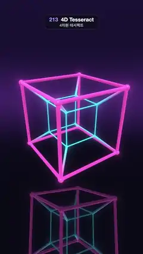

# 213 · 4D Tesseract · 4차원 테서랙트



**EN** A neon hypercube turns in four dimensions: its cyan inner cube swells into the magenta outer one and out again, mirrored on a glossy dark floor.  
**KO** 네온 하이퍼큐브가 4차원에서 돌며 하늘색 안쪽 큐브가 부풀어 자홍색 바깥 큐브가 되었다가 다시 빠져나오고, 윤기 나는 어두운 바닥에 비친다.

[Video (mp4)](https://sueun-dev.github.io/motion-effects/videos/213-tesseract-4d.mp4) · [Code](../effects/213-tesseract-4d.js) · Raymarching & fractals · 레이마칭·프랙털

## Prompt (English)

```text
Create a "4D Tesseract" motion effect: a hypercube rotating in four dimensions and projected into 3D, drawn as glowing neon tubes, so its inner cube swells through the outer one and turns inside out.

Look
- 16 corners (±1, ±1, ±1, ±1); 32 edges join corners that differ in one coordinate.
- Each frame: rotate every corner in the x–w plane by θ, then in the z–w plane by a small sway; project to 3D with a 4D perspective, xyz · 3 / (3 − w). Corners nearer the 4D eye (larger w) come out bigger.
- Edges are capsules of radius 0.045 + 0.02 · w (thicker when nearer in 4D, never thinner than about 6 px), with a bead of radius 0.08 + 0.03 · w on every corner. Colour by w: cyan #33D9FF at w = −1.2 to magenta #FF4DBF at w = 1.2 (smoothstep), so the inner cube is cyan and the outer one magenta.
- Shading: colour × (0.55 + 0.6 · diffuse) from light normalize(−0.3, 0.8, 0.5), a white specular (power 30, × 0.6) and a fresnel boost (1 − n·v)² × 0.8. Every edge also glows: add colour × exp(−9 · (distance from the view ray to the edge − radius)) × 0.10, summed over all 32 edges.
- Background: gradient #05050F (low) to #170F33 (high) with a violet band on the horizon (+ (0.16, 0.07, 0.22) · exp(−40 · dir.y²)). A glossy floor at y = −2.7 mirrors the tesseract: floor colour #080812 + reflection × (0.25 + fresnel), fresnel = 0.12 + 0.6 · (1 − |dir.y|)⁵, fading into the background between distance 6 and 22.
- The projected shape is viewed turned by yaw 0.6 and pitch −0.32; camera at (0, 0.9, 7.4) looking at (0, −0.35, 0), lens normalize(1.9 · forward + 0.8 · uv). The tesseract sits in the middle third, its reflection below.

Motion (0–5 s), a = 2π · t / 5
- θ = a / 4: a quarter turn in the x–w plane per loop, which maps the hypercube onto itself, so the loop is seamless: the inner cyan cube grows and slides out to become the outer magenta cube while the old outer cube shrinks inside.
- z–w sway 0.35 · sin a; 3D view yaw 0.6 + 0.15 · sin a.

Technique
- WebGL2 fragment shader, ray traced analytically rather than marched: ray–capsule and ray–sphere intersection for every edge and bead (nearest hit wins), and the exact closest distance between the view ray and each edge segment for the glow, so the halo is smooth with no step artefacts. The floor reflection traces the reflected ray the same way.
- The 16 projected corners (xyz and w) are computed in JavaScript per frame and passed as 16 vec4 uniforms.
- 3 × 3 supersampling, gamma 0.92, a fixed 1/255 dither.

Output and rules
- One self-contained HTML file with no external assets (three.js from a CDN is fine if you use it), drawing on a 1080 × 1920 canvas (9:16) scaled to fit the window.
- Write a function renderFrame(t) that draws the frame for time t in seconds, and preview it with requestAnimationFrame. Everything must be a pure function of t and fixed seeds: no Math.random(), Date or state carried between frames, so frame i = renderFrame(i / 30) can be exported to a 30 fps video.
- Loop seamlessly every 5 seconds: renderFrame(5) must look exactly like renderFrame(0).
- No flicker of any kind: no noise or grain that changes from frame to frame, no strobing or blinking, no z-fighting, no shimmering 1 px lines. Any grain or texture stays fixed to the screen or to the object.
- Keep the top 280 px free of important content (a title label goes there) and fill the whole frame with a designed background.
```

## 프롬프트 (한국어)

```text
"4차원 테서랙트" 모션 효과를 만들어 줘: 4차원에서 도는 하이퍼큐브를 3차원으로 투영해 빛나는 네온 관으로 그려서, 안쪽 큐브가 바깥 큐브를 뚫고 부풀며 안팎이 뒤집히는 효과.

모양
- 꼭짓점 16개 (±1, ±1, ±1, ±1); 좌표 하나만 다른 꼭짓점끼리 모서리 32개로 잇는다.
- 프레임마다: 모든 꼭짓점을 x–w 평면에서 θ만큼, z–w 평면에서 조금 흔들어 돌리고, 4차원 원근으로 3차원에 투영한다: xyz · 3 / (3 − w). 4차원 눈에 가까운(w가 큰) 꼭짓점일수록 커진다.
- 모서리는 반지름 0.045 + 0.02 · w의 캡슐(4차원에서 가까울수록 굵고, 약 6 px보다 가늘어지지 않는다), 꼭짓점마다 반지름 0.08 + 0.03 · w의 구슬. 색은 w로: w = −1.2에서 하늘색 #33D9FF, w = 1.2에서 자홍색 #FF4DBF(smoothstep). 안쪽 큐브는 하늘색, 바깥은 자홍색이 된다.
- 음영: 색 × (0.55 + 0.6 · 확산), 빛 방향 normalize(−0.3, 0.8, 0.5), 흰 스페큘러(지수 30, × 0.6), 프레넬 (1 − n·v)² × 0.8. 모든 모서리가 빛을 낸다: 색 × exp(−9 · (시선 광선과 모서리 사이 거리 − 반지름)) × 0.10을 32개 모서리에 대해 더한다.
- 배경: #05050F(아래) → #170F33(위) 그라디언트, 지평선에 보라 띠(+ (0.16, 0.07, 0.22) · exp(−40 · dir.y²)). y = −2.7의 광택 바닥이 테서랙트를 비춘다: 바닥색 #080812 + 반사 × (0.25 + 프레넬), 프레넬 = 0.12 + 0.6 · (1 − |dir.y|)⁵, 거리 6~22에서 배경으로 사라진다.
- 투영된 모양은 요 0.6, 피치 −0.32로 돌려서 본다. 카메라는 (0, 0.9, 7.4)에서 (0, −0.35, 0)을 본다, 렌즈 normalize(1.9 · 앞 + 0.8 · uv). 테서랙트는 가운데 3분의 1에, 반사는 그 아래에 있다.

움직임 (0–5초), a = 2π · t / 5
- θ = a / 4: x–w 평면에서 루프마다 4분의 1바퀴. 이 회전은 하이퍼큐브를 자기 자신으로 보내서 끊김 없이 이어진다. 안쪽 하늘색 큐브가 커지며 밖으로 미끄러져 나와 바깥 자홍색 큐브가 되고, 원래 바깥 큐브는 안으로 줄어든다.
- z–w 흔들림 0.35 · sin a, 3차원 보기 요 0.6 + 0.15 · sin a.

기법
- WebGL2 프래그먼트 셰이더, 행진 대신 해석적 레이 트레이싱: 모서리와 구슬마다 광선–캡슐, 광선–구 교차(가장 가까운 것이 이긴다), 빛 번짐은 시선 광선과 각 모서리 선분의 정확한 최근접 거리로 계산해서 계단 무늬 없이 매끄럽다. 바닥 반사는 반사 광선을 같은 방식으로 추적한다.
- 투영된 꼭짓점 16개(xyz와 w)는 프레임마다 JavaScript에서 계산해 vec4 유니폼 16개로 넘긴다.
- 3 × 3 슈퍼샘플링, 감마 0.92, 고정 1/255 디더.

출력과 규칙
- 외부 파일 없는 HTML 파일 하나(three.js를 쓴다면 CDN은 괜찮다). 1080 × 1920(9:16) 캔버스에 그리고 창 크기에 맞춰 보이게 한다.
- 시간 t(초)의 프레임을 그리는 renderFrame(t) 함수를 만들고, 미리보기는 requestAnimationFrame으로 돌린다. 모든 것은 t와 고정 시드만으로 정해진다: Math.random(), Date, 프레임 사이에 쌓이는 상태 금지. 그래야 i번째 프레임 = renderFrame(i / 30)으로 30fps 영상을 뽑을 수 있다.
- 5초마다 끊김 없이 반복: renderFrame(5)는 renderFrame(0)과 똑같아 보여야 한다.
- 어떤 깜빡임도 금지: 프레임마다 바뀌는 노이즈·그레인, 번쩍임·깜빡임, z-fighting, 반짝이며 떨리는 1px 선 모두 금지. 그레인·질감은 화면이나 물체에 고정한다.
- 위쪽 280px에는 중요한 내용을 두지 않고(제목 라벨 자리), 화면 전체를 디자인된 배경으로 채운다.
```
