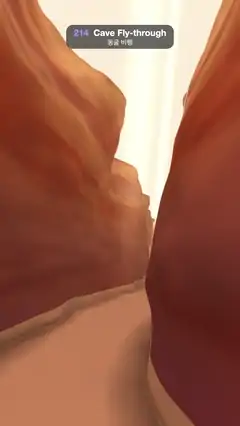

# 214 · Cave Fly-through · 동굴 비행



**EN** The camera glides through a winding sandstone slot cave, walls glowing orange and violet under a bright slit of sky, past a dusty sunbeam, forever.  
**KO** 카메라가 구불구불한 사암 협곡 동굴을 미끄러지듯 날아가고, 위쪽 하늘 틈 아래 벽이 주황빛과 보랏빛으로 빛나며, 먼지 낀 햇살 기둥을 끝없이 지나간다.

[Video (mp4)](https://sueun-dev.github.io/motion-effects/videos/214-cave-flythrough.mp4) · [Code](../effects/214-cave-flythrough.js) · Raymarching & fractals · 레이마칭·프랙털

## Prompt (English)

```text
Create a "Cave Fly-through" motion effect: an endless flight through a narrow sandstone slot cave, raymarched from a distance field built from noise, with light pouring in from the slit of sky above.

Look
- Repeat length L = 16 along z, W = 2π / L. The middle of the slot at height y: mid(z, y) = 0.8 sin(Wz) + 0.25 sin(2Wz + 1) + 0.45 (sin(Wz + 0.4y) − sin(Wz)), so it meanders and the walls lean as they rise. Half-width 1.25 + 0.16 · y · (0.6 + 0.4 sin(2Wz + 0.5y)), wider higher up.
- Wall distance = (half-width − |x − mid| + 0.9 · (fbm − 0.45)) × 0.6, where fbm = 3 octaves of value noise (weights 0.55, 0.28, 0.14) at frequency 0.5, 1, 2. The noise lattice wraps every 8, 16 and 32 cells along z (exactly L), so the cave repeats every 16 units. A sand floor at y = 0 with a little noise, (y + 0.15 · fbm(2p)).
- Rock colour: strata from fbm(0.3x, 3.2y, z) + 0.3y: bands of rust #C74D24 and apricot #FF9E5C (0.5 + 0.5 sin(7 · band)) with darker wine streaks #9E3338. Sand #FFBD85.
- Light by height h = smoothstep(−0.5, 8, y): violet (0.78, 0.46, 0.66) low down, deep orange (1.3, 0.75, 0.45) in the middle, near white (2.0, 1.75, 1.35) under the slit; × (0.7 + 0.3 · up-facing) × AO (one tap at 0.35). The floor takes a warmer light (1.15, 0.92, 0.70).
- Haze #F28C52 × 0.8 with density 0.06; the sky through the slit is a warm white (1.0, 0.92, 0.80) × 1.4.
- A dusty sunbeam slants down through the slit (axis direction normalize(0.15, 1, 0.35), once per 16 units): glow = exp(−6 · d²) × 0.4 × smoothstep(−0.5, 6, height), where d is the closest distance between the view ray and the beam axis, counted only in front of the wall the ray hits.
- Camera at height 1.4 following mid(z, 1.4), looking 5 units ahead at height 2.6, so the walls frame a strip of sky; lens normalize(1.2 · forward + 0.8 · uv), roll 0.1 · sin a.

Motion (0–5 s), a = 2π · t / 5
- The camera flies along −z exactly 16 units (one repeat) per loop: z = −16 · t / 5, so the last frame meets the first.

Technique
- WebGL2 fragment-shader raymarcher: up to 120 steps, hit when < 0.0015 · t, far limit 40 or above y = 9 (sky). Normals by tetrahedral differences (e = 0.015).
- Each pixel averages 6 samples: positions spread over the pixel by the golden ratio, and times spread over half a frame (1/60 s), which is a shutter-style motion blur, so the near walls stream past smoothly instead of strobing.
- Roll-off col / (1 + 0.3 · col), gamma 0.92, a fixed 1/255 dither.

Output and rules
- One self-contained HTML file with no external assets (three.js from a CDN is fine if you use it), drawing on a 1080 × 1920 canvas (9:16) scaled to fit the window.
- Write a function renderFrame(t) that draws the frame for time t in seconds, and preview it with requestAnimationFrame. Everything must be a pure function of t and fixed seeds: no Math.random(), Date or state carried between frames, so frame i = renderFrame(i / 30) can be exported to a 30 fps video.
- Loop seamlessly every 5 seconds: renderFrame(5) must look exactly like renderFrame(0).
- No flicker of any kind: no noise or grain that changes from frame to frame, no strobing or blinking, no z-fighting, no shimmering 1 px lines. Any grain or texture stays fixed to the screen or to the object.
- Keep the top 280 px free of important content (a title label goes there) and fill the whole frame with a designed background.
```

## 프롬프트 (한국어)

```text
"동굴 비행" 모션 효과를 만들어 줘: 노이즈로 만든 거리장을 레이마칭해서 좁은 사암 협곡 동굴을 끝없이 날아가고, 위쪽 하늘 틈으로 빛이 쏟아지는 효과.

모양
- z 방향 반복 길이 L = 16, W = 2π / L. 높이 y에서 틈의 가운데: mid(z, y) = 0.8 sin(Wz) + 0.25 sin(2Wz + 1) + 0.45 (sin(Wz + 0.4y) − sin(Wz)). 굽이치고, 벽은 올라갈수록 기운다. 반폭은 1.25 + 0.16 · y · (0.6 + 0.4 sin(2Wz + 0.5y)), 위로 갈수록 넓다.
- 벽까지의 거리 = (반폭 − |x − mid| + 0.9 · (fbm − 0.45)) × 0.6, fbm은 값 노이즈 3옥타브(가중치 0.55, 0.28, 0.14), 주파수 0.5, 1, 2. 노이즈 격자는 z 방향으로 8, 16, 32칸마다(정확히 L) 감겨서 동굴이 16마다 반복된다. y = 0에 노이즈가 조금 있는 모래 바닥 (y + 0.15 · fbm(2p)).
- 바위 색: fbm(0.3x, 3.2y, z) + 0.3y로 만든 지층: 녹슨 주황 #C74D24와 살구색 #FF9E5C의 띠(0.5 + 0.5 sin(7 · band)), 더 어두운 와인색 줄 #9E3338. 모래 #FFBD85.
- 높이 h = smoothstep(−0.5, 8, y)에 따른 빛: 아래는 보라 (0.78, 0.46, 0.66), 가운데는 짙은 주황 (1.3, 0.75, 0.45), 틈 바로 아래는 거의 흰빛 (2.0, 1.75, 1.35); × (0.7 + 0.3 · 위를 향한 정도) × AO(0.35 한 곳). 바닥은 더 따뜻한 빛 (1.15, 0.92, 0.70)을 받는다.
- 안개 #F28C52 × 0.8, 밀도 0.06. 틈으로 보이는 하늘은 따뜻한 흰색 (1.0, 0.92, 0.80) × 1.4.
- 먼지 낀 햇살 기둥이 틈으로 비스듬히 내려온다(축 방향 normalize(0.15, 1, 0.35), 16마다 하나): 빛 = exp(−6 · d²) × 0.4 × smoothstep(−0.5, 6, 높이), d는 시선 광선과 햇살 축 사이의 최근접 거리이고, 광선이 부딪힌 벽보다 앞쪽만 센다.
- 카메라는 높이 1.4에서 mid(z, 1.4)를 따라가며 5 앞의 높이 2.6을 본다. 벽 사이로 하늘이 한 줄 보인다. 렌즈 normalize(1.2 · 앞 + 0.8 · uv), 롤 0.1 · sin a.

움직임 (0–5초), a = 2π · t / 5
- 카메라가 −z 방향으로 루프마다 정확히 16(한 번의 반복)을 날아간다: z = −16 · t / 5. 마지막 프레임이 첫 프레임과 이어진다.

기법
- WebGL2 프래그먼트 셰이더 레이마처: 최대 120걸음, < 0.0015 · t이면 충돌, 최대 거리 40 또는 y = 9 위(하늘). 법선은 사면체 차분(e = 0.015).
- 픽셀마다 샘플 6개를 평균한다: 위치는 황금비로 픽셀 안에 흩고, 시간은 반 프레임(1/60초)에 흩어서 셔터 같은 모션 블러를 만든다. 가까운 벽이 깜빡이지 않고 매끄럽게 흘러간다.
- 롤오프 col / (1 + 0.3 · col), 감마 0.92, 고정 1/255 디더.

출력과 규칙
- 외부 파일 없는 HTML 파일 하나(three.js를 쓴다면 CDN은 괜찮다). 1080 × 1920(9:16) 캔버스에 그리고 창 크기에 맞춰 보이게 한다.
- 시간 t(초)의 프레임을 그리는 renderFrame(t) 함수를 만들고, 미리보기는 requestAnimationFrame으로 돌린다. 모든 것은 t와 고정 시드만으로 정해진다: Math.random(), Date, 프레임 사이에 쌓이는 상태 금지. 그래야 i번째 프레임 = renderFrame(i / 30)으로 30fps 영상을 뽑을 수 있다.
- 5초마다 끊김 없이 반복: renderFrame(5)는 renderFrame(0)과 똑같아 보여야 한다.
- 어떤 깜빡임도 금지: 프레임마다 바뀌는 노이즈·그레인, 번쩍임·깜빡임, z-fighting, 반짝이며 떨리는 1px 선 모두 금지. 그레인·질감은 화면이나 물체에 고정한다.
- 위쪽 280px에는 중요한 내용을 두지 않고(제목 라벨 자리), 화면 전체를 디자인된 배경으로 채운다.
```
