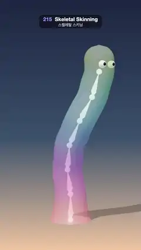

# 215 · Skeletal Skinning · 스켈레탈 스키닝



**EN** A see-through noodle creature with googly eyes dances in an S-curve; glowing octahedral bones bend inside it and rainbow bands show each bone's skin weights.  
**KO** 눈이 달린 반투명 국수 생물이 S자로 춤추고, 안에서 빛나는 팔면체 뼈가 꺾이며 무지개 띠가 뼈마다의 스킨 가중치를 보여 준다.

[Video (mp4)](https://sueun-dev.github.io/motion-effects/videos/215-skeletal-skinning.mp4) · [Code](../effects/215-skeletal-skinning.js) · Animation & characters · 애니메이션·캐릭터

## Prompt (English)

```text
Create a "Skeletal Skinning" motion effect: a soft tube creature is a skinned mesh on a chain of bones built in code; the skin is see-through so the bones are visible bending inside, and the vertex colours show the skin weights.

Look
- Skin: a lathe (64 segments round, 81 profile points) 8.4 units tall: radius 0.68 + 0.3 · e^(−1.6y) (a flared foot) up to y = 7.72, then a round head (a half sphere of radius 0.68).
- Skeleton: 7 bones in a chain, 1.2 apart, the root at the floor. Each vertex is bound to the two nearest bones: s = y / 1.2 − 0.5, k = floor(s), f = smoothstep(0, 1, s − k), weights (1 − f) for bone k and f for bone k + 1. A vertex halfway along a bone follows only that bone; at a joint it is split 50/50, so the skin bends smoothly.
- Weight colours: each bone has a hue, from coral red at the root (HSL 353°, 90 %, 58 %) through magenta, blue and teal to lime at the head (94°); each vertex colour is the weighted mix of its two bones' colours, so smooth bands show where the weights blend.
- Skin material: physical, vertex colours, opacity 0.58, roughness 0.35, clearcoat 0.5, environment 0.6, depth write off, drawn after the bones.
- Bones drawn the way an editor shows them: a cream octahedron #FFF4D6 (glow #FFB347, 0.55) from each joint to the next, widest (0.16) at 22 % of its length, flat-shaded; a glowing white ball (radius 0.13) on every joint. Two googly eyes on the head bone (white radius 0.17, dark pupils 0.085).
- Scene: vertical gradient #1C2541 → #3A506B (55 %) → #F2C6A0; a room environment at 0.5; key light #FFE9D2 (2.6) from (−6, 12, 8) with a soft shadow on a shadow-only floor (opacity 0.25); hemisphere light #BFD8FF / #6B4A3A (1.0).
- Camera: 27° field of view at (0, 5.2, 24) looking at (0, 4.4, 0); the creature stands in the middle of the frame, head near y ≈ 500 px.

Motion (0–5 s), p = 2π · t / 5 + 1.7
- Root bone turns about the vertical: 0.5 · sin p.
- Bone k = 1 … 6: bend 0.33 · sin(p − k · 2π / 6) about z and 0.18 · sin(2p − k · 2π / 6) about x. The wave spans exactly one wavelength over the six joints, so the creature dances in an S-curve without leaning over, and the eyes ride along on the head bone.

Technique
- three.js SkinnedMesh: LatheGeometry with skinIndex and skinWeight attributes written per vertex, Bones made in code and parented in a chain, new Skeleton(bones), mesh.bind(skeleton). The bone and joint meshes are children of the Bone objects, so they move with the skeleton.
- ACES Filmic tone mapping, PCF soft shadow map 2048 × 2048; the skinned skin casts the shadow.

Output and rules
- One self-contained HTML file with no external assets (three.js from a CDN is fine if you use it), drawing on a 1080 × 1920 canvas (9:16) scaled to fit the window.
- Write a function renderFrame(t) that draws the frame for time t in seconds, and preview it with requestAnimationFrame. Everything must be a pure function of t and fixed seeds: no Math.random(), Date or state carried between frames, so frame i = renderFrame(i / 30) can be exported to a 30 fps video.
- Loop seamlessly every 5 seconds: renderFrame(5) must look exactly like renderFrame(0).
- No flicker of any kind: no noise or grain that changes from frame to frame, no strobing or blinking, no z-fighting, no shimmering 1 px lines. Any grain or texture stays fixed to the screen or to the object.
- Keep the top 280 px free of important content (a title label goes there) and fill the whole frame with a designed background.
```

## 프롬프트 (한국어)

```text
"스켈레탈 스키닝" 모션 효과를 만들어 줘: 부드러운 관 모양 생물이 코드로 만든 뼈 사슬에 스키닝된 메시이고, 피부가 반투명해서 안에서 뼈가 꺾이는 것이 보이며, 정점 색이 스킨 가중치를 보여 주는 효과.

모양
- 피부: 높이 8.4의 선반 회전체(둘레 64분할, 단면 점 81개): 반지름 0.68 + 0.3 · e^(−1.6y)(퍼진 발)로 y = 7.72까지 올라가고, 그 위는 둥근 머리(반지름 0.68의 반구).
- 뼈대: 1.2 간격으로 이어진 뼈 7개, 뿌리는 바닥에. 정점마다 가장 가까운 뼈 두 개에 묶는다: s = y / 1.2 − 0.5, k = floor(s), f = smoothstep(0, 1, s − k), 뼈 k에 (1 − f), 뼈 k + 1에 f. 뼈 한가운데의 정점은 그 뼈만 따르고, 관절에서는 50/50으로 나뉘어 피부가 매끄럽게 굽는다.
- 가중치 색: 뼈마다 색상이 있다. 뿌리의 산호빨강(HSL 353°, 90 %, 58 %)에서 자홍, 파랑, 청록을 거쳐 머리의 연두(94°)까지. 정점 색은 두 뼈 색의 가중 평균이라, 가중치가 섞이는 곳이 부드러운 띠로 보인다.
- 피부 재질: 물리 기반, 정점 색, 불투명도 0.58, 거칠기 0.35, 클리어코트 0.5, 환경광 0.6, 깊이 쓰기 끔, 뼈보다 나중에 그린다.
- 뼈는 편집기에서 보이는 모양으로: 관절에서 다음 관절까지 크림색 팔면체 #FFF4D6(발광 #FFB347, 0.55), 길이의 22 % 지점이 가장 넓고(0.16) 플랫 셰이딩; 관절마다 빛나는 흰 공(반지름 0.13). 머리 뼈에 왕눈 두 개(흰자 반지름 0.17, 검은 눈동자 0.085).
- 장면: 세로 그라디언트 #1C2541 → #3A506B(55 %) → #F2C6A0; 룸 환경맵 0.5; 키 라이트 #FFE9D2(2.6)가 (−6, 12, 8)에서 그림자만 보이는 바닥(불투명도 0.25)에 부드러운 그림자를 드리운다; 반구광 #BFD8FF / #6B4A3A(1.0).
- 카메라: 시야각 27°, (0, 5.2, 24)에서 (0, 4.4, 0)을 본다. 생물은 화면 가운데에 서 있고 머리는 y ≈ 500 px 근처.

움직임 (0–5초), p = 2π · t / 5 + 1.7
- 뿌리 뼈가 세로축으로 0.5 · sin p 돈다.
- 뼈 k = 1 … 6: z축으로 0.33 · sin(p − k · 2π / 6), x축으로 0.18 · sin(2p − k · 2π / 6) 굽는다. 물결이 관절 여섯 개에 정확히 한 파장이라, 생물이 넘어지지 않고 S자로 춤추며 눈은 머리 뼈를 따라 움직인다.

기법
- three.js SkinnedMesh: LatheGeometry에 정점마다 skinIndex, skinWeight 속성을 쓰고, 코드로 만든 Bone을 사슬로 잇고, new Skeleton(bones), mesh.bind(skeleton). 뼈와 관절 메시는 Bone의 자식이라 뼈대와 함께 움직인다.
- ACES Filmic 톤 매핑, PCF 소프트 그림자 맵 2048 × 2048. 스키닝된 피부가 그림자를 드리운다.

출력과 규칙
- 외부 파일 없는 HTML 파일 하나(three.js를 쓴다면 CDN은 괜찮다). 1080 × 1920(9:16) 캔버스에 그리고 창 크기에 맞춰 보이게 한다.
- 시간 t(초)의 프레임을 그리는 renderFrame(t) 함수를 만들고, 미리보기는 requestAnimationFrame으로 돌린다. 모든 것은 t와 고정 시드만으로 정해진다: Math.random(), Date, 프레임 사이에 쌓이는 상태 금지. 그래야 i번째 프레임 = renderFrame(i / 30)으로 30fps 영상을 뽑을 수 있다.
- 5초마다 끊김 없이 반복: renderFrame(5)는 renderFrame(0)과 똑같아 보여야 한다.
- 어떤 깜빡임도 금지: 프레임마다 바뀌는 노이즈·그레인, 번쩍임·깜빡임, z-fighting, 반짝이며 떨리는 1px 선 모두 금지. 그레인·질감은 화면이나 물체에 고정한다.
- 위쪽 280px에는 중요한 내용을 두지 않고(제목 라벨 자리), 화면 전체를 디자인된 배경으로 채운다.
```
